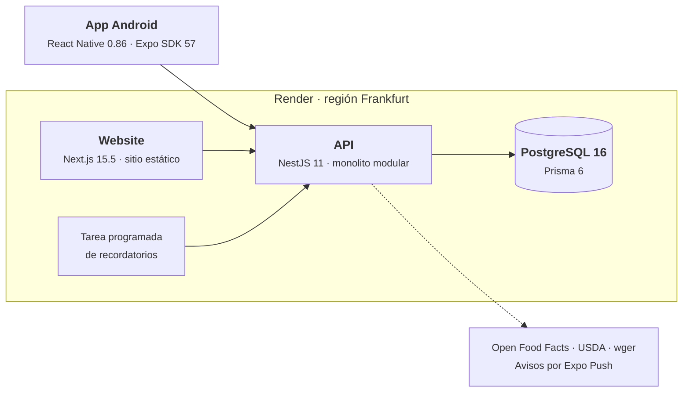

# 03 · Acta del proyecto

*Qué es BE, para quién es, qué hace y qué no, con qué está construido, cómo se ubica en su mercado y quién lo lleva adelante.*

> BE ubica, no califica: muestra qué se indicó, qué pasó y qué cambió, y la decisión queda en manos del profesional.

**Autor:** Elián Bufi  
**Carrera:** Analista de Sistemas, Escuela Da Vinci  
**Fecha:** Noviembre de 2026

> **Resumen.** BE reúne en una sola historia, ordenada en el tiempo, lo que se indica y lo que pasa en la alimentación, el entrenamiento y la composición corporal de una persona, para que sus profesionales decidan con todo el contexto.

**Entregable:** 03 · Acta del proyecto  
**Fecha:** Noviembre de 2026  
**Lo acompaña:** El desarrollo de cada análisis de negocio está en los archivos 19 a 24.

# Resumen

*BE: entender el seguimiento completo de una persona.*

Una persona puede tener acompañamiento en su alimentación, en su entrenamiento y en su composición corporal. En BE, cada área conserva sus evaluaciones, objetivos, planes, registros y revisiones dentro de una misma historia, ordenada en el tiempo. El profesional trabaja con todo el detalle de su especialidad y con el contexto de las otras áreas que la persona decide compartirle.

El profesional indica un plan; la persona registra desde su teléfono lo que realmente hizo; BE guarda las dos cosas por separado. Cuando el plan cambia, la versión anterior queda unida a lo que se registró mientras estuvo vigente. Así se puede comparar un período con el siguiente, ver cómo cada ajuste fue afectando a la persona y fundamentar la próxima decisión, sin reconstruir la historia desde mensajes y planillas sueltas.

Los gráficos ponen esa historia sobre un mismo eje del tiempo: lo de cada área, alineado o superpuesto, para encontrar patrones entre la alimentación, el entrenamiento y el cuerpo. Y si la persona cambia de profesional, su historia sigue con ella: con su autorización, el profesional nuevo ve lo que pasó antes y en qué contexto, y no empieza de cero.

La persona ve lo que tiene para hoy, registra y sigue su evolución desde la app. Sus profesionales preparan el seguimiento desde el website, revisan las comparativas y se coordinan entre ellos cuando ella lo autoriza. Administración habilita a los profesionales y no ve datos de salud.

- **01 · La persona, en el tiempo.** Cada plan, comida, sesión, toma y revisión es un punto de una sola historia. El valor aparece cuando se leen juntos, durante meses.

- **02 · Un sistema, no tres planillas.** Nutrición, Entrenamiento y Antropometría sobre la misma persona y el mismo eje del tiempo: el cuerpo se entiende como un sistema.

- **03 · Cada cambio, con su porqué.** Qué planes tuvo, cómo los hizo y qué se cambió en cada ajuste: se ve cómo cada decisión fue afectando a la persona.

- **04 · Comparar para ver patrones.** Gráficos de distintas áreas, alineados o superpuestos, para formular hipótesis con datos y no con recuerdos.

- **05 · No empezar de cero.** Si la persona cambia de profesional, su historia sigue con ella, y el nuevo la ve si ella lo autoriza.

- **06 · Más datos, más contexto.** Cuanto más se usa, más contexto tiene el profesional: la información se acumula y se puede interpretar. Que eso mejore las decisiones es una hipótesis que el piloto va a comprobar.

*Figura 1: Lo que BE le aporta al profesional y a la persona.*

# 1. El sistema

*Qué problema resuelve BE, qué le da al profesional y cómo funciona.*

> **La idea clave.** Para preparar una consulta no hace falta rearmar la historia: **ya está ahí**, ordenada, comparable y con su contexto.

## 1.1 El problema

Una persona que quiere mejorar cómo come, cómo entrena y cómo cambia su cuerpo suele tener más de un profesional. La nutricionista arma un plan en un documento y lo manda por mensajería; el entrenador hace lo mismo por su lado; las mediciones quedan en una planilla, y lo que la persona hace, si lo anota, queda en una app de consumo. Cada uno ve su parte, y solo en la consulta. Nadie mira a la persona entera ni puede reconstruir por qué se decidió lo que se decidió. Y cuando la persona cambia de profesional, el nuevo empieza de cero.

> **Texto de la figura:**
> - Hoy
> - Cada profesional ve su parte, y solo en la consulta.
> - La historia vive en chats y planillas: nadie la reconstruye.
> - Cada plan nuevo empieza de cero.
> - Con BE
> - Cada profesional ve a la persona entera, con su permiso.
> - Lo indicado y lo que pasó quedan escritos, en el tiempo.
> - La historia sigue con la persona, aunque cambie de profesional.

## 1.2 La persona entera, en el tiempo

Cuando una profesional de Nutrición abre la ficha de una persona, ve su área con todo el detalle. Si la persona también entrena y se mide con otros profesionales, y lo autoriza, ve además el resumen de esas áreas y su plan vigente, los hábitos que la persona eligió compartirle y las notas que le dejan los otros profesionales. Todo cae sobre la misma línea del tiempo: cada plan activado, cada comida y cada sesión registradas, cada toma y cada revisión, en el orden en que pasaron. Así el profesional entiende el cuerpo como un sistema, y no solo su área.

## 1.3 Cada cambio, con su porqué

Un plan activado no se modifica: el siguiente es otra versión, y la anterior queda unida a lo que la persona registró mientras estuvo vigente. Lo que importa es lo que eso permite: saber qué planes tuvo la persona y cómo los hizo, comparar un período con el siguiente, ver cómo cada modificación del plan fue afectando a la persona y entender por qué se tomó cada decisión. Cuando alguien corrige un dato, la corrección se agrega y cita al original, así que siempre se puede reconstruir qué se sabía en cada momento.

## 1.4 Comparar para ver patrones

Los gráficos de BE ponen todas las áreas sobre un mismo eje de fechas, con las versiones de cada plan de fondo, y aparecen donde el profesional decide:

- **Al planificar.** Al elegir un ejercicio, el buscador avisa si la persona ya lo hizo, y el editor muestra «La vez pasada»: qué hizo serie por serie, con qué carga y con cuántas repeticiones en reserva.
- **En cada área.** La evolución del 1RM estimado de cada ejercicio, lo registrado en la alimentación con el objetivo de cada período de fondo, y cada toma antropométrica frente a la primera y a la anterior.
- **Entre áreas.** En «Analizar», «Armá tu gráfico» pone dos o tres series alineadas, una debajo de la otra, o superpuestas en el mismo gráfico cuando comparten el eje. Por ejemplo, los carbohidratos de un período y el 1RM estimado de esas mismas semanas.
- **Para seguir un tema.** La cinta del tiempo marca, arriba de todos los gráficos, los cambios de plan, las tomas, las revisiones y las notas. Cada profesional guarda sus «Enfoques»: los gráficos que quiere seguir para una persona o para un plan.

Cada cruce entre áreas dice «Coinciden en el tiempo; esto no prueba que una cosa cause la otra» y muestra qué más cambió en ese período. El gráfico ayuda a formular una hipótesis; la decisión es del profesional.

## 1.5 No empezar de cero

La cuenta y la historia son de la persona. Cuando termina un acompañamiento, ese profesional deja de ver sus datos, pero la historia no se pierde: la persona la sigue viendo y la puede descargar. Cuando empieza con un profesional nuevo de la misma área, puede autorizarlo a ver su historia anterior: los planes que tuvo, lo que registró, sus tomas y las decisiones de cada revisión, en solo lectura y marcadas como de otro profesional. Las notas privadas del profesional anterior no se comparten, y la autorización se puede retirar en cualquier momento. El profesional nuevo ve qué le funcionó a la persona y en qué contexto, y decide con más información.

## 1.6 El ciclo y la revisión

Una vez que la persona aceptó el vínculo y autorizó el área, el trabajo entre los dos se lee como un ciclo: medir, planificar, ejecutar, revisar y ajustar. La antropometría no tiene plan: su ciclo es tomar, comparar con las tomas anteriores y volver a tomar.

Mirar los datos no es revisar. Una revisión registra la evidencia, la interpretación, el resultado, el fundamento y la próxima acción, y su resultado es uno de seis. Con eso, la próxima vez que alguien mire la historia sabe qué se decidió y por qué.

## 1.7 Qué ve cada uno

Los permisos por área existen porque son datos de salud: la persona acepta cada vínculo y autoriza cada área, y si retira un permiso, el corte vale hacia adelante. Si alguien pide un dato que no le corresponde, la respuesta es la misma que si el dato no existiera.

**Tabla 1.** Lo que ve un profesional de la persona que acompaña.

| Qué | Cuándo lo ve |
| --- | --- |
| Su área, con todo el detalle | Con el vínculo y el permiso del área vigentes |
| El resumen de otra área | Con el permiso de la persona |
| El plan vigente de otra área, en solo lectura | Si la persona lo autoriza; cada apertura queda registrada y ella la ve |
| Los hábitos | Si la persona eligió compartírselos; si no, puede pedirle acceso |
| Las notas de los otros profesionales | Las que le dejan los profesionales de la misma persona |
| La historia anterior de su área, con otro profesional | Si la persona lo autoriza, en solo lectura |
| Borradores, versiones anteriores y notas internas de otra área | Nunca |

Administración no ve datos de salud: de un alimento cargado a mano o de una receta propuesta ve quién la cargó, nunca a qué persona se le indicó.

# 2. Público objetivo

*Quién elige BE, quién lo paga y quién lo usa todos los días.*

BE tiene dos usuarios que se necesitan entre sí. **La profesional o el profesional** elige la herramienta y la paga: es quien arma el seguimiento, revisa y decide. **La persona** no paga: sigue su plan y registra desde el teléfono, y sin sus registros no hay nada que revisar.

> **Texto de la figura:**
> - Elige y paga
> - La profesional
> - Independiente, acompaña a personas en el tiempo y hoy hace el seguimiento con mensajería y planillas. Trabaja en el website.
> - **Su primera revisión** define si se queda (una hipótesis que el piloto va a comprobar): abre la ficha y ve lo indicado, lo registrado y las tomas en una pantalla.
> - se sostienen
> - Usa todos los días
> - La persona
> - No paga. Sigue su plan y registra desde el teléfono. Sin sus registros, la profesional no tiene nada que revisar.
> - **Su primera semana** define si vuelve (también, a comprobar en el piloto): sabe qué le toca hoy y registra en un toque.

**Tabla 2.** Los perfiles de BE.

| Perfil | Quién es |
| --- | --- |
| Profesional de nutrición | Licenciada o licenciado en Nutrición que acompaña a personas a lo largo del tiempo, en consultorio propio, en más de un lugar o en línea, y que hoy hace el seguimiento con mensajería, documentos y planillas |
| Profesional de entrenamiento | Entrenador o entrenadora personal, presencial u online, que arma rutinas por bloques y necesita ver qué hizo la persona, serie por serie |
| Profesional de antropometría | Quien toma mediciones con protocolo, como área propia o como parte del trabajo de un nutricionista |
| Duplas y equipos | Profesionales de distintas áreas que comparten personas y hoy se coordinan por mensajería |
| Persona | Adulta, que quiere mejorar su alimentación, su entrenamiento o su composición corporal con acompañamiento profesional, y registra desde un teléfono Android |

# 3. Uso previsto

*Cada uno en su dispositivo, sobre la misma historia.*

La persona usa la app donde come y entrena: ve lo que tiene para hoy, registra comidas y sesiones en pocos toques, responde lo que le piden sus profesionales, sigue su evolución y decide quién ve qué. El profesional trabaja en la computadora, con la vista completa: evalúa, arma y activa planes, revisa lo registrado, compara períodos y áreas con los gráficos, y deja cada decisión escrita. Administración habilita a los profesionales desde el website, con segundo factor, sin ver datos de salud.

1. **Habilita** (Administración): Habilita al profesional en un área, con un fundamento que queda registrado.
2. **Invita** (Profesional): Con un link, un QR o un código de un solo uso.
3. **Acepta y autoriza** (Persona): El vínculo y el permiso del área: dos actos distintos.
4. **Pide información** (Profesional): Un formulario de inicio; la persona elige quién ve sus hábitos.
5. **Evalúa y planifica** (Profesional): La evaluación, el objetivo y el plan, en un borrador que se guarda solo.
6. **Activa** (Profesional): «Revisar y activar…»: la versión queda fija y la persona recibe el aviso.
7. **Registra** (Persona): Ve lo de hoy y registra comidas y sesiones.
8. **Revisa y decide** (Profesional): Compara lo indicado con lo registrado y deja la decisión escrita.
9. **Ve su evolución** (Persona): Tomas, revisiones y diferencias escritas, sin calificaciones.
10. **Retira un permiso** (Persona): Cuando quiera: corta hacia adelante y lo registrado se conserva.

*Figura 9: El recorrido entre Administración, un profesional y una persona, de punta a punta.*

BE sirve tanto para un acompañamiento presencial como en línea: la consulta se prepara con lo que pasó desde la última revisión, ya ordenado.

# 4. Objetivo

*Lo que BE se propone y cómo se reconoce que lo logra.*

**Objetivo general.** Que el profesional entienda y acompañe a la persona a lo largo del tiempo, con su historia completa, ordenada y comparable entre áreas, para tomar cada decisión con más contexto.

**Objetivos específicos.**

1. Reunir en una sola historia por persona lo indicado y lo registrado en Nutrición, Entrenamiento y Antropometría.
2. Conservar cada versión de un plan unida a lo que la persona registró mientras estuvo vigente, para comparar períodos y entender cada cambio.
3. Comparar áreas y períodos con gráficos sobre un mismo eje del tiempo, alineados o superpuestos, sin afirmar causas.
4. Que cada revisión deje escrita su decisión, con evidencia, fundamento y próxima acción.
5. Que la persona controle quién ve cada área y pueda llevar su historia a un profesional nuevo.
6. Que la persona registre desde su teléfono en pocos toques y sepa siempre qué le toca hoy.

**Cómo se reconoce.** Un profesional prepara la consulta de una persona sin salir de su ficha: ve qué se indicó, qué registró la persona y qué cambió desde la última revisión, y deja la decisión escrita. BE mide además, de forma reproducible, la tasa de ciclos de seguimiento que se cierran en 30 días (TVCC-30): cuántas veces un plan activado llega a su revisión. Es el indicador del objetivo; su meta se fija con el piloto.

# 5. Alcance

*Lo que BE hace, en cada canal.*

BE tiene tres roles y dos canales. La persona usa la app para Android. El profesional trabaja en una o más áreas desde el website, pensado para la computadora. Administración trabaja en el website.

**Tabla 3.** Las funcionalidades de BE y dónde se usan.

| Funcionalidad | Qué hace | Dónde |
| --- | --- | --- |
| Cuenta y acceso | Cuenta con correo o con Google; segundo factor para Administración; recuperar el acceso | App y website |
| Vínculo e invitación | El profesional invita con un enlace, un QR o un código; la persona acepta o rechaza | El website invita; la app acepta |
| Consentimiento y permisos | La persona autoriza cada área, ve qué ve cada profesional y quién miró lo que compartió, y retira un permiso cuando quiere; al aceptar el vínculo, una sola pantalla con lo que se propone compartir, donde la persona toca «Aceptar y compartir», elige cosa por cosa con «Elegir qué compartir» o dice «Ahora no»; después, un interruptor por cosa en «Quién ve qué» | App |
| Evaluación y objetivo | La evaluación inicial en tres bloques, con los formularios que respondió la persona vinculados y las «Anotaciones» privadas del profesional, y el objetivo de cada área, con sus versiones; en Nutrición, «Calcular» propone el objetivo con un método publicado y una toma de Antropometría, y el profesional decide | Website |
| Pedidos de información | Formularios de inicio y pedidos puntuales; la persona elige con quién comparte sus hábitos | El website pide; la app responde |
| Plan de nutrición | Un editor por días tipo, con comidas, opciones y recetas, en un borrador que se guarda solo. Lo que aporta cada alimento mientras se escriben los gramos o una medida casera; el reparto por comida con el rango de cada una, también en g/kg con el último peso; la franja de cada comida con el promedio de sus opciones frente a su rango, y «Rangos y totales» del día y de cada comida. Duplicar o copiar comidas y opciones, guardar una opción como receta, y partir de una plantilla de comidas o de una comida habitual. Al activarse, una versión fija | El website arma; la app lo muestra |
| Plan de entrenamiento | Un editor por fases sobre un almanaque: el inicio y la duración del plan, cada fase con sus semanas, su objetivo y sus días, y sesiones con bloques («Seguido» o «En vueltas»), series de aproximación y efectivas. La intensidad del plan se elige una vez (RIR, RPE, % RM o solo carga); con el 1RM de referencia de cada ejercicio (calibración, último registro o declarado) las cargas en % RM se calculan y se redondean al disco elegido. Progresiones y semanas de descarga con vista previa, la carga de cada semana, la distribución de las series por músculo sobre la silueta, ejercicios de cardio con duración e intensidad, reordenar y deshacer; plantillas propias (también sin una persona) y Plantillas de BE; un catálogo de ejercicios con imagen, zonas musculares y filtros. Se activa como versión, con el 1RM congelado | El website arma; la app lo muestra |
| Registro de comidas | Las opciones de cada comida en un carrusel, con su foto; «Comí esta opción», las porciones o una comida diferente con foto; corregir sin borrar | App |
| Registro de entrenamiento | Serie por serie o de una vez, con descanso, sustituciones y «La vez pasada», con la carga de esa semana; el esfuerzo de la sesión al terminar, si el plan lo pide; una nota para el profesional | App |
| Antropometría | Elegir los métodos antes de medir; tomas con protocolo y métodos de cálculo publicados, entre ellos Kerr (1988) en cinco masas; el resultado completo y encadenado de cada método en la misma toma (de la suma de pliegues a la densidad, el porcentaje de grasa sobre el peso corporal, la masa grasa y la libre de grasa), cada paso con su fórmula, su cuenta y su fuente; cada medida frente a la primera y a la anterior | El website toma; la app muestra |
| Revisión | Comparar lo indicado con lo registrado y decidir, con evidencia, fundamento y próxima acción | El website; la app la muestra |
| Seguimiento profesional | Un espacio con lo pendiente; la ficha con el resumen, la línea de tiempo, los registros y las notas propias; un recorrido guiado la primera vez en cada editor | Website |
| Gráficos y comparativas | El historial de cada ejercicio con el 1RM estimado, la alimentación y el cuerpo en el tiempo, «Armá tu gráfico», «Patrones» y los «Enfoques» | Website |
| Coordinación entre áreas | Con el permiso de la persona: el resumen y el plan vigente de las otras áreas, y notas entre profesionales | Website |
| Historia anterior | Con la autorización de la persona, el profesional nuevo ve la historia anterior del área, en solo lectura | La app autoriza; el website la muestra |
| Derechos de la persona | Ver y descargar su historia, ejercer sus derechos sobre sus datos y cerrar la cuenta | App |
| Novedades y avisos | Avisos al teléfono sin datos de salud y novedades en la app | App |
| Recetario de BE | Recetas de cocina familiar para todos los profesionales de Nutrición, que se usan como opción del plan o se copian para adaptarlas; cada profesional propone las suyas y Administración decide si las suma | Website |
| Catálogos | Alimentos (catálogo propio, Open Food Facts y USDA), con lo cargado a mano propio de cada profesional, que se corrige y se retira, y un catálogo verificado que cuida Administración; ejercicios; recetas y plantillas de cada profesional | Website |
| Administración | Habilitar, verificar, suspender y rehabilitar a cada profesional por área, con fundamento; revisar los alimentos cargados a mano y las propuestas al Recetario de BE; decidir qué Plantillas de BE de Entrenamiento se ofrecen | Website |
| Métrica del servicio | La tasa de ciclos de seguimiento cerrados en 30 días (TVCC-30), calculada de forma reproducible | Servidor |

# 6. Límites

*Lo que BE no hace, por decisión de diseño.*

**Tabla 4.** Los límites de BE y su razón.

| BE no… | Por qué |
| --- | --- |
| Diagnostica ni califica | Ubica: muestra qué se indicó, qué pasó y la diferencia, en las unidades de cada cosa, sin calificaciones ni juicios |
| Decide por el profesional | Los métodos de cálculo los elige el profesional, y una revisión siempre es una decisión suya, con fundamento |
| Afirma causas | Los cruces entre áreas muestran coincidencias en el tiempo, con la frase que lo dice y lo que también cambió |
| Reemplaza la historia clínica | No diagnostica ni hace análisis clínicos. BE guarda lo que la persona declara como contexto, medicación incluida, pero no lo interpreta ni lo trata. |
| Comparte sin permiso | Cada área se autoriza por separado, y un área sin permiso no aparece |
| Usa inteligencia artificial sobre datos de salud | Ningún dato de una persona pasa por un modelo |
| Es un mercado de profesionales ni un chat | Es una herramienta de trabajo: las notas quedan registradas en la historia, no se pierden en una conversación |

**Canales.** La app es para Android (versión 7 o posterior); la versión para iPhone está en la proyección. El website está pensado para la computadora, de 1024 a 1920 de ancho; se recomienda 1280 o más.

**Los datos.** La demostración usa datos de prueba. La plataforma está construida y lista; para operar con datos reales falta lo legal y el entorno de empresa.

# 7. Tecnologías utilizadas

*TypeScript en las tres piezas, una sola API y una base que hace respetar las reglas.*

*Figura 10: Las piezas de BE: dos canales, un solo servidor y una sola base.*

**Tabla 5.** Las elecciones de tecnología.

| Componente | Elección |
| --- | --- |
| Lenguaje | TypeScript en las tres piezas, con un paquete compartido de contratos, textos y reglas |
| Servidor (API) | NestJS 11, un monolito modular por dominio |
| Website | Next.js 15.5, publicado como sitio estático |
| App | React Native 0.86 con Expo SDK 57, para Android |
| Base de datos | PostgreSQL 16, con Prisma 6 y migraciones en orden |
| Autenticación | Sesiones propias con renovación; entrada con Google verificada por la API; segundo factor con una aplicación de códigos para Administración |
| Licencias | El código de BE, con todos los derechos reservados (Ley 11.723). Los datos de terceros conservan las suyas: Open Food Facts (ODbL) y wger (CC BY-SA), que piden atribución y compartir igual lo derivado, y USDA, de dominio público |
| Infraestructura | Render, región Frankfurt: el website, la API, la base de datos y una tarea programada de recordatorios |
| Integración continua | GitHub Actions: tipos, pruebas unitarias y de integración, recorridos en el navegador e imagen de la API en cada cambio |
| Servicios externos | Catálogos de alimentos y ejercicios (Open Food Facts, USDA y wger) y avisos al teléfono por Expo Push |

> **Lo que ya está comprobado.** En cada cambio, cinco trabajos de integración continua corren las pruebas automáticas contra un PostgreSQL real y en un navegador. En la corrida de la rama principal del 23 de noviembre de 2026 corrieron y pasaron **4.881 casos automáticos, sin fallas**. Además, los **100 casos de prueba** de la especificación están documentados, cada uno con su resultado y su fuente (archivo 11).

- **UN SOLO LENGUAJE.** Los contratos, los textos y las reglas puras se escriben una vez en un paquete compartido. Una regla no puede decir una cosa en el teléfono y otra en el servidor.

- **MONOLITO MODULAR.** 35 módulos y 346 operaciones publicadas. Una operación de salud es completa o no ocurre, sin coordinar transacciones entre servicios. Lo elegí por el tamaño del equipo, la escala esperada y las operaciones atómicas entre áreas; puede separarse si eso cambia.

- **REGLAS EN LA BASE.** 168 tablas, 115 conjuntos de valores y 107 migraciones en orden. Claves foráneas sin borrado en cascada, índices únicos parciales y disparadores: la historia no se puede romper ni desde fuera de la API.

- **REACT NATIVE CON EXPO.** Una app nativa para Android con el mismo lenguaje que el resto, y el mismo código como base para iPhone.

- **RENDER.** Despliegue simple y portable, con la base en una red privada.

- **UN SOLO REPOSITORIO.** Un cambio que toca las tres piezas entra de una vez y se prueba junto.

*Figura 11: Por qué estas tecnologías.*

# 8. Análisis de mercado

*Un problema extendido, profesionales que trabajan en más de un lugar y una ley que pide cuidar los datos de salud.*

- **9.721** respuestas: al Censo Nacional de Profesionales en Nutrición 2023: el 59 % de su universo.
- **43,8 %** atiende en consultorio particular: El lugar de trabajo más mencionado.
- **56 %** tiene más de un empleo: Entre quienes trabajaban.
- **66,1 %** de las personas adultas: Tiene exceso de peso; el 44,2 %, actividad física baja.

*Fuente: Censo Nacional de Profesionales en Nutrición 2023 (Diaeta, 2025) y 4.ª Encuesta Nacional de Factores de Riesgo (INDEC, 2019).*

**El segmento.** El primer segmento son profesionales de nutrición y de entrenamiento que atienden en consultorio propio, en más de un lugar o en línea, y acompañan a personas a lo largo del tiempo, en la Argentina. La antropometría se suma como área propia o como parte del trabajo de un nutricionista. Un profesional que atiende en varios lugares necesita que la historia de cada persona esté ordenada en un solo sitio, y la cantidad de personas con exceso de peso y poca actividad sostiene la demanda de acompañamiento en el tiempo.

**Las tendencias que lo favorecen.**

- **El acompañamiento en línea:** la consulta a distancia necesita ver lo que pasó entre consultas, ya registrado.
- **El trabajo entre áreas:** nutrición y entrenamiento se piensan cada vez más juntos, y hoy se coordinan por mensajería.
- **La protección de los datos de salud:** la Ley 25.326 los trata como datos sensibles y pide consentimiento. Una herramienta que lo resuelve en su diseño le ahorra ese trabajo al profesional.

**Cómo se cobra.** Una suscripción mensual por profesional; la persona no paga. El precio se fija en el piloto con profesionales, con el costo de la infraestructura como piso. El detalle está en el análisis de viabilidad (24).

# 9. Comparación con la competencia

*Nueve plataformas relevadas en sus páginas públicas, con la fecha de consulta.*

- **9** plataformas relevadas: Para profesionales de entrenamiento, nutrición y salud.
- **9 de 9** tienen app o portal: Para la persona.
- **49–69** dólares por mes: Para 20 personas, en las plataformas internacionales.

*Fuente: Relevamiento propio sobre sitios oficiales, centros de ayuda y páginas de precios (20/10, 12/11 y 13/11/2026). Detalle y fuentes en el archivo 22.*

> **Lo que distingue a BE.** Lo que suma BE es **la historia de la persona entre áreas**: planes con versiones unidas a lo que pasó, comparativas en el tiempo y la continuidad cuando cambia de profesional, con su permiso como condición.

**Tabla 6.** Cinco de los nueve productos relevados, frente a BE.

| Aplicación | Lo que ofrece, según sus páginas | Frente a BE |
| --- | --- | --- |
| Nutrium | Gestión de pacientes para nutricionistas, app para el cliente, planes y antropometría | No se encontró evidencia pública de que la persona decida el acceso por área: lo decide el profesional |
| Healthie | Plataforma para profesionales de la salud, con portal del cliente, trabajo en equipo y planes que se conservan al desactivarse | Se acerca en el historial de planes; el acceso lo administra la cuenta del profesional |
| Practice Better | Gestión de consultorio, protocolos y portal del cliente; un protocolo publicado no se edita | Se acerca en las versiones; no se encontró evidencia pública de permisos por área en manos de la persona |
| ABC Trainerize | Entrenamiento y hábitos para entrenadores, con app para el cliente | Su ayuda indica que no admite varios profesionales sobre un mismo cliente |
| MediFlow (Argentina) | Gestión para profesionales de la salud, con la última versión publicada visible para el paciente | No se encontró evidencia pública de control del acceso por parte del paciente |

*Fuente: Páginas públicas de cada producto, relevadas el 20/10/2026. Detalle y fuentes en el archivo 22.*

BE no es el único producto que integra áreas ni el único que cuida los datos. Que esta combinación no aparezca en los nueve productos es una inferencia a partir de lo publicado, no una prueba de que no exista.

# 10. Roles del equipo y responsabilidades

*Un proyecto individual.*

**Tabla 7.** El equipo.

| Dato | Detalle |
| --- | --- |
| Integrante | Elián Gastón Bufi |
| Responsabilidades | Todas: el análisis y la especificación, el diseño de la experiencia, la arquitectura, el desarrollo de la API, el website y la app, las pruebas, el despliegue y la documentación |
| Experiencia en la temática | Trabaja como coach: acompaña a personas en nutrición y entrenamiento, de forma presencial y en línea. Conoce de primera mano cómo se arma un plan, cómo se sigue y dónde se pierde la información |
| Formación técnica | Bases de datos relacionales, diseño orientado a objetos y desarrollo web, de la carrera; además, TypeScript, NestJS, Next.js, React Native y Expo, Prisma y PostgreSQL avanzado, integración continua, despliegue en la nube y publicación de una app de Android |

El desarrollo se apoyó en asistentes de inteligencia artificial para programar, probar y documentar, bajo su dirección y su revisión.

# 11. Modelo de negocio

*Quién paga, cuánto cuesta sostenerlo y qué lo hace crecer.*

**La propuesta de valor.** Para el profesional, preparar cada consulta con la historia completa de la persona, ordenada, comparable entre áreas y con el porqué de cada cambio. Para la persona, saber qué le toca hoy, registrarlo en pocos toques y llevar su historia con ella.

**Los ingresos.** Una suscripción mensual por profesional, con planes según la cantidad de personas que acompaña. La persona no paga: es la que hace crecer la historia que el profesional valora.

**Los costos.** La infraestructura en la nube (el website, la API, la base de datos y la tarea programada), el correo, el dominio y el tiempo de desarrollo y de soporte. La infraestructura no es la barrera: la cubre un solo profesional suscripto. Los números, con sus fuentes, están en el análisis de viabilidad (24).

**El crecimiento.** Cada profesional invita a sus personas, y cada persona que comparte un área con otro profesional lo trae a BE: el crecimiento sale del propio trabajo entre áreas.

### F · Fortalezas

- El circuito completo funciona de punta a punta.
- Tres áreas sobre la misma persona y el mismo eje del tiempo.
- Cada cambio de plan queda unido a lo que pasó.

### D · Debilidades

- El precio se valida en el piloto con profesionales.
- Un solo autor sostiene el desarrollo.
- Por ahora, solo Android.

### O · Oportunidades

- Profesionales que atienden en más de un lugar.
- Duplas que hoy se coordinan por mensajería.
- La ley pide consentimiento para datos de salud.

### A · Amenazas

- Competidores maduros, con planes gratis.
- La costumbre: mensajería, planilla y PDF.
- Costos en dólares e ingresos en pesos.

*Figura 12: BE en cuatro cuadrantes.*

# 12. Proyección

*BE ya ordena la historia. El paso siguiente es leer más de lo que una persona puede leer sola.*

**El piloto.** Cinco a ocho profesionales con consultorio propio usan BE con sus personas, con tareas concretas: preparar una consulta, distinguir un día sin registro de uno que se apartó del plan y registrar una revisión. Con eso se fija el precio y se ordena lo que sigue.

**Más áreas y más canales.** La misma forma de trabajar (planes con versiones, registros aparte, tomas con su método y un mismo eje del tiempo) admite sumar otras áreas de la salud: el sueño, los hábitos o el ciclo menstrual, cada una con su autorización. También la versión para iPhone.

**Lo que viene en la planificación.** Sobre la misma base de planes con versiones y registros aparte, estas son las próximas líneas de trabajo:

- **El carrito de compras familiar.** Un centro familiar donde, si varios integrantes comparten comidas, BE calcula la porción de cada uno con los mismos alimentos de la receta, según el plan de cada persona, y arma el carrito con lo que hace falta. Permite trabajar con familias, desde una pareja hasta familias con varios planes distintos, sin que nadie vea lo que no le corresponde: cada integrante da su propio consentimiento.
- **La lista de compras semanal.** La suma de lo que el plan indica para la semana, por alimento y en cantidades de compra.
- **Planificar por porciones o por intercambios.** Además de los gramos, el profesional podrá indicar el plan en porciones o con listas de intercambio, siempre con la opción de seguir trabajando como hoy.
- **«Ver como la persona».** Desde el editor, ver el plan en preparación tal como lo va a ver la persona en su teléfono, antes de activarlo.
- **El RPE de la sesión para otros deportes.** Registrar una actividad que no está en el plan (correr, nadar, un partido) con su duración y el esfuerzo percibido de la sesión, para sumarla a la historia del entrenamiento.

**Leer más datos.** Cuanto más se usa BE, más historia hay para leer, y hoy el límite es cuántos datos puede interpretar un profesional. A futuro, con el consentimiento de las personas y sobre datos agregados, el análisis de grandes volúmenes y herramientas de inteligencia artificial supervisadas por el profesional podrían encontrar patrones que hoy no se ven: qué cambios funcionan mejor, para qué personas y en qué contexto. Es una línea de investigación, no una función de BE, y cada paso en esa dirección necesita su validación y su encuadre legal.

> **Referencias.** 1. Barbero L. y otros. Censo Nacional de Profesionales en Nutrición. Resultados de 2023. *Diaeta* (B. Aires) 2025;43:e25043011. https://diaeta.aalen.org.ar/index.php/2022/article/view/101
> 2. INDEC y Secretaría de Gobierno de Salud. *4.° Encuesta Nacional de Factores de Riesgo. Resultados definitivos*, octubre de 2019. https://www.indec.gob.ar/ftp/cuadros/publicaciones/enfr_2018_resultados_definitivos.pdf
> 3. Ley 25.326 de Protección de los Datos Personales. argentina.gob.ar/normativa/nacional/64790/texto (consultado el 12/11/2026).
> 4. Las fuentes de cada producto de la comparación están en el archivo 22, Benchmarking.
