# 14 · DER

*El modelo de datos de BE: las 163 tablas en trece módulos, cada relación dibujada y explicada.*

> La historia de la persona se agrega, no se reescribe: por eso se puede leer en el tiempo.

**Autor:** Elián Bufi
**Carrera:** Analista de Sistemas, Escuela Da Vinci
**Fecha:** Noviembre de 2026

> **Resumen.** La base de datos de BE, leída del mismo archivo con el que se crean las migraciones: 163 tablas, 1.490 columnas y 326 claves foráneas, todas dibujadas. De lo macro a lo micro: por qué el modelo guarda la historia de la persona, cómo se relacionan sus módulos y cada tabla con sus campos.

**Entregable:** 14 · DER · Diagrama entidad-relación
**Fecha:** Noviembre de 2026
**Lo acompaña:** `14-der-fuente.dbml`, en esta misma carpeta: el modelo completo para abrir en dbdiagram.io.

# Resumen

*Qué guarda BE, cómo está ordenado y por qué tiene la forma que tiene.*

El DER es el mapa de la base de datos de BE: qué se guarda y cómo se relaciona. En el centro está la persona, y todo lo demás se ordena alrededor de ella y del tiempo: cada plan con sus versiones, cada comida, sesión y toma registradas, cada revisión con su decisión. Nutrición, Entrenamiento y Antropometría guardan su trabajo sobre la misma persona y con las mismas reglas, así que se pueden leer juntas.

El modelo está hecho para que esa historia se pueda leer después. Un plan activado no cambia: el siguiente es otra versión, y lo que la persona registró queda unido a la versión que estaba vigente. Corregir agrega una fila, no pisa la anterior. Por eso un gráfico puede poner un período al lado del siguiente y mostrar qué cambió entre una versión del plan y la otra, y por eso, cuando la persona cambia de profesional y lo autoriza, el nuevo puede leer la historia anterior de esa área, en solo lectura y con el contexto en que ocurrió.

Los permisos son la condición legal para todo eso: un profesional no ve nada de una persona sin un vínculo por área y su consentimiento, y la base guarda la cadena de filas que lo prueba.

- **163** tablas en trece módulos
- **326** relaciones, todas dibujadas
- **0** borrados en cascada
- **102** migraciones del esquema

*Fuente: El esquema de la base, prisma/schema.prisma, y sus migraciones. Se recuentan con el procedimiento del anexo C.*

> **Texto de la figura:**
> - La cuenta y la seguridad
> - 01. Identidad y acceso
> - **14** tablas
> - 02. Administración, derechos y auditoría
> - **16** tablas
> - La relación con la persona
> - 03. Profesionales, vínculos y consentimiento
> - **14** tablas
> - 04. Proceso de acompañamiento
> - **6** tablas
> - 11. Lo que se comparte entre áreas
> - **8** tablas
> - 10. Formularios y hábitos
> - **12** tablas
> - Las tres áreas
> - 05. Nutrición
> - **16** tablas
> - 06. Recetas, fotos y registro de comidas
> - **13** tablas
> - 08. Entrenamiento
> - **18** tablas
> - 07. Antropometría
> - **11** tablas
> - Lo que las sostiene
> - 09. Catálogos e importación
> - **16** tablas
> - 12. Herramientas del profesional
> - **14** tablas
> - 13. Novedades y avisos
> - **5** tablas

# 1. Cómo se lee este DER

*La notación, las convenciones de nombres y las tres maneras de recorrer el modelo.*

## 1.1 Las líneas y sus extremos

Cada línea es una clave foránea y lleva como rótulo la columna que la guarda. Los extremos usan la notación «pata de gallo»: lo que se lee en la punta dice cuántas filas de esa tabla pueden estar en la relación.

Una línea que sale de una tabla y vuelve a ella es una cadena: cada fila apunta a la anterior de la misma tabla (una versión a su predecesora, una corrección a la previa). En las vistas de relaciones de cada módulo, esas tablas llevan el signo ↺.

> **Lo que el diagrama no puede mostrar.** Algunas reglas viven en el SQL de las migraciones y no en el esquema: los índices únicos parciales («uno solo mientras…», por ejemplo un solo borrador por plan), las restricciones de control y los disparadores que rechazan modificar lo que ya se emitió. Acá se ven sus efectos en la forma de las tablas, y el capítulo «Dónde se cumplen las reglas» muestra dónde está cada una.

## 1.2 Convenciones

**Tabla 1.** Cómo están escritos los nombres, los tipos y las marcas.

| Qué | Cómo se lee |
| --- | --- |
| Nombres | Los de la base, en español, sin tildes y con guiones bajos, tal como están en el código. |
| `asesorado_id` | El nombre técnico, en la base, de la columna que identifica a la **persona**. En la app, en el website y en estos documentos se dice «persona»; lo mismo vale para los valores que dicen ASESORADO. |
| `PK`, `FK`, `UK` | Clave primaria, clave foránea y valor único. «opcional» marca que el campo admite vacío. |
| Tipos | Los de PostgreSQL: `uuid`, `text`, `jsonb`, `date` (un día sin hora), `timestamptz(3)` (un momento con zona horaria). Un nombre con mayúsculas, como `EstadoDeVersionDePlan`, es un conjunto de valores (anexo B). |
| Tabla gris | Una tabla de otro módulo («tabla · módulo»), de otra lámina («tabla · ver lámina n») o de otra vista del mismo módulo («ver vista n»), resumida a la clave a la que se apunta. |
| Dos momentos | `momento_de_ocurrencia` es cuándo pasó; `momento_de_registro`, cuándo lo guardó BE. Si no se sabe cuándo pasó, queda vacío: nunca se copia el registro. |

## 1.3 Tres maneras de recorrerlo

1. **En este documento**: De lo macro a lo micro: las franjas, el mapa de módulos, un recorrido por la base y un capítulo por módulo con sus láminas.
2. **En dbdiagram.io**: El modelo completo e interactivo, desde «14 DER - fuente.dbml», que acompaña a este documento: zoom, buscador y cada tabla con su descripción y la de cada campo.
3. **Como código**: El DBML y cada lámina, en Mermaid, salen del esquema con un script: se leen como texto y se vuelven a generar si el esquema cambia.

*.*

> **Nada está dibujado a mano.** Un script lee `prisma/schema.prisma`, el mismo archivo con el que Prisma crea las migraciones, y escribe el DBML y las láminas. Por eso el DER coincide campo por campo con la base. Si el esquema cambia, se vuelve a generar; no se corrige a mano.

# 2. Cinco reglas que explican la forma del modelo

*Por qué hay tantas tablas de «versión», «corrección» y «evento»: el modelo está hecho para no perder nunca lo que se supo.*

> **La idea clave.** Ninguna fila con historia se edita en su lugar: **corregir, anular o cambiar de plan agrega filas.** Así se puede reconstruir qué vio la persona y qué sabía el profesional en cada momento, y comparar un período con el siguiente.

## 2.1 La historia se agrega, no se reescribe

Un objetivo o una receta no se editan, y un plan tampoco una vez activado: se agrega una versión nueva que apunta a la anterior, y la tabla madre apunta a la vigente. Lo registrado por la persona tampoco se pisa: corregirlo agrega una corrección encadenada; deshacerlo, una anulación. La base lo hace cumplir: la mayoría de las tablas con historia tiene un disparador de solo agregar, `be_solo_agregar`, que rechaza modificar o borrar una fila.

El para qué es leer a la persona en el tiempo. Como cada registro apunta a la versión del plan que estaba vigente, una revisión puede comparar lo indicado con lo que pasó en cada período, y los gráficos pueden poner de fondo qué plan regía en cada tramo. Ver cómo cada cambio del plan fue afectando a la persona depende de que nada se haya pisado.

## 2.2 Cuatro reglas más, en cifras

> **Texto de la figura:**
> - Nada se borra en cascada
> - Todas las claves foráneas son restrictivas: no se puede borrar una fila de la que dependen otras. Cerrar una cuenta suprime lo que corresponde, con fundamento, y deja constancia en `registro_de_supresion`.
> - 28. Cadenas dentro de una tabla
> - Relaciones de una tabla consigo misma: versiones que apuntan a su predecesora y correcciones que apuntan a la previa.
> - 108. Los estados tienen nombre
> - Estados y tipos son conjuntos cerrados de valores, nunca un verdadero o falso (anexo B). Las transiciones las controla el dominio y, en las máquinas centrales (planes, sesiones, vínculos, consentimientos y procesos), también la base.
> - 177. Lo estructurado, en JSON validado
> - El contenido de un plan, una respuesta o una estimación tiene forma de árbol: va en columnas `jsonb`, con un esquema estricto que se valida antes de escribir (ver «Los contenidos JSONB»).

# 3. Dónde se cumplen las reglas

*La API respeta cada regla al escribir, y la base la hace respetar aunque el código se equivoque.*

**Tabla 2.** Tres reglas centrales, en Nutrición; Entrenamiento las repite con sus propias tablas. Las pruebas corren contra PostgreSQL y prueban la API y la base.

| Regla de negocio | En la base (prisma/migrations) | En la API (apps/api/src) | La prueba (test/integration) |
| --- | --- | --- | --- |
| **Un plan tiene una sola versión vigente.** La vigencia solo pasa a la sucesora activada de la anterior, y hay un solo borrador por plan. | `plan_nutricional.version_efectiva_id` es una sola columna. El disparador `be_plan_guardar` rechaza apuntarla a un borrador o a una versión que no sucede a la vigente, y el índice único parcial `version_de_plan_nutricional_un_borrador` deja un solo borrador (`20260920100000_circuito_nutricional`). | `PlanesService.activar` (API-NUT-12, `nutricion/planes.service.ts`) exige que el borrador parta de la versión vigente y, en la misma transacción, toma la instantánea, activa la versión y mueve la vigencia. | `maquinas-wp04.int-spec.ts`: «INV-06-110 · la versión efectiva solo avanza a la sucesora activada de la anterior». `nutricion.int-spec.ts`: «diez borradores simultáneos del mismo plan dejan uno solo». |
| **Lo activado no cambia.** Una versión activada no se edita, no vuelve a borrador ni se borra; corregirla es crear una sucesora. | El disparador `be_version_de_plan_guardar` rechaza todo cambio de una versión `ACTIVADA`, y activar sin instantánea o cambiando el contenido (`20260920100000_circuito_nutricional`, redefinido en `20261106140100_descarte_de_borrador`). La instantánea es de solo agregar (`be_solo_agregar`). | `PlanesService`: editar o validar una versión activada responde 422 `PLAN_NOT_EDITABLE`. Al activar, la instantánea se guarda con la huella SHA-256 de su serialización canónica. | `nutricion.int-spec.ts`: «D1 · una versión activada no se reabre». `maquinas-wp04.int-spec.ts`: «no hay salida desde ACTIVADA». `descartar-borrador.int-spec.ts`: «la base lo exige aunque el código se equivoque». |
| **Un reintento no duplica.** Repetir una escritura con la misma `Idempotency-Key` devuelve la misma respuesta sin repetir el efecto. | El índice único `registro_de_idempotencia_operacion_ambito_clave_key` (operación, ámbito y clave) y `be_solo_agregar` sobre `registro_de_idempotencia` (`20260918200000_identidad_y_sesiones`); la columna `decisiones` guarda lo que decidió el punto de autorización (`20260921200000_idempotencia_reautoriza`). | `IdempotenciaService.ejecutar` (`plataforma/idempotencia.service.ts`), desde `EjecutorDeDominio.escribirIdempotente`: un bloqueo por clave, el efecto y el registro en una transacción. El reintento vuelve a autorizar; la misma clave con otro cuerpo es un 409 `IDEMPOTENCY_KEY_REUSED`. | `nutricion.int-spec.ts`: «D10 · un reintento no duplica» (la misma clave, la misma clave con otro cuerpo, y activar y aplicar dos veces con la misma clave). |

**Las tablas del Recetario de BE.** Las cinco tablas del recetario y de las imágenes livianas solo agregan: no admiten cambios, borrados ni TRUNCATE. La variante de una imagen se borra solo al suprimir su medio, y lo que suma o decide Administración exige su rol vigente.

## 3.1 Los contenidos JSONB: dónde se validan y cómo se versionan

Las 177 columnas `jsonb` guardan lo que tiene forma de árbol: la estructura de un plan, las respuestas de un formulario, la configuración de un gráfico guardado, una estimación de fuerza o la procedencia de cada fila. Se validan antes de escribir y la base controla su forma; se versionan de dos maneras: por la fila o por una marca adentro del contenido.

**Tabla 3.** Dónde se valida un contenido JSONB y cómo se sabe con qué forma se escribió.

| Contenido | Antes de escribir: el dominio | En la base | Cómo se versiona |
| --- | --- | --- | --- |
| La estructura de un plan (`version_de_plan_nutricional.contenido`) | Su esquema estricto (`contratos-nutricion.ts`, en `packages/domain`): un campo de más o de menos es un 400. Antes de activar, el dominio informa cada problema con su ruta. | La versión activada no cambia (`be_version_de_plan_guardar`). | **Por la fila.** Cada versión es una fila con su número; la activada queda fija y su instantánea guarda, con su huella SHA-256, exactamente lo que vio la persona. |
| Un gráfico guardado (`vista_de_analisis.configuracion`) | `ConfiguracionDeAnalisisSchema` (`contratos-analisis.ts`), estricto; la de los indicadores del resumen, `ConfiguracionDeIndicadoresSchema`. | `CHECK (jsonb_typeof("configuracion") = 'object')`. | **Por una marca adentro:** `schemaVersion: 1`. Al leerla, `vistas.service.ts` la vuelve a validar con el esquema de su uso antes de responder. |
| La estimación de fuerza (`serie_observada.estimacion`) | `MetodoDeLaEstimacionSchema` (`contratos-fuerza.ts`): la especificación, su versión y el método. | En cada observación, un `CHECK` exige carga en kg o lb, repeticiones, RIR dentro de lo estimable (hasta 12 repeticiones equivalentes) y la estimación como objeto. | **Por una marca adentro:** `BE-E1RM`, versión 1, `EPLEY_V1`. Si el método cambia, una estimación vieja sigue diciendo con qué se calculó. |
| Los hábitos de la persona (`habitos_de_la_persona.contenido`) | El pedido se valida con `RegistrarHabitosRequestSchema` (`contratos-habitos-de-la-persona.ts`), y la API escribe `{ format: 2, answers: […] }`. | Un `CHECK` exige un objeto con `format` igual a 2 y una lista de respuestas. | **Por una marca adentro:** `format: 2`. Los formularios usan la misma marca, y al leer, la API distingue el formato por ella. |
| La procedencia de una fila (`procedencia`) | La arma la API (`procedenciaDe`): la fuente, la superficie (app o website), la operación, el caso de uso y el pedido. | Obligatoria en las 113 tablas que la guardan; en 49 de ellas, además, `CHECK (jsonb_typeof("procedencia") = 'object')`. | Se escribe con la fila. En las tablas de solo agregar queda fija; en las que se actualizan, como una vista guardada, describe la última escritura. |

# 4. Cómo se relacionan los módulos

*Cada casilla cuenta las claves foráneas que van de un módulo (fila) a otro (columna). La diagonal, recuadrada, son las relaciones internas.*

| De \ A | 01 | 02 | 03 | 04 | 05 | 06 | 07 | 08 | 09 | 10 | 11 | 12 | 13 |
| --- | --- | --- | --- | --- | --- | --- | --- | --- | --- | --- | --- | --- | --- |
| 01 Identidad y acceso | **20** | · | 1 | · | · | · | · | · | · | · | · | · | · |
| 02 Administración, derechos y auditoría | 18 | **1** | 3 | · | · | · | · | · | · | · | · | · | · |
| 03 Profesionales, vínculos y consentimiento | 17 | · | **13** | · | · | · | · | · | · | · | · | · | · |
| 04 Proceso de acompañamiento | 5 | · | · | **5** | 4 | · | · | 5 | · | · | · | · | · |
| 05 Nutrición | 7 | · | · | 2 | **19** | 1 | 1 | · | · | 2 | · | · | · |
| 06 Recetas, fotos y registro de comidas | 5 | · | · | · | 3 | **16** | · | · | · | · | · | · | · |
| 07 Antropometría | 7 | · | · | · | · | · | **15** | · | · | · | · | · | · |
| 08 Entrenamiento | 13 | · | · | 2 | · | · | · | **23** | · | 2 | · | · | · |
| 09 Catálogos e importación | 11 | · | · | · | 11 | 1 | · | 7 | **5** | · | · | · | · |
| 10 Formularios y hábitos | 10 | · | 3 | · | 1 | · | · | 1 | · | **13** | · | · | · |
| 11 Lo que se comparte entre áreas | 11 | · | 4 | · | · | · | · | · | · | · | **7** | · | · |
| 12 Herramientas del profesional | 15 | · | · | · | 2 | · | · | 2 | · | · | · | **5** | · |
| 13 Novedades y avisos | 4 | · | · | · | · | · | · | · | · | · | · | · | **3** |

*Figura 4: La matriz de módulos: las 326 claves foráneas del modelo, agrupadas por el módulo de cada extremo. Cuanto más oscura la casilla, más claves. En negrita, la diagonal: las relaciones internas de cada módulo.*

Tres cosas se leen de un vistazo. La primera columna concentra casi todo: 123 claves llegan a Identidad y acceso desde los demás módulos, porque casi todo dato guarda quién es el profesional, quién es la persona o quién hizo el cambio. La segunda: Nutrición (05) y Entrenamiento (08) no se apuntan entre sí; se encuentran en el Proceso de acompañamiento (04), que apunta a las dos, y sobre la misma persona. La tercera: seis columnas quedan vacías. Administración, Antropometría, Catálogos, Lo que se comparte, Herramientas y Novedades se apoyan en los demás, pero ninguna tabla de otro módulo se apoya en ellos.

# 5. Un recorrido por la base

*Qué filas se escriben cuando un profesional y una persona empiezan a trabajar en Nutrición. El permiso no es una columna: es una cadena de filas que se consulta en cada operación.*

Cada paso deja filas, y lo que después se lee en la ficha de la persona, en los gráficos y en la exportación de sus datos sale de esas mismas filas: la historia no se arma aparte, es la base.

1. **Invita** (Profesional): `invitacion_de_vinculo`, con solo las huellas del link y del código.
2. **Usa la invitación** (Persona): `resolucion_de_invitacion` y una `solicitud_de_vinculo` dirigida a ella. El vínculo nace al aceptar.
3. **Acepta y consiente** (Persona): `vinculo`, `alcance_de_vinculo` y `evento_de_vinculo`; por área, `consentimiento` y `version_de_consentimiento` con el texto exacto que aceptó.
4. **Evalúa y fija el objetivo** (Profesional): `evaluacion_nutricional`, `objetivo_nutricional` y su `version_de_objetivo_nutricional`.
5. **Arma y activa el plan** (Profesional): `plan_nutricional` y su versión, con sus rangos; al activarla, la `instantanea_de_plan_nutricional` y el `proceso_operativo`, con la `proxima_revision` que fija la versión.
6. **Registra lo que comió** (Persona): `ingesta_nutricional`, que apunta a la versión del plan vigente; con foto, `medio` y `evidencia_visual_de_ingesta`.
7. **Revisa** (Profesional): `revision_nutricional` y `aplicacion_de_revision`; si cambia el plan, una versión nueva que apunta a la revisión.
8. **En cada escritura** (Sistema): `registro_de_auditoria` y `registro_de_idempotencia`, en la misma transacción; en las del área, también la `decision_de_acceso`; y una `novedad` para quien tiene que enterarse.

*Figura 5: El circuito de Nutrición, contado por las tablas que escribe cada paso.*

# 01 · Identidad y acceso

*La cuenta es la raíz del modelo: todo lo demás cuelga de una fila de identidad.*

`identidad` tiene una fila por cuenta, de una persona o de un profesional, y casi nada más: un estado y su procedencia. El nombre vive en el perfil y el correo en el método de acceso. Por eso es tan estable, y por eso al módulo le llegan 123 de las 181 claves que cruzan de un módulo a otro.

**El par «versión vigente / historia».** `perfil_propio` tiene muchas `version_de_perfil_propio` (`perfil_propio_id`) y, a la vez, apunta a una sola, la vigente (`version_efectiva_id`, cero o una). Son dos líneas entre las mismas tablas: una para la historia y otra para lo que vale hoy. El mismo par aparece en planes, objetivos y recetas.

**Acceso y sesiones.** Un `metodo_de_acceso` tiene a lo sumo una `credencial_local`: la contraseña existe solo para el acceso por correo. Un método no se borra: retirarlo, o volver a asociar la misma cuenta de Google, agrega un `cambio_de_metodo_de_acceso`. Cada `sesion` acumula sus `reanudacion_de_sesion`, y cada reanudación apunta a la anterior (`predecesora_id`): si alguien reutiliza una vieja, la sesión se revoca.

**Lo que la persona acepta.** Cada `acto_registrable` apunta a la `version_de_texto` exacta que leyó. Cuando la aceptación es de un área, apunta además al `alcance_de_vinculo` (módulo 03).

- **14** tablas
- **20** relaciones internas
- **1** claves hacia otros módulos
- **123** claves que llegan de otros

```mermaid
erDiagram
  identidad {
    uuid id PK
    EstadoOperativoDeCuenta estado_operativo_de_cuenta
    uuid autoria_de_creacion_id
    jsonb procedencia
    timestamptz_3 momento_de_ocurrencia
    timestamptz_3 momento_de_registro
  }
  perfil_propio {
    uuid id PK
    uuid identidad_id FK, UK
    uuid version_efectiva_id FK, UK
    timestamptz_3 momento_de_ocurrencia
    timestamptz_3 momento_de_registro
  }
  version_de_perfil_propio {
    uuid id PK
    uuid perfil_propio_id FK
    integer numero
    text nombre_visible
    jsonb procedencia
    timestamptz_3 momento_de_registro
  }
  metodo_de_acceso {
    uuid id PK
    uuid identidad_id FK
    TipoDeMetodoDeAcceso tipo
    text referencia
    text correo
    jsonb procedencia
    timestamptz_3 momento_de_ocurrencia
    timestamptz_3 momento_de_registro
  }
  cambio_de_metodo_de_acceso {
    uuid id PK
    uuid metodo_de_acceso_id FK
    uuid identidad_id FK
    integer numero
    AccionSobreMetodoDeAcceso accion
    jsonb procedencia
    timestamptz_3 momento_de_registro
  }
  credencial_local {
    uuid metodo_de_acceso_id PK, FK
    text hash
    timestamptz_3 momento_de_registro
  }
  sesion {
    uuid id PK
    uuid identidad_id FK
    EstadoDeSesion estado
    Superficie superficie
    timestamptz_3 momento_de_ocurrencia
    timestamptz_3 momento_de_registro
    timestamptz_3 expira_en
    integer version_de_control
    timestamptz_3 momento_de_finalizacion
    MotivoDeRevocacionDeSesion motivo_de_revocacion
    ClaseDeSesion clase
  }
  reanudacion_de_sesion {
    uuid id PK
    uuid sesion_id FK
    uuid predecesora_id FK, UK
    text huella UK
    timestamptz_3 momento_de_registro
  }
  control_de_sesion {
    uuid identidad_id PK, FK
    integer version
  }
  recuperacion_de_acceso {
    uuid id PK
    uuid identidad_id FK
    OrigenDeRecuperacionDeAcceso origen
    text huella UK
    timestamptz_3 vence_en
    integer intentos_fallidos
    uuid administrador_id FK
    text fundamento
    timestamptz_3 momento_de_uso
    timestamptz_3 momento_de_anulacion
    jsonb procedencia
    timestamptz_3 momento_de_registro
  }
  cambio_de_credencial {
    uuid id PK
    uuid identidad_id FK
    uuid metodo_de_acceso_id FK
    uuid recuperacion_id FK
    bigint transaccion
    jsonb procedencia
    timestamptz_3 momento_de_registro
  }
  version_de_texto {
    text id PK
    TipoDeTexto tipo
    text titulo
    text finalidad
    text texto
    text hash
    timestamptz_3 vigente_desde
    timestamptz_3 momento_de_registro
    text reemplaza_a_id FK, UK
  }
  acto_registrable {
    uuid id PK
    uuid identidad_id FK
    TipoDeActoRegistrable tipo
    EstadoDeActoRegistrable estado
    text version_de_texto_id FK
    text hash_del_texto
    text finalidad
    Superficie superficie
    text direccion_ip
    text agente_de_usuario
    uuid actor_id
    uuid autoria_id
    jsonb procedencia
    timestamptz_3 momento_de_ocurrencia
    timestamptz_3 momento_de_registro
    timestamptz_3 momento_de_revocacion
    uuid alcance_de_vinculo_id FK
  }
  capacidad_de_cliente_declarada {
    uuid id PK
    uuid identidad_id FK
    text capacidad
    Superficie superficie
    timestamptz_3 momento_de_primera_declaracion
    timestamptz_3 momento_de_ultima_declaracion
  }
  perfil_propio ||--|| identidad : "identidad_id"
  perfil_propio |o--o| version_de_perfil_propio : "version_efectiva_id"
  version_de_perfil_propio }|--|| perfil_propio : "perfil_propio_id"
  metodo_de_acceso }|--|| identidad : "identidad_id"
  cambio_de_metodo_de_acceso }|--|| metodo_de_acceso : "metodo_de_acceso_id"
  cambio_de_metodo_de_acceso }|--|| identidad : "identidad_id"
  credencial_local ||--|| metodo_de_acceso : "metodo_de_acceso_id"
  sesion }|--|| identidad : "identidad_id"
  reanudacion_de_sesion }|--|| sesion : "sesion_id"
  reanudacion_de_sesion |o--o| reanudacion_de_sesion : "predecesora_id"
  control_de_sesion ||--|| identidad : "identidad_id"
  recuperacion_de_acceso }|--|| identidad : "identidad_id"
  recuperacion_de_acceso }o--o| identidad : "administrador_id"
  cambio_de_credencial }|--|| identidad : "identidad_id"
  cambio_de_credencial }|--|| metodo_de_acceso : "metodo_de_acceso_id"
  cambio_de_credencial }|--|| recuperacion_de_acceso : "recuperacion_id"
  version_de_texto |o--o| version_de_texto : "reemplaza_a_id"
  acto_registrable }|--|| identidad : "identidad_id"
  acto_registrable }|--|| version_de_texto : "version_de_texto_id"
  acto_registrable }o--o| alcance_de_vinculo : "alcance_de_vinculo_id"
  capacidad_de_cliente_declarada }|--|| identidad : "identidad_id"
```

*Figuras 6 y 7: Identidad y acceso: las tablas del módulo con sus campos y sus relaciones. Las tablas sin campos son de otro módulo. Generado del esquema; se dibuja igual en dbdiagram.io con `14-der-fuente.dbml`.*

**Tabla 4.** Las tablas de Identidad y acceso, en el orden en que aparecen en las láminas.

| Tabla | Para qué | Campos | FK |
| --- | --- | --- | --- |
| `identidad` | La cuenta de BE: una por persona o profesional, estable en el tiempo. Todo lo demás cuelga de acá. | 6 | 0 |
| `perfil_propio` | El perfil de la cuenta. Apunta a la versión vigente; los cambios se guardan como versiones nuevas. | 5 | 2 |
| `version_de_perfil_propio` | Cada versión del perfil propio (el nombre visible). Se agrega, nunca se edita. | 6 | 1 |
| `metodo_de_acceso` | Cómo entra una cuenta: con correo y contraseña o con Google. Un correo pertenece a una sola cuenta. | 8 | 1 |
| `cambio_de_metodo_de_acceso` | Cada retiro de un método de acceso y cada vez que se vuelve a asociar. El método no se borra: solo se retira el de Google, y solo si la cuenta conserva su contraseña. | 7 | 2 |
| `credencial_local` | La contraseña del acceso por correo, guardada solo como hash. Se suprime al cerrar la cuenta. | 3 | 1 |
| `sesion` | Cada sesión abierta en la app o en el website. Se puede cerrar o revocar desde el servidor. | 11 | 1 |
| `reanudacion_de_sesion` | Cada vez que el website renueva una sesión al recargar. Si se reutiliza una reanudación vieja, la sesión se revoca. | 5 | 2 |
| `control_de_sesion` | Un contador por cuenta: si cambia, todas las sesiones anteriores dejan de valer. | 2 | 1 |
| `recuperacion_de_acceso` | Un pedido para recuperar el acceso a la cuenta, o un código de recuperación asistida que emite Administración. Se guarda solo la huella del código. | 12 | 2 |
| `cambio_de_credencial` | Cada contraseña nueva definida con un código de recuperación, unida al pedido que la permitió. | 7 | 3 |
| `version_de_texto` | Los textos que la persona acepta (términos, privacidad, consentimientos), con su versión y su huella. | 9 | 1 |
| `acto_registrable` | Cada aceptación de la persona: qué texto aceptó, cuándo, desde dónde y si después la revocó. | 17 | 3 |
| `capacidad_de_cliente_declarada` | Qué capacidades declaró la versión de la app que usó una cuenta, para saber qué funciones puede ofrecerle. | 6 | 1 |

# 02 · Administración, derechos y auditoría

*Lo que no es de ningún área pero las sostiene a todas: Administración, segundo factor, derechos de la persona, decisión de acceso, auditoría e incidencias.*

Casi no tiene relaciones internas: de sus 16 tablas, solo `cambio_de_incidencia` apunta a otra del módulo. Las demás cuelgan de una cuenta, de una pieza de otro módulo o, como la auditoría, de nada.

**La decisión de acceso deja rastro del permiso exacto.** `decision_de_acceso` apunta al `alcance_de_vinculo`, al `consentimiento` y a la `version_de_consentimiento` que estaban vigentes cuando se decidió (módulo 03). Así se puede reconstruir por qué una operación se permitió o se negó.

**La auditoría no depende de nada.** `registro_de_auditoria` no tiene claves foráneas: guarda quién, sobre quién y qué como identificadores sueltos. Si una fila desapareciera, la auditoría seguiría en pie.

**El segundo factor vive en la sesión.** `segundo_factor_de_sesion` es uno a uno con `sesion` (módulo 01): el factor se verifica por sesión, no por cuenta.

**Las incidencias tienen historia.** Lo que reporta una persona o un profesional es una `incidencia`, con una descripción que no cambia. Administración la atiende con `cambio_de_incidencia`: el estado anterior y el nuevo, el motivo y la respuesta.

- **16** tablas
- **1** relaciones internas
- **21** claves hacia otros módulos
- **0** claves que llegan de otros

```mermaid
erDiagram
  rol_administrativo {
    uuid id PK
    uuid identidad_id FK
    EstadoDeRolAdministrativo estado
    text nombre_visible
    text fundamento
    text operador
    jsonb procedencia
    timestamptz_3 momento_de_ocurrencia
    timestamptz_3 momento_de_registro
    timestamptz_3 momento_de_retiro
    text fundamento_del_retiro
    text operador_del_retiro
  }
  codigo_de_incorporacion {
    uuid id PK
    uuid identidad_id FK
    text huella UK
    MotivoDeCodigoDeIncorporacion motivo
    text fundamento
    text operador
    timestamptz_3 vence_en
    timestamptz_3 momento_de_uso
    timestamptz_3 momento_de_anulacion
    jsonb procedencia
    timestamptz_3 momento_de_registro
  }
  factor_totp {
    uuid id PK
    uuid identidad_id FK
    EstadoDeFactorTotp estado
    text secreto_cifrado
    bigint ultimo_paso
    integer fallos_seguidos
    uuid sesion_de_configuracion_id
    timestamptz_3 vence_en
    timestamptz_3 momento_de_activacion
    timestamptz_3 momento_de_baja
    jsonb procedencia
    timestamptz_3 momento_de_registro
  }
  codigo_de_recuperacion {
    uuid id PK
    uuid identidad_id FK
    uuid lote_id
    text huella UK
    timestamptz_3 momento_de_uso
    uuid sesion_de_uso_id
    timestamptz_3 momento_de_invalidacion
    timestamptz_3 momento_de_registro
  }
  segundo_factor_de_sesion {
    uuid sesion_id PK, FK
    uuid identidad_id
    timestamptz_3 verificado_en
    MetodoDeSegundoFactor metodo
    timestamptz_3 ultima_actividad
    integer intentos_fallidos
    timestamptz_3 momento_de_registro
  }
  restablecimiento_de_segundo_factor {
    uuid id PK
    uuid identidad_id FK
    uuid administrador_id FK
    text fundamento
    jsonb procedencia
    timestamptz_3 momento_de_ocurrencia
    timestamptz_3 momento_de_registro
  }
  pedido_de_derecho {
    uuid id PK
    uuid titular_id FK
    TipoDePedidoDeDerecho tipo
    text nota
    EstadoDePedidoDeDerecho estado
    date plazo
    text respuesta
    text fundamento
    uuid administrador_id FK
    timestamptz_3 momento_de_resolucion
    jsonb procedencia
    timestamptz_3 momento_de_ocurrencia
    timestamptz_3 momento_de_registro
  }
  exportacion_propia {
    uuid id PK
    uuid titular_id FK
    text dominios
    timestamptz_3 vence_en
    jsonb procedencia
    timestamptz_3 momento_de_registro
  }
  decision_de_acceso {
    uuid id PK
    bigint secuencia UK
    text operacion
    ResultadoDeDecision resultado
    uuid actor_id FK
    uuid sujeto_id FK
    Alcance alcance
    Finalidad finalidad
    DimensionDeAutorizacion dimensiones_desfavorables
    uuid alcance_de_vinculo_id FK
    uuid consentimiento_id FK
    uuid version_de_consentimiento_id FK
    text version_de_matriz
    text recurso_tipo
    uuid recurso_id
    Superficie superficie
    text request_id
    timestamptz_3 momento_de_ocurrencia
    timestamptz_3 momento_de_registro
  }
  registro_de_auditoria {
    uuid id PK
    text operacion
    ResultadoDeOperacion resultado
    text motivo
    uuid actor_id
    uuid sujeto_id
    text recurso_tipo
    text recurso_id
    Superficie superficie
    text request_id
    timestamptz_3 momento_de_ocurrencia
    timestamptz_3 momento_de_registro
  }
  registro_de_idempotencia {
    uuid id PK
    text operacion
    text ambito
    text clave
    text huella
    integer estado_http
    jsonb cuerpo
    jsonb decisiones
    timestamptz_3 momento_de_registro
  }
  evento_de_dominio {
    uuid id PK
    TipoDeEventoDeDominio tipo
    uuid identidad_id FK
    uuid actor_id
    text actor_servicio
    uuid autoria_id
    jsonb procedencia
    EstadoOperativoDeCuenta estado_anterior
    EstadoOperativoDeCuenta estado_resultante
    jsonb datos
    timestamptz_3 momento_de_ocurrencia
    timestamptz_3 momento_de_registro
  }
  solicitud_de_cierre_de_cuenta {
    uuid id PK
    uuid identidad_id FK, UK
    uuid actor_id
    text version_de_consecuencias_id FK
    jsonb procedencia
    timestamptz_3 momento_de_ocurrencia
    timestamptz_3 momento_de_registro
  }
  registro_de_supresion {
    uuid id PK
    text categoria
    uuid sujeto_id
    text fundamento
    text ejecutor
    timestamptz_3 momento_de_ocurrencia
    timestamptz_3 momento_de_registro
  }
  incidencia {
    uuid id PK
    uuid reportante_id FK
    CategoriaDeIncidencia categoria
    text descripcion
    EstadoDeIncidencia estado
    integer version
    uuid responsable_id FK
    jsonb procedencia
    timestamptz_3 momento_de_registro
    timestamptz_3 momento_de_actualizacion
  }
  cambio_de_incidencia {
    uuid id PK
    uuid incidencia_id FK
    integer numero
    EstadoDeIncidencia estado_anterior
    EstadoDeIncidencia estado_nuevo
    text motivo
    text respuesta
    uuid administrador_id FK
    jsonb procedencia
    timestamptz_3 momento_de_registro
  }
  rol_administrativo }|--|| identidad : "identidad_id"
  codigo_de_incorporacion }|--|| identidad : "identidad_id"
  factor_totp }|--|| identidad : "identidad_id"
  codigo_de_recuperacion }|--|| identidad : "identidad_id"
  segundo_factor_de_sesion ||--|| sesion : "sesion_id"
  restablecimiento_de_segundo_factor }|--|| identidad : "identidad_id"
  restablecimiento_de_segundo_factor }|--|| identidad : "administrador_id"
  pedido_de_derecho }|--|| identidad : "titular_id"
  pedido_de_derecho }o--o| identidad : "administrador_id"
  exportacion_propia }|--|| identidad : "titular_id"
  decision_de_acceso }|--|| identidad : "actor_id"
  decision_de_acceso }o--o| identidad : "sujeto_id"
  decision_de_acceso }o--o| alcance_de_vinculo : "alcance_de_vinculo_id"
  decision_de_acceso }o--o| consentimiento : "consentimiento_id"
  decision_de_acceso }o--o| version_de_consentimiento : "version_de_consentimiento_id"
  evento_de_dominio }|--|| identidad : "identidad_id"
  solicitud_de_cierre_de_cuenta ||--|| identidad : "identidad_id"
  solicitud_de_cierre_de_cuenta }|--|| version_de_texto : "version_de_consecuencias_id"
  incidencia }|--|| identidad : "reportante_id"
  incidencia }o--o| identidad : "responsable_id"
  cambio_de_incidencia }|--|| incidencia : "incidencia_id"
  cambio_de_incidencia }|--|| identidad : "administrador_id"
```

*Figuras 14 y 15: Administración, derechos y auditoría: las tablas del módulo con sus campos y sus relaciones. Las tablas sin campos son de otro módulo. Generado del esquema; se dibuja igual en dbdiagram.io con `14-der-fuente.dbml`.*

**Tabla 5.** Las tablas de Administración, derechos y auditoría, en el orden en que aparecen en las láminas.

| Tabla | Para qué | Campos | FK |
| --- | --- | --- | --- |
| `rol_administrativo` | El rol de Administración de una cuenta, con quién lo asignó, por qué y, si corresponde, su retiro. | 12 | 1 |
| `codigo_de_incorporacion` | El código de un solo uso para configurar el segundo factor de Administración. Se guarda solo su huella. | 11 | 1 |
| `factor_totp` | El autenticador (código de una aplicación) de una cuenta de Administración o de un profesional, con el secreto cifrado y los intentos fallidos. | 12 | 1 |
| `codigo_de_recuperacion` | Los códigos de recuperación del segundo factor, de un solo uso. Cada lote nuevo invalida el anterior. | 8 | 1 |
| `segundo_factor_de_sesion` | El estado del segundo factor en cada sesión que lo exige (Administración o profesional): cuándo se verificó y la última actividad. | 7 | 1 |
| `restablecimiento_de_segundo_factor` | Cada vez que Administración restablece el segundo factor de un profesional, con su fundamento. | 7 | 2 |
| `pedido_de_derecho` | Un pedido de la persona sobre sus datos (acceso, rectificación o supresión), con su plazo y la respuesta de Administración. | 13 | 2 |
| `exportacion_propia` | Cada descarga de sus propios datos que pide la persona: qué dominios incluye y hasta cuándo vale el enlace. | 6 | 1 |
| `decision_de_acceso` | Cada decisión del punto único de autorización sobre una operación protegida: quién, sobre quién, qué y por qué. | 19 | 5 |
| `registro_de_auditoria` | La auditoría de cada operación, escrita en la misma transacción. Sin IP ni datos en claro. | 12 | 0 |
| `registro_de_idempotencia` | La respuesta guardada de cada escritura con clave de idempotencia, para que un reintento no duplique nada. | 9 | 0 |
| `evento_de_dominio` | Los hechos de la cuenta (alta, cambios de estado, cierre), en orden y sin modificar. | 12 | 1 |
| `solicitud_de_cierre_de_cuenta` | El pedido de cerrar la cuenta, con quién lo pidió y qué consecuencias aceptó. | 7 | 2 |
| `registro_de_supresion` | Lo que se suprimió de verdad (por ejemplo, una contraseña al cerrar la cuenta), con su fundamento. | 7 | 0 |
| `incidencia` | Una incidencia que reportó una persona o un profesional. La descripción y la categoría no cambian; el estado y quién la tiene a cargo cambian solo con un cambio registrado. | 10 | 2 |
| `cambio_de_incidencia` | Cada cambio de estado de una incidencia: el motivo, la respuesta para quien la reportó y la cuenta de Administración que lo registró. Solo se agrega. | 10 | 2 |

# 03 · Profesionales, vínculos y consentimiento

*Un profesional no opera por tener cuenta, y no ve nada de una persona sin un vínculo por área y su consentimiento.*

**La cadena del permiso.** Un `vinculo` une a un profesional con una persona y tiene un `alcance_de_vinculo` por área (Nutrición, Entrenamiento o Antropometría). Cada alcance tiene sus `consentimiento`, y cada consentimiento sus `version_de_consentimiento`, encadenadas por `predecesora_id`. Es la cadena que consulta la decisión de acceso en cada operación.

**De dónde nace un alcance.** Cada `alcance_de_vinculo` nace de una `solicitud_de_vinculo` (`solicitud_de_origen_id`, uno a uno). Una invitación por link, QR o código (`invitacion_de_vinculo`) termina en una sola `resolucion_de_invitacion`, que puede apuntar a la solicitud que generó.

**La historia del vínculo.** `evento_de_vinculo` puede apuntar a la solicitud, al alcance, al consentimiento o a su versión: registra cada hecho con su estado anterior y el nuevo.

Del lado del profesional, `perfil_profesional`, `verificacion_profesional`, `habilitacion` y `evento_de_verificacion` guardan su alta por área, que hace Administración con fundamento. Esas tablas cuelgan de la cuenta, no entre sí.

- **14** tablas
- **13** relaciones internas
- **17** claves hacia otros módulos
- **11** claves que llegan de otros

```mermaid
erDiagram
  perfil_profesional {
    uuid id PK
    uuid identidad_id FK, UK
    TipoDePerfilProfesional tipo
    text nombre_visible
    jsonb procedencia
    timestamptz_3 momento_de_ocurrencia
    timestamptz_3 momento_de_registro
    text matricula_numero
    text matricula_jurisdiccion
  }
  cambio_de_nombre_profesional {
    uuid id PK
    uuid identidad_id FK
    text nombre_anterior
    text nombre_nuevo
    text fundamento
    uuid administrador_id FK
    bigint transaccion
    jsonb procedencia
    timestamptz_3 momento_de_ocurrencia
    timestamptz_3 momento_de_registro
  }
  verificacion_profesional {
    uuid id PK
    uuid identidad_id FK
    Alcance alcance
    EstadoDeVerificacionProfesional estado
    integer version
    jsonb procedencia
    timestamptz_3 momento_de_ocurrencia
    timestamptz_3 momento_de_registro
    timestamptz_3 momento_de_ultima_transicion
  }
  habilitacion {
    uuid id PK
    uuid identidad_id FK
    Alcance alcance
    EstadoDeHabilitacion estado
    integer version
    jsonb procedencia
    timestamptz_3 momento_de_ocurrencia
    timestamptz_3 momento_de_registro
    timestamptz_3 momento_de_ultima_transicion
  }
  evento_de_verificacion {
    uuid id PK
    bigint secuencia UK
    TipoDeEventoDeVerificacion tipo
    uuid identidad_id FK
    Alcance alcance
    text estado_previo
    text estado_posterior
    text fundamento
    text actor_servicio
    TipoDeActorDeVerificacion tipo_de_actor
    uuid administrador_id FK
    text mensaje_al_profesional
    integer version_previa
    jsonb procedencia
    timestamptz_3 momento_de_ocurrencia
    timestamptz_3 momento_de_registro
  }
  capacidad_profesional {
    uuid id PK
    uuid identidad_id FK
    uuid predecesora_id FK, UK
    ModoDeCapacidad modo
    integer limite
    text actor_servicio
    jsonb procedencia
    timestamptz_3 momento_de_ocurrencia
    timestamptz_3 momento_de_registro
  }
  invitacion_de_vinculo {
    uuid id PK
    uuid profesional_id FK
    Alcance alcance
    Finalidad finalidad
    text hash_del_token UK
    text hash_del_codigo UK
    jsonb procedencia
    timestamptz_3 momento_de_ocurrencia
    timestamptz_3 momento_de_registro
    timestamptz_3 vence_en
  }
  resolucion_de_invitacion {
    uuid invitacion_id PK, FK
    TipoDeResolucionDeInvitacion tipo
    uuid actor_id FK
    uuid solicitud_de_vinculo_id FK
    jsonb procedencia
    timestamptz_3 momento_de_ocurrencia
    timestamptz_3 momento_de_registro
  }
  solicitud_de_vinculo {
    uuid id PK
    uuid profesional_id FK
    uuid asesorado_id FK
    Alcance alcance
    Finalidad finalidad
    RolEnVinculo iniciador
    EstadoDeSolicitudDeVinculo estado
    integer version
    uuid antecedente_id FK
    jsonb procedencia
    timestamptz_3 momento_de_ocurrencia
    timestamptz_3 momento_de_registro
    timestamptz_3 vence_en
    timestamptz_3 momento_de_resolucion
  }
  vinculo {
    uuid id PK
    uuid profesional_id FK
    uuid asesorado_id FK
    timestamptz_3 momento_de_ocurrencia
    timestamptz_3 momento_de_registro
  }
  alcance_de_vinculo {
    uuid id PK
    uuid vinculo_id FK
    Alcance alcance
    Finalidad finalidad
    uuid solicitud_de_origen_id FK, UK
    EstadoDeAlcanceDeVinculo estado
    integer version
    RolEnVinculo pausado_por
    MotivoDeTransicionDeVinculo motivo_de_ultima_transicion
    jsonb procedencia
    timestamptz_3 momento_de_ocurrencia
    timestamptz_3 momento_de_registro
  }
  consentimiento {
    uuid id PK
    uuid alcance_de_vinculo_id FK
    Finalidad finalidad
    SituacionDeConsentimiento situacion
    integer version
    timestamptz_3 momento_de_ocurrencia
    timestamptz_3 momento_de_registro
  }
  version_de_consentimiento {
    uuid id PK
    uuid consentimiento_id FK
    uuid predecesora_id FK, UK
    DecisionDeConsentimiento decision
    SituacionDeConsentimiento situacion_resultante
    text version_de_texto_id FK
    text hash_del_texto
    Alcance alcance
    Finalidad finalidad
    jsonb categorias
    text version_de_matriz
    Superficie superficie
    text direccion_ip
    text agente_de_usuario
    uuid actor_id
    uuid autoria_id
    jsonb procedencia
    timestamptz_3 momento_de_ocurrencia
    timestamptz_3 momento_de_registro
  }
  evento_de_vinculo {
    uuid id PK
    bigint secuencia UK
    TipoDeEventoDeVinculo tipo
    uuid profesional_id FK
    uuid asesorado_id FK
    uuid solicitud_de_vinculo_id FK
    uuid alcance_de_vinculo_id FK
    uuid consentimiento_id FK
    uuid version_de_consentimiento_id FK
    text estado_previo
    text estado_posterior
    MotivoDeTransicionDeVinculo motivo
    uuid actor_id
    text actor_servicio
    jsonb procedencia
    timestamptz_3 momento_de_ocurrencia
    timestamptz_3 momento_de_registro
  }
  perfil_profesional ||--|| identidad : "identidad_id"
  cambio_de_nombre_profesional }|--|| identidad : "identidad_id"
  cambio_de_nombre_profesional }|--|| identidad : "administrador_id"
  verificacion_profesional }|--|| identidad : "identidad_id"
  habilitacion }|--|| identidad : "identidad_id"
  evento_de_verificacion }|--|| identidad : "identidad_id"
  evento_de_verificacion }o--o| identidad : "administrador_id"
  capacidad_profesional }|--|| identidad : "identidad_id"
  capacidad_profesional |o--o| capacidad_profesional : "predecesora_id"
  invitacion_de_vinculo }|--|| identidad : "profesional_id"
  resolucion_de_invitacion ||--|| invitacion_de_vinculo : "invitacion_id"
  resolucion_de_invitacion }|--|| identidad : "actor_id"
  resolucion_de_invitacion }o--o| solicitud_de_vinculo : "solicitud_de_vinculo_id"
  solicitud_de_vinculo }|--|| identidad : "profesional_id"
  solicitud_de_vinculo }|--|| identidad : "asesorado_id"
  solicitud_de_vinculo }o--o| solicitud_de_vinculo : "antecedente_id"
  vinculo }|--|| identidad : "profesional_id"
  vinculo }|--|| identidad : "asesorado_id"
  alcance_de_vinculo }|--|| vinculo : "vinculo_id"
  alcance_de_vinculo ||--|| solicitud_de_vinculo : "solicitud_de_origen_id"
  consentimiento }|--|| alcance_de_vinculo : "alcance_de_vinculo_id"
  version_de_consentimiento }|--|| consentimiento : "consentimiento_id"
  version_de_consentimiento |o--o| version_de_consentimiento : "predecesora_id"
  version_de_consentimiento }o--o| version_de_texto : "version_de_texto_id"
  evento_de_vinculo }|--|| identidad : "profesional_id"
  evento_de_vinculo }|--|| identidad : "asesorado_id"
  evento_de_vinculo }o--o| solicitud_de_vinculo : "solicitud_de_vinculo_id"
  evento_de_vinculo }o--o| alcance_de_vinculo : "alcance_de_vinculo_id"
  evento_de_vinculo }o--o| consentimiento : "consentimiento_id"
  evento_de_vinculo }o--o| version_de_consentimiento : "version_de_consentimiento_id"
```

*Figuras 25 y 26: Profesionales, vínculos y consentimiento: las tablas del módulo con sus campos y sus relaciones. Las tablas sin campos son de otro módulo. Generado del esquema; se dibuja igual en dbdiagram.io con `14-der-fuente.dbml`.*

**Tabla 6.** Las tablas de Profesionales, vínculos y consentimiento, en el orden en que aparecen en las láminas.

| Tabla | Para qué | Campos | FK |
| --- | --- | --- | --- |
| `perfil_profesional` | El perfil profesional de una cuenta: nombre visible, si es del área de salud y, si corresponde, su matrícula. No habilita nada por sí solo. | 9 | 1 |
| `cambio_de_nombre_profesional` | Cada cambio del nombre de un profesional hecho por Administración, con el nombre anterior, el nuevo y el fundamento. | 10 | 2 |
| `verificacion_profesional` | La verificación de un profesional por área. La historia de cada paso está en evento_de_verificacion. | 9 | 1 |
| `habilitacion` | La habilitación para operar en BE por área, separada de la verificación. | 9 | 1 |
| `evento_de_verificacion` | Cada paso de la verificación y la habilitación (verificar, rechazar, suspender, rehabilitar), con su fundamento. | 16 | 2 |
| `capacidad_profesional` | Cuántas personas puede acompañar un profesional. Cada cambio es una versión nueva. | 9 | 2 |
| `invitacion_de_vinculo` | La invitación de un profesional por enlace, QR o código. Se guardan solo las huellas del enlace y del código. | 10 | 1 |
| `resolucion_de_invitacion` | Cómo terminó una invitación: usada o revocada. Una sola por invitación. | 7 | 3 |
| `solicitud_de_vinculo` | El pedido de vínculo entre un profesional y una persona para un área, con su estado. | 14 | 3 |
| `vinculo` | El vínculo entre un profesional y una persona. Agrupa un componente por área. | 5 | 2 |
| `alcance_de_vinculo` | Un área dentro del vínculo (Nutrición, Entrenamiento o Antropometría), con su propio estado. | 12 | 2 |
| `consentimiento` | El consentimiento de la persona para un área del vínculo y una finalidad. | 7 | 1 |
| `version_de_consentimiento` | Cada decisión sobre un consentimiento (otorgar, revocar), con el texto aceptado y su huella. | 19 | 3 |
| `evento_de_vinculo` | Los hechos del vínculo (solicitud, aceptación, pausa, finalización), con estado previo y posterior. | 17 | 6 |

# 04 · Proceso de acompañamiento

*El proceso une el trabajo de un área con una persona a lo largo del tiempo, de la primera activación a la próxima revisión. Las notas propias acompañan al profesional en ese camino.*

**Se abre con un plan.** `proceso_operativo` apunta a la versión de plan que lo abrió: de Nutrición (`version_de_apertura_id`) o de Entrenamiento (`version_de_apertura_entrenamiento_id`), las dos uno a uno.

**Registra cada revisión.** `evento_de_proceso` puede apuntar a la `revision_nutricional` o a la `revision_de_entrenamiento` que se aplicó. `proxima_revision` guarda cuándo toca la siguiente; reprogramar agrega una fila que apunta a la anterior.

**Las notas propias del profesional.** `nota_propia` es lo que un profesional anota para sí sobre una persona, a veces anclado a un ejercicio del catálogo o a una comida. En BE solo la ve su autor; como es un dato sobre la persona, entra en la exportación de sus datos. Archivarla agrega un `archivo_de_nota_propia`, uno por nota: la nota no se borra.

Es el módulo que une las áreas: 14 claves salen hacia otros módulos y 4 entran desde las revisiones. Sobre estos datos se calcula la TVCC-30, la tasa de ciclos de seguimiento cerrados en 30 días (`resultado_tvcc30`): de los ciclos que vencen en la ventana, cuántos tuvieron su revisión aplicada.

- **6** tablas
- **5** relaciones internas
- **14** claves hacia otros módulos
- **4** claves que llegan de otros

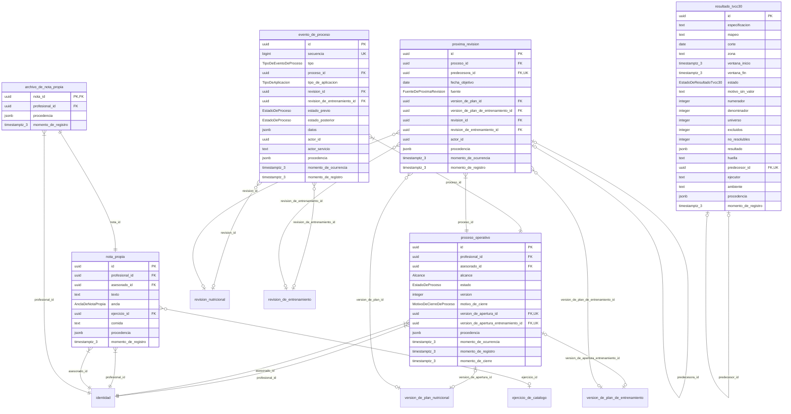

*Figura 36: Proceso de acompañamiento: las tablas del módulo con sus campos y sus relaciones. Las tablas sin campos son de otro módulo. Generado del esquema; se dibuja igual en dbdiagram.io con `14-der-fuente.dbml`.*

**Tabla 7.** Las tablas de Proceso de acompañamiento, en el orden en que aparecen en las láminas.

| Tabla | Para qué | Campos | FK |
| --- | --- | --- | --- |
| `proceso_operativo` | El acompañamiento de una persona en un área: se abre con el primer plan activado y se cierra con fundamento. | 13 | 4 |
| `evento_de_proceso` | Los hechos del proceso: apertura, revisiones aplicadas, continuidad o cierre. | 15 | 3 |
| `proxima_revision` | Cuándo toca la próxima revisión. Reprogramar crea una fila nueva y la anterior queda en la historia. | 13 | 6 |
| `resultado_tvcc30` | Cada cálculo de la TVCC-30, la tasa de ciclos de seguimiento cerrados en 30 días, con su universo, su ventana y su resultado completo. | 21 | 1 |
| `nota_propia` | La nota que un profesional escribe para sí sobre una persona, opcionalmente anclada a un ejercicio o a una comida. En BE solo la ve su autor; como es un dato sobre la persona, entra en la exportación de sus datos. | 9 | 3 |
| `archivo_de_nota_propia` | El archivo de una nota propia, una sola vez y por su autor. La nota no se borra: sigue en la historia. | 4 | 2 |

# 05 · Nutrición

*Catálogo, evaluación, objetivo, plan, registro y revisión: el circuito de Nutrición en ese orden.*

**El plan es una cadena de versiones.** `plan_nutricional` tiene muchas `version_de_plan_nutricional` y apunta a la vigente. Cada versión apunta a la anterior, a la versión de objetivo en la que se basa y, si nació de una revisión, a esa `revision_nutricional`. Una versión activada no cambia: su `instantanea_de_plan_nutricional` (uno a uno) guarda exactamente lo que vio la persona.

**Los rangos de macronutrientes.** `rangos_de_plan_nutricional` es uno a uno con una versión del plan: los gramos que indica el profesional por día tipo y por comida. Se escriben solo mientras la versión es un borrador y, al activarla, quedan fijos con ella.

**Lo registrado, separado de lo indicado.** Cada `ingesta_nutricional` apunta a la versión del plan vigente cuando se registró y, si fue una receta, a la `version_de_receta` (módulo 06). Corregir agrega una `correccion_de_ingesta` encadenada, nunca pisa la anterior.

**La revisión cierra la vuelta.** `revision_nutricional` cuelga del `proceso_operativo` (módulo 04); aplicarla deja una `aplicacion_de_revision` unida al evento del proceso, y la versión nueva del plan apunta a ella.

**El objetivo con su cálculo y la evaluación con sus citas.** `calculo_del_objetivo_nutricional` guarda con qué se escribió una versión del objetivo: la toma de Antropometría o los datos cargados a mano, los valores usados en ese momento, el método y sus parámetros; solo se agrega. `cita_de_respuesta_en_evaluacion_nutricional` une una evaluación a una respuesta de formulario sin copiarla, con la versión vigente al citar. Las «Anotaciones» del profesional viven en `evaluacion_nutricional.notas`: ninguna lectura de la persona las devuelve.

- **16** tablas
- **19** relaciones internas
- **13** claves hacia otros módulos
- **21** claves que llegan de otros

```mermaid
erDiagram
  elemento_de_catalogo_nutricional {
    uuid id PK
    ProcedenciaDeCatalogo procedencia
    uuid creado_por_id
    timestamptz_3 momento_de_registro
  }
  version_de_elemento_nutricional {
    uuid id PK
    uuid elemento_id FK
    uuid predecesora_id FK, UK
    text nombre
    jsonb composicion
    DisponibilidadDeElemento disponibilidad
    jsonb procedencia
    timestamptz_3 momento_de_registro
  }
  evaluacion_nutricional {
    uuid id PK
    uuid profesional_id FK
    uuid asesorado_id FK
    text contexto
    jsonb valoracion
    jsonb referencias
    text notas
    jsonb procedencia
    timestamptz_3 momento_de_ocurrencia
    timestamptz_3 momento_de_registro
  }
  objetivo_nutricional {
    uuid id PK
    uuid profesional_id FK
    uuid asesorado_id FK
    timestamptz_3 momento_de_registro
  }
  version_de_objetivo_nutricional {
    uuid id PK
    uuid objetivo_id FK
    uuid predecesora_id FK, UK
    uuid evaluacion_id FK
    timestamptz_3 vigente_desde
    timestamptz_3 vigente_hasta
    jsonb requerimiento_energetico
    jsonb distribucion_de_macronutrientes
    text distribucion_por_comida
    text fundamento
    text declaracion_de_metodo
    uuid revision_de_origen_id FK
    uuid autor_id
    jsonb procedencia
    timestamptz_3 momento_de_registro
  }
  plan_nutricional {
    uuid id PK
    uuid profesional_id FK
    uuid asesorado_id FK
    uuid version_efectiva_id FK, UK
    timestamptz_3 momento_de_registro
  }
  version_de_plan_nutricional {
    uuid id PK
    uuid plan_id FK
    uuid predecesora_id FK
    EstadoDeVersionDePlan estado
    integer version
    uuid version_de_objetivo_id FK
    jsonb contenido
    date proxima_revision
    uuid revision_de_origen_id FK
    uuid autor_id
    jsonb procedencia
    timestamptz_3 momento_de_registro
    timestamptz_3 momento_de_activacion
    jsonb origen_de_plantilla
  }
  instantanea_de_plan_nutricional {
    uuid id PK
    uuid version_de_plan_id FK, UK
    jsonb contenido
    text huella
    timestamptz_3 momento_de_registro
  }
  rangos_de_plan_nutricional {
    uuid id PK
    uuid version_de_plan_id FK, UK
    integer revision
    jsonb contenido
    timestamptz_3 momento_de_registro
  }
  ingesta_nutricional {
    uuid id PK
    uuid version_de_plan_id FK
    uuid asesorado_id FK
    OrigenDeIngesta origen
    ModoDeRegistroDeIngesta modo
    date fecha_local
    text zona_horaria
    text dia_tipo_id
    text comida_id
    text opcion_id
    jsonb items_consumidos
    text observacion
    text descripcion
    text descripcion_de_porcion
    jsonb procedencia
    timestamptz_3 momento_de_ocurrencia
    timestamptz_3 momento_de_registro
    integer secuencia
    jsonb cantidades_consumidas
    uuid version_de_receta_id FK
    text dia_tipo_de_contexto_id
    text comida_de_contexto_id
  }
  correccion_de_ingesta {
    uuid id PK
    uuid ingesta_id FK
    uuid correccion_previa_id FK, UK
    jsonb estimacion
    text declaracion
    uuid autor_id
    jsonb procedencia
    timestamptz_3 momento_de_registro
  }
  revision_nutricional {
    uuid id PK
    uuid proceso_id FK
    date periodo_inicio
    date periodo_fin
    text zona_horaria
    jsonb evidencias
    text interpretacion
    ResultadoDeRevision resultado
    text fundamento
    jsonb proxima_accion
    uuid autor_id
    jsonb procedencia
    timestamptz_3 momento_de_ocurrencia
    timestamptz_3 momento_de_registro
  }
  aplicacion_de_revision {
    uuid id PK
    uuid revision_id FK, UK
    uuid evento_id FK, UK
    TipoDeAplicacion tipo
    EstadoDeProceso estado_de_proceso_posterior
    uuid version_de_plan_creada_id
    uuid version_de_objetivo_creada_id
    timestamptz_3 momento_de_registro
  }
  evento_de_nutricion {
    uuid id PK
    bigint secuencia UK
    TipoDeEventoDeNutricion tipo
    uuid profesional_id
    uuid asesorado_id
    text recurso_tipo
    uuid recurso_id
    text estado_previo
    text estado_posterior
    uuid actor_id
    jsonb procedencia
    timestamptz_3 momento_de_ocurrencia
    timestamptz_3 momento_de_registro
  }
  cita_de_respuesta_en_evaluacion_nutricional {
    uuid id PK
    uuid evaluacion_id FK
    uuid respuesta_id FK
    uuid rectificacion_id FK
    text codigo_de_campo
    integer orden
    timestamptz_3 momento_de_registro
  }
  calculo_del_objetivo_nutricional {
    uuid id PK
    uuid version_de_objetivo_id FK, UK
    uuid profesional_id
    uuid asesorado_id
    uuid evaluacion_antropometrica_id FK
    jsonb contenido
    jsonb procedencia
    timestamptz_3 momento_de_registro
  }
  version_de_elemento_nutricional }|--|| elemento_de_catalogo_nutricional : "elemento_id"
  version_de_elemento_nutricional |o--o| version_de_elemento_nutricional : "predecesora_id"
  evaluacion_nutricional }|--|| identidad : "profesional_id"
  evaluacion_nutricional }|--|| identidad : "asesorado_id"
  objetivo_nutricional }|--|| identidad : "profesional_id"
  objetivo_nutricional }|--|| identidad : "asesorado_id"
  version_de_objetivo_nutricional }|--|| objetivo_nutricional : "objetivo_id"
  version_de_objetivo_nutricional |o--o| version_de_objetivo_nutricional : "predecesora_id"
  version_de_objetivo_nutricional }|--|| evaluacion_nutricional : "evaluacion_id"
  version_de_objetivo_nutricional }o--o| revision_nutricional : "revision_de_origen_id"
  plan_nutricional }|--|| identidad : "profesional_id"
  plan_nutricional }|--|| identidad : "asesorado_id"
  plan_nutricional |o--o| version_de_plan_nutricional : "version_efectiva_id"
  version_de_plan_nutricional }|--|| plan_nutricional : "plan_id"
  version_de_plan_nutricional }o--o| version_de_plan_nutricional : "predecesora_id"
  version_de_plan_nutricional }|--|| version_de_objetivo_nutricional : "version_de_objetivo_id"
  version_de_plan_nutricional }o--o| revision_nutricional : "revision_de_origen_id"
  instantanea_de_plan_nutricional ||--|| version_de_plan_nutricional : "version_de_plan_id"
  rangos_de_plan_nutricional ||--|| version_de_plan_nutricional : "version_de_plan_id"
  ingesta_nutricional }|--|| version_de_plan_nutricional : "version_de_plan_id"
  ingesta_nutricional }|--|| identidad : "asesorado_id"
  ingesta_nutricional }o--o| version_de_receta : "version_de_receta_id"
  correccion_de_ingesta }|--|| ingesta_nutricional : "ingesta_id"
  correccion_de_ingesta |o--o| correccion_de_ingesta : "correccion_previa_id"
  revision_nutricional }|--|| proceso_operativo : "proceso_id"
  aplicacion_de_revision ||--|| revision_nutricional : "revision_id"
  aplicacion_de_revision ||--|| evento_de_proceso : "evento_id"
  cita_de_respuesta_en_evaluacion_nutricional }|--|| evaluacion_nutricional : "evaluacion_id"
  cita_de_respuesta_en_evaluacion_nutricional }|--|| respuesta_de_formulario : "respuesta_id"
  cita_de_respuesta_en_evaluacion_nutricional }o--o| rectificacion_de_respuesta_de_formulario : "rectificacion_id"
  calculo_del_objetivo_nutricional ||--|| version_de_objetivo_nutricional : "version_de_objetivo_id"
  calculo_del_objetivo_nutricional }o--o| evaluacion_antropometrica : "evaluacion_antropometrica_id"
```

*Figura 42: Nutrición: las tablas del módulo con sus campos y sus relaciones. Las tablas sin campos son de otro módulo. Generado del esquema; se dibuja igual en dbdiagram.io con `14-der-fuente.dbml`.*

**Tabla 8.** Las tablas de Nutrición, en el orden en que aparecen en las láminas.

| Tabla | Para qué | Campos | FK |
| --- | --- | --- | --- |
| `elemento_de_catalogo_nutricional` | Un alimento del catálogo, con un identificador estable. Su contenido vive en las versiones. | 4 | 0 |
| `version_de_elemento_nutricional` | Cada versión de un alimento: nombre, composición y disponibilidad. | 8 | 2 |
| `evaluacion_nutricional` | La evaluación nutricional del profesional, con la fuente de cada dato. Una nueva no reemplaza a la anterior. | 10 | 2 |
| `objetivo_nutricional` | El objetivo nutricional de una persona con un profesional. Apunta a sus versiones. | 4 | 2 |
| `version_de_objetivo_nutricional` | Cada versión del objetivo: requerimiento, distribución de macronutrientes y fundamento del profesional. | 15 | 4 |
| `plan_nutricional` | El plan de comidas de una persona con un profesional. Apunta a la versión vigente. | 5 | 3 |
| `version_de_plan_nutricional` | Cada versión del plan: borrador, activada o descartada. Una versión activada no se modifica. | 14 | 4 |
| `instantanea_de_plan_nutricional` | Lo que se emitió al activar una versión, con el catálogo resuelto y su huella, para reconstruirlo igual. | 5 | 1 |
| `rangos_de_plan_nutricional` | Los rangos de macronutrientes que el profesional indica en una versión del plan, por día tipo y por comida, en gramos y con el peso del que salieron. Se escriben en el borrador y, activada la versión, quedan fijos con ella. | 5 | 1 |
| `ingesta_nutricional` | Cada comida que registra la persona: la del plan, otra opción o algo diferente. No toca lo indicado. | 22 | 3 |
| `correccion_de_ingesta` | La corrección del profesional sobre una comida libre: una estimación con su declaración, en cadena. | 8 | 2 |
| `revision_nutricional` | La revisión del profesional sobre un período: evidencia, interpretación, resultado y próxima acción. | 14 | 1 |
| `aplicacion_de_revision` | Lo que se hizo con una revisión: seguir, ajustar el plan o cerrar el proceso. | 8 | 2 |
| `evento_de_nutricion` | Los hechos del área de Nutrición, en orden, para reconstruir la historia. | 13 | 0 |
| `cita_de_respuesta_en_evaluacion_nutricional` | Una respuesta de formulario citada en una evaluación de Nutrición: es una referencia, no una copia, y fija la versión vigente al citar. | 7 | 3 |
| `calculo_del_objetivo_nutricional` | Con qué se escribió una versión del objetivo: la toma de Antropometría o los datos a mano, los valores usados, el método y sus parámetros. Solo se agrega. | 8 | 2 |

# 06 · Recetas, fotos y registro de comidas

*Las recetas del profesional, las imágenes privadas y lo que completa un registro de comida.*

**Una foto pertenece a un solo registro.** `medio` es la imagen privada (sus bytes, recodificados y sin metadatos, van en `contenido_de_medio`); `evidencia_visual_de_ingesta` la une a una `ingesta_nutricional` (módulo 05), y es uno a uno con el medio.

**Deshacer y completar también agregan.** Deshacer un registro deja una `anulacion_de_ingesta` (a lo sumo una por ingesta); completar cantidades deja una `rectificacion_de_cantidades`, encadenada con la anterior.

**Las recetas tienen versiones.** `receta` tiene sus `version_de_receta`, encadenadas, y sus imágenes por `asociacion_de_imagen_de_receta`. La ingesta apunta a la versión exacta de la receta que la persona eligió.

**El Recetario de BE y las imágenes livianas.** Una `receta` sin profesional es del Recetario de BE, y la base lo garantiza al confirmar. `receta_del_recetario` dice si la sumó Administración desde una `propuesta_al_recetario` o si la sembró BE; `copia_de_receta_del_recetario`, de qué receta del recetario sale una receta propia, que reusa la misma imagen sin duplicarla. La propuesta de una receta con imagen guarda la versión del texto de la cesión que se aceptó, su huella y el momento; `decision_sobre_propuesta_al_recetario` es la decisión de Administración, una sola por propuesta. `variante_de_medio` guarda las dos medidas livianas de la imagen de una receta (la miniatura y la grande), armadas la primera vez que se piden, y `medio` suma un índice por `(propietario_id, sha256_original)` para guardar una sola copia por huella.

- **13** tablas
- **16** relaciones internas
- **8** claves hacia otros módulos
- **2** claves que llegan de otros

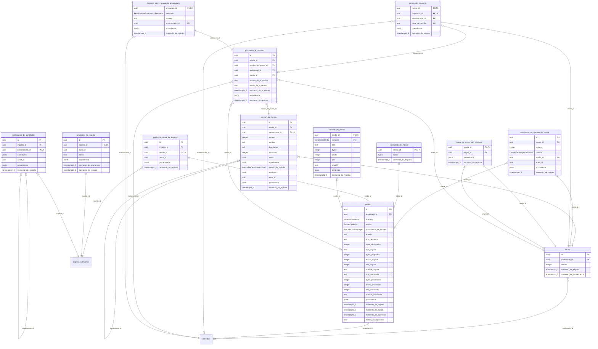

*Figura 50: Recetas, fotos y registro de comidas: las tablas del módulo con sus campos y sus relaciones. Las tablas sin campos son de otro módulo. Generado del esquema; se dibuja igual en dbdiagram.io con `14-der-fuente.dbml`.*

**Tabla 9.** Las tablas de Recetas, fotos y registro de comidas, en el orden en que aparecen en las láminas.

| Tabla | Para qué | Campos | FK |
| --- | --- | --- | --- |
| `receta` | Una receta propia del profesional o, sin profesional, del Recetario de BE. | 5 | 1 |
| `version_de_receta` | Cada versión de una receta: porciones, pasos, ingredientes y el cálculo nutricional con su método. | 14 | 2 |
| `asociacion_de_imagen_de_receta` | Cada cambio de la imagen de una receta. La vigente es la de mayor número. | 8 | 2 |
| `medio` | Los datos de una imagen privada (foto de comida, de receta o de ejercicio): tipo, tamaño, huellas y estado. | 23 | 1 |
| `contenido_de_medio` | Los bytes procesados de una imagen, recodificada y sin metadatos. | 3 | 1 |
| `evidencia_visual_de_ingesta` | La foto de una comida unida a su registro. Una foto pertenece a un solo registro. | 6 | 2 |
| `anulacion_de_ingesta` | «Deshacer registro»: la comida deja de contar, pero no se borra. | 7 | 1 |
| `rectificacion_de_cantidades` | «Completar cantidades»: las cantidades consumidas de una comida del plan, en cadena de rectificaciones. | 7 | 2 |
| `variante_de_medio` | Las medidas livianas de la imagen de una receta, armadas la primera vez que se piden. No se reescriben; se borran solo al suprimir el medio. | 9 | 1 |
| `receta_del_recetario` | Una receta del Recetario de BE: la suma un administrador desde una propuesta o la siembra BE. Solo se agrega. | 6 | 3 |
| `copia_de_receta_del_recetario` | De qué receta del recetario sale una receta propia. La copia reusa la misma imagen, sin duplicarla. Solo se agrega. | 4 | 2 |
| `propuesta_al_recetario` | Un profesional ofrece una versión de una receta suya. Con imagen, la cesión está completa; sin imagen, no hay cesión. Solo se agrega. | 10 | 4 |
| `decision_sobre_propuesta_al_recetario` | Lo que decide Administración. Sumada, con la receta ya en el recetario; rechazada, sin ella. Solo se agrega. | 6 | 2 |

# 07 · Antropometría

*Lo medido, separado de lo calculado: cada cálculo guarda el método, su versión y las mediciones exactas que usó.*

**La toma y sus mediciones.** Una `evaluacion_antropometrica` es una toma; tiene sus `medicion_antropometrica`, cada una con la versión del protocolo que siguió (`protocolo_version_id`). Corregir agrega una `correccion_de_medicion` encadenada; anular, una `anulacion_de_medicion` (una por medición).

**El cálculo y sus entradas.** `ejecucion_de_calculo` apunta a la toma y a la versión del método (`metodo_version_id`). `entrada_de_calculo` es la tabla intermedia entre el cálculo y cada medición que usó: una relación muchos a muchos, resuelta con una tabla propia.

**El profesional elige.** `referencia_de_calculo` marca qué cálculo adopta como referencia; cambiar de idea agrega otra referencia que apunta a la anterior. Por eso cada toma se puede comparar con la primera y con la anterior sabiendo con qué método se calculó cada valor.

**Kerr (1988) y los métodos de la toma.** El fraccionamiento de Kerr en cinco masas no suma tablas: son seis métodos del catálogo, filas de `especificacion_antropometrica` con su versión 1 en `version_de_especificacion_antropometrica`. Sus mediciones viven en el catálogo de mediciones del dominio, no en una versión nueva del protocolo, para no cortar la comparabilidad de las tomas anteriores. Los métodos habituales de cada profesional se leen de las corridas de cálculo de su última toma: no se guardan aparte.

- **11** tablas
- **15** relaciones internas
- **7** claves hacia otros módulos
- **1** claves que llegan de otros

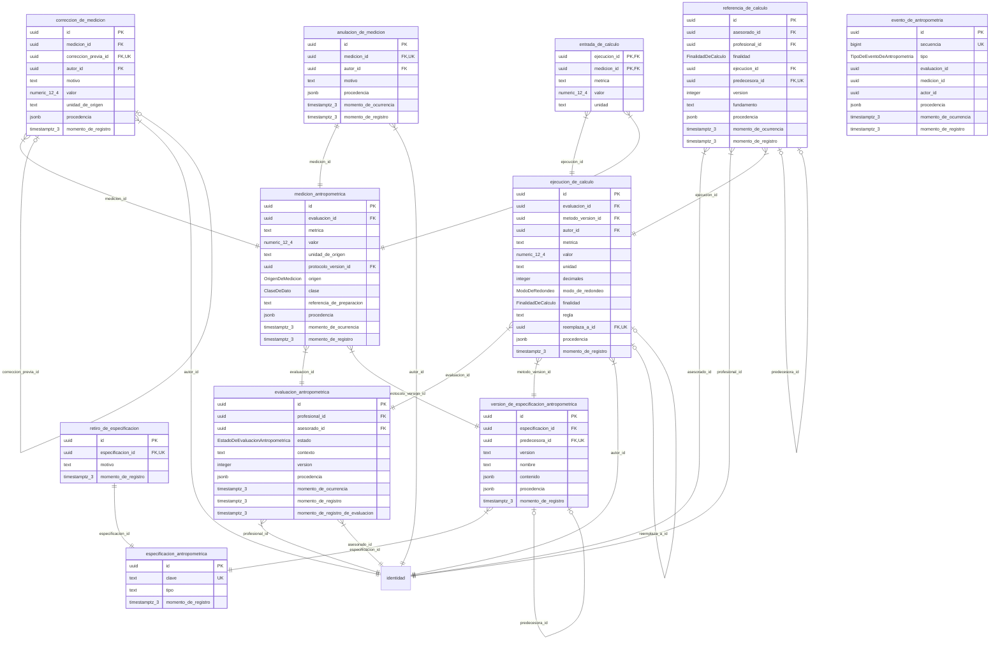

*Figura 55: Antropometría: las tablas del módulo con sus campos y sus relaciones. Las tablas sin campos son de otro módulo. Generado del esquema; se dibuja igual en dbdiagram.io con `14-der-fuente.dbml`.*

**Tabla 10.** Las tablas de Antropometría, en el orden en que aparecen en las láminas.

| Tabla | Para qué | Campos | FK |
| --- | --- | --- | --- |
| `especificacion_antropometrica` | Un protocolo de toma o un método de cálculo del catálogo, con clave estable. | 4 | 0 |
| `version_de_especificacion_antropometrica` | Cada versión de un protocolo o método: métricas, unidades, entradas y precisión. | 8 | 2 |
| `retiro_de_especificacion` | El retiro de un protocolo o método: deja de ofrecerse, pero lo que lo usó sigue explicable. | 4 | 1 |
| `evaluacion_antropometrica` | Una toma antropométrica: se prepara, se registra y queda reconstruible. | 10 | 2 |
| `medicion_antropometrica` | Cada medición directa de una toma, con su unidad de origen y su protocolo. | 12 | 2 |
| `correccion_de_medicion` | La corrección de una medición, en cadena sobre la original, que no se toca. | 9 | 3 |
| `anulacion_de_medicion` | La anulación de una medición. Es definitiva y solo puede haber una. | 7 | 2 |
| `ejecucion_de_calculo` | Cada cálculo derivado (por ejemplo, el porcentaje graso): método, versión, regla, precisión y resultado. | 14 | 4 |
| `entrada_de_calculo` | Cada medición que usó un cálculo, declarada en forma explícita, con su valor y unidad. | 5 | 2 |
| `referencia_de_calculo` | El cálculo que el profesional adopta como referencia. Cambiarla crea una fila nueva. | 11 | 4 |
| `evento_de_antropometria` | Los hechos del área de Antropometría, en orden. | 9 | 0 |

# 08 · Entrenamiento

*La forma de Nutrición, más la sesión en curso, la nota de la persona y la fuerza estimada.*

**Igual que en Nutrición.** Evaluación, objetivo con versiones, plan con versiones e instantánea, y revisión colgada del proceso: las mismas relaciones con otros nombres. La evaluación puede citar respuestas de formularios (módulo 10) por `cita_de_respuesta_en_evaluacion_de_entrenamiento`.

**La sesión en curso.** La persona carga un `borrador_de_ejecucion_de_entrenamiento` sobre una versión del plan, con sus `evento_de_tiempo_de_entrenamiento`. Al confirmarlo se convierte en una `ejecucion_de_entrenamiento` (uno a uno con el borrador), que ya no se edita: se corrige con `correccion_de_ejecucion_de_entrenamiento`. Después, la persona puede dejarle a su profesional una `nota_de_ejecucion` sobre esa sesión, que va aparte: la sesión registrada no cambia.

**La fuerza estimada.** `serie_observada` guarda cada serie que el profesional observó en un `ejercicio_de_catalogo` de una persona, con el 1RM estimado (Epley, versión 1) guardado como hecho. Corregirla o anularla agrega una fila que sucede a la anterior (`predecesora_id`, una sola sucesora).

**La notación del esfuerzo.** El contenido de `version_de_plan_de_entrenamiento` puede declarar que el plan se escribe en RPE, y se congela con la instantánea al activar. Lo guardado en cada serie es siempre el RIR, así que cambiar la notación nunca reescribe la historia. Las series de calentamiento y los bloques dentro de la sesión también viven en ese contenido.

- **18** tablas
- **23** relaciones internas
- **17** claves hacia otros módulos
- **15** claves que llegan de otros

```mermaid
erDiagram
  ejercicio_de_catalogo {
    uuid id PK
    ProcedenciaDeCatalogo procedencia
    uuid creado_por_id FK
    timestamptz_3 momento_de_registro
  }
  version_de_ejercicio {
    uuid id PK
    uuid ejercicio_id FK
    uuid predecesora_id FK, UK
    text nombre
    DisponibilidadDeElemento disponibilidad
    jsonb procedencia
    timestamptz_3 momento_de_registro
  }
  evaluacion_de_entrenamiento {
    uuid id PK
    uuid profesional_id FK
    uuid asesorado_id FK
    jsonb valoracion
    jsonb referencias
    text notas
    text contexto
    jsonb procedencia
    timestamptz_3 momento_de_ocurrencia
    timestamptz_3 momento_de_registro
  }
  cita_de_respuesta_en_evaluacion_de_entrenamiento {
    uuid id PK
    uuid evaluacion_id FK
    uuid respuesta_id FK
    uuid rectificacion_id FK
    text codigo_de_campo
    integer orden
    timestamptz_3 momento_de_registro
  }
  objetivo_de_entrenamiento {
    uuid id PK
    uuid profesional_id FK
    uuid asesorado_id FK
    timestamptz_3 momento_de_registro
  }
  version_de_objetivo_de_entrenamiento {
    uuid id PK
    uuid objetivo_id FK
    uuid predecesora_id FK, UK
    uuid evaluacion_id FK
    timestamptz_3 vigente_desde
    timestamptz_3 vigente_hasta
    jsonb objetivo
    text fundamento
    uuid revision_de_origen_id FK
    uuid autor_id
    jsonb procedencia
    timestamptz_3 momento_de_registro
  }
  plan_de_entrenamiento {
    uuid id PK
    uuid profesional_id FK
    uuid asesorado_id FK
    uuid version_efectiva_id FK, UK
    timestamptz_3 momento_de_registro
  }
  version_de_plan_de_entrenamiento {
    uuid id PK
    uuid plan_id FK
    uuid predecesora_id FK
    EstadoDeVersionDePlan estado
    integer version
    uuid version_de_objetivo_id FK
    jsonb contenido
    date proxima_revision
    uuid revision_de_origen_id FK
    uuid autor_id
    jsonb procedencia
    timestamptz_3 momento_de_registro
    timestamptz_3 momento_de_activacion
    jsonb origen_de_plantilla
  }
  instantanea_de_plan_de_entrenamiento {
    uuid id PK
    uuid version_de_plan_id FK, UK
    jsonb contenido
    text huella
    timestamptz_3 momento_de_registro
  }
  borrador_de_ejecucion_de_entrenamiento {
    uuid id PK
    uuid asesorado_id FK
    uuid version_de_plan_id FK
    text sesion_planificada_id
    date fecha_local
    text zona_horaria
    GranularidadDeRegistro granularidad
    CondicionDeSesion condicion
    text motivo
    jsonb contenido
    timestamptz_3 momento_de_ocurrencia
    integer version
    timestamptz_3 momento_de_registro
    timestamptz_3 momento_de_actualizacion
  }
  evento_de_tiempo_de_entrenamiento {
    uuid id PK
    uuid borrador_id FK
    uuid asesorado_id
    text corrida_id
    integer secuencia
    text evento_id
    TipoDeEventoDeTiempo tipo
    jsonb contenido
    timestamptz_3 instante_civil
    text ancla_monotonica
    double_precision ms_monotonicos
    BaseDelReloj base_del_reloj
    OrigenDelInstante origen_del_instante
    integer descanso_recomendado_segundos
    jsonb procedencia
    timestamptz_3 momento_de_recepcion
  }
  ejecucion_de_entrenamiento {
    uuid id PK
    uuid asesorado_id FK
    uuid version_de_plan_id FK
    text sesion_planificada_id
    date fecha_local
    text zona_horaria
    uuid borrador_id FK, UK
    GranularidadDeRegistro granularidad
    CondicionDeSesion condicion
    text motivo
    jsonb contenido
    jsonb procedencia
    timestamptz_3 momento_de_ocurrencia
    timestamptz_3 momento_de_registro
  }
  correccion_de_ejecucion_de_entrenamiento {
    uuid id PK
    uuid ejecucion_id FK
    uuid correccion_previa_id FK, UK
    uuid autor_id FK
    text motivo
    jsonb contenido
    jsonb procedencia
    timestamptz_3 momento_de_registro
  }
  nota_de_ejecucion {
    uuid id PK
    uuid ejecucion_id FK
    uuid asesorado_id FK
    text texto
    jsonb procedencia
    timestamptz_3 momento_de_registro
  }
  revision_de_entrenamiento {
    uuid id PK
    uuid proceso_id FK
    date periodo_inicio
    date periodo_fin
    text zona_horaria
    jsonb evidencias
    text interpretacion
    ResultadoDeRevision resultado
    text fundamento
    jsonb proxima_accion
    uuid autor_id
    jsonb procedencia
    timestamptz_3 momento_de_ocurrencia
    timestamptz_3 momento_de_registro
  }
  aplicacion_de_revision_de_entrenamiento {
    uuid id PK
    uuid revision_id FK, UK
    uuid evento_id FK, UK
    TipoDeAplicacion tipo
    EstadoDeProceso estado_de_proceso_posterior
    uuid version_de_plan_creada_id
    uuid version_de_objetivo_creada_id
    timestamptz_3 momento_de_registro
  }
  evento_de_entrenamiento {
    uuid id PK
    bigint secuencia UK
    TipoDeEventoDeEntrenamiento tipo
    uuid profesional_id
    uuid asesorado_id
    text recurso_tipo
    uuid recurso_id
    text estado_previo
    text estado_posterior
    uuid actor_id
    jsonb procedencia
    timestamptz_3 momento_de_ocurrencia
    timestamptz_3 momento_de_registro
  }
  serie_observada {
    uuid id PK
    uuid profesional_id FK
    uuid asesorado_id FK
    uuid ejercicio_id FK
    date fecha_local
    text zona_horaria
    double_precision carga
    text unidad
    integer repeticiones
    double_precision rir
    text nota
    jsonb estimacion
    TipoDeSerieObservada tipo
    uuid predecesora_id FK, UK
    text motivo
    integer posicion
    jsonb procedencia
    timestamptz_3 momento_de_registro
  }
  ejercicio_de_catalogo }o--o| identidad : "creado_por_id"
  version_de_ejercicio }|--|| ejercicio_de_catalogo : "ejercicio_id"
  version_de_ejercicio |o--o| version_de_ejercicio : "predecesora_id"
  evaluacion_de_entrenamiento }|--|| identidad : "profesional_id"
  evaluacion_de_entrenamiento }|--|| identidad : "asesorado_id"
  cita_de_respuesta_en_evaluacion_de_entrenamiento }|--|| evaluacion_de_entrenamiento : "evaluacion_id"
  cita_de_respuesta_en_evaluacion_de_entrenamiento }|--|| respuesta_de_formulario : "respuesta_id"
  cita_de_respuesta_en_evaluacion_de_entrenamiento }o--o| rectificacion_de_respuesta_de_formulario : "rectificacion_id"
  objetivo_de_entrenamiento }|--|| identidad : "profesional_id"
  objetivo_de_entrenamiento }|--|| identidad : "asesorado_id"
  version_de_objetivo_de_entrenamiento }|--|| objetivo_de_entrenamiento : "objetivo_id"
  version_de_objetivo_de_entrenamiento |o--o| version_de_objetivo_de_entrenamiento : "predecesora_id"
  version_de_objetivo_de_entrenamiento }|--|| evaluacion_de_entrenamiento : "evaluacion_id"
  version_de_objetivo_de_entrenamiento }o--o| revision_de_entrenamiento : "revision_de_origen_id"
  plan_de_entrenamiento }|--|| identidad : "profesional_id"
  plan_de_entrenamiento }|--|| identidad : "asesorado_id"
  plan_de_entrenamiento |o--o| version_de_plan_de_entrenamiento : "version_efectiva_id"
  version_de_plan_de_entrenamiento }|--|| plan_de_entrenamiento : "plan_id"
  version_de_plan_de_entrenamiento }o--o| version_de_plan_de_entrenamiento : "predecesora_id"
  version_de_plan_de_entrenamiento }|--|| version_de_objetivo_de_entrenamiento : "version_de_objetivo_id"
  version_de_plan_de_entrenamiento }o--o| revision_de_entrenamiento : "revision_de_origen_id"
  instantanea_de_plan_de_entrenamiento ||--|| version_de_plan_de_entrenamiento : "version_de_plan_id"
  borrador_de_ejecucion_de_entrenamiento }|--|| identidad : "asesorado_id"
  borrador_de_ejecucion_de_entrenamiento }|--|| version_de_plan_de_entrenamiento : "version_de_plan_id"
  evento_de_tiempo_de_entrenamiento }|--|| borrador_de_ejecucion_de_entrenamiento : "borrador_id"
  ejecucion_de_entrenamiento }|--|| identidad : "asesorado_id"
  ejecucion_de_entrenamiento }|--|| version_de_plan_de_entrenamiento : "version_de_plan_id"
  ejecucion_de_entrenamiento ||--|| borrador_de_ejecucion_de_entrenamiento : "borrador_id"
  correccion_de_ejecucion_de_entrenamiento }|--|| ejecucion_de_entrenamiento : "ejecucion_id"
  correccion_de_ejecucion_de_entrenamiento |o--o| correccion_de_ejecucion_de_entrenamiento : "correccion_previa_id"
  correccion_de_ejecucion_de_entrenamiento }|--|| identidad : "autor_id"
  nota_de_ejecucion }|--|| ejecucion_de_entrenamiento : "ejecucion_id"
  nota_de_ejecucion }|--|| identidad : "asesorado_id"
  revision_de_entrenamiento }|--|| proceso_operativo : "proceso_id"
  aplicacion_de_revision_de_entrenamiento ||--|| revision_de_entrenamiento : "revision_id"
  aplicacion_de_revision_de_entrenamiento ||--|| evento_de_proceso : "evento_id"
  serie_observada }|--|| identidad : "profesional_id"
  serie_observada }|--|| identidad : "asesorado_id"
  serie_observada }|--|| ejercicio_de_catalogo : "ejercicio_id"
  serie_observada |o--o| serie_observada : "predecesora_id"
```

*Figuras 63 y 64: Entrenamiento: las tablas del módulo con sus campos y sus relaciones. Las tablas sin campos son de otro módulo. Generado del esquema; se dibuja igual en dbdiagram.io con `14-der-fuente.dbml`.*

**Tabla 11.** Las tablas de Entrenamiento, en el orden en que aparecen en las láminas.

| Tabla | Para qué | Campos | FK |
| --- | --- | --- | --- |
| `ejercicio_de_catalogo` | Un ejercicio del catálogo, con identificador estable. Su contenido vive en las versiones. | 4 | 1 |
| `version_de_ejercicio` | Cada versión de un ejercicio: nombre y disponibilidad. | 7 | 2 |
| `evaluacion_de_entrenamiento` | La evaluación de entrenamiento del profesional, con su contexto y referencias. | 10 | 2 |
| `cita_de_respuesta_en_evaluacion_de_entrenamiento` | Una respuesta de formulario citada como evidencia en una evaluación. Se cita, no se copia. | 7 | 3 |
| `objetivo_de_entrenamiento` | El objetivo de entrenamiento de una persona con un profesional. Apunta a sus versiones. | 4 | 2 |
| `version_de_objetivo_de_entrenamiento` | Cada versión del objetivo de entrenamiento, con su fundamento y su vigencia. | 12 | 4 |
| `plan_de_entrenamiento` | El plan de entrenamiento de una persona con un profesional. Apunta a la versión vigente. | 5 | 3 |
| `version_de_plan_de_entrenamiento` | Cada versión del plan: bloques, sesiones y prescripciones. Una versión activada no se modifica. | 14 | 4 |
| `instantanea_de_plan_de_entrenamiento` | Lo que se emitió al activar una versión, con su huella. La sesión registrada se lee contra esta instantánea, nunca contra un borrador ni contra el catálogo actual. | 5 | 1 |
| `borrador_de_ejecucion_de_entrenamiento` | La sesión en curso: lo que la persona va cargando antes de confirmar. | 14 | 2 |
| `evento_de_tiempo_de_entrenamiento` | Cada evento de tiempo de la sesión en curso (inicio, descanso, pausa), con su reloj. | 16 | 1 |
| `ejecucion_de_entrenamiento` | La sesión registrada y confirmada. Una sola por sesión planificada y por día, y no se edita. | 14 | 3 |
| `correccion_de_ejecucion_de_entrenamiento` | La corrección de una sesión registrada, en cadena, con su autor real. | 8 | 3 |
| `nota_de_ejecucion` | La nota que la persona deja en una sesión suya ya registrada, para su profesional. Va aparte de la sesión, que no cambia, y no se edita ni se borra. | 6 | 2 |
| `revision_de_entrenamiento` | La revisión del profesional sobre un período de entrenamiento. | 14 | 1 |
| `aplicacion_de_revision_de_entrenamiento` | Lo que se hizo con una revisión de entrenamiento: seguir, ajustar, sustituir o cerrar. | 8 | 2 |
| `evento_de_entrenamiento` | Los hechos del área de Entrenamiento, en orden. | 13 | 0 |
| `serie_observada` | Cada serie que el profesional observó en un ejercicio de la persona (carga, repeticiones y RIR), con la fuerza estimada por Epley guardada como hecho. Corregir o anular agrega una fila que sucede a la anterior. La persona no la recibe. | 18 | 4 |

# 09 · Catálogos e importación

*Cómo crecen los catálogos de alimentos y ejercicios: lo que carga el profesional y lo que se importa después de revisarlo.*

**Nada entra sin revisión.** Lo que llega de Open Food Facts o de wger es un `candidato_de_importacion`, con una sola `resolucion_de_candidato`; si se acepta, apunta al alimento (módulo 05) o al ejercicio (módulo 08) que creó o reutilizó. `item_externo_de_catalogo` recuerda de dónde vino cada uno.

**Buscar por otros nombres.** `nombre_alternativo_de_alimento` y `nombre_alternativo_de_ejercicio` cuelgan del catálogo; retirarlos agrega un retiro, uno por nombre.

**La figura del cuerpo.** `zona_de_ejercicio` es la tabla intermedia entre la asignación de un ejercicio y las zonas de `zona_muscular`.

**Lo cargado a mano y el catálogo verificado.** Un alimento cargado a mano es de quien lo cargó. `grupo_de_alimento` y `medidas_caseras_de_alimento` cuelgan del alimento sin crear versiones del alimento: cambiar el grupo o las medidas no toca planes, recetas ni registros. `revision_administrativa_de_alimento` guarda cada decisión de Administración contra la versión que vio, y `alimento_del_canon`, el alimento que sumó al catálogo verificado con su fuente. `alimento_compartido` queda como historia: ya no se escribe.

- **16** tablas
- **5** relaciones internas
- **30** claves hacia otros módulos
- **0** claves que llegan de otros

```mermaid
erDiagram
  candidato_de_importacion {
    uuid id PK
    Alcance alcance
    ProveedorExterno proveedor
    text id_externo
    jsonb contenido
    text huella_de_lo_recibido
    jsonb licencia
    text url_de_origen
    uuid profesional_id FK
    timestamptz_3 recibido_en
    timestamptz_3 vence_en
    jsonb procedencia
    timestamptz_3 momento_de_registro
  }
  resolucion_de_candidato {
    uuid id PK
    uuid candidato_id FK, UK
    DecisionDeImportacion decision
    jsonb contenido_revisado
    jsonb campos_corregidos
    text fundamento
    uuid elemento_nutricional_id FK
    uuid ejercicio_id FK
    uuid version_creada_id
    uuid autor_id FK
    jsonb procedencia
    timestamptz_3 momento_de_registro
  }
  item_externo_de_catalogo {
    ProveedorExterno proveedor PK
    text id_externo PK
    uuid elemento_nutricional_id FK, UK
    uuid ejercicio_id FK, UK
    jsonb procedencia
    timestamptz_3 momento_de_registro
  }
  nombre_alternativo_de_alimento {
    uuid id PK
    uuid elemento_id FK
    text nombre
    IdiomaDeNombre idioma
    text region
    OrigenDeNombreAlternativo origen
    ProveedorExterno proveedor
    uuid profesional_id FK
    jsonb procedencia
    timestamptz_3 momento_de_registro
  }
  retiro_de_nombre_alternativo_de_alimento {
    uuid nombre_id PK, FK
    text motivo
    uuid profesional_id FK
    jsonb procedencia
    timestamptz_3 momento_de_registro
  }
  nombre_alternativo_de_ejercicio {
    uuid id PK
    uuid ejercicio_id FK
    text nombre
    IdiomaDeNombre idioma
    text region
    OrigenDeNombreAlternativo origen
    ProveedorExterno proveedor
    uuid profesional_id FK
    jsonb procedencia
    timestamptz_3 momento_de_registro
  }
  retiro_de_nombre_alternativo_de_ejercicio {
    uuid nombre_id PK, FK
    text motivo
    uuid profesional_id FK
    jsonb procedencia
    timestamptz_3 momento_de_registro
  }
  asociacion_de_imagen_de_ejercicio {
    uuid id PK
    uuid ejercicio_id FK
    uuid version_de_ejercicio_id FK
    integer numero
    CambioDeImagenDeEjercicio cambio
    uuid medio_id FK
    text texto_alternativo
    jsonb licencia
    RevisionTecnicaDeImagen revision_tecnica
    uuid autor_id
    jsonb procedencia
    timestamptz_3 momento_de_registro
  }
  zona_muscular {
    text id PK
    text nombre
    VistaAnatomica vistas_anatomicas
    text version_del_catalogo
    timestamptz_3 momento_de_registro
  }
  asignacion_de_zonas_de_ejercicio {
    uuid id PK
    uuid ejercicio_id FK
    uuid version_de_ejercicio_id FK
    integer numero
    uuid autor_id FK
    jsonb procedencia
    timestamptz_3 momento_de_registro
  }
  zona_de_ejercicio {
    uuid asignacion_id PK, FK
    text zona_id PK, FK
    RolDeZonaMuscular rol
  }
  grupo_de_alimento {
    uuid id PK
    uuid elemento_id FK
    integer numero
    GrupoDeAlimento grupo
    uuid autor_id FK
    jsonb procedencia
    timestamptz_3 momento_de_registro
  }
  alimento_compartido {
    uuid elemento_id PK, FK
    jsonb procedencia
    timestamptz_3 momento_de_registro
  }
  alimento_del_canon {
    uuid elemento_id PK, FK
    text fuente
    uuid origen_id FK
    uuid administrador_id FK
    jsonb procedencia
    timestamptz_3 momento_de_registro
  }
  medidas_caseras_de_alimento {
    uuid id PK
    uuid elemento_id FK
    integer numero
    jsonb medidas
    uuid autor_id FK
    jsonb procedencia
    timestamptz_3 momento_de_registro
  }
  revision_administrativa_de_alimento {
    uuid id PK
    uuid elemento_id FK
    integer numero
    ResultadoDeRevisionDeAlimento resultado
    uuid version_id FK
    text fuente
    uuid equivalente_id FK
    uuid administrador_id FK
    jsonb procedencia
    timestamptz_3 momento_de_registro
  }
  candidato_de_importacion }|--|| identidad : "profesional_id"
  resolucion_de_candidato ||--|| candidato_de_importacion : "candidato_id"
  resolucion_de_candidato }|--|| identidad : "autor_id"
  resolucion_de_candidato }o--o| elemento_de_catalogo_nutricional : "elemento_nutricional_id"
  resolucion_de_candidato }o--o| ejercicio_de_catalogo : "ejercicio_id"
  item_externo_de_catalogo |o--o| elemento_de_catalogo_nutricional : "elemento_nutricional_id"
  item_externo_de_catalogo |o--o| ejercicio_de_catalogo : "ejercicio_id"
  nombre_alternativo_de_alimento }|--|| elemento_de_catalogo_nutricional : "elemento_id"
  nombre_alternativo_de_alimento }o--o| identidad : "profesional_id"
  retiro_de_nombre_alternativo_de_alimento ||--|| nombre_alternativo_de_alimento : "nombre_id"
  retiro_de_nombre_alternativo_de_alimento }o--o| identidad : "profesional_id"
  nombre_alternativo_de_ejercicio }|--|| ejercicio_de_catalogo : "ejercicio_id"
  nombre_alternativo_de_ejercicio }o--o| identidad : "profesional_id"
  retiro_de_nombre_alternativo_de_ejercicio ||--|| nombre_alternativo_de_ejercicio : "nombre_id"
  retiro_de_nombre_alternativo_de_ejercicio }o--o| identidad : "profesional_id"
  asociacion_de_imagen_de_ejercicio }|--|| ejercicio_de_catalogo : "ejercicio_id"
  asociacion_de_imagen_de_ejercicio }|--|| version_de_ejercicio : "version_de_ejercicio_id"
  asociacion_de_imagen_de_ejercicio }o--o| medio : "medio_id"
  asignacion_de_zonas_de_ejercicio }|--|| ejercicio_de_catalogo : "ejercicio_id"
  asignacion_de_zonas_de_ejercicio }|--|| version_de_ejercicio : "version_de_ejercicio_id"
  asignacion_de_zonas_de_ejercicio }o--o| identidad : "autor_id"
  zona_de_ejercicio }|--|| asignacion_de_zonas_de_ejercicio : "asignacion_id"
  zona_de_ejercicio }|--|| zona_muscular : "zona_id"
  grupo_de_alimento }|--|| elemento_de_catalogo_nutricional : "elemento_id"
  grupo_de_alimento }o--o| identidad : "autor_id"
  alimento_compartido ||--|| elemento_de_catalogo_nutricional : "elemento_id"
  alimento_del_canon ||--|| elemento_de_catalogo_nutricional : "elemento_id"
  alimento_del_canon }o--o| elemento_de_catalogo_nutricional : "origen_id"
  alimento_del_canon }|--|| identidad : "administrador_id"
  medidas_caseras_de_alimento }|--|| elemento_de_catalogo_nutricional : "elemento_id"
  medidas_caseras_de_alimento }o--o| identidad : "autor_id"
  revision_administrativa_de_alimento }|--|| elemento_de_catalogo_nutricional : "elemento_id"
  revision_administrativa_de_alimento }|--|| version_de_elemento_nutricional : "version_id"
  revision_administrativa_de_alimento }o--o| elemento_de_catalogo_nutricional : "equivalente_id"
  revision_administrativa_de_alimento }|--|| identidad : "administrador_id"
```

*Figura 76: Catálogos e importación: las tablas del módulo con sus campos y sus relaciones. Las tablas sin campos son de otro módulo. Generado del esquema; se dibuja igual en dbdiagram.io con `14-der-fuente.dbml`.*

**Tabla 12.** Las tablas de Catálogos e importación, en el orden en que aparecen en las láminas.

| Tabla | Para qué | Campos | FK |
| --- | --- | --- | --- |
| `candidato_de_importacion` | Lo que devolvió un catálogo externo, listo para que el profesional lo revise, con su licencia y su huella. | 13 | 1 |
| `resolucion_de_candidato` | La decisión del profesional sobre un candidato: importarlo (con correcciones) o descartarlo. | 12 | 4 |
| `item_externo_de_catalogo` | Un ítem importado de un proveedor externo. Uno por proveedor e identificador, compartido entre profesionales. | 6 | 2 |
| `nombre_alternativo_de_alimento` | Otro nombre con que se conoce un alimento (de otro país o en inglés), para encontrarlo. | 10 | 2 |
| `retiro_de_nombre_alternativo_de_alimento` | El retiro de un nombre alternativo de alimento: queda en la historia y deja de buscarse. | 5 | 2 |
| `nombre_alternativo_de_ejercicio` | Otro nombre con que se conoce un ejercicio, para encontrarlo. | 10 | 2 |
| `retiro_de_nombre_alternativo_de_ejercicio` | El retiro de un nombre alternativo de ejercicio. | 5 | 2 |
| `asociacion_de_imagen_de_ejercicio` | Cada cambio de la imagen de un ejercicio propio, con su licencia y su revisión técnica. | 12 | 3 |
| `zona_muscular` | El catálogo de las 17 zonas musculares que dibuja la figura del cuerpo. | 5 | 0 |
| `asignacion_de_zonas_de_ejercicio` | Cada cambio de las zonas musculares de un ejercicio. La vigente es la de mayor número. | 7 | 3 |
| `zona_de_ejercicio` | Una zona dentro de una asignación, con su rol (principal o secundario). | 3 | 2 |
| `grupo_de_alimento` | El grupo de un alimento, aparte de sus versiones: cambiarlo no crea una versión ni toca planes, recetas ni registros. El vigente es el de mayor número. | 7 | 2 |
| `alimento_compartido` | Histórica: un alimento cargado a mano que veían los demás profesionales. Desde que lo cargado a mano es propio de quien lo cargó, no se escribe. | 3 | 1 |
| `alimento_del_canon` | Un alimento que Administración sumó al catálogo verificado («Sumar al canon»), con su fuente y, si salió de una carga a mano, la carga de la que partió. | 6 | 3 |
| `medidas_caseras_de_alimento` | Las medidas caseras de un alimento (la unidad, la cucharada, la taza y la porción), cada una con su equivalencia en gramos. Cada cambio es una versión nueva. | 7 | 2 |
| `revision_administrativa_de_alimento` | Cada decisión de Administración sobre un alimento cargado a mano, contra la versión que vio: certificarlo con su fuente o marcar su equivalente verificado. La vigente es la de mayor número. | 10 | 4 |

# 10 · Formularios y hábitos

*Pedirle información a la persona sin mezclarla con lo que observa el profesional; y sus hábitos, que son de ella.*

**La respuesta es de la persona.** Una `solicitud_de_formulario` cuelga de un `vinculo` (módulo 03) y de una versión de plantilla; tiene a lo sumo una `respuesta_de_formulario` y puede recibir propuestas del profesional. Rectificar agrega una `rectificacion_de_respuesta_de_formulario` encadenada.

**Los hábitos, con destinatarios.** `habitos_de_la_persona` puede nacer de una respuesta. Quién los ve lo decide la persona: `autorizacion_de_habitos` (con versiones y el texto aceptado) tiene sus `destinatario_de_habitos`, uno por `alcance_de_vinculo`.

**La evaluación con formularios.** `vinculo_de_formulario_en_evaluacion` une un formulario que la persona respondió, entero, a una evaluación inicial de Nutrición o de Entrenamiento. Es una referencia, no una copia: la respuesta sigue siendo de la persona, y desvincular deja la marca de cuándo.

- **12** tablas
- **13** relaciones internas
- **15** claves hacia otros módulos
- **4** claves que llegan de otros

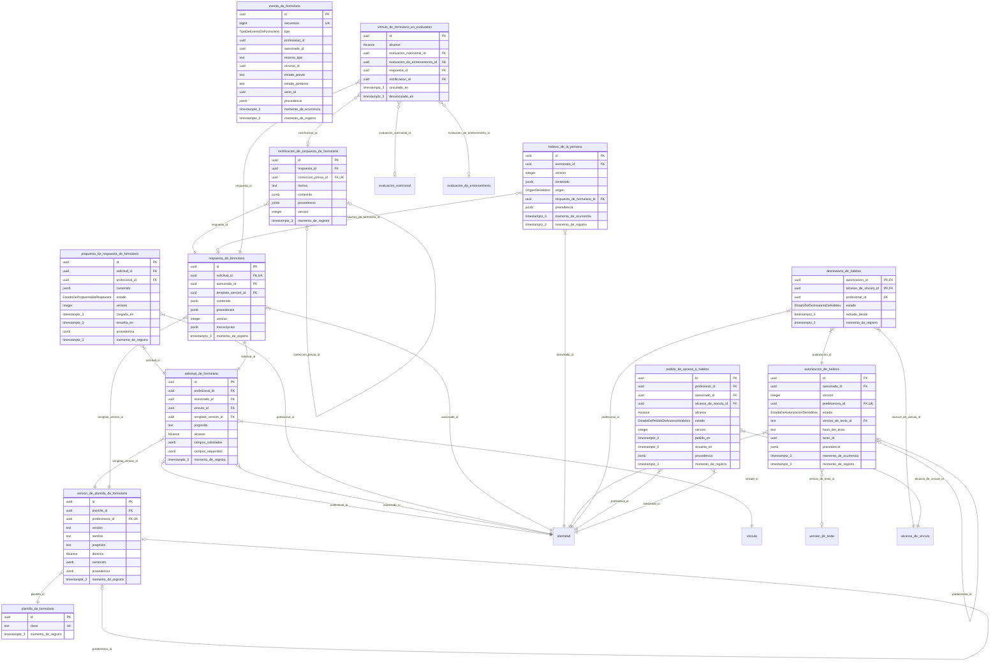

*Figura 81: Formularios y hábitos: las tablas del módulo con sus campos y sus relaciones. Las tablas sin campos son de otro módulo. Generado del esquema; se dibuja igual en dbdiagram.io con `14-der-fuente.dbml`.*

**Tabla 13.** Las tablas de Formularios y hábitos, en el orden en que aparecen en las láminas.

| Tabla | Para qué | Campos | FK |
| --- | --- | --- | --- |
| `plantilla_de_formulario` | Un formulario del catálogo (salud, hábitos, inicio), con clave estable. | 3 | 0 |
| `version_de_plantilla_de_formulario` | Cada versión de un formulario: secciones, campos, tipos y ayudas. | 10 | 2 |
| `solicitud_de_formulario` | El pedido de un profesional a una persona para que complete un formulario. | 10 | 4 |
| `propuesta_de_respuesta_de_formulario` | Lo que el profesional cargó con lo que la persona le contó, a la espera de que ella lo confirme. | 10 | 2 |
| `respuesta_de_formulario` | La respuesta de la persona. No se sobrescribe. | 9 | 3 |
| `rectificacion_de_respuesta_de_formulario` | Una rectificación de la respuesta, en cadena, sin tocar la original. | 8 | 2 |
| `evento_de_formulario` | Los hechos de los formularios, en orden. | 13 | 0 |
| `habitos_de_la_persona` | Los hábitos de la persona, que son de ella y no de un área. Cada cambio es una versión nueva. | 9 | 2 |
| `autorizacion_de_habitos` | La autorización de la persona para que los profesionales que elige vean sus hábitos. | 11 | 3 |
| `destinatario_de_habitos` | Cada profesional que recibe los hábitos según una autorización. | 6 | 3 |
| `pedido_de_acceso_a_habitos` | El pedido de un profesional para ver los hábitos de la persona. | 11 | 3 |
| `vinculo_de_formulario_en_evaluacion` | Un formulario que la persona respondió, vinculado entero a una evaluación inicial de Nutrición o de Entrenamiento. Es una referencia, no una copia. | 8 | 4 |

# 11 · Lo que se comparte entre áreas

*Por defecto, cada profesional ve solo su área. Lo que la persona decide compartir entre áreas, y la coordinación entre profesionales.*

**Compartir es una autorización con destinatarios.** `autorizacion_de_resumenes` (con versiones y el texto aceptado) tiene sus `destinatario_de_resumenes`. Cada destinatario apunta a dos alcances del módulo 03: el que recibe (`alcance_de_vinculo_id`) y el área de origen (`origen_id`).

**Las notas entre profesionales.** `nota_de_coordinacion` tiene sus destinatarios y sus referencias; corregir una nota agrega otra que apunta a ella (`corrige_a_id`).

**La historia anterior.** `autorizacion_de_historia_anterior` es la decisión de la persona de que el profesional nuevo de un área vea lo que pasó antes en esa área, en solo lectura y sin las notas privadas. Cada cambio, también retirarla, es una versión encadenada a la anterior.

- **8** tablas
- **7** relaciones internas
- **15** claves hacia otros módulos
- **0** claves que llegan de otros

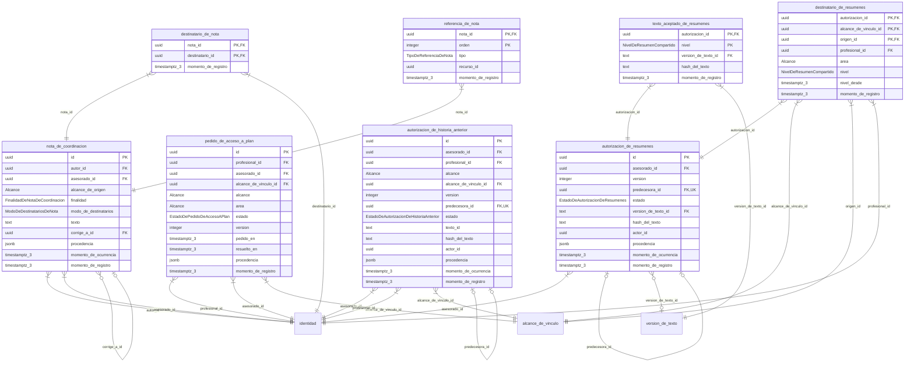

*Figura 88: Lo que se comparte entre áreas: las tablas del módulo con sus campos y sus relaciones. Las tablas sin campos son de otro módulo. Generado del esquema; se dibuja igual en dbdiagram.io con `14-der-fuente.dbml`.*

**Tabla 14.** Las tablas de Lo que se comparte entre áreas, en el orden en que aparecen en las láminas.

| Tabla | Para qué | Campos | FK |
| --- | --- | --- | --- |
| `autorizacion_de_resumenes` | La autorización de la persona para que un profesional vea lo de otras áreas, con un nivel. | 11 | 3 |
| `texto_aceptado_de_resumenes` | El texto aceptado para cada nivel de lo que se comparte, con su huella. | 5 | 2 |
| `destinatario_de_resumenes` | Quién recibe qué: el profesional, el área de origen y el nivel. | 8 | 4 |
| `pedido_de_acceso_a_plan` | El pedido de un profesional para ver el plan de otra área de la persona. | 12 | 3 |
| `nota_de_coordinacion` | Una nota breve entre los profesionales de una persona, escrita desde un área. | 11 | 3 |
| `destinatario_de_nota` | Los profesionales que recibieron una nota, fijados al escribirla. | 3 | 2 |
| `referencia_de_nota` | Un recurso citado en una nota, por su identificador. Citarlo no da acceso. | 5 | 1 |
| `autorizacion_de_historia_anterior` | La autorización de la persona para que el profesional nuevo de un área vea lo que pasó antes en esa área, en solo lectura y sin las notas privadas. Se puede retirar; cada cambio es una versión. | 14 | 4 |

# 12 · Herramientas del profesional

*Lo que el profesional arma para trabajar más rápido, sin datos de ninguna persona.*

Son moldes y elementos habituales: plantillas de planes (con versiones), ejercicios, alimentos, sesiones y comidas habituales, prescripciones y repartos de macronutrientes habituales, y las vistas de análisis que guarda para volver a mirar.

Hacia afuera, casi todas cuelgan solo de la cuenta del profesional. Las dos excepciones apuntan al catálogo: `ejercicio_habitual` al ejercicio y `alimento_habitual` al alimento. Ninguna tabla de este módulo apunta a una persona: aplicar un molde escribe valores en el borrador, como cualquier otro.

**Plantillas sin persona y enfoques.** `preparacion_de_plantilla_de_entrenamiento` es el trabajo en curso de una plantilla, privado y sin persona, que se guarda solo; guardar la plantilla crea su versión nueva. `conjunto_de_graficos` es un enfoque (hasta seis gráficos con nombre) y `eleccion_de_conjunto_de_graficos`, el enfoque elegido para una persona o para uno de sus planes: guardan solo referencias, nunca datos de una persona.

- **14** tablas
- **5** relaciones internas
- **19** claves hacia otros módulos
- **0** claves que llegan de otros

```mermaid
erDiagram
  plantilla_de_plan_de_entrenamiento {
    uuid id PK
    uuid profesional_id FK
    text nombre
    text nombre_normalizado
    text descripcion
    EstadoDePlantilla estado
    integer version
    timestamptz_3 momento_de_registro
    timestamptz_3 momento_de_actualizacion
  }
  version_de_plantilla_de_plan_de_entrenamiento {
    uuid id PK
    uuid plantilla_id FK
    integer numero
    jsonb estructura
    CargasDePlantilla cargas
    jsonb origen
    uuid autor_id FK
    jsonb procedencia
    timestamptz_3 momento_de_registro
  }
  plantilla_de_plan_nutricional {
    uuid id PK
    uuid profesional_id FK
    text nombre
    text nombre_normalizado
    text descripcion
    EstadoDePlantilla estado
    integer version
    timestamptz_3 momento_de_registro
    timestamptz_3 momento_de_actualizacion
  }
  version_de_plantilla_de_plan_nutricional {
    uuid id PK
    uuid plantilla_id FK
    integer numero
    jsonb estructura
    CantidadesDePlantilla cantidades
    jsonb origen
    uuid autor_id FK
    jsonb procedencia
    timestamptz_3 momento_de_registro
  }
  ejercicio_habitual {
    uuid id PK
    uuid profesional_id FK
    uuid ejercicio_id FK
    EstadoDeHabitual estado
    timestamptz_3 momento_de_registro
    timestamptz_3 momento_de_actualizacion
  }
  sesion_habitual {
    uuid id PK
    uuid profesional_id FK
    text nombre
    text nombre_normalizado
    jsonb estructura
    CargasDePlantilla cargas
    EstadoDeHabitual estado
    integer version
    jsonb procedencia
    timestamptz_3 momento_de_registro
    timestamptz_3 momento_de_actualizacion
  }
  alimento_habitual {
    uuid id PK
    uuid profesional_id FK
    uuid elemento_id FK
    EstadoDeHabitual estado
    timestamptz_3 momento_de_registro
    timestamptz_3 momento_de_actualizacion
  }
  comida_habitual {
    uuid id PK
    uuid profesional_id FK
    text nombre
    text nombre_normalizado
    jsonb estructura
    CantidadesDePlantilla cantidades
    EstadoDeHabitual estado
    integer version
    jsonb procedencia
    timestamptz_3 momento_de_registro
    timestamptz_3 momento_de_actualizacion
  }
  vista_de_analisis {
    uuid id PK
    uuid profesional_id FK
    text nombre
    UsoDeVistaDeAnalisis uso
    jsonb configuracion
    integer version
    jsonb procedencia
    timestamptz_3 momento_de_registro
    timestamptz_3 momento_de_actualizacion
  }
  prescripcion_habitual {
    uuid id PK
    uuid profesional_id FK
    text nombre
    text nombre_normalizado
    jsonb prescripcion
    EstadoDeHabitual estado
    integer version
    jsonb procedencia
    timestamptz_3 momento_de_registro
    timestamptz_3 momento_de_actualizacion
  }
  reparto_habitual {
    uuid id PK
    uuid profesional_id FK
    text nombre
    text nombre_normalizado
    jsonb reparto
    EstadoDeHabitual estado
    integer version
    jsonb procedencia
    timestamptz_3 momento_de_registro
    timestamptz_3 momento_de_actualizacion
  }
  preparacion_de_plantilla_de_entrenamiento {
    uuid id PK
    uuid profesional_id FK
    uuid plantilla_id FK, UK
    uuid version_base_id FK
    text nombre
    text descripcion
    jsonb estructura
    CargasDePlantilla cargas
    integer version
    jsonb procedencia
    timestamptz_3 momento_de_registro
    timestamptz_3 momento_de_actualizacion
  }
  conjunto_de_graficos {
    uuid id PK
    uuid profesional_id FK
    text nombre
    jsonb contenido
    integer version
    jsonb procedencia
    timestamptz_3 momento_de_registro
    timestamptz_3 momento_de_actualizacion
  }
  eleccion_de_conjunto_de_graficos {
    uuid id PK
    uuid profesional_id FK
    uuid asesorado_id FK
    AmbitoDeEleccionDeGraficos ambito
    uuid plan_de_entrenamiento_id FK
    uuid plan_nutricional_id FK
    uuid conjunto_id FK
    integer version
    jsonb procedencia
    timestamptz_3 momento_de_registro
    timestamptz_3 momento_de_actualizacion
  }
  plantilla_de_plan_de_entrenamiento }|--|| identidad : "profesional_id"
  version_de_plantilla_de_plan_de_entrenamiento }|--|| plantilla_de_plan_de_entrenamiento : "plantilla_id"
  version_de_plantilla_de_plan_de_entrenamiento }|--|| identidad : "autor_id"
  plantilla_de_plan_nutricional }|--|| identidad : "profesional_id"
  version_de_plantilla_de_plan_nutricional }|--|| plantilla_de_plan_nutricional : "plantilla_id"
  version_de_plantilla_de_plan_nutricional }|--|| identidad : "autor_id"
  ejercicio_habitual }|--|| identidad : "profesional_id"
  ejercicio_habitual }|--|| ejercicio_de_catalogo : "ejercicio_id"
  sesion_habitual }|--|| identidad : "profesional_id"
  alimento_habitual }|--|| identidad : "profesional_id"
  alimento_habitual }|--|| elemento_de_catalogo_nutricional : "elemento_id"
  comida_habitual }|--|| identidad : "profesional_id"
  vista_de_analisis }|--|| identidad : "profesional_id"
  prescripcion_habitual }|--|| identidad : "profesional_id"
  reparto_habitual }|--|| identidad : "profesional_id"
  preparacion_de_plantilla_de_entrenamiento }|--|| identidad : "profesional_id"
  preparacion_de_plantilla_de_entrenamiento |o--o| plantilla_de_plan_de_entrenamiento : "plantilla_id"
  preparacion_de_plantilla_de_entrenamiento }o--o| version_de_plantilla_de_plan_de_entrenamiento : "version_base_id"
  conjunto_de_graficos }|--|| identidad : "profesional_id"
  eleccion_de_conjunto_de_graficos }|--|| identidad : "profesional_id"
  eleccion_de_conjunto_de_graficos }|--|| identidad : "asesorado_id"
  eleccion_de_conjunto_de_graficos }o--o| plan_de_entrenamiento : "plan_de_entrenamiento_id"
  eleccion_de_conjunto_de_graficos }o--o| plan_nutricional : "plan_nutricional_id"
  eleccion_de_conjunto_de_graficos }|--|| conjunto_de_graficos : "conjunto_id"
```

*Figuras 93 y 94: Herramientas del profesional: las tablas del módulo con sus campos y sus relaciones. Las tablas sin campos son de otro módulo. Generado del esquema; se dibuja igual en dbdiagram.io con `14-der-fuente.dbml`.*

**Tabla 15.** Las tablas de Herramientas del profesional, en el orden en que aparecen en las láminas.

| Tabla | Para qué | Campos | FK |
| --- | --- | --- | --- |
| `plantilla_de_plan_de_entrenamiento` | Un molde de plan de entrenamiento del profesional, sin datos de ninguna persona. | 9 | 1 |
| `version_de_plantilla_de_plan_de_entrenamiento` | Cada versión de un molde de plan de entrenamiento. | 9 | 2 |
| `plantilla_de_plan_nutricional` | Un molde de plan de comidas del profesional, sin datos de ninguna persona. | 9 | 1 |
| `version_de_plantilla_de_plan_nutricional` | Cada versión de un molde de plan de comidas. | 9 | 2 |
| `ejercicio_habitual` | Un ejercicio que el profesional marcó como habitual, para tenerlo a mano. | 6 | 2 |
| `sesion_habitual` | Una sesión armada que el profesional reutiliza en sus planes. | 11 | 1 |
| `alimento_habitual` | Un alimento que el profesional marcó como habitual. | 6 | 2 |
| `comida_habitual` | Una comida armada que el profesional reutiliza en sus planes. | 11 | 1 |
| `vista_de_analisis` | Una vista guardada de «Analizar» o del resumen del profesional. Es solo configuración. | 9 | 1 |
| `prescripcion_habitual` | Una prescripción que el profesional guarda para reutilizar («Mi fuerza 5×3 · RIR 1»): series, intensidad, descanso y bases, sin ejercicio ni cargas. La ve solo él; guardarla con el mismo nombre la reemplaza. | 10 | 1 |
| `reparto_habitual` | Un reparto de macronutrientes en gramos por día que el profesional guarda para reutilizar. Lo ve solo él; aplicarlo escribe los gramos en el objetivo. | 10 | 1 |
| `preparacion_de_plantilla_de_entrenamiento` | El trabajo en curso de una plantilla de entrenamiento, privado y sin persona, que se guarda solo. Guardar la plantilla crea una versión nueva. | 12 | 3 |
| `conjunto_de_graficos` | Un enfoque: un conjunto de hasta seis gráficos con nombre, propio del profesional y reutilizable con cualquier persona. Guarda solo referencias, nunca datos de una persona. | 8 | 1 |
| `eleccion_de_conjunto_de_graficos` | El enfoque que el profesional eligió para una persona o para uno de sus planes con ella. Queda hasta que se cambie. | 11 | 5 |

# 13 · Novedades y avisos

*Las novedades avisan de un hecho; el aviso al teléfono no lleva datos de salud.*

Una `novedad` tiene a lo sumo una `lectura_de_novedad` y puede generar varios `aviso_push`, uno por cada `suscripcion_push` del teléfono. El aviso dice solo cuántas hay («Tenés una novedad.», «Tenés un recordatorio para hoy.»), sin datos de salud, y la app las muestra al abrirla.

- **5** tablas
- **3** relaciones internas
- **4** claves hacia otros módulos
- **0** claves que llegan de otros

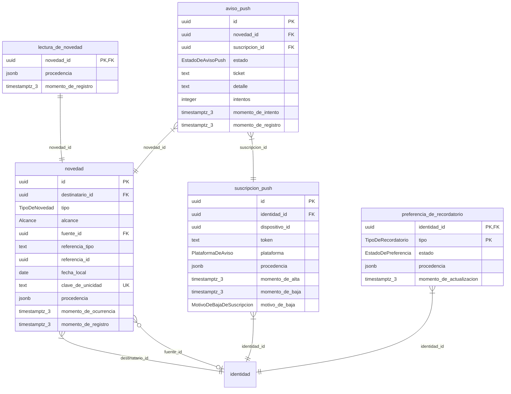

*Figura 99: Novedades y avisos: las tablas del módulo con sus campos y sus relaciones. Las tablas sin campos son de otro módulo. Generado del esquema; se dibuja igual en dbdiagram.io con `14-der-fuente.dbml`.*

**Tabla 16.** Las tablas de Novedades y avisos, en el orden en que aparecen en las láminas.

| Tabla | Para qué | Campos | FK |
| --- | --- | --- | --- |
| `novedad` | Una novedad para una persona o un profesional: un hecho que le interesa, sin datos clínicos. | 12 | 2 |
| `lectura_de_novedad` | La primera vez que alguien abrió una novedad. | 3 | 1 |
| `suscripcion_push` | Un teléfono que recibe los avisos de una cuenta, con su token. | 9 | 1 |
| `aviso_push` | Cada aviso enviado a un teléfono, con su estado e intentos. Dice solo cuántas novedades o recordatorios hay, sin datos de salud. | 9 | 2 |
| `preferencia_de_recordatorio` | Si la persona quiere los recordatorios diarios de registro, por tipo. | 5 | 1 |

# Anexo A. Diccionario de datos

*Cada tabla con todos sus campos, en el orden de la base: 1.490 columnas en 163 tablas. «Nulo: sí» quiere decir que el campo admite vacío.*

**Tabla 17.** Diccionario de 01 · Identidad y acceso.

| Tabla | Campo | Tipo | Clave | Nulo | Descripción |
| --- | --- | --- | --- | --- | --- |
| **`identidad`** | `id` | uuid | PK |   | Identificador único de la fila. |
|   | `estado_operativo_de_cuenta` | EstadoOperativoDeCuenta |   |   | Estado de la cuenta: operativa, suspendida o cerrada. |
|   | `autoria_de_creacion_id` | uuid |   |   | Quién dio el alta; en el autorregistro, la misma cuenta. |
|   | `procedencia` | jsonb |   |   | De dónde vino la fila: la fuente, la superficie (app o website), la operación, el caso de uso y el pedido que la produjo. |
|   | `momento_de_ocurrencia` | timestamptz(3) |   | sí | Cuándo pasó el hecho en la realidad; vacío si no se sabe. |
|   | `momento_de_registro` | timestamptz(3) |   |   | Cuándo BE guardó la fila. |
| **`perfil_propio`** | `id` | uuid | PK |   | Identificador único de la fila. |
|   | `identidad_id` | uuid | FK UK |   | La cuenta. |
|   | `version_efectiva_id` | uuid | FK UK | sí | La versión vigente del perfil. |
|   | `momento_de_ocurrencia` | timestamptz(3) |   | sí | Cuándo pasó el hecho en la realidad; vacío si no se sabe. |
|   | `momento_de_registro` | timestamptz(3) |   |   | Cuándo BE guardó la fila. |
| **`version_de_perfil_propio`** | `id` | uuid | PK |   | Identificador único de la fila. |
|   | `perfil_propio_id` | uuid | FK |   | El perfil propio. |
|   | `numero` | integer |   |   | Número correlativo dentro de su serie; la fila vigente es la de mayor número. |
|   | `nombre_visible` | text |   | sí | El nombre visible de la persona, que se pide al crear la cuenta. |
|   | `procedencia` | jsonb |   |   | De dónde vino la fila: la fuente, la superficie (app o website), la operación, el caso de uso y el pedido que la produjo. |
|   | `momento_de_registro` | timestamptz(3) |   |   | Cuándo BE guardó la fila. |
| **`metodo_de_acceso`** | `id` | uuid | PK |   | Identificador único de la fila. |
|   | `identidad_id` | uuid | FK |   | La cuenta. |
|   | `tipo` | TipoDeMetodoDeAcceso |   |   | Correo y contraseña (LOCAL) o Google. |
|   | `referencia` | text |   |   | Con correo: el correo normalizado. Con Google: el identificador estable de la cuenta de Google. |
|   | `correo` | text |   | sí | Solo con Google: el correo verificado por Google, para que un correo no quede en dos cuentas. |
|   | `procedencia` | jsonb |   |   | De dónde vino la fila: la fuente, la superficie (app o website), la operación, el caso de uso y el pedido que la produjo. |
|   | `momento_de_ocurrencia` | timestamptz(3) |   | sí | Cuándo pasó el hecho en la realidad; vacío si no se sabe. |
|   | `momento_de_registro` | timestamptz(3) |   |   | Cuándo BE guardó la fila. |
| **`cambio_de_metodo_de_acceso`** | `id` | uuid | PK |   | Identificador único de la fila. |
|   | `metodo_de_acceso_id` | uuid | FK |   | El método de acceso. |
|   | `identidad_id` | uuid | FK |   | La cuenta dueña del método. |
|   | `numero` | integer |   |   | Orden del cambio dentro del método: los impares son retiros y los pares, nuevas asociaciones. |
|   | `accion` | AccionSobreMetodoDeAcceso |   |   | Retiro o nueva asociación de la misma cuenta de Google. |
|   | `procedencia` | jsonb |   |   | De dónde vino la fila: la fuente, la superficie (app o website), la operación, el caso de uso y el pedido que la produjo. |
|   | `momento_de_registro` | timestamptz(3) |   |   | Cuándo BE guardó la fila. |
| **`credencial_local`** | `metodo_de_acceso_id` | uuid | PK FK |   | El método de acceso. |
|   | `hash` | text |   |   | Hash adaptativo de la contraseña; nunca se guarda en claro. |
|   | `momento_de_registro` | timestamptz(3) |   |   | Cuándo BE guardó la fila. |
| **`sesion`** | `id` | uuid | PK |   | Identificador único de la fila. |
|   | `identidad_id` | uuid | FK |   | La cuenta. |
|   | `estado` | EstadoDeSesion |   |   | Activa, finalizada o revocada. |
|   | `superficie` | Superficie |   | sí | Desde dónde se hizo: website (WEB) o app (APK). |
|   | `momento_de_ocurrencia` | timestamptz(3) |   |   | Cuándo pasó el hecho en la realidad; vacío si no se sabe. |
|   | `momento_de_registro` | timestamptz(3) |   |   | Cuándo BE guardó la fila. |
|   | `expira_en` | timestamptz(3) |   |   | Cuándo vence la sesión. |
|   | `version_de_control` | integer |   |   | La versión del control de sesión al emitirla; si cambia, la sesión deja de valer. |
|   | `momento_de_finalizacion` | timestamptz(3) |   | sí | Cuándo terminó la sesión. |
|   | `motivo_de_revocacion` | MotivoDeRevocacionDeSesion |   | sí | Por qué se revocó; vacío si no se revocó. |
|   | `clase` | ClaseDeSesion |   |   | Personal o administrativa; no cambia. |
| **`reanudacion_de_sesion`** | `id` | uuid | PK |   | Identificador único de la fila. |
|   | `sesion_id` | uuid | FK |   | La sesión. |
|   | `predecesora_id` | uuid | FK UK | sí | La fila anterior de la cadena; vacía en la primera. |
|   | `huella` | text | UK |   | Huella SHA-256 del contenido, para comprobar que no cambió. |
|   | `momento_de_registro` | timestamptz(3) |   |   | Cuándo BE guardó la fila. |
| **`control_de_sesion`** | `identidad_id` | uuid | PK FK |   | La cuenta. |
|   | `version` | integer |   |   | Contador por cuenta; al subir, invalida las sesiones anteriores. |
| **`recuperacion_de_acceso`** | `id` | uuid | PK |   | Identificador único de la fila. |
|   | `identidad_id` | uuid | FK |   | La cuenta. |
|   | `origen` | OrigenDeRecuperacionDeAcceso |   |   | Pedido por la persona o emitido por Administración (asistida). |
|   | `huella` | text | UK | sí | HMAC-SHA-256 del código; vacío en un pedido sin código. |
|   | `vence_en` | timestamptz(3) |   |   | Cuándo vence el código. |
|   | `intentos_fallidos` | integer |   |   | Códigos que no valieron; con 5, el pedido se anula. |
|   | `administrador_id` | uuid | FK | sí | En la recuperación asistida, quién la emitió. |
|   | `fundamento` | text |   | sí | En la asistida, cómo se verificó a la persona. |
|   | `momento_de_uso` | timestamptz(3) |   | sí | Cuándo se usó. |
|   | `momento_de_anulacion` | timestamptz(3) |   | sí | Cuándo se anuló. |
|   | `procedencia` | jsonb |   |   | De dónde vino la fila: la fuente, la superficie (app o website), la operación, el caso de uso y el pedido que la produjo. |
|   | `momento_de_registro` | timestamptz(3) |   |   | Cuándo BE guardó la fila. |
| **`cambio_de_credencial`** | `id` | uuid | PK |   | Identificador único de la fila. |
|   | `identidad_id` | uuid | FK |   | La cuenta. |
|   | `metodo_de_acceso_id` | uuid | FK |   | El método de acceso cuya contraseña cambió. |
|   | `recuperacion_id` | uuid | FK |   | El pedido de recuperación que lo permitió. |
|   | `transaccion` | bigint |   |   | La transacción de la base en la que se hizo el cambio. |
|   | `procedencia` | jsonb |   |   | De dónde vino la fila: la fuente, la superficie (app o website), la operación, el caso de uso y el pedido que la produjo. |
|   | `momento_de_registro` | timestamptz(3) |   |   | Cuándo BE guardó la fila. |
| **`version_de_texto`** | `id` | text | PK |   | Identificador único de la fila. |
|   | `tipo` | TipoDeTexto |   |   | Qué texto es (términos, privacidad, consentimiento u otro). |
|   | `titulo` | text |   |   | El título que se muestra. |
|   | `finalidad` | text |   |   | Para qué se pide la aceptación. |
|   | `texto` | text |   |   | El texto completo, tal como se muestra. |
|   | `hash` | text |   |   | Huella SHA-256 del texto. |
|   | `vigente_desde` | timestamptz(3) |   |   | Desde cuándo vale. |
|   | `momento_de_registro` | timestamptz(3) |   |   | Cuándo BE guardó la fila. |
|   | `reemplaza_a_id` | text | FK UK | sí | La versión del texto a la que reemplaza. |
| **`acto_registrable`** | `id` | uuid | PK |   | Identificador único de la fila. |
|   | `identidad_id` | uuid | FK |   | La cuenta. |
|   | `tipo` | TipoDeActoRegistrable |   |   | Qué aceptó: términos, información de privacidad, datos de salud, fotos de comidas o mayoría de edad. |
|   | `estado` | EstadoDeActoRegistrable |   |   | Vigente o revocado. |
|   | `version_de_texto_id` | text | FK |   | El texto que se aceptó. |
|   | `hash_del_texto` | text |   |   | Huella SHA-256 del texto aceptado. |
|   | `finalidad` | text |   |   | Para qué se usa (finalidad declarada). |
|   | `superficie` | Superficie |   | sí | Desde dónde se hizo: website (WEB) o app (APK). |
|   | `direccion_ip` | text |   | sí | Dirección IP desde la que se pidió. |
|   | `agente_de_usuario` | text |   | sí | Navegador o app desde la que se pidió. |
|   | `actor_id` | uuid |   |   | Quién hizo la acción. |
|   | `autoria_id` | uuid |   |   | Quién hizo el acto. |
|   | `procedencia` | jsonb |   |   | De dónde vino la fila: la fuente, la superficie (app o website), la operación, el caso de uso y el pedido que la produjo. |
|   | `momento_de_ocurrencia` | timestamptz(3) |   |   | Cuándo pasó el hecho en la realidad; vacío si no se sabe. |
|   | `momento_de_registro` | timestamptz(3) |   |   | Cuándo BE guardó la fila. |
|   | `momento_de_revocacion` | timestamptz(3) |   | sí | Cuándo se revocó; vacío si sigue vigente. |
|   | `alcance_de_vinculo_id` | uuid | FK | sí | El área del vínculo a la que se refiere, cuando aplica. |
| **`capacidad_de_cliente_declarada`** | `id` | uuid | PK |   | Identificador único de la fila. |
|   | `identidad_id` | uuid | FK |   | La cuenta. |
|   | `capacidad` | text |   |   | La capacidad declarada por la app. |
|   | `superficie` | Superficie |   | sí | Desde dónde se hizo: website (WEB) o app (APK). |
|   | `momento_de_primera_declaracion` | timestamptz(3) |   |   | La primera vez que se declaró. |
|   | `momento_de_ultima_declaracion` | timestamptz(3) |   |   | La última vez que se declaró. |

**Tabla 18.** Diccionario de 02 · Administración, derechos y auditoría.

| Tabla | Campo | Tipo | Clave | Nulo | Descripción |
| --- | --- | --- | --- | --- | --- |
| **`rol_administrativo`** | `id` | uuid | PK |   | Identificador único de la fila. |
|   | `identidad_id` | uuid | FK |   | La cuenta. |
|   | `estado` | EstadoDeRolAdministrativo |   |   | Vigente o retirado. |
|   | `nombre_visible` | text |   |   | El nombre con que figura en el historial administrativo. |
|   | `fundamento` | text |   |   | Fundamento escrito por quien decide. |
|   | `operador` | text |   |   | Quién corrió el comando que asignó el rol. |
|   | `procedencia` | jsonb |   |   | De dónde vino la fila: la fuente, la superficie (app o website), la operación, el caso de uso y el pedido que la produjo. |
|   | `momento_de_ocurrencia` | timestamptz(3) |   |   | Cuándo pasó el hecho en la realidad; vacío si no se sabe. |
|   | `momento_de_registro` | timestamptz(3) |   |   | Cuándo BE guardó la fila. |
|   | `momento_de_retiro` | timestamptz(3) |   | sí | Cuándo se retiró. |
|   | `fundamento_del_retiro` | text |   | sí | Por qué se retiró. |
|   | `operador_del_retiro` | text |   | sí | Quién lo retiró. |
| **`codigo_de_incorporacion`** | `id` | uuid | PK |   | Identificador único de la fila. |
|   | `identidad_id` | uuid | FK |   | La cuenta. |
|   | `huella` | text | UK |   | Huella SHA-256 del código; el código no se guarda. |
|   | `motivo` | MotivoDeCodigoDeIncorporacion |   |   | Primera configuración o restablecimiento del segundo factor. |
|   | `fundamento` | text |   |   | Por qué se emitió. |
|   | `operador` | text |   |   | Quién lo emitió. |
|   | `vence_en` | timestamptz(3) |   |   | Cuándo deja de valer. |
|   | `momento_de_uso` | timestamptz(3) |   | sí | Cuándo se usó. |
|   | `momento_de_anulacion` | timestamptz(3) |   | sí | Cuándo se anuló. |
|   | `procedencia` | jsonb |   |   | De dónde vino la fila: la fuente, la superficie (app o website), la operación, el caso de uso y el pedido que la produjo. |
|   | `momento_de_registro` | timestamptz(3) |   |   | Cuándo BE guardó la fila. |
| **`factor_totp`** | `id` | uuid | PK |   | Identificador único de la fila. |
|   | `identidad_id` | uuid | FK |   | La cuenta (de Administración o de un profesional). |
|   | `estado` | EstadoDeFactorTotp |   |   | Pendiente, activo, reemplazado, revocado o descartado. |
|   | `secreto_cifrado` | text |   |   | El secreto del autenticador, cifrado con AES-256-GCM. |
|   | `ultimo_paso` | bigint |   | sí | El último paso de tiempo aceptado; impide reutilizar un código. |
|   | `fallos_seguidos` | integer |   |   | Códigos inválidos seguidos; con 10 se bloquea hasta usar un código de recuperación. |
|   | `sesion_de_configuracion_id` | uuid |   | sí | La sesión que empezó la configuración; solo ella la confirma. |
|   | `vence_en` | timestamptz(3) |   | sí | Cuándo deja de valer. |
|   | `momento_de_activacion` | timestamptz(3) |   | sí | Cuándo quedó activo. |
|   | `momento_de_baja` | timestamptz(3) |   | sí | Cuándo se dio de baja. |
|   | `procedencia` | jsonb |   |   | De dónde vino la fila: la fuente, la superficie (app o website), la operación, el caso de uso y el pedido que la produjo. |
|   | `momento_de_registro` | timestamptz(3) |   |   | Cuándo BE guardó la fila. |
| **`codigo_de_recuperacion`** | `id` | uuid | PK |   | Identificador único de la fila. |
|   | `identidad_id` | uuid | FK |   | La cuenta (de Administración o de un profesional). |
|   | `lote_id` | uuid |   |   | El lote al que pertenece; un lote nuevo invalida el anterior. |
|   | `huella` | text | UK |   | HMAC-SHA-256 del código, con una clave del servidor; el código no se guarda. |
|   | `momento_de_uso` | timestamptz(3) |   | sí | Cuándo se usó. |
|   | `sesion_de_uso_id` | uuid |   | sí | La sesión en que se usó. |
|   | `momento_de_invalidacion` | timestamptz(3) |   | sí | Cuándo se invalidó. |
|   | `momento_de_registro` | timestamptz(3) |   |   | Cuándo BE guardó la fila. |
| **`segundo_factor_de_sesion`** | `sesion_id` | uuid | PK FK |   | La sesión. |
|   | `identidad_id` | uuid |   |   | La cuenta (la da la sesión). |
|   | `verificado_en` | timestamptz(3) |   | sí | Cuándo se verificó el segundo factor. |
|   | `metodo` | MetodoDeSegundoFactor |   | sí | Con qué se verificó: autenticador, código de recuperación o configuración inicial. |
|   | `ultima_actividad` | timestamptz(3) |   | sí | La última actividad de la sesión. |
|   | `intentos_fallidos` | integer |   |   | Intentos fallidos en esta sesión. |
|   | `momento_de_registro` | timestamptz(3) |   |   | Cuándo BE guardó la fila. |
| **`restablecimiento_de_segundo_factor`** | `id` | uuid | PK |   | Identificador único de la fila. |
|   | `identidad_id` | uuid | FK |   | El profesional. |
|   | `administrador_id` | uuid | FK |   | La cuenta de Administración. |
|   | `fundamento` | text |   |   | Fundamento escrito por quien decide. |
|   | `procedencia` | jsonb |   |   | De dónde vino la fila: la fuente, la superficie (app o website), la operación, el caso de uso y el pedido que la produjo. |
|   | `momento_de_ocurrencia` | timestamptz(3) |   | sí | Cuándo pasó el hecho en la realidad; vacío si no se sabe. |
|   | `momento_de_registro` | timestamptz(3) |   |   | Cuándo BE guardó la fila. |
| **`pedido_de_derecho`** | `id` | uuid | PK |   | Identificador único de la fila. |
|   | `titular_id` | uuid | FK |   | La persona que pide. |
|   | `tipo` | TipoDePedidoDeDerecho |   |   | Acceso, rectificación o supresión. |
|   | `nota` | text |   | sí | Lo que escribió la persona, si escribió algo. |
|   | `estado` | EstadoDePedidoDeDerecho |   |   | Recibido, resuelto o rechazado. Se resuelve una sola vez. |
|   | `plazo` | date |   |   | El último día del plazo para responder (fecha de Buenos Aires). |
|   | `respuesta` | text |   | sí | La respuesta a la persona. |
|   | `fundamento` | text |   | sí | El fundamento interno de la resolución. |
|   | `administrador_id` | uuid | FK | sí | Quién lo resolvió. |
|   | `momento_de_resolucion` | timestamptz(3) |   | sí | Cuándo se resolvió. |
|   | `procedencia` | jsonb |   |   | De dónde vino la fila: la fuente, la superficie (app o website), la operación, el caso de uso y el pedido que la produjo. |
|   | `momento_de_ocurrencia` | timestamptz(3) |   | sí | Cuándo pasó el hecho en la realidad; vacío si no se sabe. |
|   | `momento_de_registro` | timestamptz(3) |   |   | Cuándo BE guardó la fila. |
| **`exportacion_propia`** | `id` | uuid | PK |   | Identificador único de la fila. |
|   | `titular_id` | uuid | FK |   | La persona que pidió la descarga. |
|   | `dominios` | text[] |   |   | Qué partes de sus datos incluye. |
|   | `vence_en` | timestamptz(3) |   |   | Hasta cuándo vale el enlace de descarga. |
|   | `procedencia` | jsonb |   |   | De dónde vino la fila: la fuente, la superficie (app o website), la operación, el caso de uso y el pedido que la produjo. |
|   | `momento_de_registro` | timestamptz(3) |   |   | Cuándo BE guardó la fila. |
| **`decision_de_acceso`** | `id` | uuid | PK |   | Identificador único de la fila. |
|   | `secuencia` | bigint | UK |   | Orden total de los hechos. |
|   | `operacion` | text |   |   | La operación de la API a la que se refiere. |
|   | `resultado` | ResultadoDeDecision |   |   | Permitida o denegada. |
|   | `actor_id` | uuid | FK |   | Quién hizo la acción. |
|   | `sujeto_id` | uuid | FK | sí | La cuenta cuyos datos se tocan. |
|   | `alcance` | Alcance |   |   | Área: Nutrición, Entrenamiento o Antropometría. |
|   | `finalidad` | Finalidad |   |   | La finalidad del área: acompañamiento nutricional, planificación del entrenamiento o evaluación antropométrica. |
|   | `dimensiones_desfavorables` | DimensionDeAutorizacion[] |   |   | La condición que faltó: rol, especialidad o capacidad, situación, vínculo, consentimiento, finalidad o alcance. |
|   | `alcance_de_vinculo_id` | uuid | FK | sí | El área del vínculo. |
|   | `consentimiento_id` | uuid | FK | sí | El consentimiento. |
|   | `version_de_consentimiento_id` | uuid | FK | sí | La versión de consentimiento que resolvió la decisión. |
|   | `version_de_matriz` | text |   | sí | Versión de la matriz de pertinencia aplicada, si la hay. |
|   | `recurso_tipo` | text |   | sí | Tipo del recurso al que se refiere el hecho. |
|   | `recurso_id` | uuid |   | sí | Identificador del recurso al que se refiere el hecho. |
|   | `superficie` | Superficie |   | sí | Desde dónde se hizo: website (WEB) o app (APK). |
|   | `request_id` | text |   | sí | Identificador del pedido HTTP, para encontrarlo en el registro de la API. |
|   | `momento_de_ocurrencia` | timestamptz(3) |   |   | Cuándo pasó el hecho en la realidad; vacío si no se sabe. |
|   | `momento_de_registro` | timestamptz(3) |   |   | Cuándo BE guardó la fila. |
| **`registro_de_auditoria`** | `id` | uuid | PK |   | Identificador único de la fila. |
|   | `operacion` | text |   |   | La operación de la API a la que se refiere. |
|   | `resultado` | ResultadoDeOperacion |   |   | Cómo terminó la operación. |
|   | `motivo` | text |   | sí | Código interno del resultado; nunca se muestra afuera. |
|   | `actor_id` | uuid |   | sí | Quién hizo la acción. |
|   | `sujeto_id` | uuid |   | sí | La cuenta afectada, si la hay. |
|   | `recurso_tipo` | text |   | sí | Tipo del recurso al que se refiere el hecho. |
|   | `recurso_id` | text |   | sí | Identificador del recurso al que se refiere el hecho. |
|   | `superficie` | Superficie |   | sí | Desde dónde se hizo: website (WEB) o app (APK). |
|   | `request_id` | text |   | sí | Identificador del pedido HTTP, para encontrarlo en el registro de la API. |
|   | `momento_de_ocurrencia` | timestamptz(3) |   | sí | Cuándo pasó el hecho en la realidad; vacío si no se sabe. |
|   | `momento_de_registro` | timestamptz(3) |   |   | Cuándo BE guardó la fila. |
| **`registro_de_idempotencia`** | `id` | uuid | PK |   | Identificador único de la fila. |
|   | `operacion` | text |   |   | La operación de la API a la que se refiere. |
|   | `ambito` | text |   |   | Quién pidió: la cuenta autenticada o «PUBLICO». |
|   | `clave` | text |   |   | La clave de idempotencia que mandó el cliente. |
|   | `huella` | text |   |   | Huella SHA-256 del contenido, para comprobar que no cambió. |
|   | `estado_http` | integer |   |   | El código HTTP de la respuesta original. |
|   | `cuerpo` | jsonb |   |   | El cuerpo de la respuesta original, que se devuelve igual en un reintento. |
|   | `decisiones` | jsonb |   | sí | Las decisiones de acceso del pedido original, que el reintento vuelve a verificar. |
|   | `momento_de_registro` | timestamptz(3) |   |   | Cuándo BE guardó la fila. |
| **`evento_de_dominio`** | `id` | uuid | PK |   | Identificador único de la fila. |
|   | `tipo` | TipoDeEventoDeDominio |   |   | Qué hecho ocurrió (los valores posibles están en el anexo de conjuntos de valores). |
|   | `identidad_id` | uuid | FK |   | La cuenta. |
|   | `actor_id` | uuid |   | sí | Quién hizo la acción. |
|   | `actor_servicio` | text |   | sí | El servicio interno que actuó, cuando no fue una cuenta. |
|   | `autoria_id` | uuid |   | sí | Quién hizo el acto. |
|   | `procedencia` | jsonb |   |   | De dónde vino la fila: la fuente, la superficie (app o website), la operación, el caso de uso y el pedido que la produjo. |
|   | `estado_anterior` | EstadoOperativoDeCuenta |   | sí | Estado de la cuenta antes del hecho. |
|   | `estado_resultante` | EstadoOperativoDeCuenta |   | sí | Estado de la cuenta después del hecho. |
|   | `datos` | jsonb |   | sí | Datos del hecho, sin información sensible. |
|   | `momento_de_ocurrencia` | timestamptz(3) |   | sí | Cuándo pasó el hecho en la realidad; vacío si no se sabe. |
|   | `momento_de_registro` | timestamptz(3) |   |   | Cuándo BE guardó la fila. |
| **`solicitud_de_cierre_de_cuenta`** | `id` | uuid | PK |   | Identificador único de la fila. |
|   | `identidad_id` | uuid | FK UK |   | La cuenta. |
|   | `actor_id` | uuid |   |   | Quién hizo la acción. |
|   | `version_de_consecuencias_id` | text | FK |   | El texto de consecuencias que la persona aceptó al pedir el cierre. |
|   | `procedencia` | jsonb |   |   | De dónde vino la fila: la fuente, la superficie (app o website), la operación, el caso de uso y el pedido que la produjo. |
|   | `momento_de_ocurrencia` | timestamptz(3) |   |   | Cuándo pasó el hecho en la realidad; vacío si no se sabe. |
|   | `momento_de_registro` | timestamptz(3) |   |   | Cuándo BE guardó la fila. |
| **`registro_de_supresion`** | `id` | uuid | PK |   | Identificador único de la fila. |
|   | `categoria` | text |   |   | Qué categoría de dato se suprimió. |
|   | `sujeto_id` | uuid |   |   | La cuenta a la que pertenecía el dato. |
|   | `fundamento` | text |   |   | Fundamento escrito por quien decide. |
|   | `ejecutor` | text |   |   | Quién o qué ejecutó la supresión. |
|   | `momento_de_ocurrencia` | timestamptz(3) |   |   | Cuándo pasó el hecho en la realidad; vacío si no se sabe. |
|   | `momento_de_registro` | timestamptz(3) |   |   | Cuándo BE guardó la fila. |
| **`incidencia`** | `id` | uuid | PK |   | Identificador único de la fila. |
|   | `reportante_id` | uuid | FK |   | Quién la reportó: una persona o un profesional. |
|   | `categoria` | CategoriaDeIncidencia |   |   | Acceso, perfil, vínculo, integridad de los datos o funcionamiento. |
|   | `descripcion` | text |   |   | Lo que escribió quien la reportó; no cambia. |
|   | `estado` | EstadoDeIncidencia |   |   | Abierta, en curso o resuelta; cambia solo con un cambio registrado antes. |
|   | `version` | integer |   |   | Cuántos cambios tuvo; cada cambio declara la versión que leyó. |
|   | `responsable_id` | uuid | FK | sí | La cuenta de Administración que registró el último cambio: quien la tiene a cargo o quien la resolvió. |
|   | `procedencia` | jsonb |   |   | De dónde vino la fila: la fuente, la superficie (app o website), la operación, el caso de uso y el pedido que la produjo. |
|   | `momento_de_registro` | timestamptz(3) |   |   | Cuándo BE guardó la fila. |
|   | `momento_de_actualizacion` | timestamptz(3) |   |   | Última modificación de la fila. |
| **`cambio_de_incidencia`** | `id` | uuid | PK |   | Identificador único de la fila. |
|   | `incidencia_id` | uuid | FK |   | Referencia a incidencia. |
|   | `numero` | integer |   |   | La versión de la incidencia que deja este cambio (1, 2, 3…). |
|   | `estado_anterior` | EstadoDeIncidencia |   |   | El estado antes del cambio. |
|   | `estado_nuevo` | EstadoDeIncidencia |   |   | El estado después del cambio. |
|   | `motivo` | text |   |   | Por qué cambió; lo ve Administración. |
|   | `respuesta` | text |   | sí | Lo que se le responde a quien la reportó; obligatoria al resolverla. |
|   | `administrador_id` | uuid | FK |   | La cuenta de Administración. |
|   | `procedencia` | jsonb |   |   | De dónde vino la fila: la fuente, la superficie (app o website), la operación, el caso de uso y el pedido que la produjo. |
|   | `momento_de_registro` | timestamptz(3) |   |   | Cuándo BE guardó la fila. |

**Tabla 19.** Diccionario de 03 · Profesionales, vínculos y consentimiento.

| Tabla | Campo | Tipo | Clave | Nulo | Descripción |
| --- | --- | --- | --- | --- | --- |
| **`perfil_profesional`** | `id` | uuid | PK |   | Identificador único de la fila. |
|   | `identidad_id` | uuid | FK UK |   | La cuenta. |
|   | `tipo` | TipoDePerfilProfesional |   |   | Si el profesional es del área de salud (SANITARIO) o no. |
|   | `nombre_visible` | text |   |   | Nombre con el que se muestra. Solo cambia junto con su fila en cambio_de_nombre_profesional. |
|   | `procedencia` | jsonb |   |   | De dónde vino la fila: la fuente, la superficie (app o website), la operación, el caso de uso y el pedido que la produjo. |
|   | `momento_de_ocurrencia` | timestamptz(3) |   | sí | Cuándo pasó el hecho en la realidad; vacío si no se sabe. |
|   | `momento_de_registro` | timestamptz(3) |   |   | Cuándo BE guardó la fila. |
|   | `matricula_numero` | text |   | sí | Número de matrícula verificado, para un profesional de salud incorporado por Administración. |
|   | `matricula_jurisdiccion` | text |   | sí | Jurisdicción de la matrícula. Van las dos o ninguna. |
| **`cambio_de_nombre_profesional`** | `id` | uuid | PK |   | Identificador único de la fila. |
|   | `identidad_id` | uuid | FK |   | El profesional. |
|   | `nombre_anterior` | text |   |   | El nombre que tenía. |
|   | `nombre_nuevo` | text |   |   | El nombre que pasa a tener. |
|   | `fundamento` | text |   |   | Fundamento escrito por quien decide. |
|   | `administrador_id` | uuid | FK |   | La cuenta de Administración. |
|   | `transaccion` | bigint |   |   | La transacción de la base en la que se hizo el cambio; une el cambio con la modificación del perfil. |
|   | `procedencia` | jsonb |   |   | De dónde vino la fila: la fuente, la superficie (app o website), la operación, el caso de uso y el pedido que la produjo. |
|   | `momento_de_ocurrencia` | timestamptz(3) |   | sí | Cuándo pasó el hecho en la realidad; vacío si no se sabe. |
|   | `momento_de_registro` | timestamptz(3) |   |   | Cuándo BE guardó la fila. |
| **`verificacion_profesional`** | `id` | uuid | PK |   | Identificador único de la fila. |
|   | `identidad_id` | uuid | FK |   | La cuenta. |
|   | `alcance` | Alcance |   |   | Área: Nutrición, Entrenamiento o Antropometría. |
|   | `estado` | EstadoDeVerificacionProfesional |   |   | Pendiente, verificado, rechazado o suspendido. |
|   | `version` | integer |   |   | Número de versión, correlativo dentro de su serie. |
|   | `procedencia` | jsonb |   |   | De dónde vino la fila: la fuente, la superficie (app o website), la operación, el caso de uso y el pedido que la produjo. |
|   | `momento_de_ocurrencia` | timestamptz(3) |   | sí | Cuándo pasó el hecho en la realidad; vacío si no se sabe. |
|   | `momento_de_registro` | timestamptz(3) |   |   | Cuándo BE guardó la fila. |
|   | `momento_de_ultima_transicion` | timestamptz(3) |   | sí | Cuándo cambió de estado por última vez. |
| **`habilitacion`** | `id` | uuid | PK |   | Identificador único de la fila. |
|   | `identidad_id` | uuid | FK |   | La cuenta. |
|   | `alcance` | Alcance |   |   | Área: Nutrición, Entrenamiento o Antropometría. |
|   | `estado` | EstadoDeHabilitacion |   |   | Concedida o retirada. |
|   | `version` | integer |   |   | Número de versión, correlativo dentro de su serie. |
|   | `procedencia` | jsonb |   |   | De dónde vino la fila: la fuente, la superficie (app o website), la operación, el caso de uso y el pedido que la produjo. |
|   | `momento_de_ocurrencia` | timestamptz(3) |   | sí | Cuándo pasó el hecho en la realidad; vacío si no se sabe. |
|   | `momento_de_registro` | timestamptz(3) |   |   | Cuándo BE guardó la fila. |
|   | `momento_de_ultima_transicion` | timestamptz(3) |   | sí | Cuándo cambió de estado por última vez. |
| **`evento_de_verificacion`** | `id` | uuid | PK |   | Identificador único de la fila. |
|   | `secuencia` | bigint | UK |   | Orden total de los hechos. |
|   | `tipo` | TipoDeEventoDeVerificacion |   |   | Qué hecho ocurrió (los valores posibles están en el anexo de conjuntos de valores). |
|   | `identidad_id` | uuid | FK |   | La cuenta. |
|   | `alcance` | Alcance |   | sí | Área: Nutrición, Entrenamiento o Antropometría. |
|   | `estado_previo` | text |   | sí | Estado antes del hecho. |
|   | `estado_posterior` | text |   | sí | Estado después del hecho. |
|   | `fundamento` | text |   | sí | Fundamento escrito por quien decide. |
|   | `actor_servicio` | text |   | sí | El servicio interno que actuó, cuando no fue una cuenta. |
|   | `tipo_de_actor` | TipoDeActorDeVerificacion |   |   | Quién decidió: el servicio interno o una cuenta de Administración. |
|   | `administrador_id` | uuid | FK | sí | La cuenta de Administración que decidió, si fue una. |
|   | `mensaje_al_profesional` | text |   | sí | Lo que se le comunicó al profesional, separado del fundamento interno. |
|   | `version_previa` | integer |   | sí | La versión de la trayectoria al decidir, para detectar decisiones simultáneas. |
|   | `procedencia` | jsonb |   |   | De dónde vino la fila: la fuente, la superficie (app o website), la operación, el caso de uso y el pedido que la produjo. |
|   | `momento_de_ocurrencia` | timestamptz(3) |   | sí | Cuándo pasó el hecho en la realidad; vacío si no se sabe. |
|   | `momento_de_registro` | timestamptz(3) |   |   | Cuándo BE guardó la fila. |
| **`capacidad_profesional`** | `id` | uuid | PK |   | Identificador único de la fila. |
|   | `identidad_id` | uuid | FK |   | La cuenta. |
|   | `predecesora_id` | uuid | FK UK | sí | La fila anterior de la cadena; vacía en la primera. |
|   | `modo` | ModoDeCapacidad |   |   | Con límite o sin límite. |
|   | `limite` | integer |   | sí | Cuántas personas puede acompañar, si hay límite. |
|   | `actor_servicio` | text |   |   | El servicio interno que actuó, cuando no fue una cuenta. |
|   | `procedencia` | jsonb |   |   | De dónde vino la fila: la fuente, la superficie (app o website), la operación, el caso de uso y el pedido que la produjo. |
|   | `momento_de_ocurrencia` | timestamptz(3) |   | sí | Cuándo pasó el hecho en la realidad; vacío si no se sabe. |
|   | `momento_de_registro` | timestamptz(3) |   |   | Cuándo BE guardó la fila. |
| **`invitacion_de_vinculo`** | `id` | uuid | PK |   | Identificador único de la fila. |
|   | `profesional_id` | uuid | FK |   | El profesional. |
|   | `alcance` | Alcance |   |   | Área: Nutrición, Entrenamiento o Antropometría. |
|   | `finalidad` | Finalidad |   |   | La finalidad del área: acompañamiento nutricional, planificación del entrenamiento o evaluación antropométrica. |
|   | `hash_del_token` | text | UK |   | Huella SHA-256 del token del enlace; el token no se guarda. |
|   | `hash_del_codigo` | text | UK |   | Huella SHA-256 del código corto; única entre todas las invitaciones. |
|   | `procedencia` | jsonb |   |   | De dónde vino la fila: la fuente, la superficie (app o website), la operación, el caso de uso y el pedido que la produjo. |
|   | `momento_de_ocurrencia` | timestamptz(3) |   |   | Cuándo pasó el hecho en la realidad; vacío si no se sabe. |
|   | `momento_de_registro` | timestamptz(3) |   |   | Cuándo BE guardó la fila. |
|   | `vence_en` | timestamptz(3) |   |   | Cuándo deja de valer. |
| **`resolucion_de_invitacion`** | `invitacion_id` | uuid | PK FK |   | La invitación. |
|   | `tipo` | TipoDeResolucionDeInvitacion |   |   | Usada o revocada. |
|   | `actor_id` | uuid | FK |   | Quién hizo la acción. |
|   | `solicitud_de_vinculo_id` | uuid | FK | sí | El pedido de vínculo que creó al usarse. |
|   | `procedencia` | jsonb |   |   | De dónde vino la fila: la fuente, la superficie (app o website), la operación, el caso de uso y el pedido que la produjo. |
|   | `momento_de_ocurrencia` | timestamptz(3) |   |   | Cuándo pasó el hecho en la realidad; vacío si no se sabe. |
|   | `momento_de_registro` | timestamptz(3) |   |   | Cuándo BE guardó la fila. |
| **`solicitud_de_vinculo`** | `id` | uuid | PK |   | Identificador único de la fila. |
|   | `profesional_id` | uuid | FK |   | El profesional. |
|   | `asesorado_id` | uuid | FK |   | La persona. |
|   | `alcance` | Alcance |   |   | Área: Nutrición, Entrenamiento o Antropometría. |
|   | `finalidad` | Finalidad |   |   | La finalidad del área: acompañamiento nutricional, planificación del entrenamiento o evaluación antropométrica. |
|   | `iniciador` | RolEnVinculo |   |   | Quién inició el pedido: el profesional o la persona. |
|   | `estado` | EstadoDeSolicitudDeVinculo |   |   | Pendiente, aceptada, rechazada, caducada o invalidada. |
|   | `version` | integer |   |   | Número de versión, correlativo dentro de su serie. |
|   | `antecedente_id` | uuid | FK | sí | El pedido anterior, si este lo reitera. |
|   | `procedencia` | jsonb |   |   | De dónde vino la fila: la fuente, la superficie (app o website), la operación, el caso de uso y el pedido que la produjo. |
|   | `momento_de_ocurrencia` | timestamptz(3) |   | sí | Cuándo pasó el hecho en la realidad; vacío si no se sabe. |
|   | `momento_de_registro` | timestamptz(3) |   |   | Cuándo BE guardó la fila. |
|   | `vence_en` | timestamptz(3) |   |   | Cuándo deja de valer. |
|   | `momento_de_resolucion` | timestamptz(3) |   | sí | Cuándo dejó de estar pendiente. |
| **`vinculo`** | `id` | uuid | PK |   | Identificador único de la fila. |
|   | `profesional_id` | uuid | FK |   | El profesional. |
|   | `asesorado_id` | uuid | FK |   | La persona. |
|   | `momento_de_ocurrencia` | timestamptz(3) |   | sí | Cuándo pasó el hecho en la realidad; vacío si no se sabe. |
|   | `momento_de_registro` | timestamptz(3) |   |   | Cuándo BE guardó la fila. |
| **`alcance_de_vinculo`** | `id` | uuid | PK |   | Identificador único de la fila. |
|   | `vinculo_id` | uuid | FK |   | El vínculo. |
|   | `alcance` | Alcance |   |   | Área: Nutrición, Entrenamiento o Antropometría. |
|   | `finalidad` | Finalidad |   |   | La finalidad del área: acompañamiento nutricional, planificación del entrenamiento o evaluación antropométrica. |
|   | `solicitud_de_origen_id` | uuid | FK UK |   | El pedido que le dio origen. |
|   | `estado` | EstadoDeAlcanceDeVinculo |   |   | Aceptado, en pausa o finalizado. |
|   | `version` | integer |   |   | Número de versión, correlativo dentro de su serie. |
|   | `pausado_por` | RolEnVinculo |   | sí | Mientras está en pausa: quién pausó (solo esa parte puede reanudar). |
|   | `motivo_de_ultima_transicion` | MotivoDeTransicionDeVinculo |   | sí | Por qué cambió de estado la última vez. |
|   | `procedencia` | jsonb |   |   | De dónde vino la fila: la fuente, la superficie (app o website), la operación, el caso de uso y el pedido que la produjo. |
|   | `momento_de_ocurrencia` | timestamptz(3) |   | sí | Cuándo pasó el hecho en la realidad; vacío si no se sabe. |
|   | `momento_de_registro` | timestamptz(3) |   |   | Cuándo BE guardó la fila. |
| **`consentimiento`** | `id` | uuid | PK |   | Identificador único de la fila. |
|   | `alcance_de_vinculo_id` | uuid | FK |   | El área del vínculo. |
|   | `finalidad` | Finalidad |   |   | La finalidad del área: acompañamiento nutricional, planificación del entrenamiento o evaluación antropométrica. |
|   | `situacion` | SituacionDeConsentimiento |   |   | Vigente o revocado. |
|   | `version` | integer |   |   | Número de versión, correlativo dentro de su serie. |
|   | `momento_de_ocurrencia` | timestamptz(3) |   | sí | Cuándo pasó el hecho en la realidad; vacío si no se sabe. |
|   | `momento_de_registro` | timestamptz(3) |   |   | Cuándo BE guardó la fila. |
| **`version_de_consentimiento`** | `id` | uuid | PK |   | Identificador único de la fila. |
|   | `consentimiento_id` | uuid | FK |   | El consentimiento. |
|   | `predecesora_id` | uuid | FK UK | sí | La fila anterior de la cadena; vacía en la primera. |
|   | `decision` | DecisionDeConsentimiento |   |   | Otorgamiento, nueva versión, revocación o nuevo otorgamiento. |
|   | `situacion_resultante` | SituacionDeConsentimiento |   |   | La situación que deja esta decisión. |
|   | `version_de_texto_id` | text | FK | sí | El texto que se aceptó. |
|   | `hash_del_texto` | text |   | sí | Huella SHA-256 del texto aceptado. |
|   | `alcance` | Alcance |   |   | Área: Nutrición, Entrenamiento o Antropometría. |
|   | `finalidad` | Finalidad |   |   | La finalidad del área: acompañamiento nutricional, planificación del entrenamiento o evaluación antropométrica. |
|   | `categorias` | jsonb |   |   | Categorías de datos alcanzadas. |
|   | `version_de_matriz` | text |   | sí | Versión de la matriz de pertinencia aplicada, si la hay. |
|   | `superficie` | Superficie |   | sí | Desde dónde se hizo: website (WEB) o app (APK). |
|   | `direccion_ip` | text |   | sí | Dirección IP desde la que se pidió. |
|   | `agente_de_usuario` | text |   | sí | Navegador o app desde la que se pidió. |
|   | `actor_id` | uuid |   |   | Quién hizo la acción. |
|   | `autoria_id` | uuid |   |   | Quién hizo el acto. |
|   | `procedencia` | jsonb |   |   | De dónde vino la fila: la fuente, la superficie (app o website), la operación, el caso de uso y el pedido que la produjo. |
|   | `momento_de_ocurrencia` | timestamptz(3) |   |   | Cuándo pasó el hecho en la realidad; vacío si no se sabe. |
|   | `momento_de_registro` | timestamptz(3) |   |   | Cuándo BE guardó la fila. |
| **`evento_de_vinculo`** | `id` | uuid | PK |   | Identificador único de la fila. |
|   | `secuencia` | bigint | UK |   | Orden total de los hechos. |
|   | `tipo` | TipoDeEventoDeVinculo |   |   | Qué hecho ocurrió (los valores posibles están en el anexo de conjuntos de valores). |
|   | `profesional_id` | uuid | FK |   | El profesional. |
|   | `asesorado_id` | uuid | FK |   | La persona. |
|   | `solicitud_de_vinculo_id` | uuid | FK | sí | El pedido de vínculo involucrado, si lo hay. |
|   | `alcance_de_vinculo_id` | uuid | FK | sí | El área del vínculo. |
|   | `consentimiento_id` | uuid | FK | sí | El consentimiento. |
|   | `version_de_consentimiento_id` | uuid | FK | sí | La decisión de consentimiento involucrada, si la hay. |
|   | `estado_previo` | text |   | sí | Estado antes del hecho. |
|   | `estado_posterior` | text |   |   | Estado después del hecho. |
|   | `motivo` | MotivoDeTransicionDeVinculo |   | sí | Motivo del cambio, si lo hay. |
|   | `actor_id` | uuid |   | sí | Quién hizo la acción. |
|   | `actor_servicio` | text |   | sí | El servicio interno que actuó, cuando no fue una cuenta. |
|   | `procedencia` | jsonb |   |   | De dónde vino la fila: la fuente, la superficie (app o website), la operación, el caso de uso y el pedido que la produjo. |
|   | `momento_de_ocurrencia` | timestamptz(3) |   | sí | Cuándo pasó el hecho en la realidad; vacío si no se sabe. |
|   | `momento_de_registro` | timestamptz(3) |   |   | Cuándo BE guardó la fila. |

**Tabla 20.** Diccionario de 04 · Proceso de acompañamiento.

| Tabla | Campo | Tipo | Clave | Nulo | Descripción |
| --- | --- | --- | --- | --- | --- |
| **`proceso_operativo`** | `id` | uuid | PK |   | Identificador único de la fila. |
|   | `profesional_id` | uuid | FK |   | El profesional. |
|   | `asesorado_id` | uuid | FK |   | La persona. |
|   | `alcance` | Alcance |   |   | Área: Nutrición, Entrenamiento o Antropometría. |
|   | `estado` | EstadoDeProceso |   |   | Abierto o cerrado. |
|   | `version` | integer |   |   | Número de versión, correlativo dentro de su serie. |
|   | `motivo_de_cierre` | MotivoDeCierreDeProceso |   | sí | Por qué se cerró. |
|   | `version_de_apertura_id` | uuid | FK UK | sí | La versión de plan de comidas que abrió el proceso, si es de Nutrición. |
|   | `version_de_apertura_entrenamiento_id` | uuid | FK UK | sí | La versión de plan de entrenamiento que abrió el proceso, si es de Entrenamiento. |
|   | `procedencia` | jsonb |   |   | De dónde vino la fila: la fuente, la superficie (app o website), la operación, el caso de uso y el pedido que la produjo. |
|   | `momento_de_ocurrencia` | timestamptz(3) |   | sí | Cuándo pasó el hecho en la realidad; vacío si no se sabe. |
|   | `momento_de_registro` | timestamptz(3) |   |   | Cuándo BE guardó la fila. |
|   | `momento_de_cierre` | timestamptz(3) |   | sí | Cuándo se cerró. |
| **`evento_de_proceso`** | `id` | uuid | PK |   | Identificador único de la fila. |
|   | `secuencia` | bigint | UK |   | Orden total de los hechos. |
|   | `tipo` | TipoDeEventoDeProceso |   |   | Qué hecho ocurrió (los valores posibles están en el anexo de conjuntos de valores). |
|   | `proceso_id` | uuid | FK |   | El proceso de acompañamiento. |
|   | `tipo_de_aplicacion` | TipoDeAplicacion |   | sí | Qué se aplicó, si el hecho viene de una revisión. |
|   | `revision_id` | uuid | FK | sí | La revisión de Nutrición involucrada, si la hay. |
|   | `revision_de_entrenamiento_id` | uuid | FK | sí | La revisión de Entrenamiento involucrada, si la hay. |
|   | `estado_previo` | EstadoDeProceso |   | sí | Estado antes del hecho. |
|   | `estado_posterior` | EstadoDeProceso |   |   | Estado después del hecho. |
|   | `datos` | jsonb |   | sí | Las versiones involucradas, cuando corresponde. |
|   | `actor_id` | uuid |   | sí | Quién hizo la acción. |
|   | `actor_servicio` | text |   | sí | El servicio interno que actuó, cuando no fue una cuenta. |
|   | `procedencia` | jsonb |   |   | De dónde vino la fila: la fuente, la superficie (app o website), la operación, el caso de uso y el pedido que la produjo. |
|   | `momento_de_ocurrencia` | timestamptz(3) |   | sí | Cuándo pasó el hecho en la realidad; vacío si no se sabe. |
|   | `momento_de_registro` | timestamptz(3) |   |   | Cuándo BE guardó la fila. |
| **`proxima_revision`** | `id` | uuid | PK |   | Identificador único de la fila. |
|   | `proceso_id` | uuid | FK |   | El proceso de acompañamiento. |
|   | `predecesora_id` | uuid | FK UK | sí | La fila anterior de la cadena; vacía en la primera. |
|   | `fecha_objetivo` | date |   | sí | El día previsto; vacío si quedó sin fecha. |
|   | `fuente` | FuenteDeProximaRevision |   |   | De dónde salió la fecha: una versión de plan o una revisión. |
|   | `version_de_plan_id` | uuid | FK | sí | La versión de plan de comidas que la fijó, si es de Nutrición. |
|   | `version_de_plan_de_entrenamiento_id` | uuid | FK | sí | La versión de plan de entrenamiento que la fijó, si es de Entrenamiento. |
|   | `revision_id` | uuid | FK | sí | La revisión de Nutrición que la fijó, si la hay. |
|   | `revision_de_entrenamiento_id` | uuid | FK | sí | La revisión de Entrenamiento que la fijó, si la hay. |
|   | `actor_id` | uuid |   |   | Quién hizo la acción. |
|   | `procedencia` | jsonb |   |   | De dónde vino la fila: la fuente, la superficie (app o website), la operación, el caso de uso y el pedido que la produjo. |
|   | `momento_de_ocurrencia` | timestamptz(3) |   | sí | Cuándo pasó el hecho en la realidad; vacío si no se sabe. |
|   | `momento_de_registro` | timestamptz(3) |   |   | Cuándo BE guardó la fila. |
| **`resultado_tvcc30`** | `id` | uuid | PK |   | Identificador único de la fila. |
|   | `especificacion` | text |   |   | Versión de la especificación del indicador. |
|   | `mapeo` | text |   |   | Versión del mapeo de datos usado. |
|   | `corte` | date |   |   | El día hasta el que se tomaron los datos. |
|   | `zona` | text |   |   | Zona horaria del cálculo. |
|   | `ventana_inicio` | timestamptz(3) |   |   | Inicio de la ventana de 30 días. |
|   | `ventana_fin` | timestamptz(3) |   |   | Fin de la ventana. |
|   | `estado` | EstadoDeResultadoTvcc30 |   |   | Calculado o sin valor. |
|   | `motivo_sin_valor` | text |   | sí | Por qué no hubo valor, si no lo hubo. |
|   | `numerador` | integer |   | sí | Ciclos elegibles que tuvieron su revisión aplicada, con continuidad o cierre, antes de que terminara la ventana. |
|   | `denominador` | integer |   | sí | Ciclos elegibles: los que vencieron en la ventana, sin los excluidos ni los que no se pudieron clasificar. |
|   | `universo` | integer |   |   | Ciclos en el universo antes de excluir. |
|   | `excluidos` | integer |   |   | Ciclos excluidos, con su motivo en el resultado. |
|   | `no_resolubles` | integer |   |   | Ciclos que no se pudieron clasificar. |
|   | `resultado` | jsonb |   |   | El resultado completo: cada ciclo con su clasificación, motivo y fuentes. |
|   | `huella` | text |   |   | Huella SHA-256 del contenido, para comprobar que no cambió. |
|   | `predecesor_id` | uuid | FK UK | sí | La corrida anterior sobre los mismos datos; vacía en la primera. |
|   | `ejecutor` | text |   |   | Quién pidió la corrida. |
|   | `ambiente` | text |   |   | Ambiente en el que se calculó. |
|   | `procedencia` | jsonb |   |   | De dónde vino la fila: la fuente, la superficie (app o website), la operación, el caso de uso y el pedido que la produjo. |
|   | `momento_de_registro` | timestamptz(3) |   |   | Cuándo BE guardó la fila. |
| **`nota_propia`** | `id` | uuid | PK |   | Identificador único de la fila. |
|   | `profesional_id` | uuid | FK |   | El profesional. |
|   | `asesorado_id` | uuid | FK |   | La persona. |
|   | `texto` | text |   |   | El texto de la nota, de 1 a 1.000 caracteres. |
|   | `ancla` | AnclaDeNotaPropia |   | sí | A qué se refiere, si a algo: un ejercicio o una comida. |
|   | `ejercicio_id` | uuid | FK | sí | El ejercicio, cuando la nota está anclada a uno. |
|   | `comida` | text |   | sí | La comida, cuando la nota está anclada a una. |
|   | `procedencia` | jsonb |   |   | De dónde vino la fila: la fuente, la superficie (app o website), la operación, el caso de uso y el pedido que la produjo. |
|   | `momento_de_registro` | timestamptz(3) |   |   | Cuándo BE guardó la fila. |
| **`archivo_de_nota_propia`** | `nota_id` | uuid | PK FK |   | La nota archivada (una sola vez). |
|   | `profesional_id` | uuid | FK |   | El autor de la nota: el único que la puede archivar. |
|   | `procedencia` | jsonb |   |   | De dónde vino la fila: la fuente, la superficie (app o website), la operación, el caso de uso y el pedido que la produjo. |
|   | `momento_de_registro` | timestamptz(3) |   |   | Cuándo BE guardó la fila. |

**Tabla 21.** Diccionario de 05 · Nutrición.

| Tabla | Campo | Tipo | Clave | Nulo | Descripción |
| --- | --- | --- | --- | --- | --- |
| **`elemento_de_catalogo_nutricional`** | `id` | uuid | PK |   | Identificador único de la fila. |
|   | `procedencia` | ProcedenciaDeCatalogo |   |   | Cómo entró al catálogo: semilla sintética de BE, carga de un profesional o importación revisada. |
|   | `creado_por_id` | uuid |   | sí | El profesional que lo cargó; vacío en el catálogo de base. |
|   | `momento_de_registro` | timestamptz(3) |   |   | Cuándo BE guardó la fila. |
| **`version_de_elemento_nutricional`** | `id` | uuid | PK |   | Identificador único de la fila. |
|   | `elemento_id` | uuid | FK |   | El alimento. |
|   | `predecesora_id` | uuid | FK UK | sí | La fila anterior de la cadena; vacía en la primera. |
|   | `nombre` | text |   |   | Nombre visible. |
|   | `composicion` | jsonb |   |   | La composición nutricional, con su fuente. |
|   | `disponibilidad` | DisponibilidadDeElemento |   |   | Si se puede elegir para planes nuevos o está retirado. |
|   | `procedencia` | jsonb |   |   | De dónde vino la fila: la fuente, la superficie (app o website), la operación, el caso de uso y el pedido que la produjo. |
|   | `momento_de_registro` | timestamptz(3) |   |   | Cuándo BE guardó la fila. |
| **`evaluacion_nutricional`** | `id` | uuid | PK |   | Identificador único de la fila. |
|   | `profesional_id` | uuid | FK |   | El profesional. |
|   | `asesorado_id` | uuid | FK |   | La persona. |
|   | `contexto` | text |   | sí | Contexto de la evaluación. |
|   | `valoracion` | jsonb |   |   | Los datos evaluados, cada uno con su fuente: informado, observado o calculado. |
|   | `referencias` | jsonb |   |   | Referencias que usó el profesional. |
|   | `notas` | text |   | sí | Las «Anotaciones» del profesional, hasta 4.000 caracteres: ninguna lectura de la persona las devuelve. |
|   | `procedencia` | jsonb |   |   | De dónde vino la fila: la fuente, la superficie (app o website), la operación, el caso de uso y el pedido que la produjo. |
|   | `momento_de_ocurrencia` | timestamptz(3) |   |   | Cuándo pasó el hecho en la realidad; vacío si no se sabe. |
|   | `momento_de_registro` | timestamptz(3) |   |   | Cuándo BE guardó la fila. |
| **`objetivo_nutricional`** | `id` | uuid | PK |   | Identificador único de la fila. |
|   | `profesional_id` | uuid | FK |   | El profesional. |
|   | `asesorado_id` | uuid | FK |   | La persona. |
|   | `momento_de_registro` | timestamptz(3) |   |   | Cuándo BE guardó la fila. |
| **`version_de_objetivo_nutricional`** | `id` | uuid | PK |   | Identificador único de la fila. |
|   | `objetivo_id` | uuid | FK |   | El objetivo. |
|   | `predecesora_id` | uuid | FK UK | sí | La fila anterior de la cadena; vacía en la primera. |
|   | `evaluacion_id` | uuid | FK |   | La evaluación en la que se apoya. |
|   | `vigente_desde` | timestamptz(3) |   |   | Desde cuándo vale. |
|   | `vigente_hasta` | timestamptz(3) |   | sí | Hasta cuándo valió; vacío si sigue vigente. |
|   | `requerimiento_energetico` | jsonb |   |   | El requerimiento energético que decide el profesional, con su método. |
|   | `distribucion_de_macronutrientes` | jsonb |   |   | Cómo se reparten proteínas, grasas e hidratos. |
|   | `distribucion_por_comida` | text |   | sí | Cómo se reparte el día entre comidas, si se indica. |
|   | `fundamento` | text |   |   | Fundamento escrito por quien decide. |
|   | `declaracion_de_metodo` | text |   | sí | El método que declara el profesional, si lo indica. |
|   | `revision_de_origen_id` | uuid | FK | sí | La revisión que la originó, si la hay. |
|   | `autor_id` | uuid |   |   | Quién hizo el cambio. |
|   | `procedencia` | jsonb |   |   | De dónde vino la fila: la fuente, la superficie (app o website), la operación, el caso de uso y el pedido que la produjo. |
|   | `momento_de_registro` | timestamptz(3) |   |   | Cuándo BE guardó la fila. |
| **`plan_nutricional`** | `id` | uuid | PK |   | Identificador único de la fila. |
|   | `profesional_id` | uuid | FK |   | El profesional. |
|   | `asesorado_id` | uuid | FK |   | La persona. |
|   | `version_efectiva_id` | uuid | FK UK | sí | La versión vigente del plan. |
|   | `momento_de_registro` | timestamptz(3) |   |   | Cuándo BE guardó la fila. |
| **`version_de_plan_nutricional`** | `id` | uuid | PK |   | Identificador único de la fila. |
|   | `plan_id` | uuid | FK |   | El plan al que pertenece. |
|   | `predecesora_id` | uuid | FK | sí | La fila anterior de la cadena; vacía en la primera. |
|   | `estado` | EstadoDeVersionDePlan |   |   | Borrador, activada o descartada. |
|   | `version` | integer |   |   | Número de versión, correlativo dentro de su serie. |
|   | `version_de_objetivo_id` | uuid | FK |   | La versión de objetivo a la que responde. |
|   | `contenido` | jsonb |   |   | Días tipo, comidas y opciones con sus alimentos o recetas. |
|   | `proxima_revision` | date |   | sí | Cuándo toca revisar esta versión. |
|   | `revision_de_origen_id` | uuid | FK | sí | La revisión que la originó, si la hay. |
|   | `autor_id` | uuid |   |   | Quién hizo el cambio. |
|   | `procedencia` | jsonb |   |   | De dónde vino la fila: la fuente, la superficie (app o website), la operación, el caso de uso y el pedido que la produjo. |
|   | `momento_de_registro` | timestamptz(3) |   |   | Cuándo BE guardó la fila. |
|   | `momento_de_activacion` | timestamptz(3) |   | sí | Cuándo se activó. |
|   | `origen_de_plantilla` | jsonb |   | sí | De qué plantilla y versión salió este borrador, si salió de una. |
| **`instantanea_de_plan_nutricional`** | `id` | uuid | PK |   | Identificador único de la fila. |
|   | `version_de_plan_id` | uuid | FK UK |   | La versión de plan. |
|   | `contenido` | jsonb |   |   | El plan tal como se emitió, con el catálogo resuelto. |
|   | `huella` | text |   |   | Huella SHA-256 del contenido, para comprobar que no cambió. |
|   | `momento_de_registro` | timestamptz(3) |   |   | Cuándo BE guardó la fila. |
| **`rangos_de_plan_nutricional`** | `id` | uuid | PK |   | Identificador único de la fila. |
|   | `version_de_plan_id` | uuid | FK UK |   | La versión del plan a la que pertenecen (uno a uno). |
|   | `revision` | integer |   |   | Revisión propia de los rangos: empieza en 1 y avanza de a uno en cada guardado del borrador. |
|   | `contenido` | jsonb |   |   | Los rangos por día tipo y por comida, en gramos, con el peso del que salieron; validados por el dominio antes de guardarse. |
|   | `momento_de_registro` | timestamptz(3) |   |   | Cuándo BE guardó la fila. |
| **`ingesta_nutricional`** | `id` | uuid | PK |   | Identificador único de la fila. |
|   | `version_de_plan_id` | uuid | FK |   | La versión activada contra la que se registró. |
|   | `asesorado_id` | uuid | FK |   | La persona. |
|   | `origen` | OrigenDeIngesta |   |   | Del plan o fuera del plan (algo diferente). |
|   | `modo` | ModoDeRegistroDeIngesta |   |   | Eligiendo una opción del plan o con descripción libre. |
|   | `fecha_local` | date |   |   | El día, según la zona horaria de la persona. |
|   | `zona_horaria` | text |   |   | Zona horaria de la persona al registrar (formato IANA). |
|   | `dia_tipo_id` | text |   | sí | El día tipo del plan, por su identificador estable. |
|   | `comida_id` | text |   | sí | La comida del plan, por su identificador estable. |
|   | `opcion_id` | text |   | sí | La opción del plan que eligió la persona. |
|   | `items_consumidos` | jsonb |   |   | Lo que comió, ítem por ítem. |
|   | `observacion` | text |   | sí | Una observación de la persona. |
|   | `descripcion` | text |   | sí | Lo que la persona escribió, cuando comió algo diferente. Se conserva siempre. |
|   | `descripcion_de_porcion` | text |   | sí | La porción, descrita por la persona. |
|   | `procedencia` | jsonb |   |   | De dónde vino la fila: la fuente, la superficie (app o website), la operación, el caso de uso y el pedido que la produjo. |
|   | `momento_de_ocurrencia` | timestamptz(3) |   |   | Cuándo pasó el hecho en la realidad; vacío si no se sabe. |
|   | `momento_de_registro` | timestamptz(3) |   |   | Cuándo BE guardó la fila. |
|   | `secuencia` | integer |   |   | Orden total de los hechos. |
|   | `cantidades_consumidas` | jsonb |   | sí | Estado de las cantidades y sus ítems resueltos, cuando se completaron. |
|   | `version_de_receta_id` | uuid | FK | sí | La versión de receta, si la opción era una receta. |
|   | `dia_tipo_de_contexto_id` | text |   | sí | Cuando comió algo diferente: el día del plan en que lo hizo. |
|   | `comida_de_contexto_id` | text |   | sí | Cuando comió algo diferente: la comida del plan que reemplazó. |
| **`correccion_de_ingesta`** | `id` | uuid | PK |   | Identificador único de la fila. |
|   | `ingesta_id` | uuid | FK |   | La comida registrada. |
|   | `correccion_previa_id` | uuid | FK UK | sí | La corrección anterior de la cadena. |
|   | `estimacion` | jsonb |   |   | La estimación del profesional. |
|   | `declaracion` | text |   |   | La declaración que acompaña la estimación (no es una medición). |
|   | `autor_id` | uuid |   |   | Quién hizo el cambio. |
|   | `procedencia` | jsonb |   |   | De dónde vino la fila: la fuente, la superficie (app o website), la operación, el caso de uso y el pedido que la produjo. |
|   | `momento_de_registro` | timestamptz(3) |   |   | Cuándo BE guardó la fila. |
| **`revision_nutricional`** | `id` | uuid | PK |   | Identificador único de la fila. |
|   | `proceso_id` | uuid | FK |   | El proceso de acompañamiento. |
|   | `periodo_inicio` | date |   |   | Primer día del período revisado. |
|   | `periodo_fin` | date |   |   | Último día del período revisado. |
|   | `zona_horaria` | text |   |   | Zona horaria de la persona al registrar (formato IANA). |
|   | `evidencias` | jsonb |   |   | Lo que el profesional miró para decidir (registros, tomas, respuestas). |
|   | `interpretacion` | text |   |   | Lo que el profesional interpreta de la evidencia. |
|   | `resultado` | ResultadoDeRevision |   |   | Mantener, ajustar, sustituir, reprogramar la revisión, cambiar el objetivo o finalizar. |
|   | `fundamento` | text |   |   | Fundamento escrito por quien decide. |
|   | `proxima_accion` | jsonb |   |   | Lo que sigue: próxima revisión, ajuste o cierre. |
|   | `autor_id` | uuid |   |   | Quién hizo el cambio. |
|   | `procedencia` | jsonb |   |   | De dónde vino la fila: la fuente, la superficie (app o website), la operación, el caso de uso y el pedido que la produjo. |
|   | `momento_de_ocurrencia` | timestamptz(3) |   | sí | Cuándo pasó el hecho en la realidad; vacío si no se sabe. |
|   | `momento_de_registro` | timestamptz(3) |   |   | Cuándo BE guardó la fila. |
| **`aplicacion_de_revision`** | `id` | uuid | PK |   | Identificador único de la fila. |
|   | `revision_id` | uuid | FK UK |   | La revisión. |
|   | `evento_id` | uuid | FK UK |   | El hecho del proceso que deja la aplicación. |
|   | `tipo` | TipoDeAplicacion |   |   | Continuidad o cierre del proceso. |
|   | `estado_de_proceso_posterior` | EstadoDeProceso |   |   | Cómo queda el proceso. |
|   | `version_de_plan_creada_id` | uuid |   | sí | La versión de plan que creó, si creó una. |
|   | `version_de_objetivo_creada_id` | uuid |   | sí | La versión de objetivo que creó, si creó una. |
|   | `momento_de_registro` | timestamptz(3) |   |   | Cuándo BE guardó la fila. |
| **`evento_de_nutricion`** | `id` | uuid | PK |   | Identificador único de la fila. |
|   | `secuencia` | bigint | UK |   | Orden total de los hechos. |
|   | `tipo` | TipoDeEventoDeNutricion |   |   | Qué hecho ocurrió (los valores posibles están en el anexo de conjuntos de valores). |
|   | `profesional_id` | uuid |   | sí | El profesional involucrado, si lo hay. |
|   | `asesorado_id` | uuid |   | sí | La persona involucrada, si la hay. |
|   | `recurso_tipo` | text |   |   | Tipo del recurso al que se refiere el hecho. |
|   | `recurso_id` | uuid |   |   | Identificador del recurso al que se refiere el hecho. |
|   | `estado_previo` | text |   | sí | Estado antes del hecho. |
|   | `estado_posterior` | text |   | sí | Estado después del hecho. |
|   | `actor_id` | uuid |   |   | Quién hizo la acción. |
|   | `procedencia` | jsonb |   |   | De dónde vino la fila: la fuente, la superficie (app o website), la operación, el caso de uso y el pedido que la produjo. |
|   | `momento_de_ocurrencia` | timestamptz(3) |   | sí | Cuándo pasó el hecho en la realidad; vacío si no se sabe. |
|   | `momento_de_registro` | timestamptz(3) |   |   | Cuándo BE guardó la fila. |
| **`cita_de_respuesta_en_evaluacion_nutricional`** | `id` | uuid | PK |   | Identificador único de la fila. |
|   | `evaluacion_id` | uuid | FK |   | La evaluación a la que pertenece. |
|   | `respuesta_id` | uuid | FK |   | La respuesta. |
|   | `rectificacion_id` | uuid | FK | sí | La rectificación vigente al citar; `null` si lo vigente era la respuesta original. |
|   | `codigo_de_campo` | text |   |   | El campo del formulario citado. |
|   | `orden` | integer |   |   | Posición en la lista. |
|   | `momento_de_registro` | timestamptz(3) |   |   | Cuándo BE guardó la fila. |
| **`calculo_del_objetivo_nutricional`** | `id` | uuid | PK |   | Identificador único de la fila. |
|   | `version_de_objetivo_id` | uuid | FK UK |   | La versión de objetivo a la que responde. |
|   | `profesional_id` | uuid |   |   | El profesional. |
|   | `asesorado_id` | uuid |   |   | La persona. |
|   | `evaluacion_antropometrica_id` | uuid | FK | sí | La toma de referencia, si la hay; nula si la referencia es a mano. |
|   | `contenido` | jsonb |   |   | { reference, data, parameters, result }: lo que se usó y lo que dio, tal cual. |
|   | `procedencia` | jsonb |   |   | De dónde vino la fila: la fuente, la superficie (app o website), la operación, el caso de uso y el pedido que la produjo. |
|   | `momento_de_registro` | timestamptz(3) |   |   | Cuándo BE guardó la fila. |

**Tabla 22.** Diccionario de 06 · Recetas, fotos y registro de comidas.

| Tabla | Campo | Tipo | Clave | Nulo | Descripción |
| --- | --- | --- | --- | --- | --- |
| **`receta`** | `id` | uuid | PK |   | Identificador único de la fila. |
|   | `profesional_id` | uuid | FK | sí | El profesional dueño; vacío en una receta del Recetario de BE. |
|   | `version` | integer |   |   | Versión de la fila; cada escritura declara la que leyó y, si otro la cambió antes, hay conflicto. |
|   | `momento_de_registro` | timestamptz(3) |   |   | Cuándo BE guardó la fila. |
|   | `momento_de_actualizacion` | timestamptz(3) |   |   | Última modificación de la fila. |
| **`version_de_receta`** | `id` | uuid | PK |   | Identificador único de la fila. |
|   | `receta_id` | uuid | FK |   | La receta. |
|   | `predecesora_id` | uuid | FK UK | sí | La fila anterior de la cadena; vacía en la primera. |
|   | `numero` | integer |   |   | Número correlativo dentro de su serie; la fila vigente es la de mayor número. |
|   | `nombre` | text |   |   | Nombre visible. |
|   | `descripcion` | text |   | sí | Descripción, si la hay. |
|   | `porciones` | integer |   |   | Cuántas porciones rinde. |
|   | `pasos` | jsonb |   |   | Los pasos de la preparación. |
|   | `ingredientes` | jsonb |   |   | Cada ingrediente: alimento y versión del catálogo, cantidad, unidad y estado. |
|   | `metodo_de_calculo` | MetodoDeCalculoNutricional |   |   | Cómo se calculó el aporte: suma de los ingredientes según su fuente por 100 g. |
|   | `resultado` | jsonb |   |   | El aporte calculado por porción y total. |
|   | `autor_id` | uuid |   | sí | Quién escribió la versión; vacío solo en una receta del recetario sembrada por BE. |
|   | `procedencia` | jsonb |   |   | De dónde vino la fila: la fuente, la superficie (app o website), la operación, el caso de uso y el pedido que la produjo. |
|   | `momento_de_registro` | timestamptz(3) |   |   | Cuándo BE guardó la fila. |
| **`asociacion_de_imagen_de_receta`** | `id` | uuid | PK |   | Identificador único de la fila. |
|   | `receta_id` | uuid | FK |   | La receta. |
|   | `numero` | integer |   |   | Número correlativo dentro de su serie; la fila vigente es la de mayor número. |
|   | `cambio` | CambioDeImagenDeReceta |   |   | Asociar o retirar; asociar otra reemplaza la vigente. |
|   | `medio_id` | uuid | FK | sí | La imagen. |
|   | `autor_id` | uuid |   |   | Quién hizo el cambio. |
|   | `procedencia` | jsonb |   |   | De dónde vino la fila: la fuente, la superficie (app o website), la operación, el caso de uso y el pedido que la produjo. |
|   | `momento_de_registro` | timestamptz(3) |   |   | Cuándo BE guardó la fila. |
| **`medio`** | `id` | uuid | PK |   | Identificador único de la fila. |
|   | `propietario_id` | uuid | FK |   | La cuenta dueña de la imagen. |
|   | `finalidad` | FinalidadDeMedio |   |   | Para qué es: imagen de receta, foto de comida o imagen de ejercicio. |
|   | `estado` | EstadoDeMedio |   |   | Pendiente de subir, disponible o suprimido. |
|   | `procedencia_de_imagen` | ProcedenciaDeImagen |   |   | De dónde viene la imagen, tal como la declaró quien la subió. La foto de una comida es siempre aportada por la persona. |
|   | `autoria` | text |   | sí | Autoría declarada, si la hay. |
|   | `tipo_declarado` | text |   |   | Tipo de archivo que el cliente declaró antes de subir. |
|   | `bytes_declarados` | integer |   |   | Tamaño declarado antes de subir. |
|   | `tipo_original` | text |   | sí | Tipo de archivo recibido. |
|   | `bytes_originales` | integer |   | sí | Tamaño recibido. |
|   | `ancho_original` | integer |   | sí | Ancho recibido, en píxeles. |
|   | `alto_original` | integer |   | sí | Alto recibido, en píxeles. |
|   | `sha256_original` | text |   | sí | Huella de lo recibido. |
|   | `tipo_procesado` | text |   | sí | Tipo guardado: JPEG recodificado, sin metadatos. |
|   | `bytes_procesados` | integer |   | sí | Tamaño guardado. |
|   | `ancho_procesado` | integer |   | sí | Ancho guardado, en píxeles. |
|   | `alto_procesado` | integer |   | sí | Alto guardado, en píxeles. |
|   | `sha256_procesado` | text |   | sí | Huella de lo guardado. |
|   | `procedencia` | jsonb |   |   | De dónde vino la fila: la fuente, la superficie (app o website), la operación, el caso de uso y el pedido que la produjo. |
|   | `momento_de_registro` | timestamptz(3) |   |   | Cuándo BE guardó la fila. |
|   | `momento_de_subida` | timestamptz(3) |   | sí | Cuándo se completó la subida. |
|   | `momento_de_supresion` | timestamptz(3) |   | sí | Cuándo se suprimió, si se suprimió. |
|   | `motivo_de_supresion` | text |   | sí | Por qué se suprimió. |
| **`contenido_de_medio`** | `medio_id` | uuid | PK FK |   | La imagen. |
|   | `bytes` | bytea |   |   | Los bytes de la imagen procesada. |
|   | `momento_de_registro` | timestamptz(3) |   |   | Cuándo BE guardó la fila. |
| **`evidencia_visual_de_ingesta`** | `id` | uuid | PK |   | Identificador único de la fila. |
|   | `ingesta_id` | uuid | FK |   | La comida registrada. |
|   | `medio_id` | uuid | FK UK |   | La imagen. |
|   | `autor_id` | uuid |   |   | Quién hizo el cambio. |
|   | `procedencia` | jsonb |   |   | De dónde vino la fila: la fuente, la superficie (app o website), la operación, el caso de uso y el pedido que la produjo. |
|   | `momento_de_registro` | timestamptz(3) |   |   | Cuándo BE guardó la fila. |
| **`anulacion_de_ingesta`** | `id` | uuid | PK |   | Identificador único de la fila. |
|   | `ingesta_id` | uuid | FK UK |   | La comida registrada. |
|   | `autor_id` | uuid |   |   | Quién hizo el cambio. |
|   | `motivo` | text |   | sí | Por qué se deshizo, si la persona lo dijo. |
|   | `procedencia` | jsonb |   |   | De dónde vino la fila: la fuente, la superficie (app o website), la operación, el caso de uso y el pedido que la produjo. |
|   | `momento_de_ocurrencia` | timestamptz(3) |   |   | Cuándo pasó el hecho en la realidad; vacío si no se sabe. |
|   | `momento_de_registro` | timestamptz(3) |   |   | Cuándo BE guardó la fila. |
| **`rectificacion_de_cantidades`** | `id` | uuid | PK |   | Identificador único de la fila. |
|   | `ingesta_id` | uuid | FK |   | La comida registrada. |
|   | `predecesora_id` | uuid | FK UK | sí | La fila anterior de la cadena; vacía en la primera. |
|   | `cantidades` | jsonb |   |   | Las cantidades consumidas de cada ítem. |
|   | `autor_id` | uuid |   |   | Quién hizo el cambio. |
|   | `procedencia` | jsonb |   |   | De dónde vino la fila: la fuente, la superficie (app o website), la operación, el caso de uso y el pedido que la produjo. |
|   | `momento_de_registro` | timestamptz(3) |   |   | Cuándo BE guardó la fila. |
| **`variante_de_medio`** | `medio_id` | uuid | PK FK |   | El medio del que es variante. |
|   | `variante` | VarianteDeMedio | PK |   | Miniatura o grande. |
|   | `tipo` | text |   |   | Siempre image/webp. |
|   | `bytes` | integer |   |   | El tamaño, que coincide con el contenido. |
|   | `ancho` | integer |   |   | El ancho, en píxeles. |
|   | `alto` | integer |   |   | El alto, en píxeles. |
|   | `sha256` | text |   |   | La huella del contenido. |
|   | `contenido` | bytea |   |   | Días tipo, comidas y opciones con sus alimentos o recetas. |
|   | `momento_de_registro` | timestamptz(3) |   |   | Cuándo BE guardó la fila. |
| **`receta_del_recetario`** | `receta_id` | uuid | PK FK |   | La receta, sin profesional. |
|   | `propuesta_id` | uuid | FK UK | sí | La propuesta de la que salió, si la sumó Administración. |
|   | `administrador_id` | uuid | FK | sí | Quién la sumó, con su rol vigente. |
|   | `clave_de_semilla` | text | UK | sí | La clave editorial, si la sembró BE. |
|   | `procedencia` | jsonb |   |   | De dónde vino la fila. |
|   | `momento_de_registro` | timestamptz(3) |   |   | Cuándo BE guardó la fila. |
| **`copia_de_receta_del_recetario`** | `receta_id` | uuid | PK FK |   | La receta propia que salió de la copia. |
|   | `origen_id` | uuid | FK |   | La receta del recetario que se copió. |
|   | `procedencia` | jsonb |   |   | De dónde vino la fila. |
|   | `momento_de_registro` | timestamptz(3) |   |   | Cuándo BE guardó la fila. |
| **`propuesta_al_recetario`** | `id` | uuid | PK |   | Identificador único de la fila. |
|   | `receta_id` | uuid | FK |   | La receta propia que se propone. |
|   | `version_de_receta_id` | uuid | FK |   | La versión que se propone. |
|   | `profesional_id` | uuid | FK |   | Quien la propone, dueño de la receta. |
|   | `medio_id` | uuid | FK | sí | La imagen, si la tiene. |
|   | `version_de_la_cesion` | text |   | sí | La versión del texto de la cesión aceptado. |
|   | `huella_de_la_cesion` | text |   | sí | El SHA-256 del texto aceptado. |
|   | `momento_de_la_cesion` | timestamptz(3) |   | sí | Cuándo se aceptó. |
|   | `procedencia` | jsonb |   |   | De dónde vino la fila. |
|   | `momento_de_registro` | timestamptz(3) |   |   | Cuándo BE guardó la fila. |
| **`decision_sobre_propuesta_al_recetario`** | `propuesta_id` | uuid | PK FK |   | La propuesta decidida, una sola vez. |
|   | `resultado` | ResultadoDePropuestaAlRecetario |   |   | Sumada o rechazada. |
|   | `motivo` | text |   | sí | Opcional, de 1 a 300 caracteres; lo ve quien la propuso. |
|   | `administrador_id` | uuid | FK |   | Quién decidió, con su rol vigente. |
|   | `procedencia` | jsonb |   |   | De dónde vino la fila. |
|   | `momento_de_registro` | timestamptz(3) |   |   | Cuándo BE guardó la fila. |

**Tabla 23.** Diccionario de 07 · Antropometría.

| Tabla | Campo | Tipo | Clave | Nulo | Descripción |
| --- | --- | --- | --- | --- | --- |
| **`especificacion_antropometrica`** | `id` | uuid | PK |   | Identificador único de la fila. |
|   | `clave` | text | UK |   | Clave estable del protocolo o método. |
|   | `tipo` | text |   |   | Protocolo de toma o método de cálculo. |
|   | `momento_de_registro` | timestamptz(3) |   |   | Cuándo BE guardó la fila. |
| **`version_de_especificacion_antropometrica`** | `id` | uuid | PK |   | Identificador único de la fila. |
|   | `especificacion_id` | uuid | FK |   | La especificación. |
|   | `predecesora_id` | uuid | FK UK | sí | La fila anterior de la cadena; vacía en la primera. |
|   | `version` | text |   |   | Número de versión, correlativo dentro de su serie. |
|   | `nombre` | text |   |   | Nombre visible. |
|   | `contenido` | jsonb |   |   | Métricas, unidades admitidas, entradas requeridas y precisión declarada. |
|   | `procedencia` | jsonb |   |   | De dónde vino la fila: la fuente, la superficie (app o website), la operación, el caso de uso y el pedido que la produjo. |
|   | `momento_de_registro` | timestamptz(3) |   |   | Cuándo BE guardó la fila. |
| **`retiro_de_especificacion`** | `id` | uuid | PK |   | Identificador único de la fila. |
|   | `especificacion_id` | uuid | FK UK |   | La especificación. |
|   | `motivo` | text |   |   | Motivo declarado. |
|   | `momento_de_registro` | timestamptz(3) |   |   | Cuándo BE guardó la fila. |
| **`evaluacion_antropometrica`** | `id` | uuid | PK |   | Identificador único de la fila. |
|   | `profesional_id` | uuid | FK |   | El profesional. |
|   | `asesorado_id` | uuid | FK |   | La persona. |
|   | `estado` | EstadoDeEvaluacionAntropometrica |   |   | En preparación o registrada. |
|   | `contexto` | text |   | sí | Contexto de la toma. |
|   | `version` | integer |   |   | Número de versión, correlativo dentro de su serie. |
|   | `procedencia` | jsonb |   |   | De dónde vino la fila: la fuente, la superficie (app o website), la operación, el caso de uso y el pedido que la produjo. |
|   | `momento_de_ocurrencia` | timestamptz(3) |   |   | Cuándo pasó el hecho en la realidad; vacío si no se sabe. |
|   | `momento_de_registro` | timestamptz(3) |   |   | Cuándo BE guardó la fila. |
|   | `momento_de_registro_de_evaluacion` | timestamptz(3) |   | sí | Cuándo se registró la toma; vacío mientras está en preparación. |
| **`medicion_antropometrica`** | `id` | uuid | PK |   | Identificador único de la fila. |
|   | `evaluacion_id` | uuid | FK |   | La evaluación a la que pertenece. |
|   | `metrica` | text |   |   | Qué se mide o calcula (por ejemplo, perímetro de cintura). |
|   | `valor` | numeric(12,4) |   |   | Valor numérico. |
|   | `unidad_de_origen` | text |   |   | Unidad tal como se tomó; nunca se convierte en silencio. |
|   | `protocolo_version_id` | uuid | FK |   | La versión del protocolo con que se tomó. |
|   | `origen` | OrigenDeMedicion |   |   | Captura directa, autorreporte o importación controlada. |
|   | `clase` | ClaseDeDato |   |   | Medido, reportado o calculado. |
|   | `referencia_de_preparacion` | text |   | sí | Solo en importaciones: referencia de la preparación externa. |
|   | `procedencia` | jsonb |   |   | De dónde vino la fila: la fuente, la superficie (app o website), la operación, el caso de uso y el pedido que la produjo. |
|   | `momento_de_ocurrencia` | timestamptz(3) |   |   | Cuándo pasó el hecho en la realidad; vacío si no se sabe. |
|   | `momento_de_registro` | timestamptz(3) |   |   | Cuándo BE guardó la fila. |
| **`correccion_de_medicion`** | `id` | uuid | PK |   | Identificador único de la fila. |
|   | `medicion_id` | uuid | FK |   | La medición. |
|   | `correccion_previa_id` | uuid | FK UK | sí | La corrección anterior de la cadena. |
|   | `autor_id` | uuid | FK |   | Quién hizo el cambio. |
|   | `motivo` | text |   |   | Motivo declarado. |
|   | `valor` | numeric(12,4) |   |   | El valor corregido. |
|   | `unidad_de_origen` | text |   |   | Unidad tal como se tomó; nunca se convierte en silencio. |
|   | `procedencia` | jsonb |   |   | De dónde vino la fila: la fuente, la superficie (app o website), la operación, el caso de uso y el pedido que la produjo. |
|   | `momento_de_registro` | timestamptz(3) |   |   | Cuándo BE guardó la fila. |
| **`anulacion_de_medicion`** | `id` | uuid | PK |   | Identificador único de la fila. |
|   | `medicion_id` | uuid | FK UK |   | La medición. |
|   | `autor_id` | uuid | FK |   | Quién hizo el cambio. |
|   | `motivo` | text |   |   | Motivo declarado. |
|   | `procedencia` | jsonb |   |   | De dónde vino la fila: la fuente, la superficie (app o website), la operación, el caso de uso y el pedido que la produjo. |
|   | `momento_de_ocurrencia` | timestamptz(3) |   |   | Cuándo pasó el hecho en la realidad; vacío si no se sabe. |
|   | `momento_de_registro` | timestamptz(3) |   |   | Cuándo BE guardó la fila. |
| **`ejecucion_de_calculo`** | `id` | uuid | PK |   | Identificador único de la fila. |
|   | `evaluacion_id` | uuid | FK |   | La evaluación a la que pertenece. |
|   | `metodo_version_id` | uuid | FK |   | La versión del método de cálculo. |
|   | `autor_id` | uuid | FK |   | Quién hizo el cambio. |
|   | `metrica` | text |   |   | Qué se mide o calcula (por ejemplo, perímetro de cintura). |
|   | `valor` | numeric(12,4) |   |   | Valor numérico. |
|   | `unidad` | text |   |   | Unidad del valor. |
|   | `decimales` | integer |   |   | Cuántos decimales se informan. |
|   | `modo_de_redondeo` | ModoDeRedondeo |   |   | Cómo se redondea. |
|   | `finalidad` | FinalidadDeCalculo |   |   | Para qué se calculó; es parte de la identidad del cálculo. |
|   | `regla` | text |   |   | La regla de cálculo aplicada, identificada y versionada. |
|   | `reemplaza_a_id` | uuid | FK UK | sí | El cálculo al que reemplaza, si lo hay. |
|   | `procedencia` | jsonb |   |   | De dónde vino la fila: la fuente, la superficie (app o website), la operación, el caso de uso y el pedido que la produjo. |
|   | `momento_de_registro` | timestamptz(3) |   |   | Cuándo BE guardó la fila. |
| **`entrada_de_calculo`** | `ejecucion_id` | uuid | PK FK |   | La sesión registrada o el cálculo al que pertenece. |
|   | `medicion_id` | uuid | PK FK |   | La medición. |
|   | `metrica` | text |   |   | Qué se mide o calcula (por ejemplo, perímetro de cintura). |
|   | `valor` | numeric(12,4) |   |   | El valor que usó el cálculo. |
|   | `unidad` | text |   |   | Unidad del valor. |
| **`referencia_de_calculo`** | `id` | uuid | PK |   | Identificador único de la fila. |
|   | `asesorado_id` | uuid | FK |   | La persona. |
|   | `profesional_id` | uuid | FK |   | El profesional. |
|   | `finalidad` | FinalidadDeCalculo |   |   | Para qué se adopta la referencia. |
|   | `ejecucion_id` | uuid | FK |   | La sesión registrada o el cálculo al que pertenece. |
|   | `predecesora_id` | uuid | FK UK | sí | La fila anterior de la cadena; vacía en la primera. |
|   | `version` | integer |   |   | Número de versión, correlativo dentro de su serie. |
|   | `fundamento` | text |   | sí | Fundamento escrito por quien decide. |
|   | `procedencia` | jsonb |   |   | De dónde vino la fila: la fuente, la superficie (app o website), la operación, el caso de uso y el pedido que la produjo. |
|   | `momento_de_ocurrencia` | timestamptz(3) |   |   | Cuándo pasó el hecho en la realidad; vacío si no se sabe. |
|   | `momento_de_registro` | timestamptz(3) |   |   | Cuándo BE guardó la fila. |
| **`evento_de_antropometria`** | `id` | uuid | PK |   | Identificador único de la fila. |
|   | `secuencia` | bigint | UK |   | Orden total de los hechos. |
|   | `tipo` | TipoDeEventoDeAntropometria |   |   | Qué hecho ocurrió (los valores posibles están en el anexo de conjuntos de valores). |
|   | `evaluacion_id` | uuid |   | sí | La toma involucrada, si la hay. |
|   | `medicion_id` | uuid |   | sí | La medición involucrada, si la hay. |
|   | `actor_id` | uuid |   |   | Quién hizo la acción. |
|   | `procedencia` | jsonb |   |   | De dónde vino la fila: la fuente, la superficie (app o website), la operación, el caso de uso y el pedido que la produjo. |
|   | `momento_de_ocurrencia` | timestamptz(3) |   |   | Cuándo pasó el hecho en la realidad; vacío si no se sabe. |
|   | `momento_de_registro` | timestamptz(3) |   |   | Cuándo BE guardó la fila. |

**Tabla 24.** Diccionario de 08 · Entrenamiento.

| Tabla | Campo | Tipo | Clave | Nulo | Descripción |
| --- | --- | --- | --- | --- | --- |
| **`ejercicio_de_catalogo`** | `id` | uuid | PK |   | Identificador único de la fila. |
|   | `procedencia` | ProcedenciaDeCatalogo |   |   | Cómo entró al catálogo: semilla sintética de BE, carga de un profesional o importación revisada. |
|   | `creado_por_id` | uuid | FK | sí | El profesional que lo cargó; vacío en el catálogo de base. |
|   | `momento_de_registro` | timestamptz(3) |   |   | Cuándo BE guardó la fila. |
| **`version_de_ejercicio`** | `id` | uuid | PK |   | Identificador único de la fila. |
|   | `ejercicio_id` | uuid | FK |   | El ejercicio. |
|   | `predecesora_id` | uuid | FK UK | sí | La fila anterior de la cadena; vacía en la primera. |
|   | `nombre` | text |   |   | Nombre visible. |
|   | `disponibilidad` | DisponibilidadDeElemento |   |   | Si se puede elegir para planes nuevos o está retirado. |
|   | `procedencia` | jsonb |   |   | De dónde vino la fila: la fuente, la superficie (app o website), la operación, el caso de uso y el pedido que la produjo. |
|   | `momento_de_registro` | timestamptz(3) |   |   | Cuándo BE guardó la fila. |
| **`evaluacion_de_entrenamiento`** | `id` | uuid | PK |   | Identificador único de la fila. |
|   | `profesional_id` | uuid | FK |   | El profesional. |
|   | `asesorado_id` | uuid | FK |   | La persona. |
|   | `valoracion` | jsonb |   |   | Lo evaluado por el profesional. |
|   | `referencias` | jsonb |   |   | Referencias que usó el profesional. |
|   | `notas` | text |   | sí | Las «Anotaciones» del profesional, hasta 4.000 caracteres: ninguna lectura de la persona las devuelve. |
|   | `contexto` | text |   | sí | Contexto de la evaluación. |
|   | `procedencia` | jsonb |   |   | De dónde vino la fila: la fuente, la superficie (app o website), la operación, el caso de uso y el pedido que la produjo. |
|   | `momento_de_ocurrencia` | timestamptz(3) |   |   | Cuándo pasó el hecho en la realidad; vacío si no se sabe. |
|   | `momento_de_registro` | timestamptz(3) |   |   | Cuándo BE guardó la fila. |
| **`cita_de_respuesta_en_evaluacion_de_entrenamiento`** | `id` | uuid | PK |   | Identificador único de la fila. |
|   | `evaluacion_id` | uuid | FK |   | La evaluación a la que pertenece. |
|   | `respuesta_id` | uuid | FK |   | La respuesta. |
|   | `rectificacion_id` | uuid | FK | sí | La rectificación citada, si se cita una. |
|   | `codigo_de_campo` | text |   |   | El campo del formulario citado. |
|   | `orden` | integer |   |   | Posición en la lista. |
|   | `momento_de_registro` | timestamptz(3) |   |   | Cuándo BE guardó la fila. |
| **`objetivo_de_entrenamiento`** | `id` | uuid | PK |   | Identificador único de la fila. |
|   | `profesional_id` | uuid | FK |   | El profesional. |
|   | `asesorado_id` | uuid | FK |   | La persona. |
|   | `momento_de_registro` | timestamptz(3) |   |   | Cuándo BE guardó la fila. |
| **`version_de_objetivo_de_entrenamiento`** | `id` | uuid | PK |   | Identificador único de la fila. |
|   | `objetivo_id` | uuid | FK |   | El objetivo. |
|   | `predecesora_id` | uuid | FK UK | sí | La fila anterior de la cadena; vacía en la primera. |
|   | `evaluacion_id` | uuid | FK |   | La evaluación en la que se apoya. |
|   | `vigente_desde` | timestamptz(3) |   |   | Desde cuándo vale. |
|   | `vigente_hasta` | timestamptz(3) |   | sí | Hasta cuándo valió; vacío si sigue vigente. |
|   | `objetivo` | jsonb |   |   | El objetivo, tal como lo define el profesional. |
|   | `fundamento` | text |   |   | Fundamento escrito por quien decide. |
|   | `revision_de_origen_id` | uuid | FK | sí | La revisión que la originó, si la hay. |
|   | `autor_id` | uuid |   |   | Quién hizo el cambio. |
|   | `procedencia` | jsonb |   |   | De dónde vino la fila: la fuente, la superficie (app o website), la operación, el caso de uso y el pedido que la produjo. |
|   | `momento_de_registro` | timestamptz(3) |   |   | Cuándo BE guardó la fila. |
| **`plan_de_entrenamiento`** | `id` | uuid | PK |   | Identificador único de la fila. |
|   | `profesional_id` | uuid | FK |   | El profesional. |
|   | `asesorado_id` | uuid | FK |   | La persona. |
|   | `version_efectiva_id` | uuid | FK UK | sí | La versión vigente del plan. |
|   | `momento_de_registro` | timestamptz(3) |   |   | Cuándo BE guardó la fila. |
| **`version_de_plan_de_entrenamiento`** | `id` | uuid | PK |   | Identificador único de la fila. |
|   | `plan_id` | uuid | FK |   | El plan al que pertenece. |
|   | `predecesora_id` | uuid | FK | sí | La fila anterior de la cadena; vacía en la primera. |
|   | `estado` | EstadoDeVersionDePlan |   |   | Borrador, activada o descartada. |
|   | `version` | integer |   |   | Número de versión, correlativo dentro de su serie. |
|   | `version_de_objetivo_id` | uuid | FK |   | La versión de objetivo a la que responde. |
|   | `contenido` | jsonb |   |   | Fases, semanas, sesiones, bloques y prescripciones, con identificadores estables. Puede declarar la notación del esfuerzo (RPE); lo guardado en cada serie es siempre el RIR. |
|   | `proxima_revision` | date |   | sí | Cuándo toca revisar esta versión. |
|   | `revision_de_origen_id` | uuid | FK | sí | La revisión que la originó, si la hay. |
|   | `autor_id` | uuid |   |   | Quién escribió la versión (sin clave foránea). |
|   | `procedencia` | jsonb |   |   | De dónde vino la fila: la fuente, la superficie (app o website), la operación, el caso de uso y el pedido que la produjo. |
|   | `momento_de_registro` | timestamptz(3) |   |   | Cuándo BE guardó la fila. |
|   | `momento_de_activacion` | timestamptz(3) |   | sí | Cuándo se activó. |
|   | `origen_de_plantilla` | jsonb |   | sí | De qué plantilla y versión salió este borrador, si salió de una. |
| **`instantanea_de_plan_de_entrenamiento`** | `id` | uuid | PK |   | Identificador único de la fila. |
|   | `version_de_plan_id` | uuid | FK UK |   | La versión de plan. |
|   | `contenido` | jsonb |   |   | El plan tal como se emitió. |
|   | `huella` | text |   |   | Huella SHA-256 del contenido, para comprobar que no cambió. |
|   | `momento_de_registro` | timestamptz(3) |   |   | Cuándo BE guardó la fila. |
| **`borrador_de_ejecucion_de_entrenamiento`** | `id` | uuid | PK |   | Identificador único de la fila. |
|   | `asesorado_id` | uuid | FK |   | La persona. |
|   | `version_de_plan_id` | uuid | FK |   | La versión de plan. |
|   | `sesion_planificada_id` | text |   |   | La sesión del plan a la que corresponde, por su identificador estable dentro del plan. |
|   | `fecha_local` | date |   |   | El día, según la zona horaria de la persona. |
|   | `zona_horaria` | text |   |   | Zona horaria de la persona al registrar (formato IANA). |
|   | `granularidad` | GranularidadDeRegistro |   | sí | Por serie, o por ejercicio o sesión. Se decide al editar. |
|   | `condicion` | CondicionDeSesion |   | sí | Realizada, realizada con desvío o no realizada. |
|   | `motivo` | text |   | sí | Motivo, si no se hizo completa. |
|   | `contenido` | jsonb |   |   | Lo cargado hasta ahora. |
|   | `momento_de_ocurrencia` | timestamptz(3) |   | sí | Cuándo pasó el hecho en la realidad; vacío si no se sabe. |
|   | `version` | integer |   |   | Versión de la fila; cada escritura declara la que leyó. |
|   | `momento_de_registro` | timestamptz(3) |   |   | Cuándo BE guardó la fila. |
|   | `momento_de_actualizacion` | timestamptz(3) |   |   | Última modificación de la fila. |
| **`evento_de_tiempo_de_entrenamiento`** | `id` | uuid | PK |   | Identificador único de la fila. |
|   | `borrador_id` | uuid | FK |   | El borrador de la sesión en curso. |
|   | `asesorado_id` | uuid |   |   | La persona (sin clave foránea: la da el borrador). |
|   | `corrida_id` | text |   |   | La corrida del reloj en el teléfono. |
|   | `secuencia` | integer |   |   | Orden total de los hechos. |
|   | `evento_id` | text |   |   | Identificador del evento que generó el teléfono; evita duplicados. |
|   | `tipo` | TipoDeEventoDeTiempo |   |   | Inicio, pausa, reanudación, descanso, serie cronometrada, fin y otros. |
|   | `contenido` | jsonb |   |   | El evento tal como se validó. |
|   | `instante_civil` | timestamptz(3) |   |   | La hora del teléfono al ocurrir. |
|   | `ancla_monotonica` | text |   | sí | Referencia del reloj monotónico del teléfono. |
|   | `ms_monotonicos` | double precision |   | sí | Milisegundos del reloj monotónico, que no salta si cambia la hora. |
|   | `base_del_reloj` | BaseDelReloj |   | sí | Qué reloj se usó. |
|   | `origen_del_instante` | OrigenDelInstante |   |   | De dónde salió la hora. |
|   | `descanso_recomendado_segundos` | integer |   | sí | El descanso indicado en el plan, en segundos. |
|   | `procedencia` | jsonb |   |   | De dónde vino la fila: la fuente, la superficie (app o website), la operación, el caso de uso y el pedido que la produjo. |
|   | `momento_de_recepcion` | timestamptz(3) |   |   | Cuándo lo recibió el servidor. |
| **`ejecucion_de_entrenamiento`** | `id` | uuid | PK |   | Identificador único de la fila. |
|   | `asesorado_id` | uuid | FK |   | La persona. |
|   | `version_de_plan_id` | uuid | FK |   | La versión de plan. |
|   | `sesion_planificada_id` | text |   |   | La sesión del plan a la que corresponde, por su identificador estable dentro del plan. |
|   | `fecha_local` | date |   |   | El día, según la zona horaria de la persona. |
|   | `zona_horaria` | text |   |   | Zona horaria de la persona al registrar (formato IANA). |
|   | `borrador_id` | uuid | FK UK |   | El borrador del que salió. |
|   | `granularidad` | GranularidadDeRegistro |   | sí | Por serie, o por ejercicio o sesión; vacía si la sesión no se hizo. |
|   | `condicion` | CondicionDeSesion |   |   | Realizada, realizada con desvío o no realizada. |
|   | `motivo` | text |   | sí | Motivo, si no se hizo completa. |
|   | `contenido` | jsonb |   |   | Lo que hizo: ejercicios, series, repeticiones, cargas y esfuerzo. |
|   | `procedencia` | jsonb |   |   | De dónde vino la fila: la fuente, la superficie (app o website), la operación, el caso de uso y el pedido que la produjo. |
|   | `momento_de_ocurrencia` | timestamptz(3) |   |   | Cuándo pasó el hecho en la realidad; vacío si no se sabe. |
|   | `momento_de_registro` | timestamptz(3) |   |   | Cuándo BE guardó la fila. |
| **`correccion_de_ejecucion_de_entrenamiento`** | `id` | uuid | PK |   | Identificador único de la fila. |
|   | `ejecucion_id` | uuid | FK |   | La sesión registrada o el cálculo al que pertenece. |
|   | `correccion_previa_id` | uuid | FK UK | sí | La corrección anterior de la cadena. |
|   | `autor_id` | uuid | FK |   | Quién hizo el cambio. |
|   | `motivo` | text |   |   | Motivo declarado. |
|   | `contenido` | jsonb |   |   | La sesión corregida. |
|   | `procedencia` | jsonb |   |   | De dónde vino la fila: la fuente, la superficie (app o website), la operación, el caso de uso y el pedido que la produjo. |
|   | `momento_de_registro` | timestamptz(3) |   |   | Cuándo BE guardó la fila. |
| **`nota_de_ejecucion`** | `id` | uuid | PK |   | Identificador único de la fila. |
|   | `ejecucion_id` | uuid | FK |   | La sesión registrada a la que se refiere. |
|   | `asesorado_id` | uuid | FK |   | La persona: la misma de la sesión. |
|   | `texto` | text |   |   | El texto de la nota, de hasta 280 caracteres. |
|   | `procedencia` | jsonb |   |   | De dónde vino la fila: la fuente, la superficie (app o website), la operación, el caso de uso y el pedido que la produjo. |
|   | `momento_de_registro` | timestamptz(3) |   |   | Cuándo BE guardó la fila. |
| **`revision_de_entrenamiento`** | `id` | uuid | PK |   | Identificador único de la fila. |
|   | `proceso_id` | uuid | FK |   | El proceso de acompañamiento. |
|   | `periodo_inicio` | date |   |   | Primer día del período revisado. |
|   | `periodo_fin` | date |   |   | Último día del período revisado. |
|   | `zona_horaria` | text |   |   | Zona horaria de la persona al registrar (formato IANA). |
|   | `evidencias` | jsonb |   |   | Lo que el profesional miró para decidir (registros, tomas, respuestas). |
|   | `interpretacion` | text |   |   | Lo que el profesional interpreta de la evidencia. |
|   | `resultado` | ResultadoDeRevision |   |   | Mantener, ajustar, sustituir, reprogramar la revisión, cambiar el objetivo o finalizar. |
|   | `fundamento` | text |   |   | Fundamento escrito por quien decide. |
|   | `proxima_accion` | jsonb |   |   | Lo que sigue: próxima revisión, ajuste o cierre. |
|   | `autor_id` | uuid |   |   | Quién hizo el cambio. |
|   | `procedencia` | jsonb |   |   | De dónde vino la fila: la fuente, la superficie (app o website), la operación, el caso de uso y el pedido que la produjo. |
|   | `momento_de_ocurrencia` | timestamptz(3) |   | sí | Cuándo pasó el hecho en la realidad; vacío si no se sabe. |
|   | `momento_de_registro` | timestamptz(3) |   |   | Cuándo BE guardó la fila. |
| **`aplicacion_de_revision_de_entrenamiento`** | `id` | uuid | PK |   | Identificador único de la fila. |
|   | `revision_id` | uuid | FK UK |   | La revisión. |
|   | `evento_id` | uuid | FK UK |   | El hecho del proceso que deja la aplicación. |
|   | `tipo` | TipoDeAplicacion |   |   | Continuidad o cierre del proceso. |
|   | `estado_de_proceso_posterior` | EstadoDeProceso |   |   | Cómo queda el proceso. |
|   | `version_de_plan_creada_id` | uuid |   | sí | La versión de plan que creó, si creó una. |
|   | `version_de_objetivo_creada_id` | uuid |   | sí | La versión de objetivo que creó, si creó una. |
|   | `momento_de_registro` | timestamptz(3) |   |   | Cuándo BE guardó la fila. |
| **`evento_de_entrenamiento`** | `id` | uuid | PK |   | Identificador único de la fila. |
|   | `secuencia` | bigint | UK |   | Orden total de los hechos. |
|   | `tipo` | TipoDeEventoDeEntrenamiento |   |   | Qué hecho ocurrió (los valores posibles están en el anexo de conjuntos de valores). |
|   | `profesional_id` | uuid |   | sí | El profesional involucrado, si lo hay. |
|   | `asesorado_id` | uuid |   | sí | La persona involucrada, si la hay. |
|   | `recurso_tipo` | text |   |   | Tipo del recurso al que se refiere el hecho. |
|   | `recurso_id` | uuid |   |   | Identificador del recurso al que se refiere el hecho. |
|   | `estado_previo` | text |   | sí | Estado antes del hecho. |
|   | `estado_posterior` | text |   | sí | Estado después del hecho. |
|   | `actor_id` | uuid |   |   | Quién hizo la acción. |
|   | `procedencia` | jsonb |   |   | De dónde vino la fila: la fuente, la superficie (app o website), la operación, el caso de uso y el pedido que la produjo. |
|   | `momento_de_ocurrencia` | timestamptz(3) |   | sí | Cuándo pasó el hecho en la realidad; vacío si no se sabe. |
|   | `momento_de_registro` | timestamptz(3) |   |   | Cuándo BE guardó la fila. |
| **`serie_observada`** | `id` | uuid | PK |   | Identificador único de la fila. |
|   | `profesional_id` | uuid | FK |   | El profesional. |
|   | `asesorado_id` | uuid | FK |   | La persona. |
|   | `ejercicio_id` | uuid | FK |   | El ejercicio. |
|   | `fecha_local` | date |   |   | El día, según la zona horaria de la persona. |
|   | `zona_horaria` | text |   |   | Zona horaria de la persona al registrar (formato IANA). |
|   | `carga` | double precision |   | sí | La carga tal como se escribió, en su unidad (kg o lb, sin convertir); vacía en una anulación. |
|   | `unidad` | text |   | sí | La unidad de la carga: kg o lb. |
|   | `repeticiones` | integer |   | sí | Las repeticiones observadas; vacías en una anulación. |
|   | `rir` | double precision |   | sí | Las repeticiones en reserva (RIR), de 0 a 2; vacías en una anulación. |
|   | `nota` | text |   | sí | Una nota del profesional sobre la serie. |
|   | `estimacion` | jsonb |   | sí | La fuerza estimada, guardada como hecho: especificación, versión, método (Epley v1), banda, entradas y valor; vacía en una anulación. |
|   | `tipo` | TipoDeSerieObservada |   |   | Una serie observada o la anulación de la anterior. |
|   | `predecesora_id` | uuid | FK UK | sí | La fila anterior de la cadena; vacía en la primera. |
|   | `motivo` | text |   | sí | Por qué se corrigió o se anuló; vacío en la primera de la cadena. |
|   | `posicion` | integer |   |   | Lugar de la fila en su cadena de sucesiones; sirve de versión para detectar escrituras simultáneas. |
|   | `procedencia` | jsonb |   |   | De dónde vino la fila: la fuente, la superficie (app o website), la operación, el caso de uso y el pedido que la produjo. |
|   | `momento_de_registro` | timestamptz(3) |   |   | Cuándo BE guardó la fila. |

**Tabla 25.** Diccionario de 09 · Catálogos e importación.

| Tabla | Campo | Tipo | Clave | Nulo | Descripción |
| --- | --- | --- | --- | --- | --- |
| **`candidato_de_importacion`** | `id` | uuid | PK |   | Identificador único de la fila. |
|   | `alcance` | Alcance |   |   | Área: Nutrición, Entrenamiento o Antropometría. |
|   | `proveedor` | ProveedorExterno |   |   | Proveedor externo del que viene. |
|   | `id_externo` | text |   |   | Identificador del ítem en el proveedor externo. |
|   | `contenido` | jsonb |   |   | Lo necesario para revisar: nombre y composición, o nombre, categoría y músculos. |
|   | `huella_de_lo_recibido` | text |   |   | Huella de la respuesta del proveedor, tal cual llegó. |
|   | `licencia` | jsonb |   |   | La licencia del dato externo. |
|   | `url_de_origen` | text |   |   | Dónde está el dato en el proveedor. |
|   | `profesional_id` | uuid | FK |   | El profesional. |
|   | `recibido_en` | timestamptz(3) |   |   | Cuándo se recibió. |
|   | `vence_en` | timestamptz(3) |   |   | Cuándo deja de valer. |
|   | `procedencia` | jsonb |   |   | De dónde vino la fila: la fuente, la superficie (app o website), la operación, el caso de uso y el pedido que la produjo. |
|   | `momento_de_registro` | timestamptz(3) |   |   | Cuándo BE guardó la fila. |
| **`resolucion_de_candidato`** | `id` | uuid | PK |   | Identificador único de la fila. |
|   | `candidato_id` | uuid | FK UK |   | El candidato. |
|   | `decision` | DecisionDeImportacion |   |   | Importar o descartar. |
|   | `contenido_revisado` | jsonb |   | sí | Lo que el profesional dejó después de revisar. |
|   | `campos_corregidos` | jsonb |   |   | Qué campos corrigió. |
|   | `fundamento` | text |   | sí | Por qué decidió así, si lo dijo. |
|   | `elemento_nutricional_id` | uuid | FK | sí | El alimento creado, si importó uno. |
|   | `ejercicio_id` | uuid | FK | sí | El ejercicio creado, si importó uno. |
|   | `version_creada_id` | uuid |   | sí | La versión creada, si importó. |
|   | `autor_id` | uuid | FK |   | Quién hizo el cambio. |
|   | `procedencia` | jsonb |   |   | De dónde vino la fila: la fuente, la superficie (app o website), la operación, el caso de uso y el pedido que la produjo. |
|   | `momento_de_registro` | timestamptz(3) |   |   | Cuándo BE guardó la fila. |
| **`item_externo_de_catalogo`** | `proveedor` | ProveedorExterno | PK |   | Proveedor externo del que viene. |
|   | `id_externo` | text | PK |   | Identificador del ítem en el proveedor externo. |
|   | `elemento_nutricional_id` | uuid | FK UK | sí | El alimento, si el ítem es un alimento. |
|   | `ejercicio_id` | uuid | FK UK | sí | El ejercicio, si el ítem es un ejercicio. |
|   | `procedencia` | jsonb |   |   | De dónde vino la fila: la fuente, la superficie (app o website), la operación, el caso de uso y el pedido que la produjo. |
|   | `momento_de_registro` | timestamptz(3) |   |   | Cuándo BE guardó la fila. |
| **`nombre_alternativo_de_alimento`** | `id` | uuid | PK |   | Identificador único de la fila. |
|   | `elemento_id` | uuid | FK |   | El alimento. |
|   | `nombre` | text |   |   | Nombre visible. |
|   | `idioma` | IdiomaDeNombre |   |   | Idioma del nombre. |
|   | `region` | text |   | sí | País donde se usa el nombre (código ISO de dos letras); vacío si no es de uno en particular. |
|   | `origen` | OrigenDeNombreAlternativo |   |   | De dónde salió: del proveedor o de un profesional. |
|   | `proveedor` | ProveedorExterno |   | sí | Solo si salió de un proveedor. |
|   | `profesional_id` | uuid | FK | sí | Quién lo agregó, si lo agregó un profesional. |
|   | `procedencia` | jsonb |   |   | De dónde vino la fila: la fuente, la superficie (app o website), la operación, el caso de uso y el pedido que la produjo. |
|   | `momento_de_registro` | timestamptz(3) |   |   | Cuándo BE guardó la fila. |
| **`retiro_de_nombre_alternativo_de_alimento`** | `nombre_id` | uuid | PK FK |   | El nombre alternativo. |
|   | `motivo` | text |   |   | Motivo declarado. |
|   | `profesional_id` | uuid | FK | sí | Quién lo retiró. |
|   | `procedencia` | jsonb |   |   | De dónde vino la fila: la fuente, la superficie (app o website), la operación, el caso de uso y el pedido que la produjo. |
|   | `momento_de_registro` | timestamptz(3) |   |   | Cuándo BE guardó la fila. |
| **`nombre_alternativo_de_ejercicio`** | `id` | uuid | PK |   | Identificador único de la fila. |
|   | `ejercicio_id` | uuid | FK |   | El ejercicio. |
|   | `nombre` | text |   |   | Nombre visible. |
|   | `idioma` | IdiomaDeNombre |   |   | Idioma del nombre. |
|   | `region` | text |   | sí | País donde se usa el nombre (código ISO de dos letras); vacío si no es de uno en particular. |
|   | `origen` | OrigenDeNombreAlternativo |   |   | De dónde salió: del proveedor o de un profesional. |
|   | `proveedor` | ProveedorExterno |   | sí | Solo si salió de un proveedor. |
|   | `profesional_id` | uuid | FK | sí | Quién lo agregó, si lo agregó un profesional. |
|   | `procedencia` | jsonb |   |   | De dónde vino la fila: la fuente, la superficie (app o website), la operación, el caso de uso y el pedido que la produjo. |
|   | `momento_de_registro` | timestamptz(3) |   |   | Cuándo BE guardó la fila. |
| **`retiro_de_nombre_alternativo_de_ejercicio`** | `nombre_id` | uuid | PK FK |   | El nombre alternativo. |
|   | `motivo` | text |   |   | Motivo declarado. |
|   | `profesional_id` | uuid | FK | sí | Quién lo retiró. |
|   | `procedencia` | jsonb |   |   | De dónde vino la fila: la fuente, la superficie (app o website), la operación, el caso de uso y el pedido que la produjo. |
|   | `momento_de_registro` | timestamptz(3) |   |   | Cuándo BE guardó la fila. |
| **`asociacion_de_imagen_de_ejercicio`** | `id` | uuid | PK |   | Identificador único de la fila. |
|   | `ejercicio_id` | uuid | FK |   | El ejercicio. |
|   | `version_de_ejercicio_id` | uuid | FK |   | La versión del ejercicio a la que se asoció. |
|   | `numero` | integer |   |   | Número correlativo dentro de su serie; la fila vigente es la de mayor número. |
|   | `cambio` | CambioDeImagenDeEjercicio |   |   | Asociar o retirar; asociar otra reemplaza la vigente. |
|   | `medio_id` | uuid | FK | sí | La imagen. |
|   | `texto_alternativo` | text |   | sí | Texto alternativo para lectores de pantalla. |
|   | `licencia` | jsonb |   | sí | Si la imagen es propia o tiene licencia externa (con su referencia). |
|   | `revision_tecnica` | RevisionTecnicaDeImagen |   | sí | Estado de la revisión técnica de la imagen. |
|   | `autor_id` | uuid |   |   | Quién hizo el cambio. |
|   | `procedencia` | jsonb |   |   | De dónde vino la fila: la fuente, la superficie (app o website), la operación, el caso de uso y el pedido que la produjo. |
|   | `momento_de_registro` | timestamptz(3) |   |   | Cuándo BE guardó la fila. |
| **`zona_muscular`** | `id` | text | PK |   | Identificador único de la fila. |
|   | `nombre` | text |   |   | Nombre visible. |
|   | `vistas_anatomicas` | VistaAnatomica[] |   |   | En qué vistas se dibuja: anterior, posterior o las dos. |
|   | `version_del_catalogo` | text |   |   | Versión del catálogo de zonas. |
|   | `momento_de_registro` | timestamptz(3) |   |   | Cuándo BE guardó la fila. |
| **`asignacion_de_zonas_de_ejercicio`** | `id` | uuid | PK |   | Identificador único de la fila. |
|   | `ejercicio_id` | uuid | FK |   | El ejercicio. |
|   | `version_de_ejercicio_id` | uuid | FK |   | La versión del ejercicio a la que se asignó. |
|   | `numero` | integer |   |   | Número correlativo dentro de su serie; la fila vigente es la de mayor número. |
|   | `autor_id` | uuid | FK | sí | Quién hizo el cambio. |
|   | `procedencia` | jsonb |   |   | De dónde vino la fila: la fuente, la superficie (app o website), la operación, el caso de uso y el pedido que la produjo. |
|   | `momento_de_registro` | timestamptz(3) |   |   | Cuándo BE guardó la fila. |
| **`zona_de_ejercicio`** | `asignacion_id` | uuid | PK FK |   | La asignación. |
|   | `zona_id` | text | PK FK |   | La zona muscular. |
|   | `rol` | RolDeZonaMuscular |   |   | Principal o secundario. |
| **`grupo_de_alimento`** | `id` | uuid | PK |   | Identificador único de la fila. |
|   | `elemento_id` | uuid | FK |   | El alimento. |
|   | `numero` | integer |   |   | Número correlativo dentro de su serie; la fila vigente es la de mayor número. |
|   | `grupo` | GrupoDeAlimento |   |   | El grupo del alimento. |
|   | `autor_id` | uuid | FK | sí | Quién lo eligió; NULL si lo sembró BE con una migración. |
|   | `procedencia` | jsonb |   |   | De dónde vino la fila: la fuente, la superficie (app o website), la operación, el caso de uso y el pedido que la produjo. |
|   | `momento_de_registro` | timestamptz(3) |   |   | Cuándo BE guardó la fila. |
| **`alimento_compartido`** | `elemento_id` | uuid | PK FK |   | El alimento. |
|   | `procedencia` | jsonb |   |   | De dónde vino la fila: la fuente, la superficie (app o website), la operación, el caso de uso y el pedido que la produjo. |
|   | `momento_de_registro` | timestamptz(3) |   |   | Cuándo BE guardó la fila. |
| **`alimento_del_canon`** | `elemento_id` | uuid | PK FK |   | El alimento. |
|   | `fuente` | text |   |   | La tabla, la publicación o el rótulo de donde salen sus valores. |
|   | `origen_id` | uuid | FK | sí | La carga a mano de cuyos valores partió, si partió de una. |
|   | `administrador_id` | uuid | FK |   | La cuenta de Administración. |
|   | `procedencia` | jsonb |   |   | De dónde vino la fila: la fuente, la superficie (app o website), la operación, el caso de uso y el pedido que la produjo. |
|   | `momento_de_registro` | timestamptz(3) |   |   | Cuándo BE guardó la fila. |
| **`medidas_caseras_de_alimento`** | `id` | uuid | PK |   | Identificador único de la fila. |
|   | `elemento_id` | uuid | FK |   | El alimento. |
|   | `numero` | integer |   |   | Número correlativo dentro de su serie; la fila vigente es la de mayor número. |
|   | `medidas` | jsonb |   |   | Las medidas caseras, cada una con su equivalencia en gramos. |
|   | `autor_id` | uuid | FK | sí | Quién las definió; NULL si las sembró BE con una migración. |
|   | `procedencia` | jsonb |   |   | De dónde vino la fila: la fuente, la superficie (app o website), la operación, el caso de uso y el pedido que la produjo. |
|   | `momento_de_registro` | timestamptz(3) |   |   | Cuándo BE guardó la fila. |
| **`revision_administrativa_de_alimento`** | `id` | uuid | PK |   | Identificador único de la fila. |
|   | `elemento_id` | uuid | FK |   | El alimento. |
|   | `numero` | integer |   |   | Número correlativo dentro de su serie; la fila vigente es la de mayor número. |
|   | `resultado` | ResultadoDeRevisionDeAlimento |   |   | Mantener, ajustar, sustituir, reprogramar la revisión, cambiar el objetivo o finalizar. |
|   | `version_id` | uuid | FK |   | La versión que vio y revisó. |
|   | `fuente` | text |   | sí | La fuente citada: solo y siempre en CERTIFICADO. |
|   | `equivalente_id` | uuid | FK | sí | El alimento verificado equivalente: solo y siempre en EQUIVALENTE. |
|   | `administrador_id` | uuid | FK |   | La cuenta de Administración. |
|   | `procedencia` | jsonb |   |   | De dónde vino la fila: la fuente, la superficie (app o website), la operación, el caso de uso y el pedido que la produjo. |
|   | `momento_de_registro` | timestamptz(3) |   |   | Cuándo BE guardó la fila. |

**Tabla 26.** Diccionario de 10 · Formularios y hábitos.

| Tabla | Campo | Tipo | Clave | Nulo | Descripción |
| --- | --- | --- | --- | --- | --- |
| **`plantilla_de_formulario`** | `id` | uuid | PK |   | Identificador único de la fila. |
|   | `clave` | text | UK |   | Clave estable y legible. |
|   | `momento_de_registro` | timestamptz(3) |   |   | Cuándo BE guardó la fila. |
| **`version_de_plantilla_de_formulario`** | `id` | uuid | PK |   | Identificador único de la fila. |
|   | `plantilla_id` | uuid | FK |   | La plantilla. |
|   | `predecesora_id` | uuid | FK UK | sí | La fila anterior de la cadena; vacía en la primera. |
|   | `version` | text |   |   | Número de versión, correlativo dentro de su serie. |
|   | `nombre` | text |   |   | Nombre visible. |
|   | `proposito` | text |   |   | Para qué sirve el formulario. |
|   | `dominio` | Alcance |   | sí | El área a la que pertenece; vacío si sirve para las tres. |
|   | `contenido` | jsonb |   |   | Secciones y campos, con tipo, unidad, categoría y ayuda. |
|   | `procedencia` | jsonb |   |   | De dónde vino la fila: la fuente, la superficie (app o website), la operación, el caso de uso y el pedido que la produjo. |
|   | `momento_de_registro` | timestamptz(3) |   |   | Cuándo BE guardó la fila. |
| **`solicitud_de_formulario`** | `id` | uuid | PK |   | Identificador único de la fila. |
|   | `profesional_id` | uuid | FK |   | El profesional. |
|   | `asesorado_id` | uuid | FK |   | La persona. |
|   | `vinculo_id` | uuid | FK |   | El vínculo desde el que se pide. |
|   | `template_version_id` | uuid | FK |   | La versión del formulario que se pide. |
|   | `proposito` | text |   |   | Para qué lo pide el profesional. |
|   | `alcance` | Alcance |   |   | Área: Nutrición, Entrenamiento o Antropometría. |
|   | `campos_solicitados` | jsonb |   |   | Los campos que se piden. |
|   | `campos_requeridos` | jsonb |   |   | Los campos obligatorios, dentro de los pedidos. |
|   | `momento_de_registro` | timestamptz(3) |   |   | Cuándo BE guardó la fila. |
| **`propuesta_de_respuesta_de_formulario`** | `id` | uuid | PK |   | Identificador único de la fila. |
|   | `solicitud_id` | uuid | FK |   | La solicitud de formulario. |
|   | `profesional_id` | uuid | FK |   | El profesional. |
|   | `contenido` | jsonb |   | sí | Las respuestas propuestas mientras está pendiente; vacío después. |
|   | `estado` | EstadoDePropuestaDeRespuesta |   |   | Pendiente, confirmada, rechazada o retirada. |
|   | `version` | integer |   |   | Número de versión, correlativo dentro de su serie. |
|   | `cargada_en` | timestamptz(3) |   |   | Cuándo se cargó por última vez. |
|   | `resuelta_en` | timestamptz(3) |   | sí | Cuándo se resolvió. |
|   | `procedencia` | jsonb |   |   | De dónde vino la fila: la fuente, la superficie (app o website), la operación, el caso de uso y el pedido que la produjo. |
|   | `momento_de_registro` | timestamptz(3) |   |   | Cuándo BE guardó la fila. |
| **`respuesta_de_formulario`** | `id` | uuid | PK |   | Identificador único de la fila. |
|   | `solicitud_id` | uuid | FK UK |   | La solicitud de formulario. |
|   | `asesorado_id` | uuid | FK |   | La persona. |
|   | `template_version_id` | uuid | FK |   | La versión del formulario respondida. |
|   | `contenido` | jsonb |   |   | Las respuestas por campo, declaradas por la persona. |
|   | `procedencia` | jsonb |   |   | De dónde vino la fila: la fuente, la superficie (app o website), la operación, el caso de uso y el pedido que la produjo. |
|   | `version` | integer |   |   | Número de versión, correlativo dentro de su serie. |
|   | `transcripcion` | jsonb |   | sí | Si nació de una propuesta del profesional: quién la cargó, cuándo se confirmó y qué corrigió la persona. |
|   | `momento_de_registro` | timestamptz(3) |   |   | Cuándo BE guardó la fila. |
| **`rectificacion_de_respuesta_de_formulario`** | `id` | uuid | PK |   | Identificador único de la fila. |
|   | `respuesta_id` | uuid | FK |   | La respuesta. |
|   | `correccion_previa_id` | uuid | FK UK | sí | La rectificación anterior de la cadena. |
|   | `motivo` | text |   |   | Motivo declarado. |
|   | `contenido` | jsonb |   |   | Las respuestas rectificadas. |
|   | `procedencia` | jsonb |   |   | De dónde vino la fila: la fuente, la superficie (app o website), la operación, el caso de uso y el pedido que la produjo. |
|   | `version` | integer |   |   | Número de versión, correlativo dentro de su serie. |
|   | `momento_de_registro` | timestamptz(3) |   |   | Cuándo BE guardó la fila. |
| **`evento_de_formulario`** | `id` | uuid | PK |   | Identificador único de la fila. |
|   | `secuencia` | bigint | UK |   | Orden total de los hechos. |
|   | `tipo` | TipoDeEventoDeFormulario |   |   | Qué hecho ocurrió (los valores posibles están en el anexo de conjuntos de valores). |
|   | `profesional_id` | uuid |   | sí | El profesional involucrado, si lo hay. |
|   | `asesorado_id` | uuid |   | sí | La persona involucrada, si la hay. |
|   | `recurso_tipo` | text |   |   | Tipo del recurso al que se refiere el hecho. |
|   | `recurso_id` | uuid |   |   | Identificador del recurso al que se refiere el hecho. |
|   | `estado_previo` | text |   | sí | Estado antes del hecho. |
|   | `estado_posterior` | text |   | sí | Estado después del hecho. |
|   | `actor_id` | uuid |   |   | Quién hizo la acción. |
|   | `procedencia` | jsonb |   |   | De dónde vino la fila: la fuente, la superficie (app o website), la operación, el caso de uso y el pedido que la produjo. |
|   | `momento_de_ocurrencia` | timestamptz(3) |   | sí | Cuándo pasó el hecho en la realidad; vacío si no se sabe. |
|   | `momento_de_registro` | timestamptz(3) |   |   | Cuándo BE guardó la fila. |
| **`habitos_de_la_persona`** | `id` | uuid | PK |   | Identificador único de la fila. |
|   | `asesorado_id` | uuid | FK |   | La persona. |
|   | `version` | integer |   |   | Número de versión, correlativo dentro de su serie. |
|   | `contenido` | jsonb |   |   | Las respuestas de «Tus hábitos». |
|   | `origen` | OrigenDeHabitos |   |   | Desde un formulario o desde «Mis hábitos». |
|   | `respuesta_de_formulario_id` | uuid | FK | sí | La respuesta de formulario de la que salieron, si salieron de una. |
|   | `procedencia` | jsonb |   |   | De dónde vino la fila: la fuente, la superficie (app o website), la operación, el caso de uso y el pedido que la produjo. |
|   | `momento_de_ocurrencia` | timestamptz(3) |   |   | Cuándo pasó el hecho en la realidad; vacío si no se sabe. |
|   | `momento_de_registro` | timestamptz(3) |   |   | Cuándo BE guardó la fila. |
| **`autorizacion_de_habitos`** | `id` | uuid | PK |   | Identificador único de la fila. |
|   | `asesorado_id` | uuid | FK |   | La persona. |
|   | `version` | integer |   |   | Número de versión, correlativo dentro de su serie. |
|   | `predecesora_id` | uuid | FK UK | sí | La fila anterior de la cadena; vacía en la primera. |
|   | `estado` | EstadoDeAutorizacionDeHabitos |   |   | Activa o retirada. |
|   | `version_de_texto_id` | text | FK | sí | El texto que se aceptó. |
|   | `hash_del_texto` | text |   | sí | Huella SHA-256 del texto aceptado. |
|   | `actor_id` | uuid |   |   | Quién hizo la acción. |
|   | `procedencia` | jsonb |   |   | De dónde vino la fila: la fuente, la superficie (app o website), la operación, el caso de uso y el pedido que la produjo. |
|   | `momento_de_ocurrencia` | timestamptz(3) |   |   | Cuándo pasó el hecho en la realidad; vacío si no se sabe. |
|   | `momento_de_registro` | timestamptz(3) |   |   | Cuándo BE guardó la fila. |
| **`destinatario_de_habitos`** | `autorizacion_id` | uuid | PK FK |   | La autorización a la que pertenece. |
|   | `alcance_de_vinculo_id` | uuid | PK FK |   | El área del vínculo. |
|   | `profesional_id` | uuid | FK |   | El profesional. |
|   | `estado` | EstadoDeDestinatarioDeHabitos |   |   | Si recibe los hábitos o no. |
|   | `incluido_desde` | timestamptz(3) |   | sí | Desde cuándo los recibe. |
|   | `momento_de_registro` | timestamptz(3) |   |   | Cuándo BE guardó la fila. |
| **`pedido_de_acceso_a_habitos`** | `id` | uuid | PK |   | Identificador único de la fila. |
|   | `profesional_id` | uuid | FK |   | El profesional. |
|   | `asesorado_id` | uuid | FK |   | La persona. |
|   | `alcance_de_vinculo_id` | uuid | FK |   | El área del vínculo. |
|   | `alcance` | Alcance |   |   | El área desde la que pide. |
|   | `estado` | EstadoDePedidoDeAccesoAHabitos |   |   | Pendiente, aceptado, «no por ahora» o reemplazado. |
|   | `version` | integer |   |   | Número de versión, correlativo dentro de su serie. |
|   | `pedido_en` | timestamptz(3) |   |   | Cuándo se pidió. |
|   | `resuelto_en` | timestamptz(3) |   | sí | Cuándo se resolvió; vacío mientras está pendiente. |
|   | `procedencia` | jsonb |   |   | De dónde vino la fila: la fuente, la superficie (app o website), la operación, el caso de uso y el pedido que la produjo. |
|   | `momento_de_registro` | timestamptz(3) |   |   | Cuándo BE guardó la fila. |
| **`vinculo_de_formulario_en_evaluacion`** | `id` | uuid | PK |   | Identificador único de la fila. |
|   | `alcance` | Alcance |   |   | NUTRICION o ENTRENAMIENTO: dice cuál de las dos evaluaciones lleva (la otra es NULL). |
|   | `evaluacion_nutricional_id` | uuid | FK | sí | La evaluación de Nutrición, si el vínculo es de esa área. |
|   | `evaluacion_de_entrenamiento_id` | uuid | FK | sí | La evaluación de Entrenamiento, si el vínculo es de esa área. |
|   | `respuesta_id` | uuid | FK |   | La respuesta. |
|   | `rectificacion_id` | uuid | FK | sí | La rectificación vigente al vincular; `null` si lo vigente era la respuesta original. |
|   | `vinculado_en` | timestamptz(3) |   |   | Cuándo se vinculó. |
|   | `desvinculado_en` | timestamptz(3) |   | sí | Cuándo se desvinculó; vacío mientras sigue vinculado. |

**Tabla 27.** Diccionario de 11 · Lo que se comparte entre áreas.

| Tabla | Campo | Tipo | Clave | Nulo | Descripción |
| --- | --- | --- | --- | --- | --- |
| **`autorizacion_de_resumenes`** | `id` | uuid | PK |   | Identificador único de la fila. |
|   | `asesorado_id` | uuid | FK |   | La persona. |
|   | `version` | integer |   |   | Número de versión, correlativo dentro de su serie. |
|   | `predecesora_id` | uuid | FK UK | sí | La fila anterior de la cadena; vacía en la primera. |
|   | `estado` | EstadoDeAutorizacionDeResumenes |   |   | Activa o retirada. |
|   | `version_de_texto_id` | text | FK | sí | El texto que se aceptó. |
|   | `hash_del_texto` | text |   | sí | Huella SHA-256 del texto aceptado. |
|   | `actor_id` | uuid |   |   | Quién hizo la acción. |
|   | `procedencia` | jsonb |   |   | De dónde vino la fila: la fuente, la superficie (app o website), la operación, el caso de uso y el pedido que la produjo. |
|   | `momento_de_ocurrencia` | timestamptz(3) |   |   | Cuándo pasó el hecho en la realidad; vacío si no se sabe. |
|   | `momento_de_registro` | timestamptz(3) |   |   | Cuándo BE guardó la fila. |
| **`texto_aceptado_de_resumenes`** | `autorizacion_id` | uuid | PK FK |   | La autorización a la que pertenece. |
|   | `nivel` | NivelDeResumenCompartido | PK |   | Resumen, o resumen y plan. |
|   | `version_de_texto_id` | text | FK |   | El texto que se aceptó. |
|   | `hash_del_texto` | text |   |   | Huella SHA-256 del texto aceptado. |
|   | `momento_de_registro` | timestamptz(3) |   |   | Cuándo BE guardó la fila. |
| **`destinatario_de_resumenes`** | `autorizacion_id` | uuid | PK FK |   | La autorización a la que pertenece. |
|   | `alcance_de_vinculo_id` | uuid | PK FK |   | El área del vínculo. |
|   | `origen_id` | uuid | PK FK |   | El componente de vínculo del área de origen. |
|   | `profesional_id` | uuid | FK |   | El profesional. |
|   | `area` | Alcance |   |   | El área de origen de lo que se comparte. |
|   | `nivel` | NivelDeResumenCompartido |   |   | Qué ve: el resumen, o el resumen y el plan. |
|   | `nivel_desde` | timestamptz(3) |   |   | Desde cuándo vale ese nivel. |
|   | `momento_de_registro` | timestamptz(3) |   |   | Cuándo BE guardó la fila. |
| **`pedido_de_acceso_a_plan`** | `id` | uuid | PK |   | Identificador único de la fila. |
|   | `profesional_id` | uuid | FK |   | El profesional. |
|   | `asesorado_id` | uuid | FK |   | La persona. |
|   | `alcance_de_vinculo_id` | uuid | FK |   | El área del vínculo. |
|   | `alcance` | Alcance |   |   | El área desde la que pide. |
|   | `area` | Alcance |   |   | El área cuyo plan pide ver (otra, con plan). |
|   | `estado` | EstadoDePedidoDeAccesoAPlan |   |   | Pendiente, aceptado, «no por ahora» o reemplazado. |
|   | `version` | integer |   |   | Número de versión, correlativo dentro de su serie. |
|   | `pedido_en` | timestamptz(3) |   |   | Cuándo se pidió. |
|   | `resuelto_en` | timestamptz(3) |   | sí | Cuándo se resolvió; vacío mientras está pendiente. |
|   | `procedencia` | jsonb |   |   | De dónde vino la fila: la fuente, la superficie (app o website), la operación, el caso de uso y el pedido que la produjo. |
|   | `momento_de_registro` | timestamptz(3) |   |   | Cuándo BE guardó la fila. |
| **`nota_de_coordinacion`** | `id` | uuid | PK |   | Identificador único de la fila. |
|   | `autor_id` | uuid | FK |   | Quién hizo el cambio. |
|   | `asesorado_id` | uuid | FK |   | La persona. |
|   | `alcance_de_origen` | Alcance |   |   | El área desde la que escribe el autor. |
|   | `finalidad` | FinalidadDeNotaDeCoordinacion |   |   | Para qué es la nota. |
|   | `modo_de_destinatarios` | ModoDeDestinatariosDeNota |   |   | Para todos los profesionales de la persona o para uno. |
|   | `texto` | text |   |   | Hasta 600 caracteres, sin adjuntos. |
|   | `corrige_a_id` | uuid | FK | sí | La nota a la que corrige, si corrige una. |
|   | `procedencia` | jsonb |   |   | De dónde vino la fila: la fuente, la superficie (app o website), la operación, el caso de uso y el pedido que la produjo. |
|   | `momento_de_ocurrencia` | timestamptz(3) |   |   | Cuándo pasó el hecho en la realidad; vacío si no se sabe. |
|   | `momento_de_registro` | timestamptz(3) |   |   | Cuándo BE guardó la fila. |
| **`destinatario_de_nota`** | `nota_id` | uuid | PK FK |   | La nota. |
|   | `destinatario_id` | uuid | PK FK |   | El profesional que la recibió. |
|   | `momento_de_registro` | timestamptz(3) |   |   | Cuándo BE guardó la fila. |
| **`referencia_de_nota`** | `nota_id` | uuid | PK FK |   | La nota. |
|   | `orden` | integer | PK |   | Posición en la lista. |
|   | `tipo` | TipoDeReferenciaDeNota |   |   | Qué recurso se cita. |
|   | `recurso_id` | uuid |   |   | Identificador del recurso al que se refiere el hecho. |
|   | `momento_de_registro` | timestamptz(3) |   |   | Cuándo BE guardó la fila. |
| **`autorizacion_de_historia_anterior`** | `id` | uuid | PK |   | Identificador único de la fila. |
|   | `asesorado_id` | uuid | FK |   | La persona. |
|   | `profesional_id` | uuid | FK |   | El profesional. |
|   | `alcance` | Alcance |   |   | Área: Nutrición, Entrenamiento o Antropometría. |
|   | `alcance_de_vinculo_id` | uuid | FK |   | El área del vínculo. |
|   | `version` | integer |   |   | Número de versión, correlativo dentro de su serie. |
|   | `predecesora_id` | uuid | FK UK | sí | La fila anterior de la cadena; vacía en la primera. |
|   | `estado` | EstadoDeAutorizacionDeHistoriaAnterior |   |   | Borrador, activada o descartada. |
|   | `texto_id` | text |   | sí | El texto aceptado (`TEXTO_DE_LA_HISTORIA_ANTERIOR` de @be/domain) y su hash; solo en una VIGENTE. |
|   | `hash_del_texto` | text |   | sí | Huella SHA-256 del texto aceptado. |
|   | `actor_id` | uuid |   |   | Quién hizo la acción. |
|   | `procedencia` | jsonb |   |   | De dónde vino la fila: la fuente, la superficie (app o website), la operación, el caso de uso y el pedido que la produjo. |
|   | `momento_de_ocurrencia` | timestamptz(3) |   |   | Cuándo pasó el hecho en la realidad; vacío si no se sabe. |
|   | `momento_de_registro` | timestamptz(3) |   |   | Cuándo BE guardó la fila. |

**Tabla 28.** Diccionario de 12 · Herramientas del profesional.

| Tabla | Campo | Tipo | Clave | Nulo | Descripción |
| --- | --- | --- | --- | --- | --- |
| **`plantilla_de_plan_de_entrenamiento`** | `id` | uuid | PK |   | Identificador único de la fila. |
|   | `profesional_id` | uuid | FK |   | El profesional. |
|   | `nombre` | text |   |   | Nombre visible. |
|   | `nombre_normalizado` | text |   |   | El nombre en minúsculas y sin tildes; con él se evita que se repita. |
|   | `descripcion` | text |   | sí | Descripción, si la hay. |
|   | `estado` | EstadoDePlantilla |   |   | Activa o archivada. |
|   | `version` | integer |   |   | Versión de la fila; cada escritura declara la que leyó. |
|   | `momento_de_registro` | timestamptz(3) |   |   | Cuándo BE guardó la fila. |
|   | `momento_de_actualizacion` | timestamptz(3) |   |   | Última modificación de la fila. |
| **`version_de_plantilla_de_plan_de_entrenamiento`** | `id` | uuid | PK |   | Identificador único de la fila. |
|   | `plantilla_id` | uuid | FK |   | La plantilla. |
|   | `numero` | integer |   |   | Número correlativo dentro de su serie; la fila vigente es la de mayor número. |
|   | `estructura` | jsonb |   |   | La estructura del molde (días, comidas o sesiones), sin datos de ninguna persona. |
|   | `cargas` | CargasDePlantilla |   |   | Si el molde copió las cargas o las deja para cada persona. |
|   | `origen` | jsonb |   | sí | El plan del que se armó, si salió de uno. |
|   | `autor_id` | uuid | FK |   | Quién hizo el cambio. |
|   | `procedencia` | jsonb |   |   | De dónde vino la fila: la fuente, la superficie (app o website), la operación, el caso de uso y el pedido que la produjo. |
|   | `momento_de_registro` | timestamptz(3) |   |   | Cuándo BE guardó la fila. |
| **`plantilla_de_plan_nutricional`** | `id` | uuid | PK |   | Identificador único de la fila. |
|   | `profesional_id` | uuid | FK |   | El profesional. |
|   | `nombre` | text |   |   | Nombre visible. |
|   | `nombre_normalizado` | text |   |   | El nombre en minúsculas y sin tildes; con él se evita que se repita. |
|   | `descripcion` | text |   | sí | Descripción, si la hay. |
|   | `estado` | EstadoDePlantilla |   |   | Activa o archivada. |
|   | `version` | integer |   |   | Versión de la fila; cada escritura declara la que leyó. |
|   | `momento_de_registro` | timestamptz(3) |   |   | Cuándo BE guardó la fila. |
|   | `momento_de_actualizacion` | timestamptz(3) |   |   | Última modificación de la fila. |
| **`version_de_plantilla_de_plan_nutricional`** | `id` | uuid | PK |   | Identificador único de la fila. |
|   | `plantilla_id` | uuid | FK |   | La plantilla. |
|   | `numero` | integer |   |   | Número correlativo dentro de su serie; la fila vigente es la de mayor número. |
|   | `estructura` | jsonb |   |   | La estructura del molde (días, comidas o sesiones), sin datos de ninguna persona. |
|   | `cantidades` | CantidadesDePlantilla |   |   | Si el molde copió las cantidades o las deja para cada persona. |
|   | `origen` | jsonb |   | sí | El plan del que se armó, si salió de uno. |
|   | `autor_id` | uuid | FK |   | Quién hizo el cambio. |
|   | `procedencia` | jsonb |   |   | De dónde vino la fila: la fuente, la superficie (app o website), la operación, el caso de uso y el pedido que la produjo. |
|   | `momento_de_registro` | timestamptz(3) |   |   | Cuándo BE guardó la fila. |
| **`ejercicio_habitual`** | `id` | uuid | PK |   | Identificador único de la fila. |
|   | `profesional_id` | uuid | FK |   | El profesional. |
|   | `ejercicio_id` | uuid | FK |   | El ejercicio. |
|   | `estado` | EstadoDeHabitual |   |   | Activo o quitado; se reactiva, no se duplica. |
|   | `momento_de_registro` | timestamptz(3) |   |   | Cuándo BE guardó la fila. |
|   | `momento_de_actualizacion` | timestamptz(3) |   |   | Última modificación de la fila. |
| **`sesion_habitual`** | `id` | uuid | PK |   | Identificador único de la fila. |
|   | `profesional_id` | uuid | FK |   | El profesional. |
|   | `nombre` | text |   |   | Nombre visible. |
|   | `nombre_normalizado` | text |   |   | El nombre en minúsculas y sin tildes; con él se evita que se repita. |
|   | `estructura` | jsonb |   |   | La sesión, sin identificadores propios ni datos de una persona. |
|   | `cargas` | CargasDePlantilla |   |   | Si guarda las cargas o las deja para cada persona. |
|   | `estado` | EstadoDeHabitual |   |   | Activa o quitada. |
|   | `version` | integer |   |   | Versión de la fila; cada escritura declara la que leyó y, si otro la cambió antes, hay conflicto. |
|   | `procedencia` | jsonb |   |   | De dónde vino la fila: la fuente, la superficie (app o website), la operación, el caso de uso y el pedido que la produjo. |
|   | `momento_de_registro` | timestamptz(3) |   |   | Cuándo BE guardó la fila. |
|   | `momento_de_actualizacion` | timestamptz(3) |   |   | Última modificación de la fila. |
| **`alimento_habitual`** | `id` | uuid | PK |   | Identificador único de la fila. |
|   | `profesional_id` | uuid | FK |   | El profesional. |
|   | `elemento_id` | uuid | FK |   | El alimento. |
|   | `estado` | EstadoDeHabitual |   |   | Activo o quitado; se reactiva, no se duplica. |
|   | `momento_de_registro` | timestamptz(3) |   |   | Cuándo BE guardó la fila. |
|   | `momento_de_actualizacion` | timestamptz(3) |   |   | Última modificación de la fila. |
| **`comida_habitual`** | `id` | uuid | PK |   | Identificador único de la fila. |
|   | `profesional_id` | uuid | FK |   | El profesional. |
|   | `nombre` | text |   |   | Nombre visible. |
|   | `nombre_normalizado` | text |   |   | El nombre en minúsculas y sin tildes; con él se evita que se repita. |
|   | `estructura` | jsonb |   |   | La comida, sin identificadores propios ni datos de una persona. |
|   | `cantidades` | CantidadesDePlantilla |   |   | Si guarda las cantidades o las deja para cada persona. |
|   | `estado` | EstadoDeHabitual |   |   | Activa o quitada. |
|   | `version` | integer |   |   | Versión de la fila; cada escritura declara la que leyó y, si otro la cambió antes, hay conflicto. |
|   | `procedencia` | jsonb |   |   | De dónde vino la fila: la fuente, la superficie (app o website), la operación, el caso de uso y el pedido que la produjo. |
|   | `momento_de_registro` | timestamptz(3) |   |   | Cuándo BE guardó la fila. |
|   | `momento_de_actualizacion` | timestamptz(3) |   |   | Última modificación de la fila. |
| **`vista_de_analisis`** | `id` | uuid | PK |   | Identificador único de la fila. |
|   | `profesional_id` | uuid | FK |   | El profesional. |
|   | `nombre` | text |   |   | Nombre visible. |
|   | `uso` | UsoDeVistaDeAnalisis |   |   | Vista de «Analizar» o indicadores del resumen. |
|   | `configuracion` | jsonb |   |   | Métricas, modo, agrupación y período; sin datos de personas. |
|   | `version` | integer |   |   | Versión de la fila; cada escritura declara la que leyó y, si otro la cambió antes, hay conflicto. |
|   | `procedencia` | jsonb |   |   | De dónde vino la fila: la fuente, la superficie (app o website), la operación, el caso de uso y el pedido que la produjo. |
|   | `momento_de_registro` | timestamptz(3) |   |   | Cuándo BE guardó la fila. |
|   | `momento_de_actualizacion` | timestamptz(3) |   |   | Última modificación de la fila. |
| **`prescripcion_habitual`** | `id` | uuid | PK |   | Identificador único de la fila. |
|   | `profesional_id` | uuid | FK |   | El profesional. |
|   | `nombre` | text |   |   | Nombre visible. |
|   | `nombre_normalizado` | text |   |   | El nombre en minúsculas y sin tildes; con él se evita que se repita. |
|   | `prescripcion` | jsonb |   |   | Las series, la intensidad, el descanso y las bases de la prescripción, sin ejercicio y sin cargas. |
|   | `estado` | EstadoDeHabitual |   |   | Estado actual; solo cambia por las transiciones permitidas. |
|   | `version` | integer |   |   | Versión de la fila; cada escritura declara la que leyó y, si otro la cambió antes, hay conflicto. |
|   | `procedencia` | jsonb |   |   | De dónde vino la fila: la fuente, la superficie (app o website), la operación, el caso de uso y el pedido que la produjo. |
|   | `momento_de_registro` | timestamptz(3) |   |   | Cuándo BE guardó la fila. |
|   | `momento_de_actualizacion` | timestamptz(3) |   |   | Última modificación de la fila. |
| **`reparto_habitual`** | `id` | uuid | PK |   | Identificador único de la fila. |
|   | `profesional_id` | uuid | FK |   | El profesional. |
|   | `nombre` | text |   |   | Nombre visible. |
|   | `nombre_normalizado` | text |   |   | El nombre en minúsculas y sin tildes; con él se evita que se repita. |
|   | `reparto` | jsonb |   |   | Los gramos por día de cada macronutriente que se escriben en el objetivo al aplicarlo. |
|   | `estado` | EstadoDeHabitual |   |   | Estado actual; solo cambia por las transiciones permitidas. |
|   | `version` | integer |   |   | Versión de la fila; cada escritura declara la que leyó y, si otro la cambió antes, hay conflicto. |
|   | `procedencia` | jsonb |   |   | De dónde vino la fila: la fuente, la superficie (app o website), la operación, el caso de uso y el pedido que la produjo. |
|   | `momento_de_registro` | timestamptz(3) |   |   | Cuándo BE guardó la fila. |
|   | `momento_de_actualizacion` | timestamptz(3) |   |   | Última modificación de la fila. |
| **`preparacion_de_plantilla_de_entrenamiento`** | `id` | uuid | PK |   | Identificador único de la fila. |
|   | `profesional_id` | uuid | FK |   | El profesional. |
|   | `plantilla_id` | uuid | FK UK | sí | La plantilla. |
|   | `version_base_id` | uuid | FK | sí | La versión de la que partió. |
|   | `nombre` | text |   | sí | Nombre visible. |
|   | `descripcion` | text |   | sí | Descripción, si la hay. |
|   | `estructura` | jsonb |   |   | La estructura del molde (días, comidas o sesiones), sin datos de ninguna persona. |
|   | `cargas` | CargasDePlantilla |   |   | Si el molde copió las cargas o las deja para cada persona. |
|   | `version` | integer |   |   | Número de versión, correlativo dentro de su serie. |
|   | `procedencia` | jsonb |   |   | De dónde vino la fila: la fuente, la superficie (app o website), la operación, el caso de uso y el pedido que la produjo. |
|   | `momento_de_registro` | timestamptz(3) |   |   | Cuándo BE guardó la fila. |
|   | `momento_de_actualizacion` | timestamptz(3) |   |   | Última modificación de la fila. |
| **`conjunto_de_graficos`** | `id` | uuid | PK |   | Identificador único de la fila. |
|   | `profesional_id` | uuid | FK |   | El profesional. |
|   | `nombre` | text |   |   | Nombre visible. |
|   | `contenido` | jsonb |   |   | Días tipo, comidas y opciones con sus alimentos o recetas. |
|   | `version` | integer |   |   | Número de versión, correlativo dentro de su serie. |
|   | `procedencia` | jsonb |   |   | De dónde vino la fila: la fuente, la superficie (app o website), la operación, el caso de uso y el pedido que la produjo. |
|   | `momento_de_registro` | timestamptz(3) |   |   | Cuándo BE guardó la fila. |
|   | `momento_de_actualizacion` | timestamptz(3) |   |   | Última modificación de la fila. |
| **`eleccion_de_conjunto_de_graficos`** | `id` | uuid | PK |   | Identificador único de la fila. |
|   | `profesional_id` | uuid | FK |   | El profesional. |
|   | `asesorado_id` | uuid | FK |   | La persona. |
|   | `ambito` | AmbitoDeEleccionDeGraficos |   |   | Quién pidió: la cuenta autenticada o «PUBLICO». |
|   | `plan_de_entrenamiento_id` | uuid | FK | sí | El plan de entrenamiento. |
|   | `plan_nutricional_id` | uuid | FK | sí | El plan nutricional. |
|   | `conjunto_id` | uuid | FK |   | El conjunto de gráficos. |
|   | `version` | integer |   |   | Número de versión, correlativo dentro de su serie. |
|   | `procedencia` | jsonb |   |   | De dónde vino la fila: la fuente, la superficie (app o website), la operación, el caso de uso y el pedido que la produjo. |
|   | `momento_de_registro` | timestamptz(3) |   |   | Cuándo BE guardó la fila. |
|   | `momento_de_actualizacion` | timestamptz(3) |   |   | Última modificación de la fila. |

**Tabla 29.** Diccionario de 13 · Novedades y avisos.

| Tabla | Campo | Tipo | Clave | Nulo | Descripción |
| --- | --- | --- | --- | --- | --- |
| **`novedad`** | `id` | uuid | PK |   | Identificador único de la fila. |
|   | `destinatario_id` | uuid | FK |   | Quién la recibe. |
|   | `tipo` | TipoDeNovedad |   |   | Qué pasó (plan nuevo, revisión, pedido, vínculo, entre otros). |
|   | `alcance` | Alcance |   | sí | El área, si corresponde. |
|   | `fuente_id` | uuid | FK | sí | Quién la originó, si fue una cuenta. |
|   | `referencia_tipo` | text |   | sí | Tipo del recurso del hecho. |
|   | `referencia_id` | uuid |   | sí | Identificador del recurso del hecho. |
|   | `fecha_local` | date |   | sí | El día, según la zona horaria de la persona. |
|   | `clave_de_unicidad` | text | UK |   | Evita que el mismo hecho genere dos novedades. |
|   | `procedencia` | jsonb |   |   | De dónde vino la fila: la fuente, la superficie (app o website), la operación, el caso de uso y el pedido que la produjo. |
|   | `momento_de_ocurrencia` | timestamptz(3) |   | sí | Cuándo pasó el hecho en la realidad; vacío si no se sabe. |
|   | `momento_de_registro` | timestamptz(3) |   |   | Cuándo BE guardó la fila. |
| **`lectura_de_novedad`** | `novedad_id` | uuid | PK FK |   | La novedad. |
|   | `procedencia` | jsonb |   |   | De dónde vino la fila: la fuente, la superficie (app o website), la operación, el caso de uso y el pedido que la produjo. |
|   | `momento_de_registro` | timestamptz(3) |   |   | Cuándo BE guardó la fila. |
| **`suscripcion_push`** | `id` | uuid | PK |   | Identificador único de la fila. |
|   | `identidad_id` | uuid | FK |   | La cuenta. |
|   | `dispositivo_id` | uuid |   |   | Identificador que genera la app al instalarse; no identifica al teléfono fuera de BE. |
|   | `token` | text |   |   | Token de Expo Push del teléfono; nunca se registra en los logs. |
|   | `plataforma` | PlataformaDeAviso |   |   | Plataforma del teléfono. |
|   | `procedencia` | jsonb |   |   | De dónde vino la fila: la fuente, la superficie (app o website), la operación, el caso de uso y el pedido que la produjo. |
|   | `momento_de_alta` | timestamptz(3) |   |   | Cuándo se suscribió. |
|   | `momento_de_baja` | timestamptz(3) |   | sí | Cuándo se dio de baja, si se dio. |
|   | `motivo_de_baja` | MotivoDeBajaDeSuscripcion |   | sí | Por qué se dio de baja. |
| **`aviso_push`** | `id` | uuid | PK |   | Identificador único de la fila. |
|   | `novedad_id` | uuid | FK |   | La novedad. |
|   | `suscripcion_id` | uuid | FK |   | El teléfono suscrito. |
|   | `estado` | EstadoDeAvisoPush |   |   | En curso, enviado, rechazado, sin respuesta o agrupado con otro. |
|   | `ticket` | text |   | sí | El ticket de Expo, si lo aceptó. |
|   | `detalle` | text |   | sí | El código del rechazo o la falla; nunca el token. |
|   | `intentos` | integer |   |   | Cuántas veces se intentó. |
|   | `momento_de_intento` | timestamptz(3) |   |   | Cuándo se intentó por última vez. |
|   | `momento_de_registro` | timestamptz(3) |   |   | Cuándo BE guardó la fila. |
| **`preferencia_de_recordatorio`** | `identidad_id` | uuid | PK FK |   | La cuenta. |
|   | `tipo` | TipoDeRecordatorio | PK |   | Qué recordatorio (comidas o entrenamiento). |
|   | `estado` | EstadoDePreferencia |   |   | Activa o inactiva. Sin fila, inactiva. |
|   | `procedencia` | jsonb |   |   | De dónde vino la fila: la fuente, la superficie (app o website), la operación, el caso de uso y el pedido que la produjo. |
|   | `momento_de_actualizacion` | timestamptz(3) |   |   | Última modificación de la fila. |

# Anexo B. Conjuntos de valores

*Los 108 conjuntos de valores de la base, con sus valores en el orden en que se declaran y las columnas que los usan. Los valores que dicen ASESORADO se refieren a la persona.*

**Tabla 30.** Los 108 conjuntos de valores.

| Conjunto | Valores | Dónde se usa |
| --- | --- | --- |
| `EstadoOperativoDeCuenta` | OPERATIVA · SUSPENDIDA · CERRADA | `identidad.estado_operativo_de_cuenta`, `evento_de_dominio.estado_anterior`, `evento_de_dominio.estado_resultante` |
| `TipoDeMetodoDeAcceso` | LOCAL · GOOGLE | `metodo_de_acceso.tipo` |
| `EstadoDeSesion` | ACTIVA · FINALIZADA · REVOCADA | `sesion.estado` |
| `MotivoDeRevocacionDeSesion` | REVOCACION_POR_TITULAR · CIERRE_DE_CUENTA · SUSPENSION_DE_CUENTA · REANUDACION_REUTILIZADA · SEGUNDO_FACTOR_FALLIDO · INCORPORACION_ADMINISTRATIVA · SEGUNDO_FACTOR_RESTABLECIDO · ROL_ADMINISTRATIVO_RETIRADO · CREDENCIALES_ADMINISTRATIVAS_RENOVADAS · RECUPERACION_DE_ACCESO · RECUPERACION_ASISTIDA | `sesion.motivo_de_revocacion` |
| `ClaseDeSesion` | PERSONAL · ADMINISTRATIVA | `sesion.clase` |
| `Superficie` | WEB · APK | `sesion.superficie`, `acto_registrable.superficie`, `capacidad_de_cliente_declarada.superficie`, `decision_de_acceso.superficie`, `registro_de_auditoria.superficie`, `version_de_consentimiento.superficie` |
| `TipoDeTexto` | TERMINOS · PRIVACIDAD_INFO · DATOS_SALUD_BE · CONSECUENCIAS_DE_CIERRE · CONSENTIMIENTO_PROFESIONAL_SANITARIO · CONSENTIMIENTO_PROFESIONAL_NO_SANITARIO · EVIDENCIA_VISUAL · MAYORIA_DE_EDAD · HABITOS_COMPARTIDOS · RESUMENES_COMPARTIDOS · RESUMENES_Y_PLAN_COMPARTIDOS | `version_de_texto.tipo` |
| `TipoDeActoRegistrable` | TERMINOS · PRIVACIDAD_INFO · DATOS_SALUD_BE · EVIDENCIA_VISUAL · MAYORIA_DE_EDAD | `acto_registrable.tipo` |
| `EstadoDeActoRegistrable` | VIGENTE · REVOCADO | `acto_registrable.estado` |
| `TipoDeEventoDeDominio` | IdentidadCreada · MetodoDeAccesoAsociado · CuentaSuspendida · CuentaRestablecida · CuentaCerrada · ActoRevocado · ActoOtorgado · MetodoDeAccesoRetirado | `evento_de_dominio.tipo` |
| `ResultadoDeOperacion` | EXITO · RECHAZO | `registro_de_auditoria.resultado` |
| `Alcance` | NUTRICION · ENTRENAMIENTO · ANTROPOMETRIA | `decision_de_acceso.alcance`, `verificacion_profesional.alcance`, `habilitacion.alcance`, `evento_de_verificacion.alcance`, `invitacion_de_vinculo.alcance`, `solicitud_de_vinculo.alcance`, `alcance_de_vinculo.alcance`, `version_de_consentimiento.alcance`, `proceso_operativo.alcance`, `candidato_de_importacion.alcance`, `version_de_plantilla_de_formulario.dominio`, `solicitud_de_formulario.alcance`, `pedido_de_acceso_a_habitos.alcance`, `vinculo_de_formulario_en_evaluacion.alcance`, `destinatario_de_resumenes.area`, `pedido_de_acceso_a_plan.alcance`, `pedido_de_acceso_a_plan.area`, `nota_de_coordinacion.alcance_de_origen`, `autorizacion_de_historia_anterior.alcance`, `novedad.alcance` |
| `Finalidad` | ACOMPANAMIENTO_NUTRICIONAL · PLANIFICACION_DEL_ENTRENAMIENTO · EVALUACION_ANTROPOMETRICA | `decision_de_acceso.finalidad`, `invitacion_de_vinculo.finalidad`, `solicitud_de_vinculo.finalidad`, `alcance_de_vinculo.finalidad`, `consentimiento.finalidad`, `version_de_consentimiento.finalidad` |
| `TipoDePerfilProfesional` | SANITARIO · NO_SANITARIO | `perfil_profesional.tipo` |
| `EstadoDeVerificacionProfesional` | PENDIENTE · VERIFICADO · RECHAZADO · SUSPENDIDO | `verificacion_profesional.estado` |
| `EstadoDeHabilitacion` | CONCEDIDA · RETIRADA | `habilitacion.estado` |
| `EstadoDeSolicitudDeVinculo` | PENDIENTE · ACEPTADA · RECHAZADA · CADUCADA · INVALIDADA | `solicitud_de_vinculo.estado` |
| `EstadoDeAlcanceDeVinculo` | ACEPTADO · PAUSADO · FINALIZADO | `alcance_de_vinculo.estado` |
| `SituacionDeConsentimiento` | VIGENTE · REVOCADO | `consentimiento.situacion`, `version_de_consentimiento.situacion_resultante` |
| `DecisionDeConsentimiento` | OTORGAMIENTO · NUEVA_VERSION · REVOCACION · REOTORGAMIENTO | `version_de_consentimiento.decision` |
| `RolEnVinculo` | PROFESIONAL · ASESORADO | `solicitud_de_vinculo.iniciador`, `alcance_de_vinculo.pausado_por` |
| `MotivoDeTransicionDeVinculo` | DECISION_PERSONAL · DISPONIBILIDAD · OBJETIVO_CUMPLIDO · CAMBIO_DE_PROFESIONAL · OTRO · CIERRE_DE_CUENTA | `alcance_de_vinculo.motivo_de_ultima_transicion`, `evento_de_vinculo.motivo` |
| `TipoDeEventoDeVinculo` | SolicitudDeVinculoCreada · SolicitudDeVinculoAceptada · SolicitudDeVinculoRechazada · SolicitudDeVinculoCaducada · SolicitudDeVinculoInvalidada · AlcanceDeVinculoAceptado · AlcanceDeVinculoPausado · AlcanceDeVinculoReanudado · AlcanceDeVinculoFinalizado · ConsentimientoOtorgado · NuevaVersionDeConsentimientoAceptada · ConsentimientoRevocado · ConsentimientoOtorgadoNuevamente | `evento_de_vinculo.tipo` |
| `TipoDeEventoDeVerificacion` | PerfilProfesionalCreado · AlcancePresentado · ObservacionRegistrada · SubsanacionPresentada · AlcanceVerificado · AlcanceRechazado · AlcancePresentadoNuevamente · AlcanceSuspendido · AlcanceRehabilitado · HabilitacionConcedida · HabilitacionRetirada | `evento_de_verificacion.tipo` |
| `TipoDeActorDeVerificacion` | SERVICIO_INTERNO · ADMINISTRADOR | `evento_de_verificacion.tipo_de_actor` |
| `ResultadoDeDecision` | PERMITIDA · DENEGADA | `decision_de_acceso.resultado` |
| `DimensionDeAutorizacion` | ROL · ESPECIALIDAD_O_CAPACIDAD · SITUACION · VINCULO · CONSENTIMIENTO · FINALIDAD · ALCANCE | `decision_de_acceso.dimensiones_desfavorables` |
| `ModoDeCapacidad` | LIMITADA · SIN_LIMITE | `capacidad_profesional.modo` |
| `EstadoDeProceso` | ABIERTO · CERRADO | `proceso_operativo.estado`, `evento_de_proceso.estado_previo`, `evento_de_proceso.estado_posterior`, `aplicacion_de_revision.estado_de_proceso_posterior`, `aplicacion_de_revision_de_entrenamiento.estado_de_proceso_posterior` |
| `MotivoDeCierreDeProceso` | REVISION_FINALIZAR · FINALIZACION_DE_VINCULO · CIERRE_DE_CUENTA | `proceso_operativo.motivo_de_cierre` |
| `TipoDeEventoDeProceso` | ProcesoOperativoAbierto · ContinuidadOCierreAplicado · ProcesoOperativoCerrado | `evento_de_proceso.tipo` |
| `TipoDeAplicacion` | CONTINUIDAD · CIERRE_PROCESO | `evento_de_proceso.tipo_de_aplicacion`, `aplicacion_de_revision.tipo`, `aplicacion_de_revision_de_entrenamiento.tipo` |
| `FuenteDeProximaRevision` | VERSION_DE_PLAN · REVISION | `proxima_revision.fuente` |
| `DisponibilidadDeElemento` | DISPONIBLE · RETIRADO | `version_de_elemento_nutricional.disponibilidad`, `version_de_ejercicio.disponibilidad` |
| `ProcedenciaDeCatalogo` | BE_SYNTHETIC_SEED · PROFESSIONAL_MANUAL · CONTROLLED_IMPORT | `elemento_de_catalogo_nutricional.procedencia`, `ejercicio_de_catalogo.procedencia` |
| `EstadoDeVersionDePlan` | BORRADOR · ACTIVADA · DESCARTADA | `version_de_plan_nutricional.estado`, `version_de_plan_de_entrenamiento.estado` |
| `OrigenDeIngesta` | PRESCRIPTA · FUERA_DE_PRESCRIPCION | `ingesta_nutricional.origen` |
| `ModoDeRegistroDeIngesta` | OPCIONES_DE_PLATO · DESCRIPCION_LIBRE | `ingesta_nutricional.modo` |
| `ResultadoDeRevision` | MANTENER · AJUSTAR · SUSTITUIR · REPROGRAMAR_REVISION · CAMBIAR_OBJETIVO · FINALIZAR | `revision_nutricional.resultado`, `revision_de_entrenamiento.resultado` |
| `TipoDeEventoDeNutricion` | ElementoDeCatalogoCreado · EvaluacionNutricionalRegistrada · VersionDeObjetivoEmitida · BorradorDePlanCreado · BorradorDePlanGuardado · VersionDePlanActivada · IngestaRegistrada · CorreccionDeIngestaRegistrada · RevisionRegistrada · PlantillaDePlanCreada · PlantillaDePlanVersionada · PlantillaDePlanEditada · AlimentoHabitualMarcado · AlimentoHabitualQuitado · ComidaHabitualGuardada · ComidaHabitualEditada · RepartoHabitualGuardado · RepartoHabitualQuitado · RecetaCreada · RecetaVersionada · ImagenDeRecetaAsociada · ImagenDeRecetaRetirada · IngestaAnulada · CantidadesDeIngestaRectificadas · BorradorDePlanDescartado · ElementoDeCatalogoVersionado · ElementoDeCatalogoRetirado | `evento_de_nutricion.tipo` |
| `EstadoDeEvaluacionAntropometrica` | EN_PREPARACION · REGISTRADA | `evaluacion_antropometrica.estado` |
| `OrigenDeMedicion` | CAPTURA_DIRECTA · AUTORREPORTE · IMPORTACION_CONTROLADA | `medicion_antropometrica.origen` |
| `ClaseDeDato` | MEDIDO · REPORTADO · CALCULADO | `medicion_antropometrica.clase` |
| `ModoDeRedondeo` | MEDIO_ARRIBA · ABAJO · ARRIBA | `ejecucion_de_calculo.modo_de_redondeo` |
| `FinalidadDeCalculo` | SOPORTE_ANTROPOMETRICO · SOPORTE_DE_OBJETIVO_NUTRICIONAL | `ejecucion_de_calculo.finalidad`, `referencia_de_calculo.finalidad` |
| `TipoDeEventoDeAntropometria` | EvaluacionAntropometricaRegistrada · MedicionCorregida · MedicionAnulada · CalculoEjecutado · ReferenciaDeCalculoAdoptada | `evento_de_antropometria.tipo` |
| `CondicionDeSesion` | REALIZADA · REALIZADA_CON_DESVIO · NO_REALIZADA | `borrador_de_ejecucion_de_entrenamiento.condicion`, `ejecucion_de_entrenamiento.condicion` |
| `GranularidadDeRegistro` | SERIE · EJERCICIO_O_SESION | `borrador_de_ejecucion_de_entrenamiento.granularidad`, `ejecucion_de_entrenamiento.granularidad` |
| `TipoDeEventoDeEntrenamiento` | EjercicioDeCatalogoCreado · EvaluacionDeEntrenamientoRegistrada · VersionDeObjetivoDeEntrenamientoEmitida · BorradorDePlanDeEntrenamientoCreado · BorradorDePlanDeEntrenamientoGuardado · VersionDePlanDeEntrenamientoActivada · BorradorDeEjecucionCreado · BorradorDeEjecucionGuardado · EjecucionRegistrada · EjecucionCorregida · RevisionDeEntrenamientoRegistrada · PlantillaDePlanCreada · PlantillaDePlanVersionada · PlantillaDePlanEditada · EjercicioHabitualMarcado · EjercicioHabitualQuitado · SesionHabitualGuardada · SesionHabitualEditada · BorradorDePlanDeEntrenamientoDescartado · SerieObservadaRegistrada · SerieObservadaSucedida · PrescripcionHabitualGuardada · PrescripcionHabitualQuitada | `evento_de_entrenamiento.tipo` |
| `TipoDeEventoDeFormulario` | SolicitudDeFormularioCreada · RespuestaDeFormularioRegistrada · RespuestaDeFormularioRectificada · PropuestaDeRespuestaCargada · PropuestaDeRespuestaReemplazada · PropuestaDeRespuestaRetirada · PropuestaDeRespuestaRechazada · PropuestaDeRespuestaConfirmada · VersionDeHabitosRegistrada · AutorizacionDeHabitosActivada · AutorizacionDeHabitosModificada · AutorizacionDeHabitosRetirada · PedidoDeAccesoAHabitosHecho · PedidoDeAccesoAHabitosReemplazado · PedidoDeAccesoAHabitosAceptado · PedidoDeAccesoAHabitosNoPorAhora · AutorizacionDeResumenesActivada · AutorizacionDeResumenesModificada · AutorizacionDeResumenesRetirada · PedidoDeAccesoAPlanHecho · PedidoDeAccesoAPlanReemplazado · PedidoDeAccesoAPlanAceptado · PedidoDeAccesoAPlanNoPorAhora | `evento_de_formulario.tipo` |
| `EstadoDePropuestaDeRespuesta` | PENDIENTE · CONFIRMADA · RECHAZADA · RETIRADA | `propuesta_de_respuesta_de_formulario.estado` |
| `OrigenDeHabitos` | FORMULARIO · MIS_HABITOS | `habitos_de_la_persona.origen` |
| `EstadoDeAutorizacionDeHabitos` | ACTIVA · RETIRADA | `autorizacion_de_habitos.estado` |
| `EstadoDeDestinatarioDeHabitos` | LOS_RECIBE · NO_LOS_RECIBE | `destinatario_de_habitos.estado` |
| `EstadoDePedidoDeAccesoAHabitos` | PENDIENTE · ACEPTADO · NO_POR_AHORA · REEMPLAZADO | `pedido_de_acceso_a_habitos.estado` |
| `EstadoDeAutorizacionDeResumenes` | ACTIVA · RETIRADA | `autorizacion_de_resumenes.estado` |
| `NivelDeResumenCompartido` | RESUMEN · RESUMEN_Y_PLAN | `texto_aceptado_de_resumenes.nivel`, `destinatario_de_resumenes.nivel` |
| `EstadoDePedidoDeAccesoAPlan` | PENDIENTE · ACEPTADO · NO_POR_AHORA · REEMPLAZADO | `pedido_de_acceso_a_plan.estado` |
| `ProveedorExterno` | OPEN_FOOD_FACTS · WGER | `candidato_de_importacion.proveedor`, `item_externo_de_catalogo.proveedor`, `nombre_alternativo_de_alimento.proveedor`, `nombre_alternativo_de_ejercicio.proveedor` |
| `DecisionDeImportacion` | IMPORTAR · RECHAZAR | `resolucion_de_candidato.decision` |
| `IdiomaDeNombre` | ES · EN | `nombre_alternativo_de_alimento.idioma`, `nombre_alternativo_de_ejercicio.idioma` |
| `OrigenDeNombreAlternativo` | SIEMBRA_DE_BE · PROVEEDOR · PROFESIONAL | `nombre_alternativo_de_alimento.origen`, `nombre_alternativo_de_ejercicio.origen` |
| `GrupoDeAlimento` | CARNES · PESCADOS · HUEVOS · LACTEOS · CEREALES · LEGUMBRES · VERDURAS · FRUTAS · ACEITES · FRUTOS_SECOS · DULCES · BEBIDAS · OTROS | `grupo_de_alimento.grupo` |
| `ResultadoDeRevisionDeAlimento` | CERTIFICADO · EQUIVALENTE · QUITADA | `revision_administrativa_de_alimento.resultado` |
| `EstadoDePlantilla` | ACTIVA · ARCHIVADA | `plantilla_de_plan_de_entrenamiento.estado`, `plantilla_de_plan_nutricional.estado` |
| `CargasDePlantilla` | NO_COPIADAS · COPIADAS | `version_de_plantilla_de_plan_de_entrenamiento.cargas`, `sesion_habitual.cargas`, `preparacion_de_plantilla_de_entrenamiento.cargas` |
| `CantidadesDePlantilla` | NO_COPIADAS · COPIADAS | `version_de_plantilla_de_plan_nutricional.cantidades`, `comida_habitual.cantidades` |
| `EstadoDeHabitual` | ACTIVO · QUITADO | `ejercicio_habitual.estado`, `sesion_habitual.estado`, `alimento_habitual.estado`, `comida_habitual.estado`, `prescripcion_habitual.estado`, `reparto_habitual.estado` |
| `MetodoDeCalculoNutricional` | SUM_SOURCE_PER_100G_V1 | `version_de_receta.metodo_de_calculo` |
| `FinalidadDeMedio` | RECETA_REFERENCIA · EVIDENCIA_DE_INGESTA · REFERENCIA_DE_EJERCICIO | `medio.finalidad` |
| `EstadoDeMedio` | PENDIENTE · DISPONIBLE · SUPRIMIDO | `medio.estado` |
| `ProcedenciaDeImagen` | GENERADA_POR_IA · APORTADA_POR_LA_PERSONA | `medio.procedencia_de_imagen` |
| `CambioDeImagenDeReceta` | ASOCIAR · RETIRAR | `asociacion_de_imagen_de_receta.cambio` |
| `VarianteDeMedio` | MINIATURA · GRANDE | `variante_de_medio.variante` |
| `ResultadoDePropuestaAlRecetario` | SUMADA · RECHAZADA | `decision_sobre_propuesta_al_recetario.resultado` |
| `CambioDeImagenDeEjercicio` | ASOCIAR · RETIRAR | `asociacion_de_imagen_de_ejercicio.cambio` |
| `RevisionTecnicaDeImagen` | PENDIENTE_DE_REVISION_PROFESIONAL · REVISADA_POR_PROFESIONAL | `asociacion_de_imagen_de_ejercicio.revision_tecnica` |
| `TipoDeEventoDeTiempo` | SESION_INICIADA · SESION_PAUSADA · SESION_REANUDADA · SESION_FINALIZADA · EJERCICIO_ACTIVADO · DESCANSO_INICIADO · DESCANSO_FINALIZADO · SERIE_CRONOMETRADA_INICIADA · SERIE_CRONOMETRADA_FINALIZADA · MEDICION_DEJADA_INCOMPLETA | `evento_de_tiempo_de_entrenamiento.tipo` |
| `OrigenDelInstante` | MONOTONICO · RELOJ_CIVIL_RECUPERADO · DECLARADO | `evento_de_tiempo_de_entrenamiento.origen_del_instante` |
| `BaseDelReloj` | DESDE_EL_ARRANQUE · DEL_PROCESO | `evento_de_tiempo_de_entrenamiento.base_del_reloj` |
| `RolDeZonaMuscular` | PRINCIPAL · SECUNDARIO | `zona_de_ejercicio.rol` |
| `VistaAnatomica` | ANTERIOR · POSTERIOR | `zona_muscular.vistas_anatomicas` |
| `UsoDeVistaDeAnalisis` | ANALISIS · INDICADORES_DEL_RESUMEN | `vista_de_analisis.uso` |
| `AmbitoDeEleccionDeGraficos` | PERSONA · PLAN_DE_ENTRENAMIENTO · PLAN_NUTRICIONAL | `eleccion_de_conjunto_de_graficos.ambito` |
| `TipoDeNovedad` | PLAN_ACTIVADO · REVISION_REGISTRADA · SOLICITUD_RECIBIDA · SOLICITUD_ACEPTADA · SOLICITUD_RECHAZADA · VINCULO_PAUSADO · VINCULO_REANUDADO · VINCULO_FINALIZADO · CONSENTIMIENTO_REVOCADO · RECORDATORIO_DE_COMIDAS · RECORDATORIO_DE_ENTRENAMIENTO · RECORDATORIO_DE_SESION_DEL_DIA · RECORDATORIO_DE_SESION_PENDIENTE · NOTA_DE_COORDINACION_RECIBIDA · DECISION_ADMINISTRATIVA · ACCESO_PROFESIONAL_SUSPENDIDO · ACCESO_PROFESIONAL_RESTABLECIDO · PROPUESTA_DE_FORMULARIO_CARGADA · PROPUESTA_DE_FORMULARIO_CONFIRMADA · PROPUESTA_DE_FORMULARIO_RECHAZADA · PEDIDO_DE_ACCESO_A_HABITOS · PEDIDO_DE_ACCESO_A_PLAN | `novedad.tipo` |
| `PlataformaDeAviso` | ANDROID | `suscripcion_push.plataforma` |
| `MotivoDeBajaDeSuscripcion` | RETIRADA · REEMPLAZADA · OTRA_CUENTA · TOKEN_INVALIDO | `suscripcion_push.motivo_de_baja` |
| `EstadoDeAvisoPush` | EN_CURSO · ENVIADO · RECHAZADO · SIN_RESPUESTA · AGRUPADO | `aviso_push.estado` |
| `TipoDeRecordatorio` | COMIDAS · ENTRENAMIENTO | `preferencia_de_recordatorio.tipo` |
| `EstadoDePreferencia` | ACTIVA · INACTIVA | `preferencia_de_recordatorio.estado` |
| `EstadoDeResultadoTvcc30` | CALCULADO · SIN_VALOR | `resultado_tvcc30.estado` |
| `TipoDeResolucionDeInvitacion` | USADA · REVOCADA | `resolucion_de_invitacion.tipo` |
| `FinalidadDeNotaDeCoordinacion` | CONTEXTO_PARA_TU_AREA · CAMBIO_EN_MI_AREA · PEDIDO_DE_COORDINACION | `nota_de_coordinacion.finalidad` |
| `ModoDeDestinatariosDeNota` | TODOS · UNO | `nota_de_coordinacion.modo_de_destinatarios` |
| `TipoDeReferenciaDeNota` | VERSION_DE_PLAN_NUTRICIONAL · REVISION_NUTRICIONAL · VERSION_DE_PLAN_DE_ENTRENAMIENTO · REVISION_DE_ENTRENAMIENTO · EVALUACION_ANTROPOMETRICA | `referencia_de_nota.tipo` |
| `EstadoDeRolAdministrativo` | VIGENTE · RETIRADO | `rol_administrativo.estado` |
| `MotivoDeCodigoDeIncorporacion` | INCORPORACION · RESTABLECIMIENTO | `codigo_de_incorporacion.motivo` |
| `EstadoDeFactorTotp` | PENDIENTE · ACTIVO · REEMPLAZADO · REVOCADO · DESCARTADO | `factor_totp.estado` |
| `MetodoDeSegundoFactor` | TOTP · CODIGO_DE_RECUPERACION · CONFIGURACION | `segundo_factor_de_sesion.metodo` |
| `TipoDePedidoDeDerecho` | ACCESO · RECTIFICACION · SUPRESION | `pedido_de_derecho.tipo` |
| `EstadoDePedidoDeDerecho` | RECIBIDO · RESUELTO · RECHAZADO | `pedido_de_derecho.estado` |
| `OrigenDeRecuperacionDeAcceso` | PEDIDO · ASISTIDA | `recuperacion_de_acceso.origen` |
| `TipoDeSerieObservada` | OBSERVADA · ANULACION | `serie_observada.tipo` |
| `CategoriaDeIncidencia` | ACCESO · PERFIL · VINCULO · INTEGRIDAD_DE_DATOS · FUNCIONAMIENTO | `incidencia.categoria` |
| `EstadoDeIncidencia` | ABIERTA · EN_CURSO · RESUELTA | `incidencia.estado`, `cambio_de_incidencia.estado_anterior`, `cambio_de_incidencia.estado_nuevo` |
| `AccionSobreMetodoDeAcceso` | RETIRO · REASOCIACION | `cambio_de_metodo_de_acceso.accion` |
| `AnclaDeNotaPropia` | EJERCICIO · COMIDA | `nota_propia.ancla` |
| `EstadoDeAutorizacionDeHistoriaAnterior` | VIGENTE · RETIRADA | `autorizacion_de_historia_anterior.estado` |

# Anexo C. De dónde salen las cifras

*Todo sale del esquema de la base y de sus migraciones, en el repositorio. Cualquiera puede repetir la cuenta.*

**Tabla 31.** Cada cifra del documento y cómo se obtiene.

| Cifra | Valor | Cómo se cuenta |
| --- | --- | --- |
| Tablas | 163 | Bloques `model` de `prisma/schema.prisma`. |
| Columnas | 1.490 | Campos escalares de esos modelos (sin las listas de relaciones). |
| Claves foráneas | 326 | Atributos `@relation(fields: …)`; todas con `onDelete: Restrict`. |
| Entre módulos | 181 | Claves cuya tabla y cuya referencia están en módulos distintos. |
| Llegan a Identidad y acceso | 123 | Claves entre módulos cuya referencia es una tabla del módulo 01. |
| Relaciones uno a uno | 66 | Claves cuya columna es única. |
| Cadenas dentro de una tabla | 28 | Claves que apuntan a la misma tabla. |
| Conjuntos de valores | 108 | Bloques `enum` del esquema. |
| Columnas jsonb | 177 | Campos `Json`. |
| Tablas con procedencia en jsonb | 113 | Modelos con el campo `procedencia Json`; 49 de ellos con el `CHECK` de objeto en sus migraciones. |
| Migraciones | 102 | Carpetas de `prisma/migrations/`. |

Las cifras, las láminas y el DBML se recalculan del esquema cada vez que se genera este documento. La agrupación en trece módulos es para leer el modelo por partes: en la base, todas las tablas conviven en un mismo esquema.

> **Fuentes.** 1. `prisma/schema.prisma` y `prisma/migrations/`, en el repositorio github.com/Elian-Bufi/be.
> 2. «14 DER - fuente.dbml»: el modelo completo para dbdiagram.io, generado del mismo esquema.
> 3. Las láminas, una por archivo Mermaid, generadas del mismo esquema.
