# 15 · Diagrama de clases

*Las clases que guardan la historia de la persona y las que la ponen a trabajar en la API.*

> Ninguna escritura de salud ocurre sin permiso ni auditoría, porque no depende de que cada servicio se acuerde.

**Autor:** Elián Bufi  
**Carrera:** Analista de Sistemas, Escuela Da Vinci  
**Fecha:** Noviembre de 2026

> **Resumen.** Dos capas que se distinguen en cada vista: 168 clases de persistencia (los modelos de Prisma) con sus 334 asociaciones, y 123 clases inyectables y 50 controladores en la API. Primero, la persistencia de un vistazo, la forma común de toda escritura de un dato de salud y tres operaciones centrales, clase por clase; al final, el inventario completo, como anexo.

**Entregable:** 15 · Diagrama de clases  
**Fecha:** Noviembre de 2026  
**Lo acompaña:** El nivel de los datos está en el entregable 14 (DER); el de los componentes, en el 17.

# Resumen

*Qué muestra este diagrama, por qué importa y la idea central del diseño.*

El DER (14) muestra cómo se guardan los datos. Este documento muestra las clases que los guardan y las que trabajan con ellos, en dos capas que se distinguen en cada vista:

- **La persistencia:** los 168 modelos de Prisma, uno por tabla, en los mismos trece módulos que el DER. Guardan la historia de la persona: cada plan como una sucesión de versiones, cada comida y cada sesión unidas a la versión del plan que regía cuando pasaron, cada toma con su protocolo y cada cálculo con su método, y cada corrección como un registro nuevo que no pisa al anterior. Por eso se puede ver qué se indicó, qué pasó y cómo cada cambio del plan fue afectando a la persona.
- **La API:** las 123 clases inyectables (servicios, ejecutores, guards, interceptores y adaptadores), con sus métodos públicos, y los 50 controladores, que son la puerta HTTP: 346 operaciones del contrato. Deciden quién puede hacer qué, escriben y auditan.

La decisión de diseño más importante une las dos capas: toda escritura de un dato de salud pasa por una sola clase abstracta, `EjecutorDeDominio`, que decide el permiso, escribe y deja la auditoría en la misma transacción. Ninguna escritura ocurre sin autorización ni auditoría, porque no depende de que cada servicio se acuerde.

# 1. Cómo se lee

*La notación UML de las vistas y las láminas, y las convenciones para no repetir lo que ya está en el DER.*

> **Lo que no se repite.** Casi todas las clases de persistencia tienen un identificador, su procedencia y dos momentos (cuándo pasó y cuándo se registró): no se repiten en cada recuadro, están completos en el DER. Instante es un momento con zona horaria; FechaCivil, un día sin hora; Json, un contenido estructurado que valida el dominio. Las láminas y las fichas llaman «persona» a quien sigue el acompañamiento, también donde el esquema y el código usan otro nombre técnico (en columnas y valores del esquema y en un método de `ProcesoService`). El DER muestra las columnas con su nombre técnico y lo explica en sus convenciones.
>
> Las vistas (la persistencia de un vistazo, el núcleo y las tres operaciones) muestran solo las clases que cuentan cada historia. El inventario completo, con cada clase, sus atributos o sus métodos y sus relaciones, está en los anexos A y B.

# 2. La persistencia de un vistazo

*Las clases que cuentan la historia de la persona, sin atributos: el permiso, el seguimiento de cada área y, en cada una, el plan en versiones y lo que pasó bajo cada versión.*

Un `PlanNutricional` es una sucesión de `VersionDePlanNutricional`, cada una con su instantánea fija; cada `IngestaNutricional` apunta a la versión que regía cuando la persona la registró, y una `RevisionNutricional` del seguimiento puede dar origen a la versión siguiente. Entrenamiento repite la misma forma con sus clases, y Antropometría separa lo medido (`MedicionAntropometrica`) de lo calculado (`EjecucionDeCalculo`). El permiso es la otra mitad: el `Vinculo` entre el profesional y la persona, un `AlcanceDeVinculo` por área y su `Consentimiento`, con cada decisión de la persona como una versión.

Esa forma común es la que permite comparar períodos y áreas sobre el mismo eje del tiempo. Los gráficos del profesional no guardan copias: leen estas mismas clases por `AnalisisController` (la línea de tiempo, API-DSH-04, y las proyecciones, API-PRJ-01) y por las lecturas de Entrenamiento y de las notas propias, y en cada pedido el PDP vuelve a decidir el permiso. La historia anterior que la persona autoriza a un profesional nuevo de la misma área sale de las mismas clases: los planes activados, lo registrado bajo ellos, las tomas y las decisiones de las revisiones, en solo lectura y marcados como de otro profesional; las notas propias del profesional anterior no entran.

# 3. El núcleo: cómo se ejecuta una operación

*Antes de ver cada operación conviene ver la forma que comparten todas las escrituras de datos de salud: del controlador al ejecutor de dominio, sus colaboradores y lo que escribe en la persistencia.*

1. **Valida**: El cuerpo se valida contra su contrato; si no cumple, 400.
2. **Clave**: Si la operación la exige, revisa la clave de idempotencia: un reintento no duplica.
3. **Decide**: En una transacción, PdpService decide el permiso antes de escribir.
4. **Escribe y audita**: El efecto, la auditoría de éxito y, con clave, el registro de idempotencia, juntos.
5. **O revierte**: Si el permiso se niega, se revierte, se anota la negativa y se responde 404.

Un controlador recibe el pedido, protegido por `SesionGuard`, y lo delega en un servicio de su módulo. El servicio no escribe por su cuenta: lo hace a través de una de las 15 subclases de `EjecutorDeDominio`, que solo fijan el alcance y su finalidad. Un reintento con la misma clave vuelve a decidir el permiso antes de devolver la respuesta guardada: si ya no se permite, es el mismo 404. La vista muestra también las tres clases de persistencia que escribe esa forma común: la decisión de acceso y la auditoría en cada escritura, y el registro de idempotencia cuando el pedido lleva su clave.

# 4. Tres operaciones, clase por clase

*Las responsabilidades y las colaboraciones de tres operaciones centrales, con las clases reales de la API y lo que cada una lee o escribe en la persistencia.*

Cada operación se cuenta igual: para qué sirve, el pedido que la dispara, la vista de sus clases y una tabla de responsabilidades y colaboraciones (al estilo de las tarjetas CRC: clase, responsabilidad, colaboradores) con lo que hace cada clase en esa operación. En las vistas, las clases de persistencia llevan el estereotipo «persistencia» y su módulo; los números de las flechas siguen el orden del código.

**Tabla 1.** Las tres operaciones.

| Operación | El pedido | Para qué, en una línea |
| --- | --- | --- |
| Activar un plan | `POST /nutrition/plans/{planId}/activate` (API-NUT-12) | La versión activada queda fija, y todo lo que se registre desde ahí queda unido a ella. |
| Registrar una comida o una sesión | `POST /me/nutrition/meal-records` (API-ING-02) y `POST /training/execution-drafts/{draftId}/confirm` (API-TRN-18) | Lo que pasó queda unido a la versión del plan que regía, sin pisar lo anterior. |
| Retirar un permiso | `POST /me/consents/{consentId}/revoke` (API-CON-04) | La persona corta el acceso a un área cuando quiere, sin borrar la historia. |

## 4.1 Activar un plan

**Para qué.** Activar convierte el borrador del profesional en la versión vigente del plan. Desde ese momento, todo lo que la persona registre queda unido a esa versión; cuando el plan cambia, se activa una versión nueva y la anterior conserva lo que pasó mientras rigió. Por eso se puede ver, período por período, cómo cada cambio del plan fue afectando a la persona y por qué se tomó cada decisión.

**El pedido.** `POST /nutrition/plans/{planId}/activate` (API-NUT-12), con la versión esperada del borrador y una clave de idempotencia. En Entrenamiento, `PlanesDeEntrenamientoService.activar()` sigue el mismo molde con `EjecutorDeEntrenamiento` y deja su `InstantaneaDePlanDeEntrenamiento`.

**Tabla 2.** Activar un plan: responsabilidades y colaboraciones.

| Clase | Capa | Responsabilidad en esta operación | Colabora con |
| --- | --- | --- | --- |
| NutricionController | API · controlador | Recibe el pedido, protegido por SesionGuard, y lo delega. | PlanesService |
| PlanesService | API · servicio | Bloquea la versión y su plan; exige que sea un borrador nacido de la versión vigente y unido al objetivo vigente; serializa las activaciones de la persona y rechaza la activación si otro profesional tiene abierto su seguimiento nutricional (409). Valida la estructura, congela la instantánea con su huella, activa la versión, la vuelve la vigente del plan y registra el evento. | EjecutorNutricional, PdpService, EvaluacionesService, CatalogoService, ProcesoService y PublicadorDeNovedades |
| EjecutorNutricional | API · ejecutor | Hereda de EjecutorDeDominio: valida el cuerpo y la clave, abre la transacción y deja la auditoría de éxito y el registro de idempotencia. Si el permiso se niega, revierte y responde 404. | IdempotenciaService, AuditoriaService y PdpService |
| PdpService | API · servicio | Decide el permiso dentro de la transacción, con el vínculo y el consentimiento vigentes, y registra la decisión. | DecisionDeAcceso |
| EvaluacionesService | API · servicio | Da la versión vigente del objetivo, a la que el plan tiene que estar unido. | VersionDeObjetivoNutricional |
| CatalogoService | API · servicio | Da las versiones vigentes de los alimentos que cita el plan, para validarlo y congelarlo. | VersionDeElementoNutricional |
| ProcesoService | API · servicio | Abre el seguimiento del área, con su evento, o lo continúa; y fija la próxima revisión que trae la versión. | ProcesoOperativo, EventoDeProceso y ProximaRevision |
| PublicadorDeNovedades | API · servicio | Deja la novedad para la persona en la misma transacción; el aviso al teléfono sale después de confirmar. | Novedad |
| VersionDePlanNutricional | Persistencia · P05 | Pasa de BORRADOR a ACTIVADA, con su momento de activación. Desde ahí no se edita: un cambio es una versión nueva. | PlanNutricional |
| InstantaneaDePlanNutricional | Persistencia · P05 | Una por versión: la copia fija del plan, con su huella SHA-256 y las versiones del catálogo y de las recetas que cita. | VersionDePlanNutricional |
| PlanNutricional | Persistencia · P05 | Apunta a su versión vigente: una sola a la vez. | VersionDePlanNutricional |

Lo comprueban las pruebas de integración de `test/integration/nutricion.int-spec.ts`: una versión activada no se edita, no se valida ni se vuelve a activar, y su contenido no cambia; activar con la misma clave devuelve el mismo resultado sin repetir el efecto; y la prueba de RF-031 rechaza la activación con otro seguimiento nutricional abierto (ACTIVE_PLAN_CONFLICT).

## 4.2 Registrar una comida o una sesión

**Para qué.** La persona registra desde la app lo que comió: la opción del plan, con sus porciones, o una comida diferente, con texto, fotos o los dos. Cada registro queda unido a la versión del plan que regía; así el profesional compara lo indicado con lo registrado en cada período, sin reconstruir nada. Corregir no borra: anular o completar las cantidades agrega un registro nuevo.

**El pedido.** `POST /me/nutrition/meal-records` (API-ING-02), con una clave de idempotencia. Una sesión de entrenamiento sigue el mismo molde (tabla de abajo).

**Tabla 3.** Registrar una comida: responsabilidades y colaboraciones.

| Clase | Capa | Responsabilidad en esta operación | Colabora con |
| --- | --- | --- | --- |
| RegistroDeComidasController | API · controlador | Recibe el pedido de la app, protegido por SesionGuard, y lo delega. | RegistroDeComidasService |
| RegistroDeComidasService | API · servicio | Comprueba que el plan citado sea el vigente de la persona (si cambió, lo dice y no reasigna en silencio) y que la comida no sea futura. Con una opción del plan, la busca en la instantánea vigente; con una comida diferente, une las fotos, que no pueden estar unidas a otro registro. Una sola comida efectiva por comida y día: una igual devuelve la existente; una distinta es un conflicto (409). Registra el evento. | EjecutorNutricional, PdpService, IngestasService y MediosService |
| EjecutorNutricional | API · ejecutor | La forma común: valida, revisa la clave, abre la transacción y audita. | IdempotenciaService y AuditoriaService |
| PdpService | API · servicio | Decide con la persona como titular y el profesional del plan, y registra la decisión. | DecisionDeAcceso |
| IngestasService | API · servicio | Da el plan vigente, el del seguimiento abierto, con su instantánea; y la comida ya registrada ese día, si la hay. | VersionDePlanNutricional, InstantaneaDePlanNutricional e IngestaNutricional |
| MediosService | API · servicio | Comprueba que cada foto sea de la persona, esté disponible y sea de una comida. | Medio |
| IngestaNutricional | Persistencia · P05 | La comida registrada, unida a su versión del plan, con su día y su zona horaria. No se edita: la anulación y la corrección de cantidades son registros aparte. | VersionDePlanNutricional, AnulacionDeIngesta y RectificacionDeCantidades |
| EvidenciaVisualDeIngesta | Persistencia · P06 | Une cada foto a la comida, con su autoría. La base no deja unir una foto a dos registros. | IngestaNutricional y Medio |

Lo comprueban las pruebas de `test/integration/registro-de-comidas.int-spec.ts`: un doble envío no duplica; una foto ajena, ya unida a otro registro, de una receta o inexistente se rechaza (MEDIA_REFERENCE_INVALID); y deshacer anula sin borrar, y lo anulado deja de contar.

**Tabla 4.** La sesión de entrenamiento, con el mismo molde.

| Parte | En la sesión |
| --- | --- |
| El pedido | `POST /training/execution-drafts/{draftId}/confirm` (API-TRN-18), con una clave de idempotencia. |
| Controlador | `EntrenamientoController`, protegido por `SesionGuard`. |
| Servicio | `EjecucionesDeEntrenamientoService.confirmar()`: la sesión se arma como borrador mientras la persona entrena y, al confirmarla, queda registrada, unida a su versión del plan y con su momento dentro del período en que esa versión regía. Una sola sesión registrada por cada sesión de la agenda. |
| Ejecutor | `EjecutorDeEntrenamiento`, la misma forma común. |
| Persistencia | `EjecucionDeEntrenamiento` (Persistencia · P08), unida a `VersionDePlanDeEntrenamiento`, y su `EventoDeEntrenamiento`. Corregirla agrega una `CorreccionDeEjecucionDeEntrenamiento`. |
| Lo comprueban | Las pruebas de `test/integration/entrenamiento.int-spec.ts`: un reintento de confirmar no duplica, y otra confirmación de la misma sesión es EXECUTION_ALREADY_REGISTERED (409); corregir no sobrescribe: el original queda y la corrección es la vista efectiva. |

## 4.3 Retirar un permiso

**Para qué.** La persona decide quién ve cada área y lo puede cambiar cuando quiera, desde la app. Retirar el permiso de un área corta el acceso de ese profesional desde su operación siguiente, sin borrar la historia: la revocación queda como un hecho más, con su momento y su evidencia, y el profesional se entera por sus novedades. Es la condición necesaria para trabajar con datos de salud.

**El pedido.** `POST /me/consents/{consentId}/revoke` (API-CON-04). No lleva clave de idempotencia porque lo es por su sentido: revocar dos veces devuelve lo mismo, con la misma fecha, y deja una sola revocación.

**Por qué no pasa por EjecutorDeDominio.** No escribe un dato de salud: escribe el permiso mismo. Tiene su propia transacción, con la auditoría adentro, y el mismo cuidado con la concurrencia: bloquea las filas del alcance y del consentimiento en modo de actualización, mientras que cada decisión de `PdpService` las toma en modo compartido (la función `be_bloquear_lo_que_corta`). Si el profesional está escribiendo en ese instante, uno espera al otro: ninguna decisión que permite queda con un momento posterior al retiro.

**Tabla 5.** Retirar un permiso: responsabilidades y colaboraciones.

| Clase | Capa | Responsabilidad en esta operación | Colabora con |
| --- | --- | --- | --- |
| ConsentimientosController | API · controlador | Recibe el pedido de la app, protegido por SesionGuard, y lo delega. | ConsentimientoProfesionalService |
| ConsentimientoProfesionalService | API · servicio | Solo la persona titular revoca; a cualquier otro le responde como si el consentimiento no existiera (404). Bloquea el alcance y el consentimiento, pasa el consentimiento a REVOCADO, agrega la versión de la revocación con su evidencia (superficie, dirección IP y agente), registra el evento y deja la novedad para el profesional. No finaliza el vínculo ni borra nada. | AuditoriaService y PublicadorDeNovedades |
| AuditoriaService | API · servicio | Escribe la auditoría en la misma transacción: sin auditoría, no hay retiro. | RegistroDeAuditoria |
| PublicadorDeNovedades | API · servicio | Deja la novedad CONSENTIMIENTO_REVOCADO para el profesional. | Novedad |
| PdpService | API · servicio | En la operación siguiente del profesional, decide con el consentimiento revocado: deniega, lo registra y la respuesta es 404, igual que la de un dato inexistente. No guarda decisiones en memoria. | Consentimiento y DecisionDeAcceso |
| Consentimiento | Persistencia · P03 | Uno por alcance del vínculo y finalidad; su situación pasa de VIGENTE a REVOCADO. | AlcanceDeVinculo y VersionDeConsentimiento |
| VersionDeConsentimiento | Persistencia · P03 | La cadena de decisiones de la persona: la revocación es una versión nueva, encadenada a la anterior. | Consentimiento |
| EventoDeVinculo | Persistencia · P03 | El hecho ConsentimientoRevocado, con su estado previo y su estado posterior. | Consentimiento |

Lo comprueban las pruebas de `test/integration/consentimiento.int-spec.ts` (retirar Entrenamiento no toca Nutrición: el profesional de Entrenamiento pierde el acceso, el de Nutrición lo conserva, y la revocación queda como versión y como hecho; revocar dos veces deja una sola revocación) y la de concurrencia de `test/integration/concurrencia-wp03.int-spec.ts`: con lecturas en curso, ninguna decisión que permite tiene un momento posterior a la revocación, y toda lectura que empieza después de confirmarla da 404.

Retirar una sola cosa (lo de otra área, la historia anterior) sin cortar el área entera pasa por `CompartirService` (API-CMP-03), desde los interruptores de «Quién ve qué»: escribe con `EjecutorDeCompartir` y deja la misma auditoría.

# 5. El plan de entrenamiento: su forma y su vida

*Cómo está armado un plan de entrenamiento por dentro y por qué estados pasa cada versión, de borrador a reemplazada.*

## 5.1 La jerarquía del plan

Un plan de entrenamiento tiene versiones, y cada versión guarda su estructura en un solo contenido JSON (`version_de_plan_de_entrenamiento.contenido`), validado por su esquema estricto (`contratos-entrenamiento.ts`). Adentro, el plan se ordena en **fases**; una fase organiza sus **sesiones** directamente o bajo **microciclos**, nunca las dos cosas a la vez. Cada sesión tiene sus **ejercicios** (las prescripciones), que pueden agruparse en **bloques** «Seguido» o «En vueltas», y cada ejercicio, sus **series**: las de aproximación (`WARM_UP`) arriba y las efectivas (`WORKING`) debajo. La **planificación** de la versión pone las fechas (el inicio, las semanas del plan y de cada fase), la intensidad del plan, el redondeo de las cargas, las aproximaciones por porcentaje y la **progresión, que es una regla de la fase**: no se copia en cada serie, se aplica al leer la carga de cada semana.

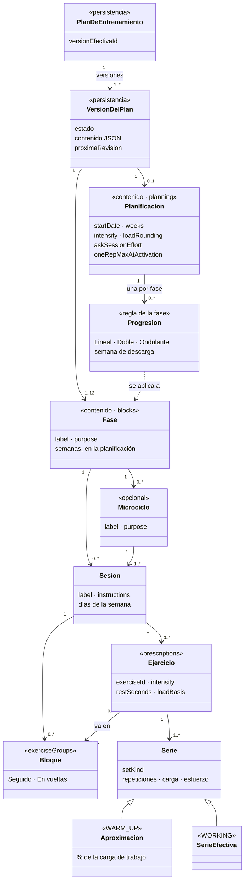

*Figura 5b: La jerarquía de un plan de entrenamiento, del plan a la serie. Fuente: packages/domain/src/contratos-entrenamiento.ts y prisma/schema.prisma.*

## 5.2 Los estados de una versión del plan

La versión del plan tiene tres estados en la base (`EstadoDeVersionDePlan`): `BORRADOR`, `ACTIVADA` y `DESCARTADA`. Mientras es borrador, se guarda sola y recalcula sus cargas en % RM cada vez que cambia el 1RM de referencia. «Revisar y activar…» la valida: lo que impide activar la frena (por ejemplo, fases que suman más semanas que el plan, o un ejercicio sin su objetivo de intensidad). Al activarse, queda inmutable: su instantánea guarda el contenido con el 1RM congelado de cada ejercicio, y el plan apunta a ella como su única versión vigente. Cuando una revisión decide «Ajustar» o «Sustituir», o el profesional ajusta el plan, nace un borrador sucesor; al activarlo, la anterior deja de ser la vigente, sin cambiar: sigue unida a lo que la persona registró mientras rigió.

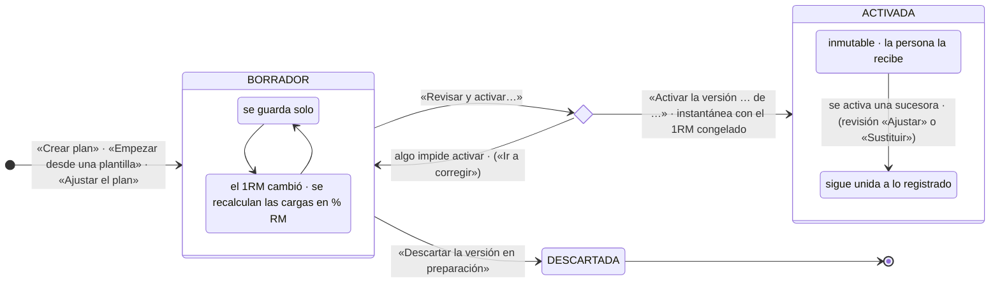

*Figura 5c: Los estados de una versión del plan de entrenamiento. La base rechaza cualquier cambio de una versión activada y cualquier vigencia que no pase a la sucesora activada de la anterior. Fuente: prisma/schema.prisma (`EstadoDeVersionDePlan`) y apps/api/src/entrenamiento/planes.service.ts.*

# Anexo A. La persistencia, módulo por módulo

*Las 168 clases de persistencia en los mismos trece módulos que el DER, con sus atributos propios y sus 334 asociaciones. Es el inventario generado del esquema.*

Cada módulo tiene su diagrama, con sus clases de persistencia y sus atributos propios. Una clase de otro módulo aparece sin atributos, solo para ubicar la asociación. Cada asociación se dibuja una vez, desde la clase que tiene la columna, con su multiplicidad.

**Tabla 6.** Los trece módulos de la persistencia: qué guarda cada uno, cuántas clases y cuántas asociaciones tiene.

| Módulo | Qué guarda | Clases | Asociaciones |
| --- | --- | --- | --- |
| P01 Identidad y acceso | La identidad, raíz del modelo: el perfil propio con sus versiones, los métodos de acceso, las sesiones y la recuperación del acceso. | 14 | 21 |
| P02 Administración, derechos y auditoría | La seguridad y la historia: el rol de Administración, el segundo factor, los derechos de la persona, la decisión de acceso, la auditoría, la idempotencia y las incidencias. | 17 | 23 |
| P03 Profesionales, vínculos y consentimiento | El profesional y su relación con la persona: el vínculo, un alcance por área y su consentimiento, con versiones. | 14 | 30 |
| P04 Proceso de acompañamiento | El seguimiento de un área con una persona en el tiempo: sus eventos, la próxima revisión y el cálculo de los ciclos de seguimiento cerrados en 30 días; y las notas propias del profesional, que solo lee su autor. | 6 | 19 |
| P05 Nutrición | El catálogo de alimentos, la evaluación, el objetivo y el plan en versiones, la comida registrada y la revisión. | 16 | 32 |
| P06 Recetas, fotos y registro de comidas | Las recetas, las fotos privadas y lo que completa el registro de comidas. | 13 | 24 |
| P07 Antropometría | Lo medido separado de lo calculado, con las entradas exactas de cada cálculo. | 11 | 22 |
| P08 Entrenamiento | El catálogo de ejercicios, la evaluación, el objetivo, el plan en versiones, la sesión en curso, la sesión registrada con su nota, la revisión y la fuerza estimada. | 20 | 45 |
| P09 Catálogos e importación | Lo que llega de un proveedor externo, que pasa por un candidato y una resolución antes de entrar al catálogo. | 17 | 36 |
| P10 Formularios y hábitos | Los formularios (pedido, propuesta, respuesta y rectificación) y los hábitos, que son de la persona. | 12 | 28 |
| P11 Lo que se comparte entre áreas | Lo que la persona decide compartir entre áreas y las notas de coordinación entre sus profesionales. | 8 | 22 |
| P12 Herramientas del profesional | Las herramientas del profesional: moldes y elementos habituales y las vistas de análisis que guarda, sin datos de ninguna persona. | 15 | 25 |
| P13 Novedades y avisos | Las novedades y los avisos al teléfono. | 5 | 7 |

### P01 Identidad y acceso

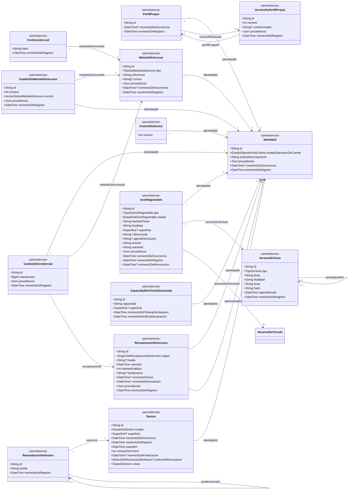

*Figuras 8 a 12: P01 Identidad y acceso, sus clases de persistencia con sus atributos propios y sus asociaciones. Las clases sin recuadro son de otro módulo. Generado del esquema.*

### P02 Administración, derechos y auditoría

```mermaid
classDiagram
  direction LR
  class RolAdministrativo {
    <<persistencia>>
    +String id
    +EstadoDeRolAdministrativo estado
    +String nombreVisible
    +String fundamento
    +String operador
    +Json procedencia
    +DateTime momentoDeOcurrencia
    +DateTime momentoDeRegistro
    +DateTime? momentoDeRetiro
    +String? fundamentoDelRetiro
    +String? operadorDelRetiro
  }
  class CodigoDeIncorporacion {
    <<persistencia>>
    +String id
    +String huella
    +MotivoDeCodigoDeIncorporacion motivo
    +String fundamento
    +String operador
    +DateTime venceEn
    +DateTime? momentoDeUso
    +DateTime? momentoDeAnulacion
    +Json procedencia
    +DateTime momentoDeRegistro
  }
  class FactorTotp {
    <<persistencia>>
    +String id
    +EstadoDeFactorTotp estado
    +String secretoCifrado
    +BigInt? ultimoPaso
    +Int fallosSeguidos
    +String? sesionDeConfiguracionId
    +DateTime? venceEn
    +DateTime? momentoDeActivacion
    +DateTime? momentoDeBaja
    +Json procedencia
    +DateTime momentoDeRegistro
  }
  class CodigoDeRecuperacion {
    <<persistencia>>
    +String id
    +String loteId
    +String huella
    +DateTime? momentoDeUso
    +String? sesionDeUsoId
    +DateTime? momentoDeInvalidacion
    +DateTime momentoDeRegistro
  }
  class SegundoFactorDeSesion {
    <<persistencia>>
    +String identidadId
    +DateTime? verificadoEn
    +MetodoDeSegundoFactor? metodo
    +DateTime? ultimaActividad
    +Int intentosFallidos
    +DateTime momentoDeRegistro
  }
  class RestablecimientoDeSegundoFactor {
    <<persistencia>>
    +String id
    +String fundamento
    +Json procedencia
    +DateTime? momentoDeOcurrencia
    +DateTime momentoDeRegistro
  }
  class PedidoDeDerecho {
    <<persistencia>>
    +String id
    +TipoDePedidoDeDerecho tipo
    +String? nota
    +EstadoDePedidoDeDerecho estado
    +DateTime plazo
    +String? respuesta
    +String? fundamento
    +DateTime? momentoDeResolucion
    +Json procedencia
    +DateTime? momentoDeOcurrencia
    +DateTime momentoDeRegistro
  }
  class ExportacionPropia {
    <<persistencia>>
    +String id
    +String dominios
    +DateTime venceEn
    +Json procedencia
    +DateTime momentoDeRegistro
  }
  class DecisionDeAcceso {
    <<persistencia>>
    +String id
    +BigInt secuencia
    +String operacion
    +ResultadoDeDecision resultado
    +Alcance alcance
    +Finalidad finalidad
    +DimensionDeAutorizacion dimensionesDesfavorables
    +String? versionDeMatriz
    +String? recursoTipo
    +String? recursoId
    +Superficie? superficie
    +String? requestId
    +DateTime momentoDeOcurrencia
    +DateTime momentoDeRegistro
  }
  class RegistroDeAuditoria {
    <<persistencia>>
    +String id
    +String operacion
    +ResultadoDeOperacion resultado
    +String? motivo
    +String? actorId
    +String? sujetoId
    +String? recursoTipo
    +String? recursoId
    +Superficie? superficie
    +String? requestId
    +DateTime? momentoDeOcurrencia
    +DateTime momentoDeRegistro
  }
  class RegistroDeIdempotencia {
    <<persistencia>>
    +String id
    +String operacion
    +String ambito
    +String clave
    +String huella
    +Int estadoHttp
    +Json cuerpo
    +Json? decisiones
    +DateTime momentoDeRegistro
  }
  class EventoDeDominio {
    <<persistencia>>
    +String id
    +TipoDeEventoDeDominio tipo
    +String? actorId
    +String? actorServicio
    +String? autoriaId
    +Json procedencia
    +EstadoOperativoDeCuenta? estadoAnterior
    +EstadoOperativoDeCuenta? estadoResultante
    +Json? datos
    +DateTime? momentoDeOcurrencia
    +DateTime momentoDeRegistro
  }
  class SolicitudDeCierreDeCuenta {
    <<persistencia>>
    +String id
    +String actorId
    +Json procedencia
    +DateTime momentoDeOcurrencia
    +DateTime momentoDeRegistro
  }
  class RegistroDeSupresion {
    <<persistencia>>
    +String id
    +String categoria
    +String sujetoId
    +String fundamento
    +String ejecutor
    +DateTime momentoDeOcurrencia
    +DateTime momentoDeRegistro
  }
  class Incidencia {
    <<persistencia>>
    +String id
    +CategoriaDeIncidencia categoria
    +String descripcion
    +EstadoDeIncidencia estado
    +Int version
    +Json procedencia
    +DateTime momentoDeRegistro
    +DateTime momentoDeActualizacion
  }
  class CambioDeIncidencia {
    <<persistencia>>
    +String id
    +Int numero
    +EstadoDeIncidencia estadoAnterior
    +EstadoDeIncidencia estadoNuevo
    +String motivo
    +String? respuesta
    +Json procedencia
    +DateTime momentoDeRegistro
  }
  class DecisionSobrePlantillaDeBe {
    <<persistencia>>
    +String id
    +String clave
    +EstadoDePlantillaDeBe estado
    +String? motivo
    +Json procedencia
    +DateTime momentoDeRegistro
  }
  RolAdministrativo "*" --> "1" Identidad : identidadId
  CodigoDeIncorporacion "*" --> "1" Identidad : identidadId
  FactorTotp "*" --> "1" Identidad : identidadId
  CodigoDeRecuperacion "*" --> "1" Identidad : identidadId
  SegundoFactorDeSesion "1" --> "1" Sesion : sesionId
  RestablecimientoDeSegundoFactor "*" --> "1" Identidad : identidadId
  RestablecimientoDeSegundoFactor "*" --> "1" Identidad : administradorId
  PedidoDeDerecho "*" --> "1" Identidad : titularId
  PedidoDeDerecho "*" --> "0..1" Identidad : administradorId
  ExportacionPropia "*" --> "1" Identidad : titularId
  DecisionDeAcceso "*" --> "1" Identidad : actorId
  DecisionDeAcceso "*" --> "0..1" Identidad : sujetoId
  DecisionDeAcceso "*" --> "0..1" AlcanceDeVinculo : alcanceDeVinculoId
  DecisionDeAcceso "*" --> "0..1" Consentimiento : consentimientoId
  DecisionDeAcceso "*" --> "0..1" VersionDeConsentimiento : versionDeConsentimientoId
  EventoDeDominio "*" --> "1" Identidad : identidadId
  SolicitudDeCierreDeCuenta "1" --> "1" Identidad : identidadId
  SolicitudDeCierreDeCuenta "*" --> "1" VersionDeTexto : versionDeConsecuenciasId
  Incidencia "*" --> "1" Identidad : reportanteId
  Incidencia "*" --> "0..1" Identidad : responsableId
  CambioDeIncidencia "*" --> "1" Incidencia : incidenciaId
  CambioDeIncidencia "*" --> "1" Identidad : administradorId
  DecisionSobrePlantillaDeBe "*" --> "1" Identidad : administradorId
```

*Figuras 13 a 19: P02 Administración, derechos y auditoría, sus clases de persistencia con sus atributos propios y sus asociaciones. Las clases sin recuadro son de otro módulo. Generado del esquema.*

### P03 Profesionales, vínculos y consentimiento

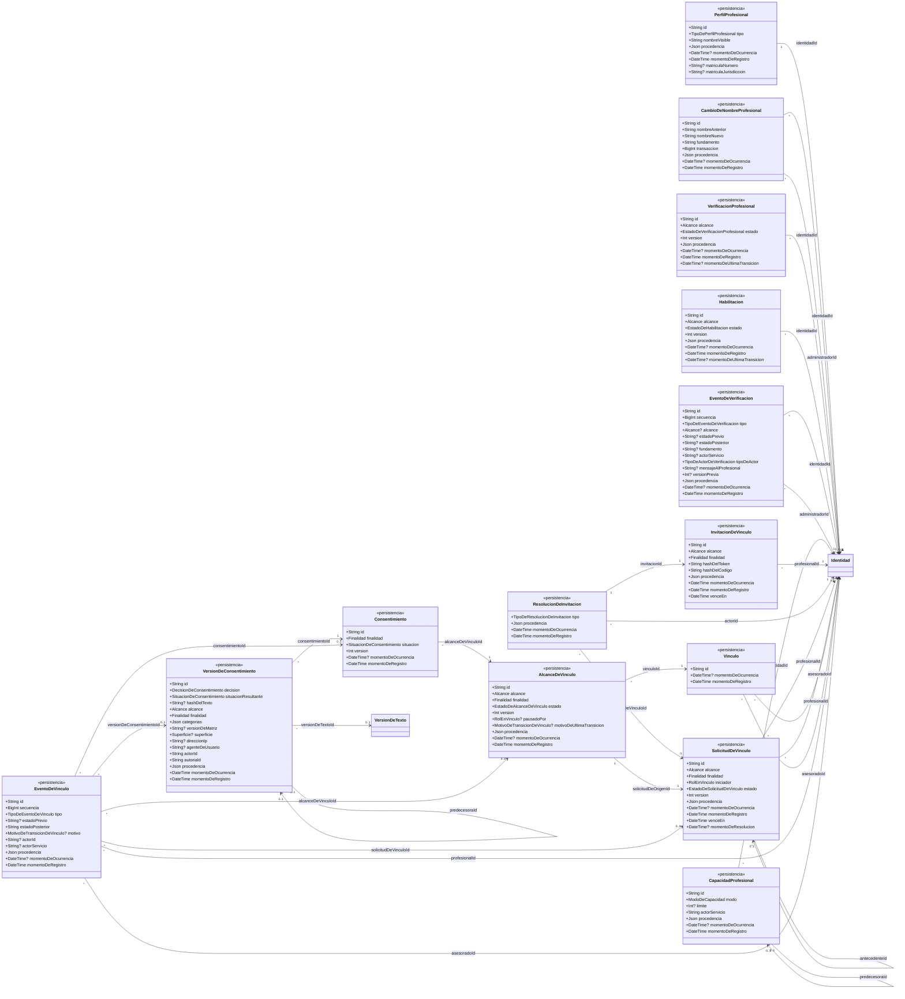

*Figuras 20 a 25: P03 Profesionales, vínculos y consentimiento, sus clases de persistencia con sus atributos propios y sus asociaciones. Las clases sin recuadro son de otro módulo. Generado del esquema.*

### P04 Proceso de acompañamiento

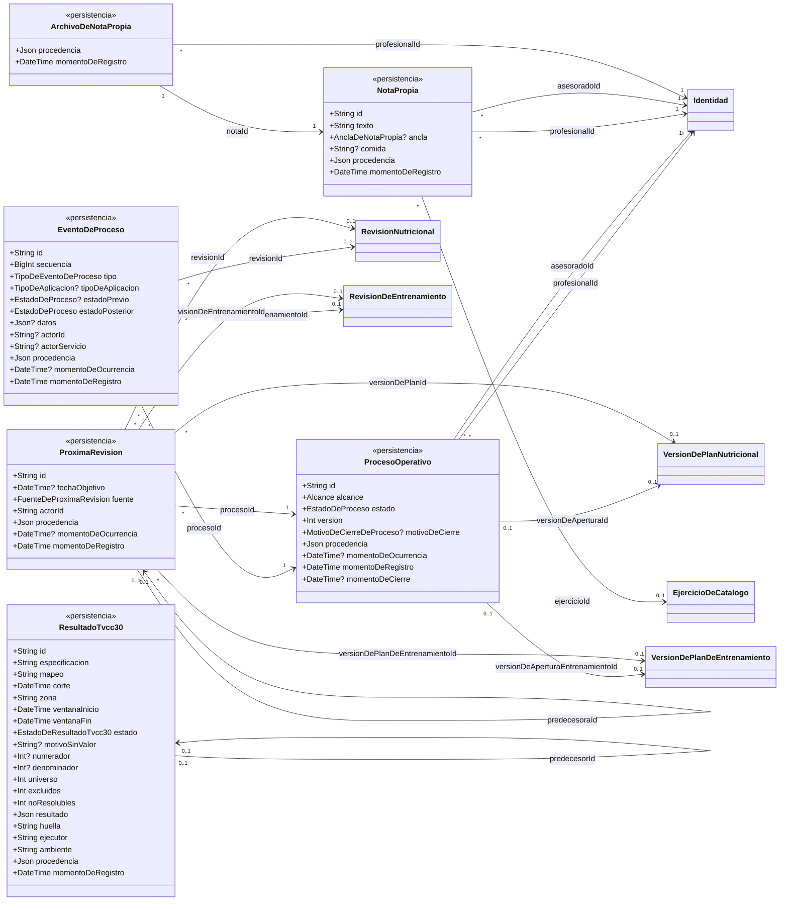

*Figuras 26 a 29: P04 Proceso de acompañamiento, sus clases de persistencia con sus atributos propios y sus asociaciones. Las clases sin recuadro son de otro módulo. Generado del esquema.*

### P05 Nutrición

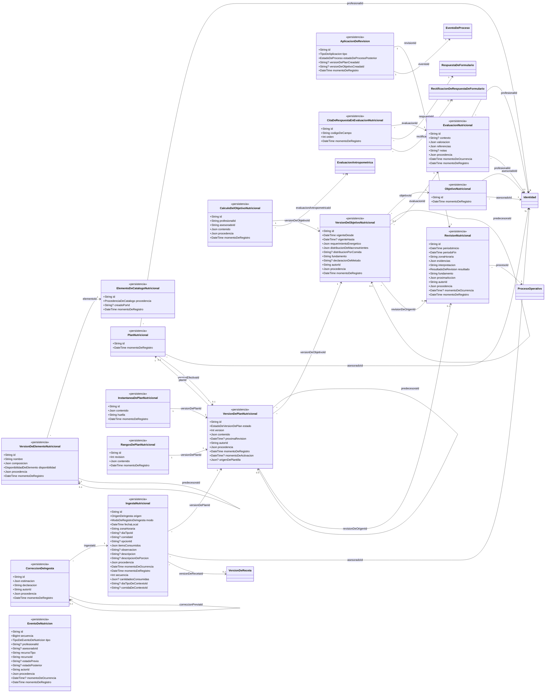

*Figuras 30 a 35: P05 Nutrición, sus clases de persistencia con sus atributos propios y sus asociaciones. Las clases sin recuadro son de otro módulo. Generado del esquema.*

### P06 Recetas, fotos y registro de comidas

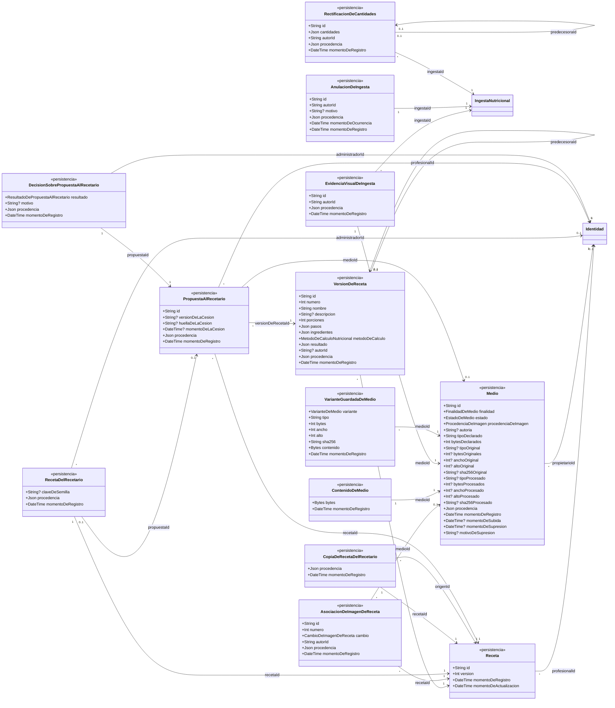

*Figuras 36 a 38: P06 Recetas, fotos y registro de comidas, sus clases de persistencia con sus atributos propios y sus asociaciones. Las clases sin recuadro son de otro módulo. Generado del esquema.*

### P07 Antropometría

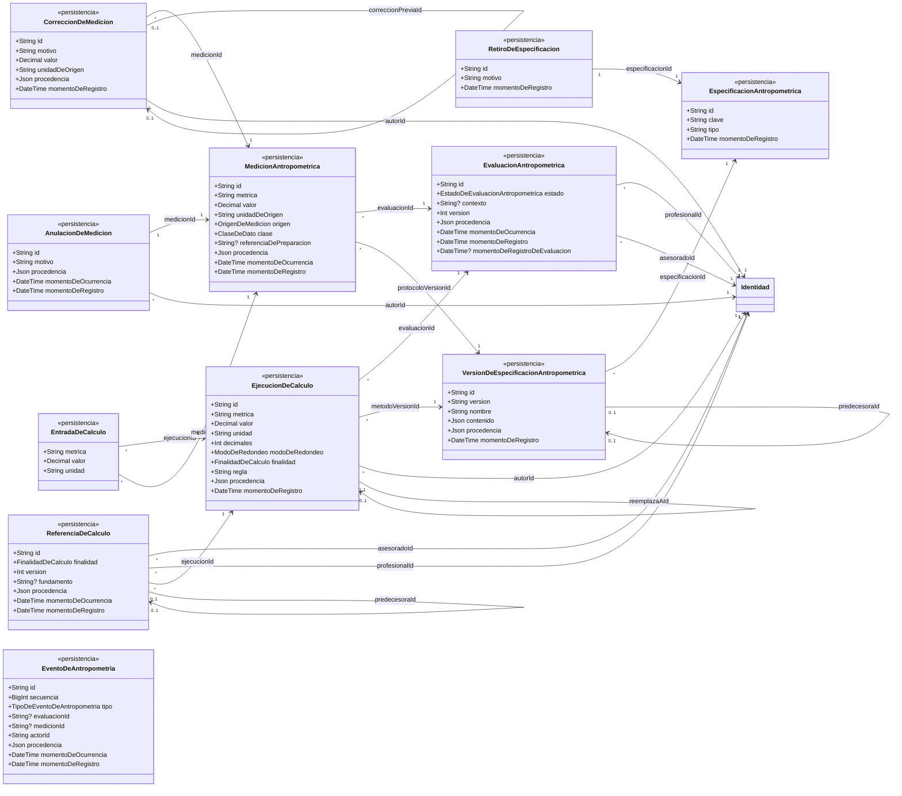

*Figuras 39 a 43: P07 Antropometría, sus clases de persistencia con sus atributos propios y sus asociaciones. Las clases sin recuadro son de otro módulo. Generado del esquema.*

### P08 Entrenamiento

```mermaid
classDiagram
  direction LR
  class EjercicioDeCatalogo {
    <<persistencia>>
    +String id
    +ProcedenciaDeCatalogo procedencia
    +DateTime momentoDeRegistro
  }
  class VersionDeEjercicio {
    <<persistencia>>
    +String id
    +String nombre
    +DisponibilidadDeElemento disponibilidad
    +Json procedencia
    +DateTime momentoDeRegistro
  }
  class EvaluacionDeEntrenamiento {
    <<persistencia>>
    +String id
    +Json valoracion
    +Json referencias
    +String? notas
    +String? contexto
    +Json procedencia
    +DateTime momentoDeOcurrencia
    +DateTime momentoDeRegistro
  }
  class CitaDeRespuestaEnEvaluacionDeEntrenamiento {
    <<persistencia>>
    +String id
    +String codigoDeCampo
    +Int orden
    +DateTime momentoDeRegistro
  }
  class ObjetivoDeEntrenamiento {
    <<persistencia>>
    +String id
    +DateTime momentoDeRegistro
  }
  class VersionDeObjetivoDeEntrenamiento {
    <<persistencia>>
    +String id
    +DateTime vigenteDesde
    +DateTime? vigenteHasta
    +Json objetivo
    +String fundamento
    +String autorId
    +Json procedencia
    +DateTime momentoDeRegistro
  }
  class PlanDeEntrenamiento {
    <<persistencia>>
    +String id
    +DateTime momentoDeRegistro
  }
  class VersionDePlanDeEntrenamiento {
    <<persistencia>>
    +String id
    +EstadoDeVersionDePlan estado
    +Int version
    +Json contenido
    +DateTime? proximaRevision
    +String autorId
    +Json procedencia
    +DateTime momentoDeRegistro
    +DateTime? momentoDeActivacion
    +Json? origenDePlantilla
  }
  class InstantaneaDePlanDeEntrenamiento {
    <<persistencia>>
    +String id
    +Json contenido
    +String huella
    +DateTime momentoDeRegistro
  }
  class BorradorDeEjecucionDeEntrenamiento {
    <<persistencia>>
    +String id
    +String sesionPlanificadaId
    +DateTime fechaLocal
    +String zonaHoraria
    +GranularidadDeRegistro? granularidad
    +CondicionDeSesion? condicion
    +String? motivo
    +Json contenido
    +DateTime? momentoDeOcurrencia
    +Int version
    +DateTime momentoDeRegistro
    +DateTime momentoDeActualizacion
  }
  class EventoDeTiempoDeEntrenamiento {
    <<persistencia>>
    +String id
    +String asesoradoId
    +String corridaId
    +Int secuencia
    +String eventoId
    +TipoDeEventoDeTiempo tipo
    +Json contenido
    +DateTime instanteCivil
    +String? anclaMonotonica
    +Float? msMonotonicos
    +BaseDelReloj? baseDelReloj
    +OrigenDelInstante origenDelInstante
    +Int? descansoRecomendadoSegundos
    +Json procedencia
    +DateTime momentoDeRecepcion
  }
  class EjecucionDeEntrenamiento {
    <<persistencia>>
    +String id
    +String sesionPlanificadaId
    +DateTime fechaLocal
    +String zonaHoraria
    +GranularidadDeRegistro? granularidad
    +CondicionDeSesion condicion
    +String? motivo
    +Json contenido
    +Json procedencia
    +DateTime momentoDeOcurrencia
    +DateTime momentoDeRegistro
  }
  class CorreccionDeEjecucionDeEntrenamiento {
    <<persistencia>>
    +String id
    +String motivo
    +Json contenido
    +Json procedencia
    +DateTime momentoDeRegistro
  }
  class NotaDeEjecucion {
    <<persistencia>>
    +String id
    +String texto
    +Json procedencia
    +DateTime momentoDeRegistro
  }
  class RevisionDeEntrenamiento {
    <<persistencia>>
    +String id
    +DateTime periodoInicio
    +DateTime periodoFin
    +String zonaHoraria
    +Json evidencias
    +String interpretacion
    +ResultadoDeRevision resultado
    +String fundamento
    +Json proximaAccion
    +String autorId
    +Json procedencia
    +DateTime? momentoDeOcurrencia
    +DateTime momentoDeRegistro
  }
  class AplicacionDeRevisionDeEntrenamiento {
    <<persistencia>>
    +String id
    +TipoDeAplicacion tipo
    +EstadoDeProceso estadoDeProcesoPosterior
    +String? versionDePlanCreadaId
    +String? versionDeObjetivoCreadaId
    +DateTime momentoDeRegistro
  }
  class EventoDeEntrenamiento {
    <<persistencia>>
    +String id
    +BigInt secuencia
    +TipoDeEventoDeEntrenamiento tipo
    +String? profesionalId
    +String? asesoradoId
    +String recursoTipo
    +String recursoId
    +String? estadoPrevio
    +String? estadoPosterior
    +String actorId
    +Json procedencia
    +DateTime? momentoDeOcurrencia
    +DateTime momentoDeRegistro
  }
  class SerieObservada {
    <<persistencia>>
    +String id
    +DateTime fechaLocal
    +String zonaHoraria
    +Float? carga
    +String? unidad
    +Int? repeticiones
    +Float? rir
    +String? nota
    +Json? estimacion
    +TipoDeSerieObservada tipo
    +String? motivo
    +Int posicion
    +Json procedencia
    +DateTime momentoDeRegistro
  }
  class UnoRMDeReferencia {
    <<persistencia>>
    +String id
    +OrigenDelUnoRM origen
    +Float valor
    +String unidad
    +DateTime fechaLocal
    +Json? serie
    +Json? metodo
    +String? banda
    +Json? registro
    +String? nota
    +Json procedencia
    +DateTime momentoDeRegistro
  }
  class EsfuerzoDeSesionDeEntrenamiento {
    <<persistencia>>
    +String id
    +Int valor
    +Int? minutos
    +String? origenDeMinutos
    +Json procedencia
    +DateTime momentoDeRegistro
  }
  EjercicioDeCatalogo "*" --> "0..1" Identidad : creadoPorId
  VersionDeEjercicio "*" --> "1" EjercicioDeCatalogo : ejercicioId
  VersionDeEjercicio "0..1" --> "0..1" VersionDeEjercicio : predecesoraId
  EvaluacionDeEntrenamiento "*" --> "1" Identidad : profesionalId
  EvaluacionDeEntrenamiento "*" --> "1" Identidad : asesoradoId
  CitaDeRespuestaEnEvaluacionDeEntrenamiento "*" --> "1" EvaluacionDeEntrenamiento : evaluacionId
  CitaDeRespuestaEnEvaluacionDeEntrenamiento "*" --> "1" RespuestaDeFormulario : respuestaId
  CitaDeRespuestaEnEvaluacionDeEntrenamiento "*" --> "0..1" RectificacionDeRespuestaDeFormulario : rectificacionId
  ObjetivoDeEntrenamiento "*" --> "1" Identidad : profesionalId
  ObjetivoDeEntrenamiento "*" --> "1" Identidad : asesoradoId
  VersionDeObjetivoDeEntrenamiento "*" --> "1" ObjetivoDeEntrenamiento : objetivoId
  VersionDeObjetivoDeEntrenamiento "0..1" --> "0..1" VersionDeObjetivoDeEntrenamiento : predecesoraId
  VersionDeObjetivoDeEntrenamiento "*" --> "1" EvaluacionDeEntrenamiento : evaluacionId
  VersionDeObjetivoDeEntrenamiento "*" --> "0..1" RevisionDeEntrenamiento : revisionDeOrigenId
  PlanDeEntrenamiento "*" --> "1" Identidad : profesionalId
  PlanDeEntrenamiento "*" --> "1" Identidad : asesoradoId
  PlanDeEntrenamiento "0..1" --> "0..1" VersionDePlanDeEntrenamiento : versionEfectivaId
  VersionDePlanDeEntrenamiento "*" --> "1" PlanDeEntrenamiento : planId
  VersionDePlanDeEntrenamiento "*" --> "0..1" VersionDePlanDeEntrenamiento : predecesoraId
  VersionDePlanDeEntrenamiento "*" --> "1" VersionDeObjetivoDeEntrenamiento : versionDeObjetivoId
  VersionDePlanDeEntrenamiento "*" --> "0..1" RevisionDeEntrenamiento : revisionDeOrigenId
  InstantaneaDePlanDeEntrenamiento "1" --> "1" VersionDePlanDeEntrenamiento : versionDePlanId
  BorradorDeEjecucionDeEntrenamiento "*" --> "1" Identidad : asesoradoId
  BorradorDeEjecucionDeEntrenamiento "*" --> "1" VersionDePlanDeEntrenamiento : versionDePlanId
  EventoDeTiempoDeEntrenamiento "*" --> "1" BorradorDeEjecucionDeEntrenamiento : borradorId
  EjecucionDeEntrenamiento "*" --> "1" Identidad : asesoradoId
  EjecucionDeEntrenamiento "*" --> "1" VersionDePlanDeEntrenamiento : versionDePlanId
  EjecucionDeEntrenamiento "1" --> "1" BorradorDeEjecucionDeEntrenamiento : borradorId
  CorreccionDeEjecucionDeEntrenamiento "*" --> "1" EjecucionDeEntrenamiento : ejecucionId
  CorreccionDeEjecucionDeEntrenamiento "0..1" --> "0..1" CorreccionDeEjecucionDeEntrenamiento : correccionPreviaId
  CorreccionDeEjecucionDeEntrenamiento "*" --> "1" Identidad : autorId
  NotaDeEjecucion "*" --> "1" EjecucionDeEntrenamiento : ejecucionId
  NotaDeEjecucion "*" --> "1" Identidad : asesoradoId
  RevisionDeEntrenamiento "*" --> "1" ProcesoOperativo : procesoId
  AplicacionDeRevisionDeEntrenamiento "1" --> "1" RevisionDeEntrenamiento : revisionId
  AplicacionDeRevisionDeEntrenamiento "1" --> "1" EventoDeProceso : eventoId
  SerieObservada "*" --> "1" Identidad : profesionalId
  SerieObservada "*" --> "1" Identidad : asesoradoId
  SerieObservada "*" --> "1" EjercicioDeCatalogo : ejercicioId
  SerieObservada "0..1" --> "0..1" SerieObservada : predecesoraId
  UnoRMDeReferencia "*" --> "1" Identidad : profesionalId
  UnoRMDeReferencia "*" --> "1" Identidad : asesoradoId
  UnoRMDeReferencia "*" --> "1" EjercicioDeCatalogo : ejercicioId
  EsfuerzoDeSesionDeEntrenamiento "1" --> "1" EjecucionDeEntrenamiento : ejecucionId
  EsfuerzoDeSesionDeEntrenamiento "*" --> "1" Identidad : asesoradoId
```

*Figuras 44 a 51: P08 Entrenamiento, sus clases de persistencia con sus atributos propios y sus asociaciones. Las clases sin recuadro son de otro módulo. Generado del esquema.*

### P09 Catálogos e importación

```mermaid
classDiagram
  direction LR
  class CandidatoDeImportacion {
    <<persistencia>>
    +String id
    +Alcance alcance
    +ProveedorExterno proveedor
    +String idExterno
    +Json contenido
    +String huellaDeLoRecibido
    +Json licencia
    +String urlDeOrigen
    +DateTime recibidoEn
    +DateTime venceEn
    +Json procedencia
    +DateTime momentoDeRegistro
  }
  class ResolucionDeCandidato {
    <<persistencia>>
    +String id
    +DecisionDeImportacion decision
    +Json? contenidoRevisado
    +Json camposCorregidos
    +String? fundamento
    +String? versionCreadaId
    +Json procedencia
    +DateTime momentoDeRegistro
  }
  class ItemExternoDeCatalogo {
    <<persistencia>>
    +ProveedorExterno proveedor
    +String idExterno
    +Json procedencia
    +DateTime momentoDeRegistro
  }
  class NombreAlternativoDeAlimento {
    <<persistencia>>
    +String id
    +String nombre
    +IdiomaDeNombre idioma
    +String? region
    +OrigenDeNombreAlternativo origen
    +ProveedorExterno? proveedor
    +Json procedencia
    +DateTime momentoDeRegistro
  }
  class RetiroDeNombreAlternativoDeAlimento {
    <<persistencia>>
    +String motivo
    +Json procedencia
    +DateTime momentoDeRegistro
  }
  class NombreAlternativoDeEjercicio {
    <<persistencia>>
    +String id
    +String nombre
    +IdiomaDeNombre idioma
    +String? region
    +OrigenDeNombreAlternativo origen
    +ProveedorExterno? proveedor
    +Json procedencia
    +DateTime momentoDeRegistro
  }
  class RetiroDeNombreAlternativoDeEjercicio {
    <<persistencia>>
    +String motivo
    +Json procedencia
    +DateTime momentoDeRegistro
  }
  class AsociacionDeImagenDeEjercicio {
    <<persistencia>>
    +String id
    +Int numero
    +CambioDeImagenDeEjercicio cambio
    +String? textoAlternativo
    +Json? licencia
    +RevisionTecnicaDeImagen? revisionTecnica
    +String autorId
    +Json procedencia
    +DateTime momentoDeRegistro
  }
  class ZonaMuscular {
    <<persistencia>>
    +String id
    +String nombre
    +VistaAnatomica vistasAnatomicas
    +String versionDelCatalogo
    +DateTime momentoDeRegistro
  }
  class AsignacionDeZonasDeEjercicio {
    <<persistencia>>
    +String id
    +Int numero
    +Json procedencia
    +DateTime momentoDeRegistro
  }
  class ZonaDeEjercicio {
    <<persistencia>>
    +RolDeZonaMuscular rol
  }
  class GrupoDeAlimentoAsignado {
    <<persistencia>>
    +String id
    +Int numero
    +GrupoDeAlimento grupo
    +Json procedencia
    +DateTime momentoDeRegistro
  }
  class AlimentoCompartido {
    <<persistencia>>
    +Json procedencia
    +DateTime momentoDeRegistro
  }
  class AlimentoDelCanon {
    <<persistencia>>
    +String fuente
    +Json procedencia
    +DateTime momentoDeRegistro
  }
  class MedidasCaserasDeAlimento {
    <<persistencia>>
    +String id
    +Int numero
    +Json medidas
    +Json procedencia
    +DateTime momentoDeRegistro
  }
  class RevisionAdministrativaDeAlimento {
    <<persistencia>>
    +String id
    +Int numero
    +ResultadoDeRevisionDeAlimento resultado
    +String? fuente
    +Json procedencia
    +DateTime momentoDeRegistro
  }
  class ClasificacionDeEjercicio {
    <<persistencia>>
    +String id
    +Int numero
    +GrupoMuscularDeEjercicio? grupoMuscular
    +EquipamientoDeEjercicio equipamiento
    +PatronDeMovimiento? patron
    +ArticulacionesDeEjercicio? articulaciones
    +Json procedencia
    +DateTime momentoDeRegistro
  }
  CandidatoDeImportacion "*" --> "1" Identidad : profesionalId
  ResolucionDeCandidato "1" --> "1" CandidatoDeImportacion : candidatoId
  ResolucionDeCandidato "*" --> "1" Identidad : autorId
  ResolucionDeCandidato "*" --> "0..1" ElementoDeCatalogoNutricional : elementoNutricionalId
  ResolucionDeCandidato "*" --> "0..1" EjercicioDeCatalogo : ejercicioId
  ItemExternoDeCatalogo "0..1" --> "0..1" ElementoDeCatalogoNutricional : elementoNutricionalId
  ItemExternoDeCatalogo "0..1" --> "0..1" EjercicioDeCatalogo : ejercicioId
  NombreAlternativoDeAlimento "*" --> "1" ElementoDeCatalogoNutricional : elementoId
  NombreAlternativoDeAlimento "*" --> "0..1" Identidad : profesionalId
  RetiroDeNombreAlternativoDeAlimento "1" --> "1" NombreAlternativoDeAlimento : nombreId
  RetiroDeNombreAlternativoDeAlimento "*" --> "0..1" Identidad : profesionalId
  NombreAlternativoDeEjercicio "*" --> "1" EjercicioDeCatalogo : ejercicioId
  NombreAlternativoDeEjercicio "*" --> "0..1" Identidad : profesionalId
  RetiroDeNombreAlternativoDeEjercicio "1" --> "1" NombreAlternativoDeEjercicio : nombreId
  RetiroDeNombreAlternativoDeEjercicio "*" --> "0..1" Identidad : profesionalId
  AsociacionDeImagenDeEjercicio "*" --> "1" EjercicioDeCatalogo : ejercicioId
  AsociacionDeImagenDeEjercicio "*" --> "1" VersionDeEjercicio : versionDeEjercicioId
  AsociacionDeImagenDeEjercicio "*" --> "0..1" Medio : medioId
  AsignacionDeZonasDeEjercicio "*" --> "1" EjercicioDeCatalogo : ejercicioId
  AsignacionDeZonasDeEjercicio "*" --> "1" VersionDeEjercicio : versionDeEjercicioId
  AsignacionDeZonasDeEjercicio "*" --> "0..1" Identidad : autorId
  ZonaDeEjercicio "*" --> "1" AsignacionDeZonasDeEjercicio : asignacionId
  ZonaDeEjercicio "*" --> "1" ZonaMuscular : zonaId
  GrupoDeAlimentoAsignado "*" --> "1" ElementoDeCatalogoNutricional : elementoId
  GrupoDeAlimentoAsignado "*" --> "0..1" Identidad : autorId
  AlimentoCompartido "1" --> "1" ElementoDeCatalogoNutricional : elementoId
  AlimentoDelCanon "1" --> "1" ElementoDeCatalogoNutricional : elementoId
  AlimentoDelCanon "*" --> "0..1" ElementoDeCatalogoNutricional : origenId
  AlimentoDelCanon "*" --> "1" Identidad : administradorId
  MedidasCaserasDeAlimento "*" --> "1" ElementoDeCatalogoNutricional : elementoId
  MedidasCaserasDeAlimento "*" --> "0..1" Identidad : autorId
  RevisionAdministrativaDeAlimento "*" --> "1" ElementoDeCatalogoNutricional : elementoId
  RevisionAdministrativaDeAlimento "*" --> "1" VersionDeElementoNutricional : versionId
  RevisionAdministrativaDeAlimento "*" --> "0..1" ElementoDeCatalogoNutricional : equivalenteId
  RevisionAdministrativaDeAlimento "*" --> "1" Identidad : administradorId
  ClasificacionDeEjercicio "*" --> "1" EjercicioDeCatalogo : ejercicioId
```

*Figuras 52 a 55: P09 Catálogos e importación, sus clases de persistencia con sus atributos propios y sus asociaciones. Las clases sin recuadro son de otro módulo. Generado del esquema.*

### P10 Formularios y hábitos

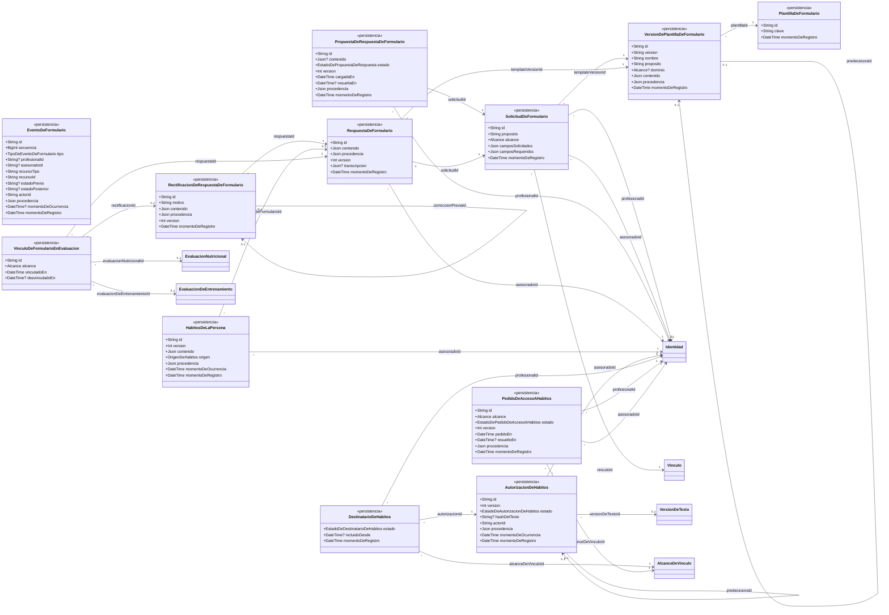

*Figuras 56 a 60: P10 Formularios y hábitos, sus clases de persistencia con sus atributos propios y sus asociaciones. Las clases sin recuadro son de otro módulo. Generado del esquema.*

### P11 Lo que se comparte entre áreas

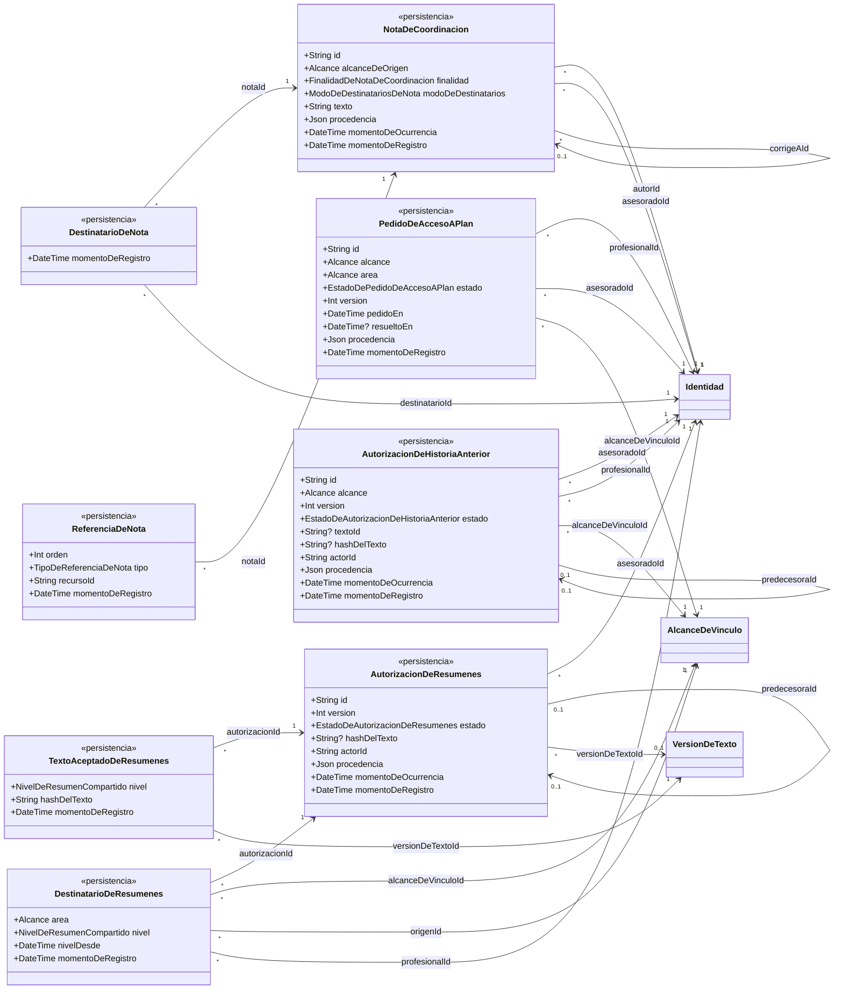

*Figuras 61 a 62: P11 Lo que se comparte entre áreas, sus clases de persistencia con sus atributos propios y sus asociaciones. Las clases sin recuadro son de otro módulo. Generado del esquema.*

### P12 Herramientas del profesional

```mermaid
classDiagram
  direction LR
  class PlantillaDePlanDeEntrenamiento {
    <<persistencia>>
    +String id
    +String nombre
    +String nombreNormalizado
    +String? descripcion
    +EstadoDePlantilla estado
    +Int version
    +DateTime momentoDeRegistro
    +DateTime momentoDeActualizacion
  }
  class VersionDePlantillaDePlanDeEntrenamiento {
    <<persistencia>>
    +String id
    +Int numero
    +Json estructura
    +Json? planificacion
    +CargasDePlantilla cargas
    +Json? origen
    +Json procedencia
    +DateTime momentoDeRegistro
  }
  class PlantillaDePlanNutricional {
    <<persistencia>>
    +String id
    +String nombre
    +String nombreNormalizado
    +String? descripcion
    +EstadoDePlantilla estado
    +Int version
    +DateTime momentoDeRegistro
    +DateTime momentoDeActualizacion
  }
  class VersionDePlantillaDePlanNutricional {
    <<persistencia>>
    +String id
    +Int numero
    +Json estructura
    +CantidadesDePlantilla cantidades
    +Json? origen
    +Json procedencia
    +DateTime momentoDeRegistro
  }
  class EjercicioHabitual {
    <<persistencia>>
    +String id
    +EstadoDeHabitual estado
    +DateTime momentoDeRegistro
    +DateTime momentoDeActualizacion
  }
  class SesionHabitual {
    <<persistencia>>
    +String id
    +String nombre
    +String nombreNormalizado
    +Json estructura
    +CargasDePlantilla cargas
    +EstadoDeHabitual estado
    +Int version
    +Json procedencia
    +DateTime momentoDeRegistro
    +DateTime momentoDeActualizacion
  }
  class AlimentoHabitual {
    <<persistencia>>
    +String id
    +EstadoDeHabitual estado
    +DateTime momentoDeRegistro
    +DateTime momentoDeActualizacion
  }
  class ComidaHabitual {
    <<persistencia>>
    +String id
    +String nombre
    +String nombreNormalizado
    +Json estructura
    +CantidadesDePlantilla cantidades
    +EstadoDeHabitual estado
    +Int version
    +Json procedencia
    +DateTime momentoDeRegistro
    +DateTime momentoDeActualizacion
  }
  class VistaDeAnalisis {
    <<persistencia>>
    +String id
    +String nombre
    +UsoDeVistaDeAnalisis uso
    +Json configuracion
    +Int version
    +Json procedencia
    +DateTime momentoDeRegistro
    +DateTime momentoDeActualizacion
  }
  class PrescripcionHabitual {
    <<persistencia>>
    +String id
    +String nombre
    +String nombreNormalizado
    +Json prescripcion
    +EstadoDeHabitual estado
    +Int version
    +Json procedencia
    +DateTime momentoDeRegistro
    +DateTime momentoDeActualizacion
  }
  class RepartoHabitual {
    <<persistencia>>
    +String id
    +String nombre
    +String nombreNormalizado
    +Json reparto
    +EstadoDeHabitual estado
    +Int version
    +Json procedencia
    +DateTime momentoDeRegistro
    +DateTime momentoDeActualizacion
  }
  class PreparacionDePlantillaDeEntrenamiento {
    <<persistencia>>
    +String id
    +String? nombre
    +String? descripcion
    +Json estructura
    +Json? planificacion
    +CargasDePlantilla cargas
    +Int version
    +Json procedencia
    +DateTime momentoDeRegistro
    +DateTime momentoDeActualizacion
  }
  class ConjuntoDeGraficos {
    <<persistencia>>
    +String id
    +String nombre
    +Json contenido
    +Int version
    +Json procedencia
    +DateTime momentoDeRegistro
    +DateTime momentoDeActualizacion
  }
  class EleccionDeConjuntoDeGraficos {
    <<persistencia>>
    +String id
    +AmbitoDeEleccionDeGraficos ambito
    +Int version
    +Json procedencia
    +DateTime momentoDeRegistro
    +DateTime momentoDeActualizacion
  }
  class RecorridoGuiadoVisto {
    <<persistencia>>
    +String recorrido
    +EstadoDelRecorridoGuiado estado
    +Json procedencia
    +DateTime momentoDeActualizacion
  }
  PlantillaDePlanDeEntrenamiento "*" --> "1" Identidad : profesionalId
  VersionDePlantillaDePlanDeEntrenamiento "*" --> "1" PlantillaDePlanDeEntrenamiento : plantillaId
  VersionDePlantillaDePlanDeEntrenamiento "*" --> "1" Identidad : autorId
  PlantillaDePlanNutricional "*" --> "1" Identidad : profesionalId
  VersionDePlantillaDePlanNutricional "*" --> "1" PlantillaDePlanNutricional : plantillaId
  VersionDePlantillaDePlanNutricional "*" --> "1" Identidad : autorId
  EjercicioHabitual "*" --> "1" Identidad : profesionalId
  EjercicioHabitual "*" --> "1" EjercicioDeCatalogo : ejercicioId
  SesionHabitual "*" --> "1" Identidad : profesionalId
  AlimentoHabitual "*" --> "1" Identidad : profesionalId
  AlimentoHabitual "*" --> "1" ElementoDeCatalogoNutricional : elementoId
  ComidaHabitual "*" --> "1" Identidad : profesionalId
  VistaDeAnalisis "*" --> "1" Identidad : profesionalId
  PrescripcionHabitual "*" --> "1" Identidad : profesionalId
  RepartoHabitual "*" --> "1" Identidad : profesionalId
  PreparacionDePlantillaDeEntrenamiento "*" --> "1" Identidad : profesionalId
  PreparacionDePlantillaDeEntrenamiento "0..1" --> "0..1" PlantillaDePlanDeEntrenamiento : plantillaId
  PreparacionDePlantillaDeEntrenamiento "*" --> "0..1" VersionDePlantillaDePlanDeEntrenamiento : versionBaseId
  ConjuntoDeGraficos "*" --> "1" Identidad : profesionalId
  EleccionDeConjuntoDeGraficos "*" --> "1" Identidad : profesionalId
  EleccionDeConjuntoDeGraficos "*" --> "1" Identidad : asesoradoId
  EleccionDeConjuntoDeGraficos "*" --> "0..1" PlanDeEntrenamiento : planDeEntrenamientoId
  EleccionDeConjuntoDeGraficos "*" --> "0..1" PlanNutricional : planNutricionalId
  EleccionDeConjuntoDeGraficos "*" --> "1" ConjuntoDeGraficos : conjuntoId
  RecorridoGuiadoVisto "*" --> "1" Identidad : identidadId
```

*Figuras 63 a 65: P12 Herramientas del profesional, sus clases de persistencia con sus atributos propios y sus asociaciones. Las clases sin recuadro son de otro módulo. Generado del esquema.*

### P13 Novedades y avisos

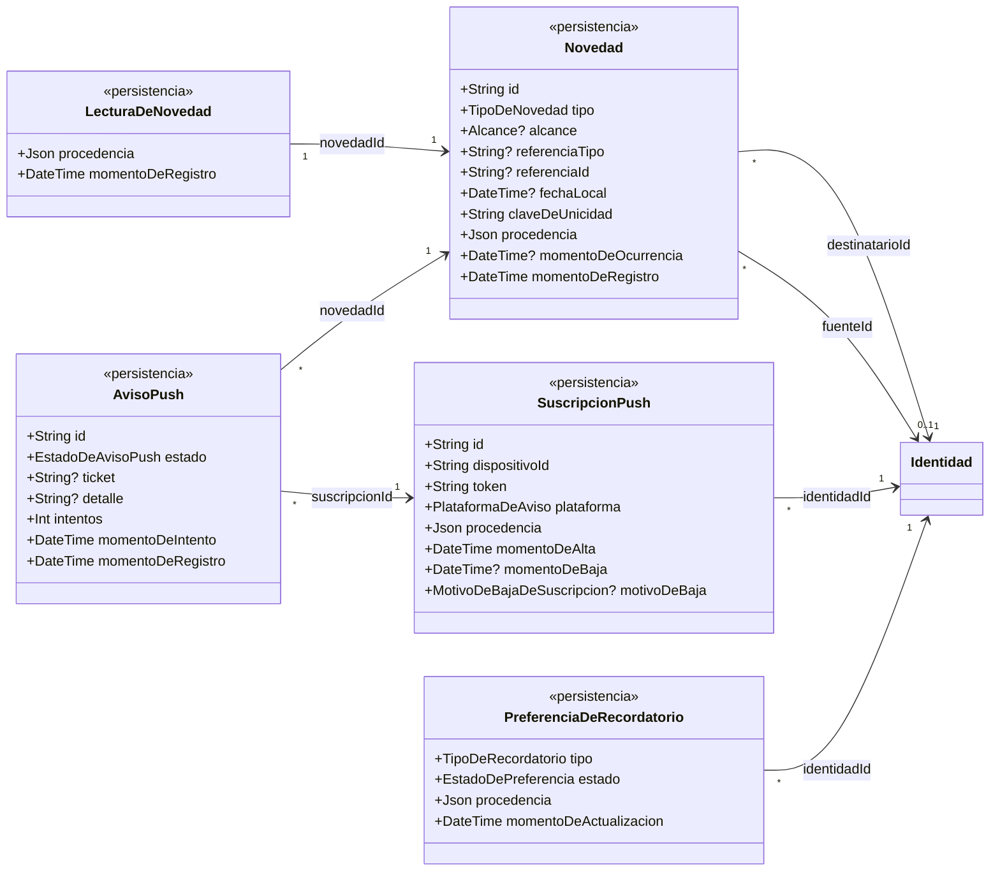

*Figuras 66 a 66: P13 Novedades y avisos, sus clases de persistencia con sus atributos propios y sus asociaciones. Las clases sin recuadro son de otro módulo. Generado del esquema.*

# Anexo B. Las clases de la API, módulo por módulo

*Los 50 controladores y las 123 clases inyectables de la API, cada uno como una caja UML: su estereotipo, sus métodos públicos y con quién colabora. Es el inventario generado del código.*

Cada ficha tiene tres partes, como una clase en UML: arriba, el estereotipo (controlador, servicio, ejecutor, guard o adaptador) y el nombre; en el medio, los métodos públicos (en un controlador, cuántas operaciones HTTP atiende); abajo, con quién colabora. **Recibe** son las clases inyectables que le llegan por el constructor; **Persistencia**, las clases de persistencia que su archivo lee o escribe; **Le delegan**, los controladores que la llaman. Los ejecutores no tienen métodos propios: heredan los de `EjecutorDeDominio`.

Cada controlador dice qué guards lo protegen, contados operación por operación: los de la clase y los de cada método. Una operación sin guard de sesión es pública por su naturaleza (entrar, con contraseña o con Google; registrarse; recuperar el acceso; leer un texto legal publicado, el canal de contacto o el estado del servicio) o se autoriza de otra forma: el servicio valida la sesión él mismo (reanudarla con su cookie, cerrarla o pedir el cierre de la cuenta), una ruta firmada que vence (una foto o una exportación) o el secreto de la tarea programada de los recordatorios.

**Tabla 7.** La API por módulo: controladores, clases inyectables y rutas HTTP.

| Módulo | Controladores | Clases | Rutas HTTP |
| --- | --- | --- | --- |
| Sesión | 2 | 5 | 10 |
| Acceso con Google | 2 | 3 | 6 |
| Identidad | 2 | 6 | 8 |
| Recuperación del acceso | 1 | 1 | 2 |
| Derechos de la persona | 1 | 2 | 6 |
| Administración | 1 | 5 | 31 |
| Incidencias | 1 | 1 | 2 |
| Profesional | 0 | 2 | 0 |
| Vínculo | 2 | 3 | 14 |
| Consentimiento | 2 | 4 | 12 |
| Autorización (PDP) | 0 | 2 | 0 |
| Plataforma | 0 | 6 | 0 |
| Prisma | 0 | 1 | 0 |
| Proceso | 0 | 1 | 0 |
| Nutrición | 6 | 16 | 69 |
| Entrenamiento | 7 | 18 | 82 |
| Antropometría | 1 | 7 | 20 |
| Formularios | 3 | 8 | 25 |
| Medios | 2 | 3 | 5 |
| Integraciones | 0 | 2 | 0 |
| Novedades | 2 | 5 | 7 |
| Coordinación | 1 | 2 | 3 |
| Resúmenes | 1 | 2 | 9 |
| Análisis | 2 | 2 | 7 |
| Notas propias | 1 | 2 | 3 |
| Cartera | 1 | 0 | 2 |
| Tablero | 1 | 0 | 1 |
| Contacto | 1 | 0 | 1 |
| Salud del servicio | 1 | 1 | 3 |
| Compartir | 1 | 2 | 3 |
| Contexto de la persona | 1 | 2 | 2 |
| Evaluación con formularios | 1 | 2 | 4 |
| Gráficos (enfoques) | 1 | 2 | 7 |
| Historia anterior | 1 | 2 | 4 |
| HTTP (global) | 0 | 2 | 0 |
| Recorridos guiados | 1 | 1 | 2 |
| **Total** | **50** | **123** | **350** |

Las rutas son los decoradores HTTP de los controladores: 350, con las de salud del servicio. El contrato publicado (`docs/api/openapi.json`) tiene 346 operaciones.

Cartera y el tablero resuelven sus lecturas con funciones, sin clases inyectables propias, y Contacto solo expone un controlador. Profesional, Autorización (PDP), Plataforma, Prisma, Proceso y Integraciones no tienen operaciones HTTP propias: sus clases las usan los demás módulos. `SolicitudesService` existe dos veces, en Vínculo y en Formularios: son clases distintas con el mismo nombre.

### Sesión · 2 controladores · 5 clases inyectables

#### SegundoFactorDeLaSesionController «controlador · Sesión»

- 6 operaciones HTTP
- protegido por SesionGuard

- **Delega en:** SegundoFactorDeLaSesionService

#### SesionesController «controlador · Sesión»

- 4 operaciones HTTP
- SesionGuard en 1 de 4

- **Delega en:** SesionService, ReanudacionService

#### ReanudacionService «servicio · Sesión»

- +emitir()
- +emitirAdministrativa()
- +reanudar()
- +reanudarAdministrativa()

- **Recibe:** PrismaService, SesionService, AuditoriaService, LimitadorService
- **Persistencia:** ControlDeSesion, Identidad, ReanudacionDeSesion, Sesion
- **Le delegan:** SesionesController

#### SegundoFactorDeLaSesionService «servicio · Sesión»

- +estado()
- +verificar()
- +usarCodigoDeRecuperacion()
- +iniciarConfiguracion()
- +confirmarConfiguracion()
- +regenerarCodigos()

- **Recibe:** PrismaService, AuditoriaService, LimitadorService
- **Persistencia:** CodigoDeRecuperacion, FactorTotp, Identidad, MetodoDeAcceso, PerfilProfesional, SegundoFactorDeSesion, Sesion
- **Le delegan:** SegundoFactorDeLaSesionController

#### SesionGuard «guard · Sesión»

- +canActivate()

- **Recibe:** PrismaService, TokensService
- **Persistencia:** Sesion

#### SesionService «servicio · Sesión»

- +iniciar()
- +abrirEn()
- +respuesta()
- +finalizarActual()
- +revocarTodas()

- **Recibe:** PrismaService, TokensService, CredencialesService, AuditoriaService, LimitadorService
- **Persistencia:** ControlDeSesion, Identidad, MetodoDeAcceso, RolAdministrativo, SegundoFactorDeSesion, Sesion, SuscripcionPush
- **Le delegan:** SesionesController

#### TokensService «servicio · Sesión»

- +firmar()
- +verificar()

### Acceso con Google · 2 controladores · 3 clases inyectables

#### AccesoGoogleController «controlador · Acceso con Google»

- 3 operaciones HTTP
- sin guard de sesión

- **Delega en:** AccesoGoogleService, ReanudacionService

#### MetodosDeAccesoController «controlador · Acceso con Google»

- 3 operaciones HTTP
- protegido por SesionGuard

- **Delega en:** MetodosDeAccesoService

#### AccesoGoogleService «servicio · Acceso con Google»

- +iniciar()
- +vincular()
- +registrar()

- **Recibe:** PrismaService, VerificadorDeGoogle, SesionService, RegistroService, CredencialesService, AuditoriaService, LimitadorService, CorreoService
- **Persistencia:** CambioDeMetodoDeAcceso, EventoDeDominio, MetodoDeAcceso
- **Le delegan:** AccesoGoogleController

#### MetodosDeAccesoService «servicio · Acceso con Google»

- +listar()
- +vincular()
- +desvincular()

- **Recibe:** PrismaService, VerificadorDeGoogle, CredencialesService, AuditoriaService, LimitadorService, CorreoService
- **Persistencia:** CambioDeMetodoDeAcceso, CredencialLocal, EventoDeDominio, MetodoDeAcceso
- **Le delegan:** MetodosDeAccesoController

#### VerificadorDeGoogle «adaptador · Acceso con Google»

- +verificar()

### Identidad · 2 controladores · 6 clases inyectables

#### IdentidadController «controlador · Identidad»

- 7 operaciones HTTP
- SesionGuard en 5 de 7

- **Delega en:** RegistroService, CuentaPropiaService, PerfilPropioService, CierreService

#### TextosPublicadosController «controlador · Identidad»

- 1 operación HTTP
- sin guard de sesión

#### CierreService «servicio · Identidad»

- +solicitar()

- **Recibe:** PrismaService, TokensService, IdempotenciaService, AuditoriaService, EstadoDeCuentaService, VinculosService, SolicitudesService
- **Persistencia:** RegistroDeIdempotencia, Sesion, SolicitudDeCierreDeCuenta
- **Le delegan:** IdentidadController

#### CuentaPropiaService «servicio · Identidad»

- +consultar()

- **Recibe:** PrismaService
- **Persistencia:** EventoDeDominio, Identidad, PerfilProfesional
- **Le delegan:** IdentidadController

#### EjecutorDePerfilPropio «ejecutor · Identidad»

- hereda los métodos de EjecutorDeDominio

- **Persistencia:** PerfilProfesional, PerfilPropio, VersionDePerfilPropio

**Hereda de:** EjecutorDeDominio

#### EstadoDeCuentaService «servicio · Identidad»

- +transicionar()

- **Recibe:** AuditoriaService
- **Persistencia:** ActoRegistrable, CredencialLocal, EventoDeDominio, Identidad, RegistroDeSupresion

#### PerfilPropioService «servicio · Identidad»

- +consultar()
- +loQueFaltaParaSeguir()
- +aceptarVersionVigente()
- +editar()

- **Recibe:** EjecutorDePerfilPropio
- **Persistencia:** PerfilProfesional, PerfilPropio, VersionDePerfilPropio
- **Le delegan:** IdentidadController

#### RegistroService «servicio · Identidad»

- +registrar()
- +crearIdentidad()

- **Recibe:** IdempotenciaService, CredencialesService, AuditoriaService, LimitadorService
- **Persistencia:** ActoRegistrable, ControlDeSesion, CredencialLocal, EventoDeDominio, Identidad, MetodoDeAcceso, PerfilPropio, VersionDePerfilPropio, VersionDeTexto
- **Le delegan:** IdentidadController

### Recuperación del acceso · 1 controlador · 1 clase inyectable

#### RecuperacionController «controlador · Recuperación del acceso»

- 2 operaciones HTTP
- sin guard de sesión

- **Delega en:** RecuperacionService

#### RecuperacionService «servicio · Recuperación del acceso»

- +pedir()
- +completar()
- +emitirAsistida()

- **Recibe:** PrismaService, AuditoriaService, LimitadorService, CredencialesService, CorreoService
- **Persistencia:** CambioDeCredencial, CredencialLocal, Identidad, MetodoDeAcceso, RecuperacionDeAcceso, RolAdministrativo
- **Le delegan:** RecuperacionController

### Derechos de la persona · 1 controlador · 2 clases inyectables

#### DerechosController «controlador · Derechos de la persona»

- 6 operaciones HTTP
- SesionGuard en 5 de 6

- **Delega en:** DerechosService

#### DerechosService «servicio · Derechos de la persona»

- +pedir()
- +pedidoPropio()
- +pedidosPropios()
- +exportar()
- +exportacionPropia()
- +descargar()
- +consultarParaAdministracion()
- +resolver()

- **Recibe:** PrismaService, IdempotenciaService, AuditoriaService, RutaDeExportacion, LimitadorService
- **Persistencia:** ControlDeSesion, ExportacionPropia, Identidad, PedidoDeDerecho
- **Le delegan:** DerechosController

#### RutaDeExportacion «adaptador · Derechos de la persona»

- +vencimiento()
- +firmar()
- +verificar()

### Administración · 1 controlador · 5 clases inyectables

#### AdministracionController «controlador · Administración»

- 31 operaciones HTTP
- SesionAdministrativaGuard en 28 de 31; SegundoFactorGuard en 23 de 31

- **Delega en:** AccesoAdministrativoService, AdministracionService, DerechosService, RecuperacionService, IncidenciasService, PlantillasDeBeAdminService

#### AccesoAdministrativoService «servicio · Administración»

- +iniciar()
- +reanudar()
- +cerrar()
- +estado()
- +verificarCodigo()
- +usarCodigoDeRecuperacion()
- +iniciarConfiguracion()
- +confirmarConfiguracion()
- +regenerarCodigos()

- **Recibe:** PrismaService, TokensService, SesionService, CredencialesService, AuditoriaService, LimitadorService, ReanudacionService
- **Persistencia:** CodigoDeIncorporacion, CodigoDeRecuperacion, FactorTotp, Identidad, MetodoDeAcceso, SegundoFactorDeSesion, Sesion
- **Le delegan:** AdministracionController

#### AdministracionService «servicio · Administración»

- +consultar()
- +ficha()
- +historial()
- +decidir()
- +incorporar()
- +cambiarNombre()
- +restablecerSegundoFactor()

- **Recibe:** PrismaService, VerificacionService, PublicadorDeNovedades, IdempotenciaService, AuditoriaService, LimitadorService
- **Persistencia:** AlcanceDeVinculo, CambioDeNombreProfesional, CodigoDeRecuperacion, EventoDeVerificacion, FactorTotp, Habilitacion, Identidad, MetodoDeAcceso, PerfilProfesional, RestablecimientoDeSegundoFactor, RolAdministrativo, VerificacionProfesional, Vinculo
- **Le delegan:** AdministracionController

#### PlantillasDeBeAdminService «servicio · Administración»

- +consultar()
- +decidir()

- **Recibe:** PrismaService, IdempotenciaService, AuditoriaService
- **Persistencia:** DecisionSobrePlantillaDeBe
- **Le delegan:** AdministracionController

#### SegundoFactorGuard «guard · Administración»

- +canActivate()

- **Recibe:** PrismaService, AuditoriaService
- **Persistencia:** SegundoFactorDeSesion, Sesion

#### SesionAdministrativaGuard «guard · Administración»

- +canActivate()

- **Recibe:** PrismaService, TokensService, AuditoriaService
- **Persistencia:** SegundoFactorDeSesion, Sesion

### Incidencias · 1 controlador · 1 clase inyectable

#### IncidenciasController «controlador · Incidencias»

- 2 operaciones HTTP
- protegido por SesionGuard

- **Delega en:** IncidenciasService

#### IncidenciasService «servicio · Incidencias»

- +reportar()
- +propias()
- +consultar()
- +detalle()
- +cambiarEstado()

- **Recibe:** PrismaService, IdempotenciaService, AuditoriaService, LimitadorService
- **Persistencia:** CambioDeIncidencia, Incidencia
- **Le delegan:** IncidenciasController

### Profesional · 2 clases inyectables

#### SiembraDemoService «servicio · Profesional»

- +onApplicationBootstrap()

- **Recibe:** PrismaService, VerificacionService
- **Persistencia:** MetodoDeAcceso

#### VerificacionService «servicio · Profesional»

- +asegurarPerfilProfesional()
- +crearPerfilIncorporado()
- +transicionarVerificacion()
- +transicionarHabilitacion()
- +prepararProfesional()

- **Persistencia:** EventoDeVerificacion, Habilitacion, PerfilProfesional, RolAdministrativo, VerificacionProfesional

### Vínculo · 2 controladores · 3 clases inyectables

#### InvitacionesController «controlador · Vínculo»

- 5 operaciones HTTP
- protegido por SesionGuard

- **Delega en:** InvitacionesService

#### VinculoController «controlador · Vínculo»

- 9 operaciones HTTP
- protegido por SesionGuard

- **Delega en:** SolicitudesService, VinculosService

#### InvitacionesService «servicio · Vínculo»

- +crear()
- +listar()
- +anular()
- +ver()
- +usar()

- **Recibe:** PrismaService, IdempotenciaService, AuditoriaService, LimitadorService, SolicitudesService
- **Persistencia:** InvitacionDeVinculo, ResolucionDeInvitacion
- **Le delegan:** InvitacionesController

#### SolicitudesService «servicio · Vínculo»

- +crear()
- +crearEnTransaccion()
- +listar()
- +aceptar()
- +rechazar()
- +caducarVencidas()
- +invalidarPorCierre()
- +bloquearCuentas()
- +profesionalHabilitado()
- +profesionalDisponible()

- **Recibe:** PrismaService, IdempotenciaService, AuditoriaService, PublicadorDeNovedades
- **Persistencia:** AlcanceDeVinculo, Habilitacion, Identidad, PerfilProfesional, RolAdministrativo, SolicitudDeVinculo, VerificacionProfesional, Vinculo
- **Le delegan:** VinculoController

#### VinculosService «servicio · Vínculo»

- +listar()
- +detalle()
- +pausar()
- +reanudar()
- +finalizar()
- +finalizarPorCierre()

- **Recibe:** PrismaService, PdpService, IdempotenciaService, AuditoriaService, LimitadorService, ProcesoService, PublicadorDeNovedades
- **Persistencia:** AlcanceDeVinculo, EventoDeVinculo, VersionDeConsentimiento, Vinculo
- **Le delegan:** VinculoController

### Consentimiento · 2 controladores · 4 clases inyectables

#### ConsentimientoController «controlador · Consentimiento»

- 1 operación HTTP
- protegido por SesionGuard

- **Delega en:** ConsentimientoService

#### ConsentimientosController «controlador · Consentimiento»

- 11 operaciones HTTP
- protegido por SesionGuard

- **Delega en:** ConsentimientoProfesionalService, ConsentimientoDeSaludService, EvidenciaVisualService

#### ConsentimientoDeSaludService «servicio · Consentimiento»

- +otorgar()
- +historial()
- +revocar()

- **Recibe:** PrismaService, IdempotenciaService, AuditoriaService
- **Persistencia:** ActoRegistrable, EventoDeDominio, Identidad, VersionDeTexto
- **Le delegan:** ConsentimientosController

#### ConsentimientoProfesionalService «servicio · Consentimiento»

- +requisitos()
- +otorgar()
- +listar()
- +revocar()

- **Recibe:** PrismaService, PdpService, IdempotenciaService, AuditoriaService, LimitadorService, PublicadorDeNovedades
- **Persistencia:** AlcanceDeVinculo, Consentimiento, PerfilProfesional, VersionDeConsentimiento, VersionDeTexto, Vinculo
- **Le delegan:** ConsentimientosController

#### ConsentimientoService «servicio · Consentimiento»

- +requisito()

- **Recibe:** PrismaService
- **Persistencia:** ActoRegistrable, VersionDeTexto
- **Le delegan:** ConsentimientoController

#### EvidenciaVisualService «servicio · Consentimiento»

- +requisito()
- +otorgar()
- +listar()
- +revocar()

- **Recibe:** PrismaService, IdempotenciaService, AuditoriaService, LimitadorService
- **Persistencia:** ActoRegistrable, AlcanceDeVinculo, Consentimiento, EventoDeDominio, PerfilProfesional, Vinculo
- **Le delegan:** ConsentimientosController

### Autorización (PDP) · 2 clases inyectables

#### PdpGuard «guard · Autorización (PDP)»

- +canActivate()

- **Recibe:** PdpService, LimitadorService

#### PdpService «servicio · Autorización (PDP)»

- +capturarDecisiones()
- +reautorizar()
- +decidirPorAlcance()
- +decidirEnTransaccion()
- +bloquearIdentidades()
- +decidirDestinatariosEnTransaccion()
- +decidirAlgunAlcanceEnTransaccion()
- +registrarDenegacion()
- +registrarRecursoNoRevelable()
- +evaluarSinRegistrar()
- +leerHechos()

- **Recibe:** PrismaService
- **Persistencia:** ActoRegistrable, AlcanceDeVinculo, Consentimiento, DecisionDeAcceso, Habilitacion, Identidad, PerfilProfesional, VerificacionProfesional, VersionDeConsentimiento, Vinculo

### Plataforma · 6 clases inyectables

#### EjecutorDeDominio «abstracta · Plataforma»

- +escribirIdempotente()
- +escribirIdempotenteConPreparacion()
- +escribir()
- +leer()
- +noRevelable()

- **Recibe:** PrismaService, IdempotenciaService, AuditoriaService, PdpService

**La heredan:** EjecutorDeVistas, EjecutorAntropometrico, EjecutorDeCoordinacion, EjecutorDeEntrenamiento, EjecutorDeFormularios, EjecutorDePerfilPropio, EjecutorDeMedios, EjecutorDeNotasPropias, EjecutorNutricional, EjecutorDeResumenes

#### AuditoriaService «servicio · Plataforma»

- +registrar()

- **Recibe:** PrismaService
- **Persistencia:** RegistroDeAuditoria

#### CorreoService «servicio · Plataforma»

- +enviar()
- +enviarSinEsperar()

#### CredencialesService «servicio · Plataforma»

- +onModuleInit()
- +generarHash()
- +verificar()
- +costoDelSenuelo()

- **Recibe:** PrismaService
- **Persistencia:** CredencialLocal

#### IdempotenciaService «servicio · Plataforma»

- +yaRegistrada()
- +ejecutar()

- **Recibe:** PrismaService
- **Persistencia:** RegistroDeIdempotencia

#### LimitadorService «servicio · Plataforma»

- +consumir()

### Prisma · 1 clase inyectable

#### PrismaService «servicio · Prisma»

- +onModuleDestroy()

**Hereda de:** PrismaClient

### Proceso · 1 clase inyectable

#### ProcesoService «servicio · Proceso»

- +abrirOContinuar()
- +procesoAbierto()
- +bloquear()
- +aplicarResultado()
- +cerrarPorFinalizacionDeVinculo()
- +fijarProximaRevision()
- +proximaRevisionVigente()
- +proximasRevisionesVigentes()
- +capacidadVigente()
- +personasQueOcupan()
- +configurarCapacidad()

- **Persistencia:** AlcanceDeVinculo, CapacidadProfesional, Consentimiento, EventoDeProceso, Identidad, ProcesoOperativo, ProximaRevision, Vinculo

### Nutrición · 6 controladores · 16 clases inyectables

#### HabitualesNutricionalesController «controlador · Nutrición»

- 8 operaciones HTTP
- protegido por SesionGuard

- **Delega en:** HabitualesNutricionalesService

#### NutricionController «controlador · Nutrición»

- 38 operaciones HTTP
- protegido por SesionGuard

- **Delega en:** EvaluacionesService, PlanesService, CatalogoService, IngestasService, RevisionesService, LimitadorService, ImportacionNutricionalService, PlantillasNutricionalesService, RangosDeNutricionService

#### RecetasController «controlador · Nutrición»

- 7 operaciones HTTP
- protegido por SesionGuard

- **Delega en:** RecetasService

#### RegistroDeComidasController «controlador · Nutrición»

- 6 operaciones HTTP
- protegido por SesionGuard

- **Delega en:** RegistroDeComidasService, LimitadorService

#### CatalogoService «servicio · Nutrición»

- +listar()
- +buscar()
- +crear()
- +disponibles()
- +vigentes()
- +vigenteDelElemento()
- +exigirProfesionalDeNutricion()
- +versionesCitables()
- +versionesPorId()

- **Recibe:** PrismaService, EjecutorNutricional
- **Persistencia:** ElementoDeCatalogoNutricional, NombreAlternativoDeAlimento, RetiroDeNombreAlternativoDeAlimento, VersionDeElementoNutricional
- **Le delegan:** NutricionController

#### EjecutorNutricional «ejecutor · Nutrición»

- hereda los métodos de EjecutorDeDominio

**Hereda de:** EjecutorDeDominio

#### EvaluacionesService «servicio · Nutrición»

- +crearEvaluacion()
- +listarEvaluaciones()
- +consultarEvaluacion()
- +crearObjetivo()
- +emitirVersionDeObjetivo()
- +listarObjetivos()
- +objetivoEfectivo()
- +efectivaDe()

- **Recibe:** EjecutorNutricional, PdpService
- **Persistencia:** EvaluacionNutricional, ObjetivoNutricional, VersionDeObjetivoNutricional
- **Le delegan:** NutricionController

#### HabitualesNutricionalesService «servicio · Nutrición»

- +listarAlimentos()
- +marcarAlimento()
- +listarComidas()
- +guardarComida()
- +editarComida()

- **Recibe:** EjecutorNutricional, CatalogoService
- **Persistencia:** AlimentoHabitual, ComidaHabitual
- **Le delegan:** HabitualesNutricionalesController

#### ImportacionNutricionalService «servicio · Nutrición»

- +crearCandidato()
- +resolver()

- **Recibe:** PrismaService, EjecutorNutricional, CatalogoService, OpenFoodFacts
- **Persistencia:** CandidatoDeImportacion, ElementoDeCatalogoNutricional, ResolucionDeCandidato, VersionDeElementoNutricional
- **Le delegan:** NutricionController

#### IngestasService «servicio · Nutrición»

- +hoy()
- +registrar()
- +consultar()
- +listarPropias()
- +corregir()
- +planVigente()
- +contextoDeHoy()
- +efectivaDeLaComida()

- **Recibe:** EjecutorNutricional, PdpService, CatalogoService
- **Persistencia:** ActoRegistrable, CorreccionDeIngesta, IngestaNutricional, InstantaneaDePlanNutricional, PlanNutricional, ProcesoOperativo, VersionDeObjetivoNutricional, VersionDePlanNutricional
- **Le delegan:** NutricionController

#### PlanesService «servicio · Nutrición»

- +crearBorrador()
- +crearVersionBorrador()
- +listar()
- +consultar()
- +estimacionesDeLasOpciones()
- +editarBorrador()
- +validar()
- +activar()
- +descartar()
- +leerVersion()

- **Recibe:** EjecutorNutricional, PdpService, CatalogoService, EvaluacionesService, ProcesoService, PlantillasNutricionalesService, PublicadorDeNovedades
- **Persistencia:** InstantaneaDePlanNutricional, ObjetivoNutricional, PlanNutricional, ProcesoOperativo, RangosDePlanNutricional, VersionDePlanNutricional
- **Le delegan:** NutricionController

#### PlantillasNutricionalesService «servicio · Nutrición»

- +crear()
- +listar()
- +consultar()
- +nuevaVersion()
- +editar()
- +versionParaAplicar()

- **Recibe:** EjecutorNutricional, CatalogoService
- **Persistencia:** PlantillaDePlanNutricional, VersionDePlanNutricional, VersionDePlantillaDePlanNutricional
- **Le delegan:** NutricionController

#### RangosDeNutricionService «servicio · Nutrición»

- +leer()
- +escribir()

- **Recibe:** EjecutorNutricional, PdpService
- **Persistencia:** DecisionDeAcceso, MedicionAntropometrica, PlanNutricional, RangosDePlanNutricional, VersionDePlanNutricional
- **Le delegan:** NutricionController

#### RecetasService «servicio · Nutrición»

- +crear()
- +listar()
- +consultar()
- +editar()
- +asociarImagen()
- +retirarImagen()
- +calcular()

- **Recibe:** EjecutorNutricional, CatalogoService, MediosService
- **Persistencia:** AsociacionDeImagenDeReceta, Receta, VersionDeReceta
- **Le delegan:** RecetasController

#### RegistroDeComidasService «servicio · Nutrición»

- +hoyConOpciones()
- +registrar()
- +consultar()
- +listarPropios()
- +rectificar()
- +anular()

- **Recibe:** EjecutorNutricional, PdpService, IngestasService, MediosService
- **Persistencia:** AnulacionDeIngesta, EvidenciaVisualDeIngesta, IngestaNutricional, RectificacionDeCantidades, VersionDePlanNutricional
- **Le delegan:** RegistroDeComidasController

#### RevisionesService «servicio · Nutrición»

- +contexto()
- +registrar()
- +consultar()
- +evidencia()
- +listarPropias()
- +consultarPropia()
- +aplicar()
- +pendiente()

- **Recibe:** EjecutorNutricional, PdpService, ProcesoService, PlanesService, EvaluacionesService, PublicadorDeNovedades
- **Persistencia:** AplicacionDeRevision, EvaluacionNutricional, IngestaNutricional, ObjetivoNutricional, PlanNutricional, ProcesoOperativo, RevisionNutricional, VersionDeObjetivoNutricional, VersionDePlanNutricional
- **Le delegan:** NutricionController

#### AlimentosController «controlador · Nutrición»

- 4 operaciones HTTP
- protegido por SesionGuard

- **Delega en:** AlimentosService

#### AlimentosService «servicio · Nutrición»

- +listarPropios()
- +corregir()
- +retirar()
- +consultar()

- **Recibe:** PrismaService, EjecutorNutricional, CatalogoService
- **Persistencia:** VersionDeElementoNutricional
- **Le delegan:** AlimentosController

#### ObjetivoYCalculadorController «controlador · Nutrición»

- 3 operaciones HTTP
- protegido por SesionGuard

- **Delega en:** ObjetivoYCalculadorService, LimitadorService

#### ObjetivoYCalculadorService «servicio · Nutrición»

- +tomas()
- +crear()
- +leer()

- **Recibe:** EjecutorNutricional, PdpService, EvaluacionesService
- **Persistencia:** CalculoDelObjetivoNutricional, DecisionDeAcceso, VersionDeObjetivoNutricional
- **Le delegan:** ObjetivoYCalculadorController

#### PropuestasAlRecetarioService «servicio · Nutrición»

- +consultar()
- +decidir()

- **Recibe:** PrismaService, IdempotenciaService, AuditoriaService, MediosService, RecetasService
- **Persistencia:** AsociacionDeImagenDeReceta, DecisionSobrePropuestaAlRecetario, ElementoDeCatalogoNutricional, Medio, PropuestaAlRecetario, Receta, RecetaDelRecetario, VersionDeReceta
- **Le delegan:** AdministracionController

#### RevisionDeAlimentosService «servicio · Nutrición»

- +consultar()
- +decidir()
- +buscarVerificados()
- +parecidos()
- +sumarAlCanon()

- **Recibe:** PrismaService, IdempotenciaService, AuditoriaService, CatalogoService
- **Persistencia:** AlimentoDelCanon, ElementoDeCatalogoNutricional, GrupoDeAlimentoAsignado, RevisionAdministrativaDeAlimento, VersionDeElementoNutricional
- **Le delegan:** AdministracionController

### Entrenamiento · 7 controladores · 18 clases inyectables

#### EntrenamientoController «controlador · Entrenamiento»

- 42 operaciones HTTP
- protegido por SesionGuard

- **Delega en:** EvaluacionesDeEntrenamientoService, CatalogoDeEjerciciosService, PlanesDeEntrenamientoService, EjecucionesDeEntrenamientoService, RevisionesDeEntrenamientoService, LimitadorService, ImportacionDeEjerciciosService, PlantillasDeEntrenamientoService

#### EntrenamientoPorSerieController «controlador · Entrenamiento»

- 10 operaciones HTTP
- protegido por SesionGuard

- **Delega en:** ObjetivosPorSerieService, TiemposDeSesionService, ImagenesDeEjercicioService, LimitadorService

#### FuerzaController «controlador · Entrenamiento»

- 3 operaciones HTTP
- protegido por SesionGuard

- **Delega en:** SeriesObservadasService

#### HabitualesDeEntrenamientoController «controlador · Entrenamiento»

- 8 operaciones HTTP
- protegido por SesionGuard

- **Delega en:** HabitualesDeEntrenamientoService

#### NotasDeLaSesionController «controlador · Entrenamiento»

- 3 operaciones HTTP
- protegido por SesionGuard

- **Delega en:** NotasDeLaSesionService, LimitadorService

#### CatalogoDeEjerciciosService «servicio · Entrenamiento»

- +visibles()
- +listar()
- +buscar()
- +fichas()
- +crear()
- +citables()
- +ejercicioCitable()
- +vigenteDelEjercicio()
- +esProfesionalDeEntrenamiento()

- **Recibe:** PrismaService, EjecutorDeEntrenamiento, PdpService
- **Persistencia:** EjercicioDeCatalogo, NombreAlternativoDeEjercicio, PlanDeEntrenamiento, RetiroDeNombreAlternativoDeEjercicio, VersionDeEjercicio
- **Le delegan:** EntrenamientoController

#### CompatibilidadDeClientesService «servicio · Entrenamiento»

- +titularCapaz()
- +registrarDeclaracion()
- +registrarRetencion()

- **Recibe:** PrismaService, AuditoriaService
- **Persistencia:** CapacidadDeClienteDeclarada

#### EjecucionesDeEntrenamientoService «servicio · Entrenamiento»

- +hoy()
- +agenda()
- +ocurrenciasDelPeriodo()
- +abrirBorrador()
- +consultarBorrador()
- +editarBorrador()
- +confirmar()
- +listarHistoriaPropia()
- +consultarEjecucion()
- +corregir()
- +planConProcesoAbierto()
- +versionesPertinentes()
- +borradorDelTitular()
- +ejecucionRevelable()
- +ejecucionApi()
- +ejecucionesApi()

- **Recibe:** EjecutorDeEntrenamiento, PdpService, CatalogoDeEjerciciosService, CompatibilidadDeClientesService
- **Persistencia:** BorradorDeEjecucionDeEntrenamiento, CorreccionDeEjecucionDeEntrenamiento, EjecucionDeEntrenamiento, PlanDeEntrenamiento, ProcesoOperativo, VersionDePlanDeEntrenamiento
- **Le delegan:** EntrenamientoController

#### EjecutorDeEntrenamiento «ejecutor · Entrenamiento»

- hereda los métodos de EjecutorDeDominio

**Hereda de:** EjecutorDeDominio

#### EvaluacionesDeEntrenamientoService «servicio · Entrenamiento»

- +crearEvaluacion()
- +listarEvaluaciones()
- +consultarEvaluacion()
- +crearObjetivo()
- +emitirVersionDeObjetivo()
- +listarObjetivos()
- +objetivoEfectivo()
- +efectivaDe()

- **Recibe:** EjecutorDeEntrenamiento, PdpService
- **Persistencia:** CitaDeRespuestaEnEvaluacionDeEntrenamiento, EvaluacionDeEntrenamiento, ObjetivoDeEntrenamiento, VersionDeObjetivoDeEntrenamiento
- **Le delegan:** EntrenamientoController

#### HabitualesDeEntrenamientoService «servicio · Entrenamiento»

- +listarEjercicios()
- +marcarEjercicio()
- +listarSesiones()
- +guardarSesion()
- +editarSesion()

- **Recibe:** EjecutorDeEntrenamiento, CatalogoDeEjerciciosService
- **Persistencia:** EjercicioDeCatalogo, EjercicioHabitual, SesionHabitual, VersionDeEjercicio
- **Le delegan:** HabitualesDeEntrenamientoController

#### ImagenesDeEjercicioService «servicio · Entrenamiento»

- +listar()
- +asociar()
- +retirar()
- +cambiarZonas()

- **Recibe:** EjecutorDeEntrenamiento, MediosService
- **Persistencia:** AsociacionDeImagenDeEjercicio, EjercicioDeCatalogo, VersionDeEjercicio
- **Le delegan:** EntrenamientoPorSerieController

#### ImportacionDeEjerciciosService «servicio · Entrenamiento»

- +crearCandidato()
- +resolver()

- **Recibe:** PrismaService, EjecutorDeEntrenamiento, CatalogoDeEjerciciosService, Wger
- **Persistencia:** CandidatoDeImportacion, EjercicioDeCatalogo, ResolucionDeCandidato, VersionDeEjercicio
- **Le delegan:** EntrenamientoController

#### NotasDeLaSesionService «servicio · Entrenamiento»

- +agregar()
- +propias()
- +delProfesional()

- **Recibe:** EjecutorDeEntrenamiento, EjecucionesDeEntrenamientoService, PdpService
- **Persistencia:** EjecucionDeEntrenamiento, NotaDeEjecucion
- **Le delegan:** NotasDeLaSesionController

#### ObjetivosPorSerieService «servicio · Entrenamiento»

- +consultarPlan()
- +consultarSesion()

- **Recibe:** EjecutorDeEntrenamiento, PdpService, CatalogoDeEjerciciosService, EjecucionesDeEntrenamientoService, CompatibilidadDeClientesService
- **Persistencia:** BorradorDeEjecucionDeEntrenamiento, VersionDePlanDeEntrenamiento
- **Le delegan:** EntrenamientoPorSerieController

#### PlanesDeEntrenamientoService «servicio · Entrenamiento»

- +crearBorrador()
- +crearVersionBorrador()
- +listar()
- +consultar()
- +editarBorrador()
- +validar()
- +activar()
- +descartar()
- +leerVersion()

- **Recibe:** EjecutorDeEntrenamiento, PdpService, CatalogoDeEjerciciosService, EvaluacionesDeEntrenamientoService, ProcesoService, PlantillasDeEntrenamientoService, CompatibilidadDeClientesService, PublicadorDeNovedades
- **Persistencia:** InstantaneaDePlanDeEntrenamiento, ObjetivoDeEntrenamiento, PlanDeEntrenamiento, ProcesoOperativo, VersionDePlanDeEntrenamiento
- **Le delegan:** EntrenamientoController

#### PlantillasDeEntrenamientoService «servicio · Entrenamiento»

- +crear()
- +listar()
- +consultar()
- +nuevaVersion()
- +editar()
- +versionParaAplicar()

- **Recibe:** EjecutorDeEntrenamiento, CatalogoDeEjerciciosService
- **Persistencia:** PlantillaDePlanDeEntrenamiento, VersionDePlanDeEntrenamiento, VersionDePlantillaDePlanDeEntrenamiento
- **Le delegan:** EntrenamientoController

#### RevisionesDeEntrenamientoService «servicio · Entrenamiento»

- +contexto()
- +registrar()
- +consultar()
- +evidencia()
- +listarPropias()
- +consultarPropia()
- +aplicar()

- **Recibe:** EjecutorDeEntrenamiento, PdpService, ProcesoService, PlanesDeEntrenamientoService, EvaluacionesDeEntrenamientoService, EjecucionesDeEntrenamientoService, PublicadorDeNovedades
- **Persistencia:** AplicacionDeRevisionDeEntrenamiento, EjecucionDeEntrenamiento, EvaluacionDeEntrenamiento, ObjetivoDeEntrenamiento, PlanDeEntrenamiento, ProcesoOperativo, RevisionDeEntrenamiento, VersionDeObjetivoDeEntrenamiento, VersionDePlanDeEntrenamiento
- **Le delegan:** EntrenamientoController

#### SeriesObservadasService «servicio · Entrenamiento»

- +registrar()
- +listar()
- +suceder()

- **Recibe:** EjecutorDeEntrenamiento, PdpService
- **Persistencia:** SerieObservada
- **Le delegan:** FuerzaController

#### TiemposDeSesionService «servicio · Entrenamiento»

- +registrar()
- +consultarDelBorrador()
- +consultarDeLaEjecucion()
- +sesionEnCurso()

- **Recibe:** EjecutorDeEntrenamiento, EjecucionesDeEntrenamientoService
- **Persistencia:** BorradorDeEjecucionDeEntrenamiento, EjecucionDeEntrenamiento, EventoDeTiempoDeEntrenamiento
- **Le delegan:** EntrenamientoPorSerieController

#### PreparacionesDePlantillaService «servicio · Entrenamiento»

- +crear()
- +abrir()
- +listar()
- +consultar()
- +guardar()
- +revisar()
- +publicar()
- +descartar()
- +versiones()

- **Recibe:** EjecutorDeEntrenamiento, CatalogoDeEjerciciosService, PlantillasDeEntrenamientoService
- **Persistencia:** PlantillaDePlanDeEntrenamiento, PreparacionDePlantillaDeEntrenamiento, VersionDePlantillaDePlanDeEntrenamiento
- **Le delegan:** EntrenamientoController

#### PlantillasDeBeController «controlador · Entrenamiento»

- 2 operaciones HTTP: leer las Plantillas de BE y crear el borrador de una persona desde una de ellas
- SesionGuard en 2 de 2

- **Delega en:** PlantillasDeBeService, PlanesDeEntrenamientoService

#### EditorDeEntrenamientoTanda2Controller «controlador · Entrenamiento»

- 4 operaciones HTTP: leer y sumar el 1RM de referencia, registrar el esfuerzo de la sesión y leer los esfuerzos de una persona
- SesionGuard en 4 de 4

- **Delega en:** UnoRMService, EsfuerzoDeLaSesionService

#### PlantillasDeBeService «servicio · Entrenamiento»

- +listar()

- **Recibe:** EjecutorDeEntrenamiento
- **Persistencia:** DecisionSobrePlantillaDeBe (la oferta vigente de cada plantilla)
- **Le delegan:** PlantillasDeBeController

#### UnoRMService «servicio · Entrenamiento»

- +listar()
- +sumar()
- +vigentesDe()

- **Recibe:** EjecutorDeEntrenamiento, PdpService, EjecucionesDeEntrenamientoService
- **Persistencia:** UnoRMDeReferencia, EjercicioDeCatalogo
- **Le delegan:** EditorDeEntrenamientoTanda2Controller; PlanesDeEntrenamientoService, al resolver las cargas en % RM y al congelar el 1RM en la activación

#### EsfuerzoDeLaSesionService «servicio · Entrenamiento»

- +registrar()
- +delProfesional()

- **Recibe:** EjecutorDeEntrenamiento, PdpService, EjecucionesDeEntrenamientoService
- **Persistencia:** EsfuerzoDeSesionDeEntrenamiento, CorreccionDeEjecucionDeEntrenamiento
- **Le delegan:** EditorDeEntrenamientoTanda2Controller

### Antropometría · 1 controlador · 7 clases inyectables

#### AntropometriaController «controlador · Antropometría»

- 19 operaciones HTTP
- protegido por SesionGuard

- **Delega en:** EspecificacionesService, EvaluacionesAntropometricasService, MedicionesService, EvolucionService, MetodosService, CalculosService, LimitadorService

#### CalculosService «servicio · Antropometría»

- +ejecutarCalculo()
- +listar()
- +consultar()
- +adoptar()

- **Recibe:** EjecutorAntropometrico, PdpService
- **Persistencia:** EjecucionDeCalculo, MedicionAntropometrica, PerfilProfesional, ReferenciaDeCalculo, VersionDeEspecificacionAntropometrica
- **Le delegan:** AntropometriaController

#### EjecutorAntropometrico «ejecutor · Antropometría»

- hereda los métodos de EjecutorDeDominio

**Hereda de:** EjecutorDeDominio

#### EspecificacionesService «servicio · Antropometría»

- +listar()

- **Recibe:** EjecutorAntropometrico
- **Persistencia:** VersionDeEspecificacionAntropometrica
- **Le delegan:** AntropometriaController

#### EvaluacionesAntropometricasService «servicio · Antropometría»

- +crearRegistrada()
- +crearBorrador()
- +guardarBorrador()
- +registrar()
- +listarBorradores()
- +listarRegistradas()
- +consultar()

- **Recibe:** EjecutorAntropometrico, PdpService
- **Persistencia:** EjecucionDeCalculo, EntradaDeCalculo, EvaluacionAntropometrica, MedicionAntropometrica, VersionDeEspecificacionAntropometrica
- **Le delegan:** AntropometriaController

#### EvolucionService «servicio · Antropometría»

- +consultar()

- **Recibe:** EjecutorAntropometrico, PdpService
- **Persistencia:** EjecucionDeCalculo, MedicionAntropometrica
- **Le delegan:** AntropometriaController

#### MedicionesService «servicio · Antropometría»

- +corregir()
- +anular()

- **Recibe:** EjecutorAntropometrico, PdpService
- **Persistencia:** AnulacionDeMedicion, CorreccionDeMedicion, EjecucionDeCalculo, MedicionAntropometrica
- **Le delegan:** AntropometriaController

#### MetodosService «servicio · Antropometría»

- +listar()
- +consultar()

- **Recibe:** EjecutorAntropometrico
- **Persistencia:** VersionDeEspecificacionAntropometrica
- **Le delegan:** AntropometriaController

### Formularios · 3 controladores · 8 clases inyectables

#### FormulariosController «controlador · Formularios»

- 8 operaciones HTTP
- protegido por SesionGuard

- **Delega en:** PlantillasService, SolicitudesService, RespuestasService, LimitadorService

#### FormulariosDeInicioController «controlador · Formularios»

- 8 operaciones HTTP
- protegido por SesionGuard

- **Delega en:** VistasV2Service, RespuestasV2Service, PropuestasService, LimitadorService

#### HabitosController «controlador · Formularios»

- 9 operaciones HTTP
- protegido por SesionGuard

- **Delega en:** HabitosService, LimitadorService

#### EjecutorDeFormularios «ejecutor · Formularios»

- hereda los métodos de EjecutorDeDominio

**Hereda de:** EjecutorDeDominio

#### HabitosService «servicio · Formularios»

- +mios()
- +registrar()
- +compartir()
- +dejarDeCompartir()
- +deLaPersona()
- +pedirAcceso()
- +paraElProfesional()
- +pedidosQueEsperan()
- +responderPedido()

- **Recibe:** EjecutorDeFormularios, PdpService, PublicadorDeNovedades
- **Persistencia:** PedidoDeAccesoAHabitos
- **Le delegan:** HabitosController

#### PlantillasService «servicio · Formularios»

- +listar()
- +consultar()

- **Recibe:** EjecutorDeFormularios
- **Persistencia:** PlantillaDeFormulario, VersionDePlantillaDeFormulario
- **Le delegan:** FormulariosController

#### PropuestasService «servicio · Formularios»

- +cargar()
- +retirar()
- +rechazar()

- **Recibe:** EjecutorDeFormularios, PdpService, PublicadorDeNovedades
- **Persistencia:** PropuestaDeRespuestaDeFormulario, SolicitudDeFormulario
- **Le delegan:** FormulariosDeInicioController

#### RespuestasService «servicio · Formularios»

- +responder()
- +rectificar()

- **Recibe:** EjecutorDeFormularios, PdpService
- **Persistencia:** PropuestaDeRespuestaDeFormulario, RectificacionDeRespuestaDeFormulario, RespuestaDeFormulario, SolicitudDeFormulario, VersionDePlantillaDeFormulario
- **Le delegan:** FormulariosController

#### RespuestasV2Service «servicio · Formularios»

- +responder()
- +corregir()

- **Recibe:** EjecutorDeFormularios, PdpService, PublicadorDeNovedades
- **Persistencia:** PropuestaDeRespuestaDeFormulario, RectificacionDeRespuestaDeFormulario, RespuestaDeFormulario, SolicitudDeFormulario
- **Le delegan:** FormulariosDeInicioController

#### SolicitudesService «servicio · Formularios»

- +crear()
- +listar()
- +consultarDetalle()
- +listarPropias()

- **Recibe:** EjecutorDeFormularios, PdpService
- **Persistencia:** PerfilProfesional, RespuestaDeFormulario, SolicitudDeFormulario, VersionDePlantillaDeFormulario, Vinculo
- **Le delegan:** FormulariosController

#### VistasV2Service «servicio · Formularios»

- +definicion()
- +bandeja()
- +vista()

- **Recibe:** EjecutorDeFormularios, PdpService
- **Persistencia:** PerfilProfesional, PropuestaDeRespuestaDeFormulario, RespuestaDeFormulario, SolicitudDeFormulario, VersionDePlantillaDeFormulario
- **Le delegan:** FormulariosDeInicioController

### Medios · 2 controladores · 3 clases inyectables

#### MediosController «controlador · Medios»

- 3 operaciones HTTP
- protegido por SesionGuard

- **Delega en:** MediosService, LimitadorService

#### RutasFirmadasController «controlador · Medios»

- 2 operaciones HTTP
- sin guard de sesión

- **Delega en:** MediosService

#### EjecutorDeMedios «ejecutor · Medios»

- hereda los métodos de EjecutorDeDominio

**Hereda de:** EjecutorDeDominio

#### MediosService «servicio · Medios»

- +crearIntencion()
- +subir()
- +acceso()
- +contenido()
- +suprimir()
- +problemasDeReferencia()

- **Recibe:** PrismaService, EjecutorDeMedios, PdpService, AuditoriaService, RutasFirmadas
- **Persistencia:** ActoRegistrable, AsociacionDeImagenDeEjercicio, AsociacionDeImagenDeReceta, EjercicioDeCatalogo, InstantaneaDePlanDeEntrenamiento, InstantaneaDePlanNutricional, Medio, PlanDeEntrenamiento, PlanNutricional, Receta, RegistroDeSupresion, VersionDePlanDeEntrenamiento, VersionDePlanNutricional
- **Le delegan:** MediosController, RutasFirmadasController

#### RutasFirmadas «adaptador · Medios»

- +vencimiento()
- +firmar()
- +verificar()

### Integraciones · 2 clases inyectables

#### OpenFoodFacts «adaptador · Integraciones»

- +consultar()

#### Wger «adaptador · Integraciones»

- +consultar()

### Novedades · 2 controladores · 5 clases inyectables

#### NovedadesController «controlador · Novedades»

- 6 operaciones HTTP
- protegido por SesionGuard

- **Delega en:** NovedadesService, LimitadorService

#### TareasController «controlador · Novedades»

- 1 operación HTTP
- sin guard de sesión

- **Delega en:** RecordatoriosService

#### CanalExpo «adaptador · Novedades»

- +enviar()

#### DespachadorDeAvisos «servicio · Novedades»

- +programar()
- +onModuleDestroy()
- +despachar()

- **Recibe:** PrismaService, CanalExpo
- **Persistencia:** AvisoPush, LecturaDeNovedad, Novedad, SuscripcionPush

#### NovedadesService «servicio · Novedades»

- +listar()
- +abrir()
- +registrarSuscripcion()
- +retirarSuscripcion()
- +preferencias()
- +reemplazarPreferencias()

- **Recibe:** PrismaService, AuditoriaService
- **Persistencia:** AlcanceDeVinculo, EventoDeVerificacion, LecturaDeNovedad, NotaDeCoordinacion, Novedad, PedidoDeAccesoAPlan, PerfilProfesional, PreferenciaDeRecordatorio, SolicitudDeVinculo, SuscripcionPush, Vinculo
- **Le delegan:** NovedadesController

#### PublicadorDeNovedades «servicio · Novedades»

- +publicar()

- **Recibe:** DespachadorDeAvisos
- **Persistencia:** Novedad

#### RecordatoriosService «servicio · Novedades»

- +correr()

- **Recibe:** PrismaService, PdpService, PublicadorDeNovedades, DespachadorDeAvisos
- **Persistencia:** AnulacionDeIngesta, IngestaNutricional, PlanDeEntrenamiento, PlanNutricional, PreferenciaDeRecordatorio, ProcesoOperativo, VersionDePlanDeEntrenamiento
- **Le delegan:** TareasController

### Coordinación · 1 controlador · 2 clases inyectables

#### NotasDeCoordinacionController «controlador · Coordinación»

- 3 operaciones HTTP
- protegido por SesionGuard; PdpGuard en 1 de 3

- **Delega en:** NotasDeCoordinacionService, LimitadorService

#### EjecutorDeCoordinacion «ejecutor · Coordinación»

- hereda los métodos de EjecutorDeDominio

**Hereda de:** EjecutorDeDominio

#### NotasDeCoordinacionService «servicio · Coordinación»

- +crear()
- +destinatarios()
- +propias()

- **Recibe:** EjecutorDeCoordinacion, PdpService, PrismaService, PublicadorDeNovedades
- **Persistencia:** DestinatarioDeNota, EvaluacionAntropometrica, NotaDeCoordinacion, ReferenciaDeNota, RevisionDeEntrenamiento, RevisionNutricional, VersionDePlanDeEntrenamiento, VersionDePlanNutricional, Vinculo
- **Le delegan:** NotasDeCoordinacionController

### Resúmenes · 1 controlador · 2 clases inyectables

#### ResumenesController «controlador · Resúmenes»

- 9 operaciones HTTP
- protegido por SesionGuard

- **Delega en:** ResumenesService, LimitadorService

#### EjecutorDeResumenes «ejecutor · Resúmenes»

- hereda los métodos de EjecutorDeDominio

**Hereda de:** EjecutorDeDominio

#### ResumenesService «servicio · Resúmenes»

- +mios()
- +compartir()
- +dejarDeCompartir()
- +paraElProfesional()
- +plan()
- +loQueSeComparte()
- +pedirVerElPlan()
- +pedidosQueEsperan()
- +responderPedido()

- **Recibe:** EjecutorDeResumenes, PdpService, PublicadorDeNovedades, PlanesService, PlanesDeEntrenamientoService, EvaluacionesService, EvaluacionesDeEntrenamientoService, ProcesoService
- **Persistencia:** EjecucionDeEntrenamiento, IngestaNutricional, ObjetivoDeEntrenamiento, ObjetivoNutricional, PedidoDeAccesoAPlan, ProcesoOperativo, VersionDePlanDeEntrenamiento
- **Le delegan:** ResumenesController

### Análisis · 2 controladores · 2 clases inyectables

#### AnalisisController «controlador · Análisis»

- 3 operaciones HTTP
- protegido por SesionGuard, PdpGuard

- **Delega en:** PrismaService, EjecucionesDeEntrenamientoService

#### VistasDeAnalisisController «controlador · Análisis»

- 4 operaciones HTTP
- protegido por SesionGuard

- **Delega en:** VistasDeAnalisisService

#### EjecutorDeVistas «ejecutor · Análisis»

- hereda los métodos de EjecutorDeDominio

**Hereda de:** EjecutorDeDominio

#### VistasDeAnalisisService «servicio · Análisis»

- +listar()
- +crear()
- +reemplazar()
- +borrar()

- **Recibe:** EjecutorDeVistas
- **Persistencia:** VistaDeAnalisis
- **Le delegan:** VistasDeAnalisisController

### Notas propias · 1 controlador · 2 clases inyectables

#### NotasPropiasController «controlador · Notas propias»

- 3 operaciones HTTP
- protegido por SesionGuard

- **Delega en:** NotasPropiasService, LimitadorService

#### EjecutorDeNotasPropias «ejecutor · Notas propias»

- hereda los métodos de EjecutorDeDominio

**Hereda de:** EjecutorDeDominio

#### NotasPropiasService «servicio · Notas propias»

- +agregar()
- +listar()
- +archivar()

- **Recibe:** EjecutorDeNotasPropias, PdpService, CatalogoDeEjerciciosService
- **Persistencia:** ArchivoDeNotaPropia, NotaPropia, VersionDeEjercicio, VersionDePlanDeEntrenamiento, VersionDePlanNutricional
- **Le delegan:** NotasPropiasController

### Cartera · 1 controlador

#### CarteraController «controlador · Cartera»

- 2 operaciones HTTP
- protegido por SesionGuard

- **Delega en:** PrismaService, PdpService, ProcesoService, LimitadorService

### Tablero · 1 controlador

#### DashboardController «controlador · Tablero»

- 1 operación HTTP
- protegido por SesionGuard, PdpGuard

- **Delega en:** PrismaService, ProcesoService

### Contacto · 1 controlador

#### ContactoController «controlador · Contacto»

- 1 operación HTTP
- sin guard de sesión

### Salud del servicio · 1 controlador · 1 clase inyectable

#### HealthController «controlador · Salud del servicio»

- 3 operaciones HTTP
- sin guard de sesión

- **Delega en:** HealthService

#### HealthService «servicio · Salud del servicio»

- +readiness()

- **Recibe:** PrismaService
- **Le delegan:** HealthController

### Compartir · 1 controlador · 2 clases inyectables

#### CompartirController «controlador · Compartir»

- 3 operaciones HTTP
- protegido por SesionGuard

- **Delega en:** CompartirService, LimitadorService

#### CompartirService «servicio · Compartir»

- +propuesta()
- +compartir()
- +retirar()

- **Recibe:** EjecutorDeCompartir, AuditoriaService
- **Persistencia:** Vinculo
- **Le delegan:** CompartirController

#### EjecutorDeCompartir «ejecutor · Compartir»

- extiende EjecutorDeDominio

- **Recibe:** PrismaService, IdempotenciaService, AuditoriaService, PdpService
- **Le delegan:** CompartirService

### Contexto de la persona · 1 controlador · 2 clases inyectables

#### ContextoDeLaPersonaController «controlador · Contexto de la persona»

- 2 operaciones HTTP
- protegido por SesionGuard

- **Delega en:** ContextoDeLaPersonaService, LimitadorService

#### ContextoDeLaPersonaService «servicio · Contexto de la persona»

- +respuestas()
- +cuerpo()

- **Recibe:** EjecutorDelContexto, PdpService
- **Persistencia:** SolicitudDeFormulario
- **Le delegan:** ContextoDeLaPersonaController

#### EjecutorDelContexto «ejecutor · Contexto de la persona»

- extiende EjecutorDeDominio

- **Recibe:** PrismaService, IdempotenciaService, AuditoriaService, PdpService
- **Le delegan:** ContextoDeLaPersonaService

### Evaluación con formularios · 1 controlador · 2 clases inyectables

#### EjecutorDeEvaluacionYFormularios «ejecutor · Evaluación con formularios»

- extiende EjecutorDeDominio

- **Recibe:** PrismaService, IdempotenciaService, AuditoriaService, PdpService
- **Le delegan:** EvaluacionYFormulariosService

#### EvaluacionYFormulariosController «controlador · Evaluación con formularios»

- 4 operaciones HTTP
- protegido por SesionGuard

- **Delega en:** EvaluacionYFormulariosService, LimitadorService

#### EvaluacionYFormulariosService «servicio · Evaluación con formularios»

- +listar()
- +vincular()
- +desvincular()
- +abrir()

- **Recibe:** EjecutorDeEvaluacionYFormularios, PdpService
- **Persistencia:** EvaluacionDeEntrenamiento, EvaluacionNutricional, RespuestaDeFormulario, VinculoDeFormularioEnEvaluacion
- **Le delegan:** EvaluacionYFormulariosController

### Gráficos (enfoques) · 1 controlador · 2 clases inyectables

#### EjecutorDeGraficos «ejecutor · Gráficos (enfoques)»

- extiende EjecutorDeDominio

- **Recibe:** PrismaService, IdempotenciaService, AuditoriaService, PdpService
- **Le delegan:** EnfoquesService

#### EnfoquesController «controlador · Gráficos (enfoques)»

- 7 operaciones HTTP
- protegido por SesionGuard

- **Delega en:** EnfoquesService, LimitadorService

#### EnfoquesService «servicio · Gráficos (enfoques)»

- +listar()
- +crear()
- +reemplazar()
- +borrar()
- +elecciones()
- +elegir()
- +quitar()

- **Recibe:** EjecutorDeGraficos, PdpService
- **Persistencia:** ConjuntoDeGraficos, EleccionDeConjuntoDeGraficos
- **Le delegan:** EnfoquesController

### Historia anterior · 1 controlador · 2 clases inyectables

#### EjecutorDeHistoriaAnterior «ejecutor · Historia anterior»

- extiende EjecutorDeDominio

- **Recibe:** PrismaService, IdempotenciaService, AuditoriaService, PdpService
- **Le delegan:** HistoriaAnteriorService

#### HistoriaAnteriorController «controlador · Historia anterior»

- 4 operaciones HTTP
- protegido por SesionGuard

- **Delega en:** HistoriaAnteriorService, LimitadorService

#### HistoriaAnteriorService «servicio · Historia anterior»

- +mia()
- +autorizar()
- +retirar()
- +leer()

- **Recibe:** EjecutorDeHistoriaAnterior, PdpService, PlanesService, PlanesDeEntrenamientoService, EjecucionesDeEntrenamientoService
- **Persistencia:** AlcanceDeVinculo
- **Le delegan:** HistoriaAnteriorController

### HTTP (global) · 2 clases inyectables

#### SinBloquesDeLaSesionInterceptor «interceptor · HTTP (global)»

- +intercept()

#### SinTipoDeSerieInterceptor «interceptor · HTTP (global)»

- +intercept()

### Recorridos guiados · 1 controlador · 1 clase inyectable

#### RecorridosController «controlador · Recorridos guiados»

- 2 operaciones HTTP: leer los recorridos que vio el usuario y marcar uno como visto u omitido
- SesionGuard en 2 de 2

- **Delega en:** RecorridosService

#### RecorridosService «servicio · Recorridos guiados»

- +listar()
- +marcar()

- **Recibe:** PrismaService, AuditoriaService
- **Persistencia:** RecorridoGuiadoVisto
- **Le delegan:** RecorridosController

### El dominio compartido · las reglas puras

Las clases de la API no hacen las cuentas por su cuenta: usan funciones puras de `packages/domain`, las mismas que usan el website y la app. Las que sostienen lo más nuevo:

| Módulo del dominio | Qué resuelve | Lo usan |
| --- | --- | --- |
| `evaluacion-inicial` | Los tres bloques de la evaluación («Lo que contó», «Lo medido» y «Lo que necesita el cálculo»), el origen de cada dato y lo crítico primero. | Las evaluaciones de Nutrición y de Entrenamiento |
| `fraccionamiento-de-kerr` | Las cinco masas de Kerr (1988) y el «Peso estructurado» frente al peso medido. | Los métodos de Antropometría |
| `metodos-de-la-toma` | Lo que piden los métodos elegidos antes de medir y el método habitual del profesional. | La toma de Antropometría |
| `notacion-del-esfuerzo` | El RIR y el RPE como dos escrituras de la misma medida (RPE = 10 − RIR). | El plan, el registro y la fuerza estimada de Entrenamiento |
| `recetario` y `contratos-recetario` | Copiar, proponer y decidir sobre el Recetario de BE. | `RecetasService` y `PropuestasAlRecetarioService` |
| `calculador-de-macros` | Los métodos publicados para estimar el gasto y proponer el objetivo, con su fórmula y su cita. | `ObjetivoYCalculadorService`, que rehace la cuenta al guardar |

# Anexo C. Cómo se generó

*El inventario se genera del esquema y del código del repositorio; las vistas se arman leyendo el código de cada operación.*

**Tabla 8.** De dónde sale cada parte del diagrama.

| Parte | Fuente |
| --- | --- |
| Las clases de persistencia y sus asociaciones | `prisma/schema.prisma`: cada modelo es una clase y cada clave foránea, una asociación con su multiplicidad (1, 0..1 o *, según la columna sea obligatoria o única). |
| Las clases de la API | Las clases `@Injectable()` y `@Controller()` de `apps/api/src`: sus métodos públicos, las clases que reciben en el constructor y las tablas que su archivo lee o escribe, con Prisma o con SQL. |
| El núcleo | `apps/api/src/plataforma/ejecutor.ts` y sus 15 subclases. |
| Las tres operaciones | `nutricion/planes.service.ts` (activar), `nutricion/registro-de-comidas.service.ts` (registrar una comida), `entrenamiento/ejecuciones.service.ts` (confirmar una sesión) y `consentimiento/consentimiento-profesional.service.ts` (revocar), con sus pruebas de integración. |
| Los diagramas de cada módulo | Mermaid, un diagrama por módulo de persistencia, generado del esquema. Cada lámina se dibuja en dos direcciones y queda la que se imprime más grande; si la letra más chica no llega a 7,2 pt en una página apaisada, el grupo se parte en dos y se vuelve a dibujar. |
