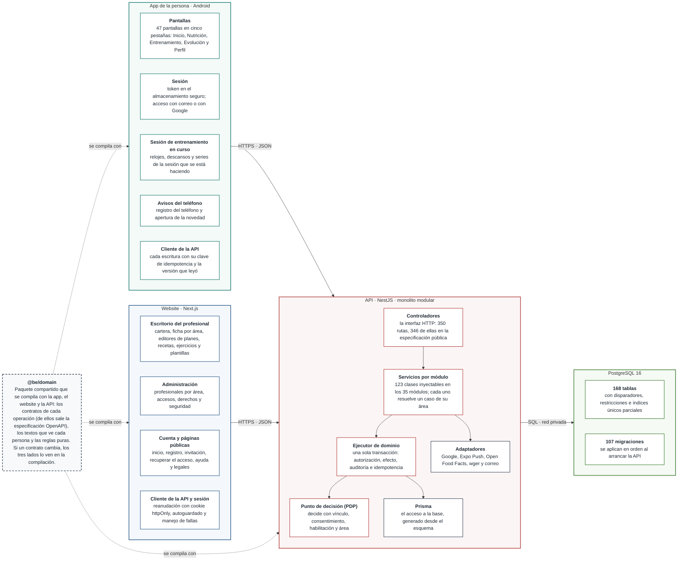
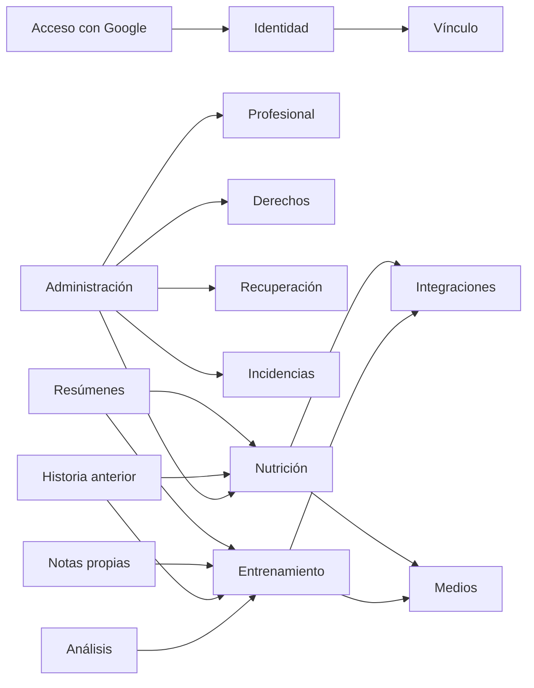

# 17 · Diagrama de componentes

*Las partes de cada pieza de BE, lo que ofrece cada una y de qué depende.*

> Cada área resuelve lo suyo; lo común está en un solo lugar.

**Autor:** Elián Bufi  
**Carrera:** Analista de Sistemas, Escuela Da Vinci  
**Fecha:** Noviembre de 2026

> **Resumen.** El nivel 3 del modelo C4. Los 35 módulos de la API con sus rutas y sus dependencias, las zonas del website, los temas de la app y el paquete que comparten las tres, con dos recorridos de punta a punta (un gráfico y la historia anterior) y las interfaces entre los componentes.

**Entregable:** 17 · Diagrama de componentes  
**Fecha:** Noviembre de 2026  
**Lo acompaña:** El nivel anterior (contenedores) está en el entregable 16; el siguiente (clases), en el 15.

# Resumen

*Qué hay adentro de cada pieza y por qué la API está partida así.*

Este documento baja un nivel respecto del de arquitectura: de las piezas que se despliegan a las partes que tiene cada una. Importa porque explica dónde vive cada responsabilidad: si cambia una regla de Nutrición, se toca un módulo; si cambia cómo se decide un permiso, se toca uno solo, y vale para todos.

La forma sigue a lo que BE ofrece. Nutrición, Entrenamiento y Antropometría son módulos hermanos que guardan la historia de la misma persona (los planes por versiones, lo que registró y sus tomas) sobre el mismo eje del tiempo. Análisis los lee juntos para los gráficos y la línea del tiempo, sin escribir en ellos, y Gráficos guarda los enfoques de cada profesional. Y el permiso se decide en un solo lugar, el punto único de decisión: la misma regla vale para cada área, para cada gráfico y para la historia anterior, que un profesional nuevo ve solo si la persona lo autoriza.

- **35** módulos: en la API
- **350** rutas HTTP: 346 en la especificación pública
- **39** páginas: del website
- **49** pantallas: de la app

*Fuente: El repositorio: apps/api/src (módulos y controladores), docs/api/openapi.json, apps/web/src/app y apps/mobile/src/pantallas.*

*Figura 1: Las tres aplicaciones tienen la misma forma en capas: arriba lo que ofrecen, en el medio sus piezas y abajo lo que habla con la otra punta (la API o la base). Debajo de las tres, el paquete que comparten al compilar.*

# 1. La API, módulo por módulo

*Un monolito modular: una sola aplicación dividida en 35 módulos de NestJS, agrupados de lo que ve la persona a lo que sostiene a todos.*

## 1.1 Las dependencias

El grafo muestra las importaciones explícitas entre módulos: la lista `imports` de cada `@Module`.

No dibuja Sesión, que trae el guard que pide la sesión en cada ruta protegida: la importan casi todos los módulos, y dibujarla taparía el resto. Tampoco dibuja los cinco módulos globales (Prisma, Plataforma, Autorización, Proceso y Novedades): se registran una sola vez y cualquier módulo usa sus servicios sin importarlos. Análisis, Cartera y Dashboard importan además Prisma de forma explícita, y tampoco se dibuja.

Quedan diecisiete dependencias, pocas a propósito: cada área resuelve lo suyo, y lo común está en los globales.

*Figura 3: Las 17 importaciones explícitas entre módulos (la lista imports de cada uno), sin Sesión ni los globales (todos los usan y no se dibujan). La flecha va del módulo que importa al importado. Leído de apps/api/src/*/*.module.ts.*

## 1.2 Cada módulo, en una fila

**Tabla 1.** Los 35 módulos: sus rutas HTTP, las clases inyectables que registra cada uno (el detalle de las clases está en el entregable 15), su responsabilidad y el módulo del DER donde están sus tablas (entregable 14).

| Módulo | Rutas | Clases | Responsabilidad | Tablas (módulo del DER) |
| --- | --- | --- | --- | --- |
| Sesión | 10 | 5 | Abre, reanuda y cierra sesiones, y el segundo factor de la sesión cuando la política lo pide: hoy, el de Administración. | Identidad y acceso |
| Acceso con Google | 6 | 3 | Verifica el token de Google, asocia o crea la cuenta y administra los métodos de acceso de cada cuenta. | Identidad y acceso |
| Identidad | 8 | 6 | Alta, perfil propio, estado y cierre de la cuenta; textos publicados. | Identidad y acceso |
| Recuperación | 2 | 1 | Recuperar el acceso con un código. | Identidad y acceso |
| Derechos | 6 | 2 | Pedidos de la persona sobre sus datos y descarga propia. | Administración, derechos y auditoría |
| Contacto | 1 | 0 | Ayuda y contacto. | — |
| Incidencias | 2 | 1 | Avisar un problema, como persona o como profesional, y ver los avisos propios. | Administración, derechos y auditoría |
| Administración | 31 | 5 | Habilita profesionales por área, con su propia sesión y segundo factor; atiende los pedidos de derechos, la recuperación asistida del acceso las incidencias, la revisión de los alimentos cargados a mano, las propuestas al Recetario de BE y qué Plantillas de BE de Entrenamiento se ofrecen. | Administración, derechos y auditoría |
| Profesional | 0 | 2 | Verificación y habilitación del profesional. | Profesionales, vínculos y consentimiento |
| Vínculo | 14 | 3 | Solicitudes, vínculos por área e invitaciones. | Profesionales, vínculos y consentimiento |
| Consentimiento | 12 | 4 | Consentimientos por área, de datos de salud y de fotos de comidas. | Profesionales, vínculos y consentimiento |
| Coordinación | 3 | 2 | Notas entre los profesionales de una persona. | Lo que se comparte entre áreas |
| Resúmenes | 9 | 2 | El resumen y el plan vigente que la persona comparte de otras áreas. | Lo que se comparte entre áreas |
| Historia anterior | 4 | 2 | La historia anterior de un área para el profesional nuevo: la persona la autoriza o la retira y ve cuándo la miró; el profesional la lee en solo lectura. | Lo que se comparte entre áreas |
| Nutrición | 69 | 16 | Catálogo, alimentos propios y su revisión, evaluaciones, objetivos con su cálculo, planes con sus rangos, registro de comidas, recetas y el Recetario de BE con sus propuestas, plantillas, habituales y revisiones. | Nutrición; Recetas, fotos y registro de comidas |
| Entrenamiento | 82 | 18 | Catálogo con su clasificación, evaluaciones, objetivos, planes por fases con su planificación (progresiones, descargas y aproximaciones), la intensidad del plan, el 1RM de referencia, plantillas sin persona y Plantillas de BE, sesión en curso, series, el esfuerzo de la sesión, fuerza estimada, notas de la sesión, habituales y revisiones. | Entrenamiento; Catálogos e importación |
| Antropometría | 20 | 7 | Tomas, mediciones, métodos (con Kerr y los métodos habituales de cada profesional), cálculos y evolución. | Antropometría |
| Formularios | 25 | 8 | Formularios, propuestas del profesional, respuestas y hábitos. | Formularios y hábitos |
| Medios | 5 | 3 | Subida y entrega de imágenes privadas, con las dos medidas livianas de la imagen de una receta. | Recetas, fotos y registro de comidas |
| Integraciones | 0 | 2 | Adaptadores de Open Food Facts y wger. | Catálogos e importación |
| Dashboard | 1 | 0 | El resumen de la persona en su ficha, solo de las áreas permitidas. | (solo lectura) |
| Cartera | 2 | 0 | La cartera y la cola de revisiones. | (solo lectura) |
| Análisis | 7 | 2 | «Analizar», la línea del tiempo, las series de los gráficos y las vistas guardadas. | Herramientas del profesional |
| Gráficos | 7 | 2 | Los enfoques: conjuntos de gráficos con nombre, para una persona o para un plan. | Herramientas del profesional |
| Notas propias | 3 | 2 | Las notas privadas del profesional sobre una persona: solo las ve su autor. | Proceso de acompañamiento |
| Prisma | 0 | 1 | Acceso a la base (global). | todas |
| Plataforma | 0 | 6 | Auditoría, idempotencia, límites, credenciales y correo (global). | Administración, derechos y auditoría |
| Autorización | 0 | 2 | El punto único de decisión (global). | Administración, derechos y auditoría |
| Proceso | 0 | 1 | El proceso de acompañamiento (global). | Proceso de acompañamiento |
| Novedades | 7 | 5 | Novedades, avisos y recordatorios (global). | Novedades y avisos |
| Health | 3 | 1 | Salud del servicio para el despliegue. | — |
| Compartir | 3 | 2 | La pantalla única de compartir al aceptar y dejar de compartir una cosa sola desde «Quién ve qué». | Profesionales, vínculos y consentimiento |
| Contexto de la persona | 2 | 2 | El panel del editor: lo de la persona, en solo lectura y con el permiso del área. | Formularios y hábitos; Antropometría |
| Evaluación con formularios | 4 | 2 | Vincula a la evaluación inicial los formularios que la persona respondió. | Formularios y hábitos |
| Recorridos guiados | 2 | 1 | Recuerda, por usuario, qué recorrido guiado de cada editor vio u omitió, para mostrarlo solo la primera vez. | Herramientas del profesional |

> **Las clases globales.** Dos interceptores sacan, para la app que no los conoce, el tipo de serie y los bloques de la sesión; se registran en la aplicación, sin módulo propio.

> **Rutas y operaciones.** Las 350 rutas son los decoradores HTTP de los controladores. La especificación pública (OpenAPI) tiene 346 operaciones: no incluye las tres de salud del servicio (`/health`, `/health/live` y `/health/ready`) ni la tarea interna que disparan los recordatorios (`/internal/reminder-runs`). Las otras 346 coinciden una a una con las rutas.

# 2. El website y la app

*Los dos clientes tienen la misma forma: pantallas que delegan en un cliente de la API, que se ocupa de la sesión, de la clave de idempotencia y de la versión esperada de las escrituras.*

## 2.1 El website: 39 páginas en cinco zonas

El website es un sitio estático hecho con Next.js: cada página se genera al compilar y, en el navegador, pide sus datos a la API. Las rutas de las páginas están, en su mayoría, en inglés, y la interfaz, en español.

**Tabla 2.** Las zonas del website, con sus páginas.

| Zona | Páginas | Rutas | Para qué |
| --- | --- | --- | --- |
| Públicas | 9 | `/` · `/login` · `/register` · `/recover` · `/invitacion` · `/help` · `/legal/terminos` · `/legal/privacidad` · `/legal/fuentes` | Inicio, entrar, crear la cuenta, recuperar el acceso, aceptar una invitación, ayuda y textos legales. |
| Cuenta de la persona | 6 | `/account` · `/account/news` · `/account/privacy` · `/account/relationships` (y `consent`, `detail`) | Novedades, privacidad, vínculos y consentimientos desde la web. |
| Escritorio del profesional | 7 | `/pro` · `/pro/advisees` · `…/nutrition` · `…/training` · `…/anthropometry` · `…/forms` · `…/previous-history` | Tablero, cartera y la ficha de cada persona por área, con sus editores (en Nutrición, el reparto por comida y las franjas de cada comida; en todos, el panel «Contexto de…»), sus gráficos, «Patrones» y la historia anterior. |
| Herramientas del profesional | 8 | `/pro/recipes` · `/pro/foods` · `/pro/exercises` · `/pro/templates` · `/pro/templates/training` · `/pro/news` · `/pro/security` · `/pro/guia` | «Mis recetas» y el Recetario de BE, «Mis alimentos», ejercicios propios, plantillas (también la de entrenamiento sin persona), novedades, seguridad y guía de uso. |
| Administración | 9 | `/admin` · `/admin/professional` · `/admin/access` · `/admin/incidents` · `/admin/rights` · `/admin/security` · `/admin/foods` · `/admin/recipes` · `/admin/training-templates` | Profesionales por área, accesos, incidencias, pedidos de derechos, seguridad, «Alimentos» y «Propuestas al Recetario de BE». |

La ruta `/pro/advisees` está en inglés; en la interfaz, esa sección se llama «Personas».

## 2.2 La app: 49 pantallas en seis temas

Se cuentan los archivos de pantalla: las pantallas completas y las piezas grandes que se abren dentro de ellas, como la tira de la semana o la nota para tu profe. La navegación las reparte en cinco pestañas: Inicio, Nutrición, Entrenamiento, Evolución y Perfil. El título de Nutrición y de Entrenamiento queda fijo en la cabecera, entre el logo y la campana.

**Tabla 3.** Las pantallas de la app, agrupadas por tema.

| Tema | Pantallas | Cuáles |
| --- | --- | --- |
| Acceso | 10 | login, registro, acceso con Google, inicio del acceso, recuperación, recuperar el acceso, antes de seguir, la presentación de la primera vez, invitación, consentimiento |
| Inicio | 9 | inicio, tarjeta de inicio, la tira de la semana, inicio de Nutrición, de Entrenamiento, de mediciones y de información, novedades, notas de coordinación |
| Nutrición | 5 | nutrición, comidas de hoy (con el carrusel de opciones), opción de comida, comida diferente (con la foto que se achica), registro rápido |
| Entrenamiento | 8 | entrenamiento (con «La vez pasada» de cada ejercicio y el selector de RPE), plan por serie, sesión enfocada, serie en lista, tiempos de la sesión, corrección, historial, nota para tu profe |
| Evolución | 6 | progreso, progreso de una medida, indicadores, antropometría, figura de la toma, revisiones |
| Perfil | 11 | perfil, cuenta, avisos y nombre, privacidad, tus datos, quién ve qué, vínculo, vínculos, formularios, mis hábitos, ayuda y contacto |

# 3. Dos recorridos de punta a punta

*Cómo trabajan juntas las piezas en dos funciones que hacen a BE: un gráfico de la historia de la persona y la historia anterior que recibe un profesional nuevo.*

## 3.1 Un gráfico, de la base a la pantalla

Los gráficos ponen la historia de la persona sobre un mismo eje del tiempo, en el lugar donde el profesional decide: al elegir un ejercicio, al escribir una carga o al ajustar un objetivo. Ninguno escribe en el plan, y todos salen de las mismas cuatro capas.

> **Texto de la figura:**
> - Lo que ve el profesional
> - en el website
> - «La vez pasada»«Con historial» en el buscador«Desde el inicio y desde la anterior»El historial del ejercicio, con el 1RM estimado (Epley v1)La alimentación y el cuerpo en el tiempo«Armá tu gráfico»: alineadas o superpuestasLa cinta del tiempo«Patrones»Los enfoques
> - Las piezas comunes
> - website, una sola vez para todos los gráficos
> - El eje de fechas comúnLos paneles alineadosEl cursor compartidoLa tabla equivalente de cada gráficoLos estados: cargando, sin datos, poca historia y errorEl registro de los gráficos de cada área
> - Las lecturas
> - API: el punto único de decisión resuelve cada pedido
> - **Análisis:** las series de cada área y la línea del tiempo**Entrenamiento:** la fuerza estimada y lo indicado**Antropometría:** las tomas**Gráficos:** los enfoques
> - @be/domain
> - el paquete compartido
> - El catálogo de series: área, unidad, eje y métodoLos gráficos sugeridosLas marcas: lo registrado lleno, lo indicado huecoLa guardia de vocabulario y la frase de los cruces

Las lecturas son las mismas que usa cada módulo, con el mismo permiso: se piden por tramos de fechas y el navegador no guarda una copia de los datos de salud. Solo los enfoques necesitan operaciones propias, porque guardan algo nuevo: el conjunto de gráficos que un profesional elige para una persona o para uno de sus planes, hasta que lo cambie. Del lado de la persona, la app muestra «La vez pasada» debajo de cada ejercicio que ya hizo, en la sesión en curso.

Tres reglas atraviesan todas las capas:

- **Lo que se ve es lo que la persona permite.** Un gráfico de un área sin acceso no aparece, ni en gris ni con candado, y un cruce entre áreas se arma solo cuando el profesional lleva las dos.
- **Lo indicado y lo registrado van separados.** Lo indicado se dibuja con una marca hueca, y lo registrado, con una llena. Un día sin registro queda vacío, nunca como un cero, y la línea no lo cruza.
- **Coincidir no es causar.** Cada cruce lleva la frase «Coinciden en el tiempo; esto no prueba que una cosa cause la otra», y la guardia de vocabulario del paquete compartido controla que ningún texto de un gráfico califique.

## 3.2 La historia anterior, de la autorización a la lectura

Si la persona cambia de profesional en un área, no empieza de cero: con su autorización, el profesional nuevo ve lo que pasó antes en esa área y en qué contexto, para entender qué le funcionó mejor y decidir con más información. La continuidad atraviesa la app, la API y el website.

1. **Autoriza** (Persona): En la app, en «Quién ve qué» o al aceptar a un profesional nuevo, le comparte su historia anterior de esa área. Por omisión, no se comparte.
2. **Decide** (Sistema): Cada cambio queda auditado. En cada lectura, el punto único de decisión pide el vínculo y el consentimiento del área, y el módulo, la autorización vigente.
3. **Lee** (Profesional): En el website, desde «Más» en la ficha: los planes, lo registrado bajo cada uno, las tomas con su método y las decisiones de las revisiones. Solo lectura, marcado como de otro profesional.
4. **Ve y decide** (Persona): Ve cuándo la miró el profesional y puede retirar la autorización en cualquier momento.

*Figura 5: La historia anterior de un área, de la autorización a la lectura.*

El módulo Historia anterior usa las lecturas de Nutrición y de Entrenamiento (por eso los importa). Nunca viajan las notas privadas del profesional anterior, sus borradores ni sus notas internas, y el anterior no se nombra. Lo que la persona no autorizó responde igual que lo que no existe, y la ficha, sin mostrar ni insinuar datos, explica cómo pedírsela.

# 4. Las interfaces entre componentes

*Qué ofrece cada componente, quién lo usa y cómo. Es el contrato que hay que respetar si una pieza se reemplaza.*

**Tabla 4.** Las interfaces de BE: quién ofrece, quién usa y cómo.

| Interfaz | Ofrece | Usa | Cómo |
| --- | --- | --- | --- |
| API HTTP | API | App y website | HTTPS con JSON; 346 operaciones en la especificación OpenAPI. Según la escritura, la clave de idempotencia evita que un doble envío se registre dos veces, y la versión esperada, que una edición pise a otra. |
| Contratos | @be/domain | App, website y API | Tipos y esquemas compartidos al compilar; la verificación automática falla si la especificación publicada se desvía. |
| Acceso a datos | Prisma | Módulos de la API | Cliente generado desde el esquema; las consultas corren dentro de la transacción del ejecutor. |
| Tareas internas | API | Tarea programada de los recordatorios | HTTPS con un secreto de tareas que genera Render. |
| Avisos | Expo Push | Novedades | Un aviso por teléfono que agrupa las novedades sin leer («Tenés 2 novedades»), sin datos de salud. |
| Inicio con Google | Google | Acceso con Google | La app y el website obtienen un token; la API lo verifica. |
| Catálogos externos | Open Food Facts, wger | Integraciones | Búsquedas con tiempo máximo; lo importado pasa por una revisión. |
| Imágenes | Medios | App y website | Subida en dos pasos y entrega por rutas firmadas. |

## 4.1 El paquete compartido

`@be/domain` es lo que hace que la app, el website y la API digan lo mismo. Tiene más de 200 archivos de código, sin contar sus pruebas: los contratos de cada pedido y cada respuesta, validados en los dos extremos; los textos que ve cada persona en la app y en el website; las reglas puras (cálculos, editores de planes, máquinas de estados, fechas civiles) que no dependen de la red ni de la base; y el catálogo de series de los gráficos, con su guardia de vocabulario. De los contratos sale la especificación OpenAPI.

Entre sus reglas puras están las que comparten la API, el website y la app para lo más nuevo: `tipos-de-serie`, `bloques-de-la-sesion`, `preparacion-de-plantilla`, `alimentos-del-catalogo`, `contexto-de-la-persona`, `compartir`, `evaluacion-inicial`, `calculador-de-macros`, `fraccionamiento-de-kerr`, `metodos-de-la-toma`, `notacion-del-esfuerzo`, `recetario` y `enfoques`, cada una con su contrato.

> **Fuentes.** 1. `apps/api/src`: los módulos (`*.module.ts`), sus importaciones y los decoradores HTTP de los controladores; `docs/api/openapi.json`.
> 2. `apps/web/src/app/**/page.tsx`, `apps/mobile/src/pantallas/` y `packages/domain/src/`, sin las pruebas.
> 3. `apps/web/src/app/pro/advisees/graficos/` y, en `packages/domain/src/`, el catálogo de series, las marcas y el vocabulario de los gráficos.
> 4. `apps/api/src/historia-anterior/`, `apps/web/src/app/pro/advisees/previous-history/` y, en la app, «Quién ve qué» y «Vínculos»: la historia anterior.
