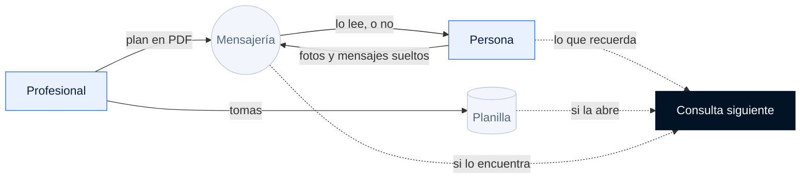
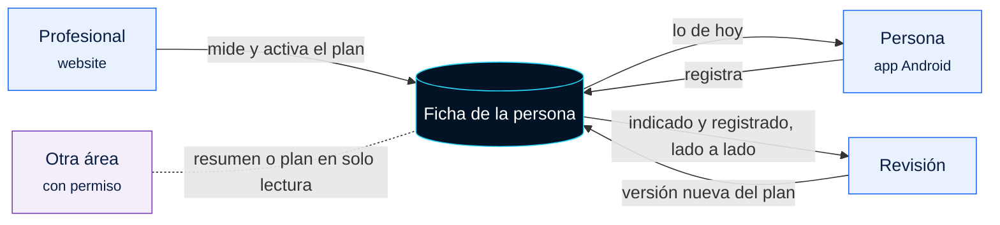

# 23 · SCAMPER

*Siete preguntas aplicadas al seguimiento entre consultas: qué quedó en BE, qué va a la proyección y qué se descartó a propósito.*

> Las ideas que más diferencian a BE no son las que suman, sino las que sacan o invierten.

**Autor:** Elián Bufi
**Carrera:** Analista de Sistemas, Escuela Da Vinci
**Fecha:** Noviembre de 2026

> **Resumen.** Las siete preguntas de SCAMPER, aplicadas al seguimiento tal como lo hace hoy un profesional, con PDF, planilla y chat. Salieron veintidós ideas y dieciocho son parte de BE. Las que más cambiaron el producto no agregan funciones: sacan o invierten algo.

**Entregable:** 23 · SCAMPER
**Fecha:** Noviembre de 2026
**Lo acompaña:** El .docx editable con el mismo contenido.

# Resumen

*Veintidós ideas en siete preguntas. Dieciocho son parte de BE; dos van a la proyección y dos se descartaron a propósito.*

> **Texto de la figura:**
> - S
> - Sustituir
> - C
> - Combinar
> - A
> - Adaptar
> - M
> - Modificar
> - P
> - Poner en otros usos
> - E
> - Eliminar
> - R
> - Reordenar
> - En BE (18)Proyección (2)Descartada a propósito (2)

> **La idea clave.** Las ideas que más cambiaron BE **no agregan funciones: sacan o invierten algo**. Eliminar las calificaciones, eliminar el chat y darle a la persona la decisión sobre el acceso.

# 1. Qué se transforma

*SCAMPER transforma algo que ya existe. Lo que existe es el seguimiento entre consultas tal como lo hace hoy un profesional.*

SCAMPER es una lista de siete preguntas para transformar algo que ya existe: sustituir, combinar, adaptar, modificar, poner en otros usos, eliminar y reordenar. No se aplica sobre una app imaginaria sino sobre una práctica concreta: el plan en un PDF que viaja por mensajería, las tomas en una planilla y las fotos de las comidas en el chat.

*Figura 2: El seguimiento de hoy: cada pieza vive en una herramienta distinta y la consulta depende de la memoria.*

*Figura 3: El mismo seguimiento en BE: todo pasa por la ficha de la persona, con su permiso.*

# 2. Las siete preguntas

*Cada pregunta, las ideas que dejó y qué pasó con cada una.*

> **La idea clave.** De cada idea, qué quedó en BE. Una idea descartada también es una decisión de diseño.

## 2.1 S · Sustituir

**¿Qué parte del seguimiento actual se puede reemplazar por algo mejor?**

| Idea | Qué quedó en BE | Dónde quedó |
| --- | --- | --- |
| El PDF que viaja por mensajería, por un plan que la persona ve en la app. | El profesional arma el plan en el website y, al activarlo, la persona lo ve en la app con lo que le toca hoy. | En BE |
| La planilla de tomas, por protocolos con versión. | Cada toma registra el protocolo y el método de cálculo con su versión, para comparar con el mismo criterio. | En BE |
| El criterio del profesional, por una IA que arme el plan. | Descartada: BE no decide por el profesional. Los cálculos los pide el profesional y su resultado no cambia solo el plan. | Descartada |

## 2.2 C · Combinar

**¿Qué piezas sueltas valen más juntas?**

| Idea | Qué quedó en BE | Dónde quedó |
| --- | --- | --- |
| Tres áreas sobre la misma persona. | Nutrición, Entrenamiento y Antropometría comparten la ficha de la persona, cada una con su permiso. | En BE |
| Link, código y QR en una sola invitación. | La invitación es de un solo uso y llega por cualquiera de los tres caminos. | En BE |
| Gráficos de distintas áreas sobre el mismo eje del tiempo. | Las comparativas alinean o superponen series de Nutrición, Entrenamiento y Antropometría, con las versiones del plan de fondo. | En BE |
| Turnos y cobros dentro de BE. | Fuera del alcance de esta etapa: hoy no los tiene. | Proyección |

## 2.3 A · Adaptar

**¿Qué funciona bien en otro dominio y se puede traer?**

| Idea | Qué quedó en BE | Dónde quedó |
| --- | --- | --- |
| Del control de versiones del software: nunca pisar lo anterior. | Un plan activado queda como versión y no se modifica; ajustar crea una versión nueva. | En BE |
| De la historia clínica: corregir sin borrar. | Una corrección es un registro nuevo que cita al original. La única excepción es la foto de una comida que la persona pide suprimir: se borra la imagen y queda la constancia. | En BE |
| De las ciencias del entrenamiento: estimar la fuerza con una fórmula conocida. | Con las series registradas, BE estima la fuerza máxima con la fórmula de Epley, con su versión, y muestra «Cómo se calculó». El profesional la usa para pasar de un porcentaje a kilos. | En BE |

## 2.4 M · Modificar, magnificar o minimizar

**¿Qué conviene agrandar y qué conviene achicar?**

| Idea | Qué quedó en BE | Dónde quedó |
| --- | --- | --- |
| Minimizar el esfuerzo de registrar. | Inicio por acciones, «Ya la hice» en un toque, registro por niveles y descanso entre series que se cuenta solo. | En BE |
| Magnificar la evolución antropométrica. | Las medidas se leen en pares (por ejemplo, cintura con pliegue abdominal), con el valor y la diferencia escrita de cada toma. | En BE |
| Modificar la apariencia de la app. | Una apariencia propia, con los temas Azul noche y Claro, sin cambios en los datos. | En BE |

## 2.5 P · Poner en otros usos

**¿Para qué más sirve lo que ya está construido?**

| Idea | Qué quedó en BE | Dónde quedó |
| --- | --- | --- |
| Usar los registros para medir el servicio, no a la persona. | La tasa de ciclos cerrados en 30 días mide, de los ciclos de seguimiento que vencieron en esa ventana, cuántos se cerraron con una revisión aplicada, y se calcula de forma reproducible. | En BE |
| La historia de la persona, para su próximo profesional. | Con la autorización de la persona, el profesional nuevo ve su historia anterior del área, en solo lectura. | En BE |
| La misma estructura para otras disciplinas. | Kinesiología u otro deporte podrían usar el mismo circuito; registrar otro deporte en Entrenamiento es la primera idea, con su duración y el esfuerzo percibido de la sesión (el RPE de la sesión). | Proyección |

## 2.6 E · Eliminar

**¿Qué sobra, aunque la competencia lo tenga?**

| Idea | Qué quedó en BE | Dónde quedó |
| --- | --- | --- |
| Calificaciones y colores que juzgan. | BE ubica, no califica: muestra valores y diferencias, nunca un juicio. | En BE |
| El chat como canal de trabajo. | BE no tiene chat general: lo que se intercambia queda como formulario, nota entre profesionales o registro, con su historia. | En BE |
| Publicidad y venta de datos. | Excluidas del modelo de negocio desde la especificación. | Descartada |

## 2.7 R · Reordenar o invertir

**¿Qué pasa si se cambia el orden, o quién decide?**

| Idea | Qué quedó en BE | Dónde quedó |
| --- | --- | --- |
| Invertir quién decide el acceso. | Decide la persona, por área, y puede retirar el permiso; el corte vale hacia adelante. | En BE |
| Separar dos pasos que suelen ir juntos. | Aceptar el vínculo y consentir el tratamiento de los datos son dos actos distintos. | En BE |
| Primero medir, después planificar. | El circuito arranca con la evaluación y el objetivo; el plan se arma después, sobre esa base. | En BE |

# 3. Dónde cae cada idea

*Las veintidós ideas sobre el circuito de BE. Las inversiones se juntan en el vínculo, y lo que se eliminó, en la revisión.*

> **Texto de la figura:**
> - **Vínculo**Antes del circuito: invitación y permiso
> - **Medir**Evaluación y tomas
> - **Planificar**Armar y activar el plan
> - **Ejecutar**La persona registra
> - **Revisar**Indicado frente a registrado
> - **Ajustar**Versión nueva del plan
> - **C**Link, código y QR en una invitación
> - **R**La persona decide el acceso, por área
> - **R**Aceptar el vínculo y consentir: dos actos
> - **P**La historia, para el próximo profesional
> - **C**Turnos y cobros dentro de BE
> - **E**Publicidad y venta de datos
> - **S**Protocolos y métodos con versión, en lugar de la planilla
> - **R**Primero medir, después planificar
> - **A**Estimar la fuerza con Epley, con «Cómo se calculó»
> - **S**Una IA que arme el plan
> - **S**El plan en la app, en lugar del PDF
> - **M**Registrar en un toque, por niveles
> - **A**Corregir sin borrar
> - **M**Apariencia propia, en dos temas
> - **P**Registrar otro deporte
> - **C**Tres áreas sobre la misma persona
> - **M**La evolución en pares de medidas
> - **C**Comparativas entre áreas en el mismo eje
> - **E**Sin calificaciones ni colores que juzgan
> - **E**Sin chat: formularios, notas y registros
> - **P**Medir el servicio, no a la persona
> - **A**Nunca pisar lo anterior: versiones del plan
> - En BEProyecciónDescartada a propósito

# 4. Lo que deja el ejercicio

*Tres conclusiones y un orden para lo que queda.*

## 4.1 Las ideas que más pesan

- **3** ideas que sacan o invierten: sin calificaciones, sin chat y la persona decide el acceso
- **0 de 9** competidores: dejan a la persona decidir el acceso por área (entregable 22)
- **2** descartadas a propósito: una IA que arme el plan y la venta de datos

Las ideas que más cambiaron el producto no fueron las que agregan funciones, sino las que sacan o invierten algo: eliminar las calificaciones, eliminar el chat y darle a la persona la decisión sobre el acceso. Son también las que más lo diferencian de la competencia: en ninguno de los nueve productos relevados en el benchmarking (entregable 22) la persona decide quién ve cada área.

Las dos descartadas también dicen algo. Que una IA arme el plan y vender datos son caminos que el mercado recorre; BE no los toma porque contradicen su principio: ubicar, nunca calificar, y no decidir por el profesional.

> **La proyección.** Turnos y cobros, registrar otro deporte con el RPE de la sesión y, como «Combinar», el carrito de compras familiar (los planes de varias personas en una sola compra), entran en el orden que marque el piloto con profesionales (FODA, 19, y buyer persona, 21).

> **Fuentes.** 1. La estimación de fuerza de BE: la fórmula de Epley, versión 1, con «Cómo se calculó».
> 2. Benchmarking (22), de esta misma entrega.
> 3. Eberle, B. *SCAMPER: Games for Imagination Development*. D.O.K. Publishers, 1971. Sobre la lista de preguntas de Osborn, A. F. *Applied Imagination*. Scribner, 1953.
