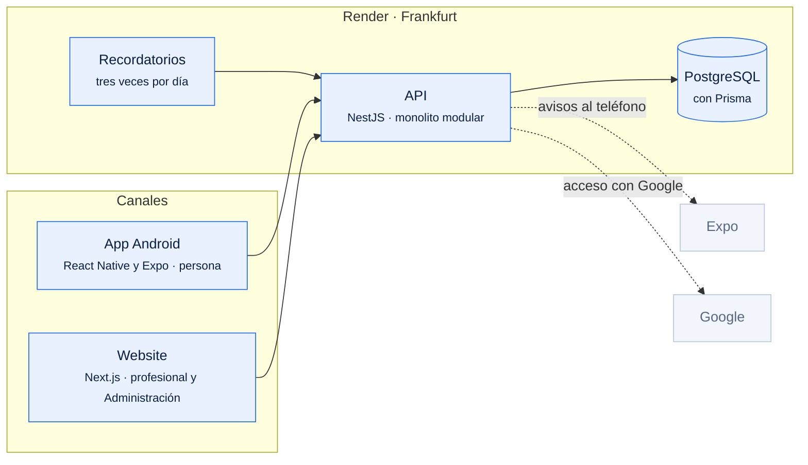

# 24 · Análisis de viabilidad

*Si BE puede funcionar como producto: viabilidad técnica, económica, operativa y legal, con sus costos reales y sus condiciones.*

> La infraestructura no es la barrera: la clave es cuántos profesionales adoptan BE y a qué precio.

**Autor:** Elián Bufi  
**Carrera:** Analista de Sistemas, Escuela Da Vinci  
**Fecha:** Noviembre de 2026

> **Resumen.** BE puede arrancar chico: está construido, se verifica en cada cambio y su infraestructura base cuesta unos USD 14 por mes. Para operar con datos reales suma un ambiente de producción y la revisión legal. El precio se fija en el piloto con profesionales.

**Entregable:** 24 · Análisis de viabilidad  
**Fecha:** Noviembre de 2026

# Resumen

*Cuatro dimensiones, cada una ubicada según cuánto está demostrado y cuánto depende del piloto.*

> **Texto de la figura:**
> - SupuestoCon condicionesDemostrado
> - **Técnica**¿Se puede construir?
> - Construido y verificado en cada cambio
> - **Económica · costos**¿Cuánto cuesta operarlo?
> - Unos USD 14 por mes de base, con los planes configurados
> - **Económica · ingresos**¿Alguien lo paga?
> - Se fija en el piloto; ARS 35.000 es una referencia
> - **Operativa**¿Se puede sostener?
> - Alcanza para pocos profesionales; depende de una persona
> - **Legal**¿Se puede operar con datos de salud?
> - Controles en el producto; se completa con asesoramiento legal

> **La idea clave.** BE **puede arrancar chico**. Para operar con datos reales suma dos condiciones: un ambiente de producción separado y la revisión legal.

# 1. Viabilidad técnica

*Es la dimensión mejor demostrada, porque no depende de supuestos: el sistema existe, funciona en la nube y se verifica en cada cambio.*

> **La idea clave.** Lo técnico no es la pregunta abierta: **BE está construido, desplegado y verificado** en cada cambio.

## 1.1 Qué hay construido

- **168** tablas: en PostgreSQL
- **107** migraciones: del esquema, en orden
- **346** operaciones: de la API
- **35** módulos: de un monolito modular

*Fuente: El repositorio de BE: prisma/schema.prisma, prisma/migrations y docs/api/openapi.json.*

*Figura 2: Cómo está desplegado BE: en la nube (Render, región Frankfurt).*

El website se publica como sitio estático en el mismo proveedor. Cada cambio pasa por la verificación automática (tipos, pruebas unitarias y de integración, recorridos en navegador) antes de desplegarse. La app se descarga desde el website, siempre en su última versión.

## 1.2 Por qué un monolito modular

Una sola aplicación de servidor, dividida en módulos por dominio. Se eligió por el tamaño del equipo (una persona), la escala esperada y la necesidad de operaciones atómicas entre áreas: activar un plan, registrar y revisar tocan varias tablas que tienen que cambiar juntas o no cambiar. Si esas condiciones cambian, los módulos se pueden separar en servicios. Antes de crecer, la capacidad se mide con una prueba de carga.

## 1.3 Para operar con datos reales

**Tabla 1.** Lo que suma la viabilidad técnica para operar con datos reales.

| Qué | Por qué importa |
| --- | --- |
| Un ambiente de producción separado | Los datos reales van en un ambiente propio, separado del de la demostración. |
| Una restauración de la base, ensayada | Una copia que nunca se restauró no está probada: se ensaya antes de operar. |
| Una prueba de carga | Mide cuántos profesionales y personas sostiene la infraestructura antes de crecer. |
| La versión para iPhone | Suma a las personas que usan iPhone, con el mismo código de la app. |

# 2. Viabilidad económica

*Lo que cuesta se calcula con precios publicados. Lo que ingresa depende del precio que fije el piloto.*

> **La idea clave.** Un solo profesional que pague la referencia **cubre la infraestructura actual**. El costo que pesa no es el servidor: es el tiempo.

## 2.1 Lo que cuesta

**Tabla 2.** Cada concepto, su proveedor, su costo y cuándo entra.

| Concepto | Proveedor y plan | Costo | Cuándo |
| --- | --- | --- | --- |
| Servidor de la API | Render, servicio web Starter (0,5 CPU y 512 MB) | USD 7 por mes | Hoy |
| Base de datos | Render, PostgreSQL Basic-256mb | USD 6 por mes, más el almacenamiento | Hoy |
| Recordatorios | Render, tarea programada Starter, tres veces por día | Por tiempo de ejecución, con un mínimo de USD 1 por mes | Hoy |
| Website | Render, sitio estático | Sin costo | Hoy |
| Avisos al teléfono | Servicio de avisos de Expo | Sin costo | Hoy |
| Ambiente de producción | Render: la API en Starter y una base de 1 GB con 5 GB de disco, con el correo gratuito y un .com.ar | Unos USD 28,50 por mes en total | Al operar con datos reales |
| Dominio propio | NIC Argentina, .com.ar | ARS 8.500 por año | Al operar con datos reales |
| Correo de la cuenta | Un proveedor de correo transaccional, por ejemplo Resend | Gratis hasta 3.000 correos por mes y 100 por día; USD 20 por mes hasta 50.000 | Al operar con datos reales |
| Tienda de Android | Google Play, cuenta de desarrollador | USD 25, una sola vez | Al publicar en la tienda |

Costo base hoy: unos USD 14 por mes, cerca de ARS 22.000 a ARS 1.570 por dólar. Para operar con datos reales, el ambiente de producción recomendado cuesta unos USD 28,50 por mes en total. A eso se suman, una sola vez, USD 25 de Google Play, y los impuestos y la comisión del medio de cobro.

## 2.2 Lo que puede ingresar

El ingreso depende del precio que fije el piloto. ARS 35.000 por mes por profesional es solo una referencia; el precio y el modelo de cobro se deciden con el buyer persona (21). Con esa referencia, tres escenarios muestran el orden de magnitud. No son proyecciones.

**Tabla 3.** Los tres escenarios y su lectura.

| Profesionales que pagan | Ingreso bruto por mes | Infraestructura por mes | Lectura |
| --- | --- | --- | --- |
| 1 | ARS 35.000 | unos ARS 22.000 (USD 14) | Uno solo cubre la infraestructura actual. |
| 10 | ARS 350.000 | unos ARS 22.000 (USD 14) | La infraestructura deja de ser el problema. |
| 30 | ARS 1.050.000 | unos ARS 74.000 (USD 47), con la base Basic-1gb y el correo pago | El costo que pesa es el tiempo de trabajo. |

## 2.3 Lo que esta cuenta no incluye

> **Lo que está en la cuenta.** - La infraestructura en la nube, con precios publicados.
> - El ingreso bruto, con una referencia que no es un precio.

> **Lo que no está, y pesa más.** - El tiempo de desarrollo y de soporte.
> - La revisión legal.
> - Los impuestos y la comisión del medio de cobro.

La conclusión es que la infraestructura no es una barrera. La clave es cuántos profesionales adoptan BE y a qué precio, y eso lo fija el piloto.

# 3. Viabilidad operativa

*Cómo se hace hoy cada actividad que BE necesita para funcionar, y quién la hace.*

> **La idea clave.** El riesgo operativo principal es que **todo depende de una persona**. Para pocos profesionales es manejable; para crecer, el soporte y la habilitación tienen que repartirse o automatizarse.

## 3.1 Cada actividad, hoy

**Tabla 4.** Las actividades de operación y cómo se hacen.

| Actividad | Cómo se hace |
| --- | --- |
| Habilitar profesionales | Administración observa, verifica o rechaza, suspende y rehabilita a cada profesional por área, con un fundamento registrado y segundo factor obligatorio. BE no certifica matrículas. |
| Dar de alta a un profesional real | Administración verifica la matrícula fuera de BE y lo da de alta con su fundamento. El profesional no se autodeclara. |
| Sumar a una persona | Invitación de un solo uso con link, código o QR. |
| Recuperar el acceso | Desde la app o el website; sin un proveedor de correo configurado, la recuperación es asistida desde Administración. |
| Distribuir la app | Se descarga desde el website y se instala en el teléfono; publicarla en Google Play es el paso siguiente. |
| Dar soporte | Ayuda y contacto dentro de BE, en la app y en el website. |
| Que el profesional aprenda solo | Editores simples (el borrador se guarda solo y el plan se activa con «Revisar y activar…») y un manual por rol. |

## 3.2 Todo pasa por una persona

> **Texto de la figura:**
> - **Desarrollar**Código, pruebas y despliegue de los tres canales.
> - **Habilitar profesionales**Verificar la matrícula y dar de alta, con su fundamento.
> - **Operar la infraestructura**Render, la base, los recordatorios y sus costos.
> - **Dar soporte**Ayuda, contacto y recuperar el acceso asistido.
> - **Una persona**el autor de BE
> - **Distribuir la app**Publicar cada versión y acompañar la instalación.
> - **Vender**Presentar BE, validar el precio y cobrar.
> - **Cuidar los datos**Permisos, copias y la revisión legal.
> - **Diseñar**Decidir qué entra en BE y qué queda afuera.

# 4. Viabilidad legal

*BE trata datos de salud, que la Ley 25.326 considera sensibles. Lo que ya resuelve el producto y lo que se completa con asesoramiento legal.*

> **La idea clave.** BE implementa los controles técnicos que pide la ley para datos de salud. Este capítulo **no reemplaza la opinión de un abogado**: ordena lo que hace el producto y las preguntas para esa revisión.

## 4.1 Lo que pide la ley y lo que hace BE

**Tabla 5.** Los artículos de la Ley 25.326 que tocan a BE, lo que hace el producto y lo que se valida con asesoramiento legal.

| Lo que pide la ley | Qué hace BE | A validar con un abogado |
| --- | --- | --- |
| Consentimiento libre, expreso e informado (art. 5) | La persona acepta el vínculo y, en un acto aparte, autoriza cada área; puede retirar el permiso. Queda registrado. | Los textos finales del consentimiento y de los términos. |
| Nadie está obligado a dar datos sensibles (art. 7) | La persona decide qué área autoriza. | Que ningún dato de salud sea condición para usar BE. |
| Datos de salud en manos de profesionales de la salud (art. 8) | Cada profesional ve solo lo que la persona autorizó en su área. | Cómo encuadran los entrenadores, que no son profesionales de la salud, y el rol de BE como prestador del servicio (art. 25). |
| Seguridad de los datos (art. 9) | Autorización por área en cada operación, registro de quién hizo qué y segundo factor para Administración; el profesional entra con su contraseña o con Google, con límite de intentos. | Si alcanza. |
| Acceso en 10 días corridos; rectificación y supresión en 5 días hábiles (arts. 14 y 16) | La persona descarga sus datos y pide su supresión desde la app; las correcciones quedan registradas sin borrar lo anterior. | Los plazos y el procedimiento. |
| Inscripción de las bases de datos (art. 21) | La inscripción de la base ante la Agencia de Acceso a la Información Pública (AAIP) se tramita antes de operar con datos reales. | Si corresponde inscribirla ante la autoridad de control. |
| Transferencia internacional (art. 12) | Los datos se alojan en Frankfurt, en la Unión Europea, que la autoridad de control considera con protección adecuada. Los proveedores tienen sede en los Estados Unidos. | Si hacen falta cláusulas contractuales con cada proveedor. |

La demostración usa datos sintéticos; los datos reales van en el ambiente de producción, separado.

## 4.2 Antes de operar con datos reales

1. **Revisión legal**: Un abogado revisa consentimiento, términos, encuadre de los entrenadores e inscripción de la base.
2. **Ambiente de producción**: Separado del de la demostración, con la restauración de una copia ensayada.
3. **Abrir de a poco**: Pocos profesionales primero, para encontrar las faltas antes de crecer.
4. **Consentimiento expreso para datos de salud**: Los textos finales del consentimiento, revisados, en la app y en el website, con su versión registrada.
5. **Inscripción ante la AAIP**: La base de datos, inscripta antes de recibir el primer dato real.

**Las licencias.** El código de BE es propio, con todos los derechos reservados (Ley 11.723 de Propiedad Intelectual). Los datos de terceros conservan sus licencias: Open Food Facts (ODbL) y wger (CC BY-SA) piden atribución y que lo derivado se comparta igual, y los de USDA son de dominio público. BE muestra la fuente de cada alimento y de cada ejercicio importados.

*Figura 6: Lo que tiene que pasar, en orden, antes de abrir BE a datos reales.*

Cada paso habilita al siguiente: no tiene sentido abrir un ambiente de producción sin los textos legales cerrados. A esto se suman las reglas propias de Google Play para apps que tratan datos de salud, que se revisan al publicar la app en la tienda.

# 5. Conclusión

*Las cuatro respuestas en una tabla, y la pregunta que el código no puede responder.*

> **La idea clave.** Lo que ninguna dimensión técnica responde es **cuántos profesionales adoptan BE y a qué precio**: lo responde el piloto con profesionales.

## 5.1 El veredicto, dimensión por dimensión

**Tabla 6.** La viabilidad de BE.

| Dimensión | Respuesta | Por qué |
| --- | --- | --- |
| Técnica | Viable | Está construido y verificado: 168 tablas, 346 operaciones y verificación automática de cada cambio. |
| Económica | Viable en costos | La infraestructura base cuesta unos USD 14 por mes, y la de producción, unos USD 28,50; el ingreso lo fija el piloto. |
| Operativa | Viable para pocos profesionales | Depende de una sola persona; para crecer hay que repartir el soporte y la habilitación. |
| Legal | Viable con condiciones | Los controles técnicos están en el producto; se completa con asesoramiento legal antes de operar con datos reales. |

El próximo paso no es una función nueva: es el piloto con profesionales (19, 20 y 21). Con esa respuesta se decide el precio, se prepara el ambiente de producción y BE se abre a datos reales.

> **Fuentes.** 1. El repositorio de BE: prisma/schema.prisma, prisma/migrations, docs/api/openapi.json y render.yaml (los planes configurados).
> 2. Precios de Render según «Render Pricing in 2026» (kuberns.com/blogs/render-pricing) y «Render.com in Mid-2026» (jwatte.com/blog/render-com-platform-review), consultados el 12/11/2026. La página oficial render.com/pricing no muestra los montos como texto; render.com/docs/cronjobs confirma el mínimo de USD 1 por mes de la tarea programada (13/11/2026).
> 3. Expo. «Push notifications FAQ». docs.expo.dev/push-notifications/faq (consultado el 12/11/2026).
> 4. Resolución 5/2024 de la Secretaría Legal y Técnica, según El Litoral (consultado el 12/11/2026). No se pudo confirmar en nic.ar si el arancel cambió después.
> 5. Resend. Pricing. resend.com/pricing (consultado el 12 y el 13/11/2026).
> 6. Google. «Get started with Play Console». support.google.com/googleplay/android-developer/answer/6112435 (consultado el 12/11/2026).
> 7. Ley 25.326 de Protección de los Datos Personales, artículos 2, 5, 7, 8, 9, 12, 14, 16, 21 y 25. argentina.gob.ar/normativa/nacional/64790/texto (consultado el 12/11/2026).
> 8. Disposición 60/2016 de la Dirección Nacional de Protección de Datos Personales, modificada por la Resolución 34/2019 de la Agencia de Acceso a la Información Pública. argentina.gob.ar/aaip/datospersonales/transferencias-internacionales (consultado el 12/11/2026).
> 9. Cotización de venta del Banco Nación informada por El Economista y C5N el 5 y el 6/11/2026. Detalle en «22 Benchmarking».
> 10. Propuesta de producción de BE (13/11/2026): Render, la API en Starter y una base de 1 GB con 5 GB de disco, con el correo gratuito y un .com.ar.
