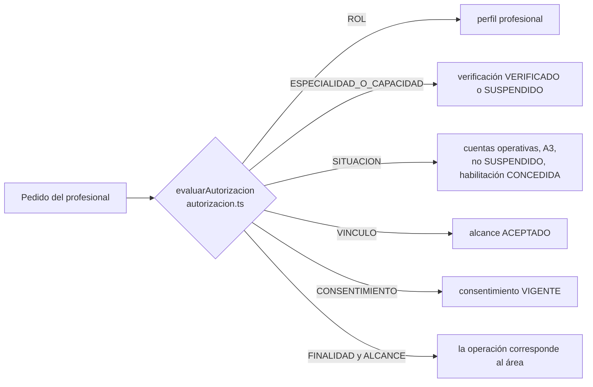
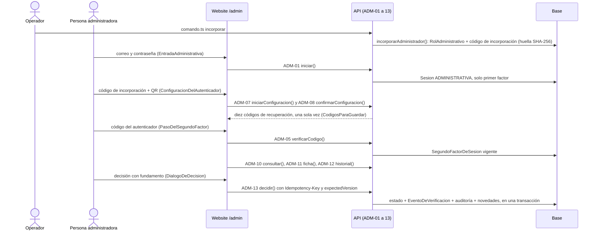
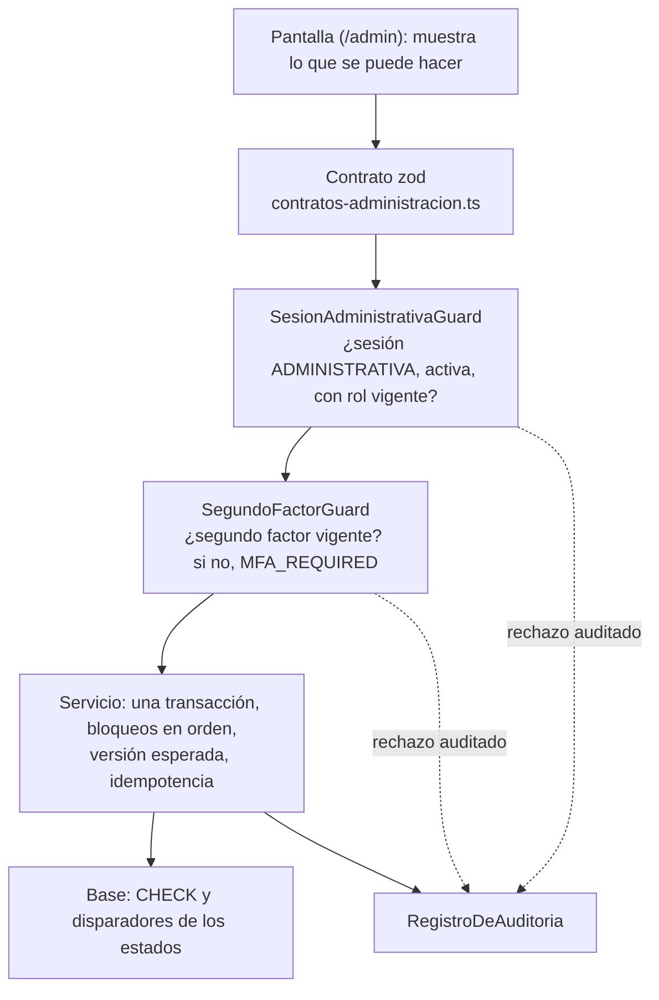
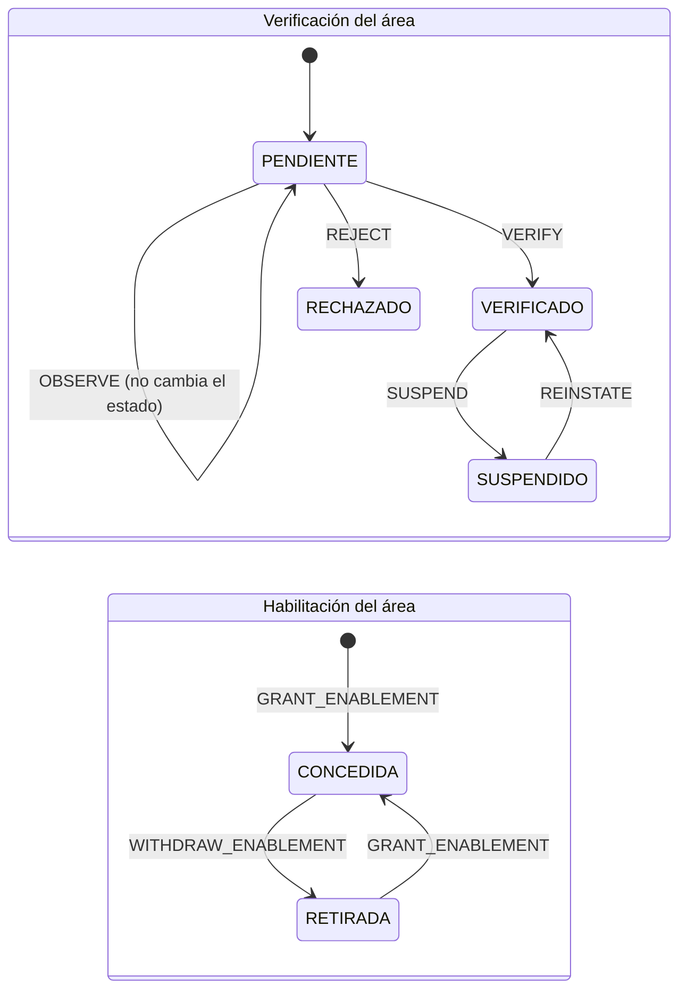
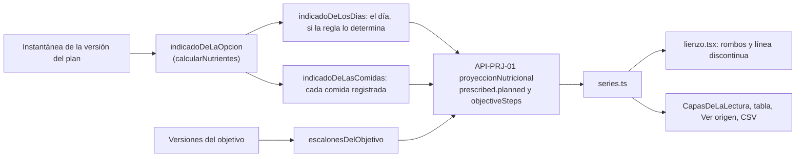

# Guía de estudio · tanda del 2026-10-25

Administración (A), sustitución de ejercicios (B) y comparación de Nutrición (C). Es para entender **cómo funciona lo nuevo
leyendo el código real**: cada parte tiene una explicación en criollo y otra técnica, con enlaces a los archivos. Los
diagramas están armados con los nombres de las funciones, no son un dibujo aparte.

- **Para practicar:** [`TANDA-2026-10-25-TAREAS.md`](TANDA-2026-10-25-TAREAS.md). Las respuestas esperadas están aparte,
  en [`TANDA-2026-10-25-RESPUESTAS.md`](TANDA-2026-10-25-RESPUESTAS.md): abrilas después de intentar.
- **Los enlaces** apuntan a archivos de `main`. A llegó con #210, C con #211 y B con #195, integrados el 2026-10-25 en
  el orden #214 (la clave del segundo factor en `render.yaml`) → #210 → #211 → #195 → esta guía. Se comprobaron contra el
  árbol integrado. La rama del ensayo conjunto (`ensayo/tanda-2026-10-25-no-integrar`, #213) quedó como evidencia, sin
  integrar.

## 1. Seis cosas que no son lo mismo

En criollo: que un profesional **pueda trabajar con una persona** depende de seis cosas distintas. Cada una la cambia
alguien distinto y se ve por separado. Administración decide solo dos: la verificación y la habilitación, **por área**.

| Concepto | En criollo | Dónde vive | Quién la cambia | Si falta, corta… |
|---|---|---|---|---|
| **Identidad** | la cuenta para entrar | `Identidad` | la persona, al registrarse | todo: sin cuenta operativa no entra nadie |
| **Perfil profesional** | «esta cuenta es de un profesional» | `PerfilProfesional` | el servicio interno (DL-036); en esta versión, no el profesional | sin perfil no es profesional ni aparece en `/admin` |
| **Verificación** (por área) | BE revisó lo que el profesional presentó para Nutrición, Entrenamiento o Antropometría | `VerificacionProfesional`: `PENDIENTE`, `VERIFICADO`, `SUSPENDIDO`, `RECHAZADO` | **Administración** | operar esa área |
| **Habilitación** (por área) | BE le permite operar esa área | `Habilitacion`: `CONCEDIDA`, `RETIRADA` | **Administración** | operar esa área |
| **Vínculo** | la persona y el profesional trabajan juntos en un área | `AlcanceDeVinculo`: `ACEPTADO`, `PAUSADO`, `FINALIZADO` | los dos, con la invitación o la solicitud | ver y registrar con esa persona |
| **Consentimiento** | la persona autorizó compartir sus datos de salud | `Consentimiento`: `VIGENTE`, `REVOCADO` | la persona | lo mismo |

**«Habilitado para operar en BE» no es «matrícula certificada».** BE no certifica matrículas en esta versión (D-1).

En el código, las seis se juntan en un solo lugar, el **PDP** (punto de decisión de autorización): la función
[`evaluarAutorizacion`](../../packages/domain/src/autorizacion.ts#L93) mira siete dimensiones en cada pedido, sin
caché. Para la verificación y la habilitación, la regla es una línea: **puede operar quien tiene el área `VERIFICADO`
y la habilitación `CONCEDIDA`**. Por eso una decisión de Administración vale desde el pedido siguiente.

## 2. Administración, de punta a punta

En criollo: el operador incorpora a una persona como administradora desde la terminal; ella entra en `/admin` con su
contraseña, configura un autenticador (la aplicación de códigos del teléfono), guarda sus códigos de recuperación y,
con el segundo factor vigente, revisa profesionales y decide por área. Cada decisión queda en la historia y avisa.

| Paso | Website | API | Base |
|---|---|---|---|
| Incorporar | — | [`incorporarAdministrador`](../../apps/api/src/administracion/incorporacion.ts#L92) ([`comando.ts`](../../apps/api/src/administracion/comando.ts)) | `RolAdministrativo`, `CodigoDeIncorporacion` |
| Entrar | [`EntradaAdministrativa`](../../apps/web/src/app/admin/acceso.tsx#L45) | [`iniciar`](../../apps/api/src/administracion/acceso-administrativo.service.ts#L128) | `Sesion` (clase `ADMINISTRATIVA`) |
| Configurar el autenticador | [`ConfiguracionDelAutenticador`](../../apps/web/src/app/admin/acceso.tsx#L354) | [`iniciarConfiguracion`](../../apps/api/src/administracion/acceso-administrativo.service.ts#L329), [`confirmarConfiguracion`](../../apps/api/src/administracion/acceso-administrativo.service.ts#L390) | `FactorTotp`, `CodigoDeRecuperacion` |
| Segundo factor | [`PasoDelSegundoFactor`](../../apps/web/src/app/admin/acceso.tsx#L228) | [`verificarCodigo`](../../apps/api/src/administracion/acceso-administrativo.service.ts#L248) | `SegundoFactorDeSesion` |
| Decidir | [`DialogoDeDecision`](../../apps/web/src/app/admin/professional/decision.tsx#L80) | [`decidir`](../../apps/api/src/administracion/administracion.service.ts#L212) | `EventoDeVerificacion`, `RegistroDeAuditoria`, novedades |

## 3. Las capas de una operación administrativa

En criollo: **ocultar un botón no autoriza nada.** Aunque alguien llame a la API a mano, el servidor vuelve a preguntar
en cada pedido si la sesión es de Administración, si el rol sigue vigente y si el segundo factor está vigente.

- Los guards están en [`sesion-administrativa.guard.ts`](../../apps/api/src/administracion/sesion-administrativa.guard.ts);
  cada ruta declara su operación con `@OperacionAdministrativa('API-ADM-NN')`, así un rechazo queda auditado con lo que se
  intentó.
- Una sesión común en una ruta de Administración recibe `403`; una administrativa sin segundo factor, `403 MFA_REQUIRED`.
- Al revés también: una sesión administrativa **no sirve** fuera de Administración, así que el administrador no lee
  datos de salud ni llamando directo a la API.

## 4. Suspender y restablecer

En criollo: **verificar** y **habilitar** son dos llaves distintas; las dos tienen que estar puestas para operar. Una
**observación** es una nota: no cambia nada. **Rehabilitar** una verificación suspendida no vuelve a conceder una
habilitación que se había retirado.

- **Efecto inmediato:** el PDP lee el estado en cada pedido. Una sesión abierta del profesional ya no opera el área
  suspendida desde el pedido siguiente; las otras áreas siguen.
- **Nada se borra:** planes, registros y borradores se conservan. Restablecer no «recupera» nada: cada pedido vuelve a
  pasar por el PDP completo (si el vínculo terminó, sigue cortando).
- **Avisos** (Novedades): al profesional, cada decisión con el texto que se le comunica (nunca el fundamento interno);
  a las personas vinculadas, solo el efecto («tiene suspendido el acceso a Nutrición en BE»), sin motivos.
- **Concurrencia:** dos administradores con información vieja no se pisan: la decisión lleva la versión del área
  (`expectedVersion`) y, si cambió, `409 VERSION_CONFLICT`; la pantalla conserva lo escrito y vuelve a leer.

## 5. El segundo factor en una página

| Qué | Cómo está hecho | Dónde |
|---|---|---|
| Código del autenticador | TOTP (RFC 6238) con la biblioteca `otpauth`; se acepta un paso de cada lado y un código usado no vale otra vez | [`validarCodigoTotp`](../../apps/api/src/administracion/segundo-factor.ts#L89) |
| El secreto | cifrado con AES-256-GCM, atado a la identidad; clave derivada (HKDF) de `BE_CLAVE_DEL_SEGUNDO_FACTOR`, que nunca se imprime | [`cifrarSecreto`](../../apps/api/src/administracion/segundo-factor.ts#L31) |
| Códigos de recuperación | diez, de un solo uso, guardados como HMAC | [`codigosDeRecuperacionNuevos`](../../apps/api/src/administracion/segundo-factor.ts#L65) |
| Renovar los códigos | con el segundo factor y la contraseña. En la transacción, primero la identidad en modo exclusivo (como el comando del operador) y después, otra vez, la sesión: queda como máximo un lote vigente, y una renovación ordenada después de una revocación no emite nada (pasada de cierre, `EVIDENCIA/ADMINISTRACION/CONCURRENCIA-DE-LA-RENOVACION.md`) | [`regenerarCodigos`](../../apps/api/src/administracion/acceso-administrativo.service.ts#L451) |
| Intentos | cinco fallidos en una sesión la revocan; diez seguidos bloquean el autenticador (lo destraba un código de recuperación o el operador) | [`estadoBloqueado`](../../apps/api/src/administracion/acceso-administrativo.service.ts#L490) |
| Recargar | la reanudación devuelve lo que dice **la base** del segundo factor: si venció, la pantalla pide el código; reanudar no inventa un segundo factor | [`reanudar`](../../apps/api/src/administracion/acceso-administrativo.service.ts#L169) |
| Perder el teléfono | con un código de recuperación, se reemplaza el autenticador; sin códigos, el operador corre `restablecer-segundo-factor`; nunca queda un modo sin segundo factor | [`restablecerSegundoFactor`](../../apps/api/src/administracion/incorporacion.ts#L127) y `EVIDENCIA/ADMINISTRACION/OPERACION.md` |

## 6. B · Sustitución de ejercicios (APK)

En criollo: en la sesión del día, la persona puede decir «hice otro ejercicio en lugar de este». **Lo planificado no se
pisa**: queda lo que el plan decía y lo que se hizo, cada uno con su nombre.

- Solo viaja el ejercicio realizado (`performedExerciseVersionId`); la API calcula «sustituido» y el plan no cambia (R-1).
- Un ejercicio tiene un solo realizado: las series ya registradas pasan a contar como el ejecutado, **y antes se
  pregunta diciendo cuántas** (R-2). No hay alternativas por serie ni equivalencias de carga.
- Los tiempos (descanso, serie cronometrada) siguen igual (R-4); buscar y guardar necesitan conexión, y un resultado
  incierto se dice sin perder lo escrito (R-5). «Volver al planificado» deshace una elección por error.
- Código: [`sustitucion-de-ejercicio.ts`](../../apps/mobile/src/sustitucion-de-ejercicio.ts) (las reglas, sin pantalla)
  y [`sesion-enfocada.tsx`](../../apps/mobile/src/pantallas/sesion-enfocada.tsx) (el diálogo). Falta probarla en el
  teléfono con una candidata (`EVIDENCIA/SUSTITUCION-DE-EJERCICIOS/GUION-DEL-TELEFONO.md`).

## 7. C · Las tres capas del gráfico de Nutrición

En criollo: en «Analizar», cada gráfico de Nutrición muestra **tres cosas distintas** con su nombre y su forma. Ninguna
califica a las otras: no hay porcentajes ni «bien» o «mal».

| Capa | Forma | Qué es | Cuándo hay |
|---|---|---|---|
| **Registrado** | línea continua con puntos | lo que la persona registró | días con registros; un hueco no es cero ni se une |
| **Objetivo del profesional** | línea discontinua | lo que fijó el objetivo, por día | calorías y macros en gramos; una proporción de las calorías se dice y no se dibuja |
| **Indicado en el plan** | rombos huecos | lo que el plan indicaba ese día, con sus porciones | **solo si el plan no deja elegir** (una opción por comida); si no, se dice por qué |

- **La regla del día:** rige una sola versión, se sabe el día tipo y cada comida tiene una sola opción. Las alternativas
  **nunca** se suman ni se promedian.
- **La instantánea:** lo indicado de ayer no cambia si hoy se activa otra versión. El día en que cambió la versión no
  tiene un indicado del día; cada comida lo tiene con su versión.
- Código: [`indicado-del-plan.ts`](../../packages/domain/src/indicado-del-plan.ts),
  [`lectura-proyecciones.ts`](../../apps/api/src/analisis/lectura-proyecciones.ts),
  [`lienzo.tsx`](../../apps/web/src/app/pro/advisees/seguimiento/lienzo.tsx) y
  [`analizar.tsx`](../../apps/web/src/app/pro/advisees/seguimiento/analizar.tsx).

## 8. Diez palabras técnicas, en criollo

| Palabra | En criollo |
|---|---|
| **TOTP** | el código de seis números que cambia cada 30 segundos en la aplicación del teléfono |
| **HMAC** | una huella de un dato hecha con una clave secreta: sirve para comparar sin guardar el dato |
| **AES-GCM** | cifrado que además detecta si alguien tocó lo cifrado |
| **HKDF** | sacar varias claves distintas de un mismo secreto |
| **Guard** | el control de la API que decide, antes de cada operación, si el pedido puede pasar |
| **PDP** | el lugar único donde BE decide si un profesional puede hacer algo con una persona |
| **Idempotencia** | repetir el mismo pedido (doble clic, reintento) no hace la cosa dos veces |
| **Versión esperada (409)** | «decidí sobre lo que vi»: si cambió mientras tanto, no se decide y se vuelve a leer |
| **Instantánea** | la copia congelada de un plan al activarse: lo de ayer se lee con lo que regía ayer |
| **Transacción** | todo junto o nada: el estado, la historia, la auditoría y los avisos |
