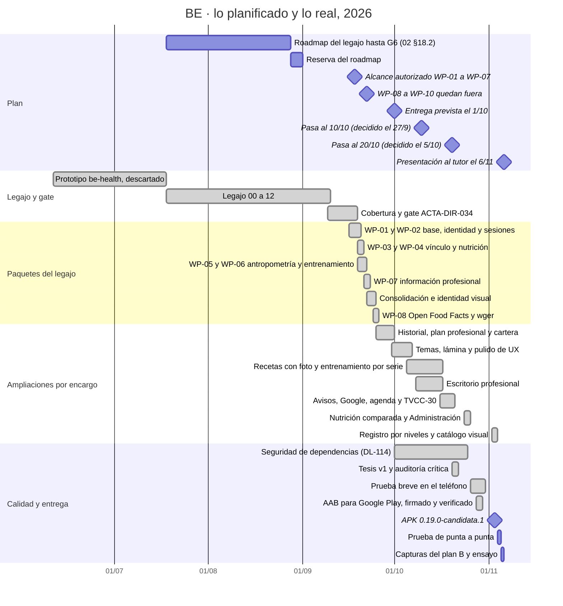

# Gantt de BE: lo planificado y lo real (al 3/11)

**Dónde estamos.** El legajo no fija fechas por paquete: lo planificado que existe es el roadmap del legajo (02 §18.2), el
alcance que autorizó ACTA-DIR-034 y la fecha de entrega, que se corrió tres veces (1/10 → 10/10 → 20/10 → 6/11). Lo real
sale de los commits, los PR y las releases; el corte anterior, con más detalle y sus fuentes, es el DV-10 del 2/10
(`docs/mesa/MESA_02/DV-10/DV-10_GANTT.md`). Lo del 4 al 6/11 es plan.

Cada barra real termina al final de su último día (por eso el diagrama le suma uno a la fecha final de la tabla).

| Qué se planificó | Qué pasó | Lectura |
|---|---|---|
| El roadmap completo, de G0 a G6, para el 27/08, con reserva hasta el 31/08 (02 §18.2; no era una fecha institucional) | El legajo cerró el 9/9 (ACTA-DIR-033.2) y el código empezó el 16/9 (`747fe11`) | Desviado: la auditoría del 6/9 reabrió el legajo en cadena |
| La entrega el 1/10 | Pasó al 10/10 (decidido el 27/9), al 20/10 (el 5/10) y a la presentación al tutor del 6/11 | Corrida 36 días. El 6/11 todavía no figura en el repositorio: el `README.md` dice 20/10 |
| Alcance: WP-01 a WP-07 (ACTA-DIR-034, 18/9); el 22/9, WP-08 a WP-10 fuera | WP-01 a WP-07 en siete días (16 al 22/9). Después, por encargo de Dirección: WP-08 (25/9), la TVCC-30 de WP-10 (16/10) y Administración, parte de WP-09 (25/10) | Reabierto con cada corrimiento, cada vez con su paquete en `docs/paquetes/` |
| Nutrición como primer circuito (02 §19.2) y la APK temprana (M0 y M1, 02 §19.3) | WP-04 el 19/9; M0 a M2 el 18/9 y M3 el 19/9 | Cumplido |
| Una versión de la APK para la defensa (M4) | La estable sigue siendo la 0.13.2 (3/10); la demo usa la 0.19.0-candidata.1 (3/11) | A decidir: se promueve solo con el «pasala a estable» de Dirección, después de la prueba |
| La validación inicial con usuarios (G4, 00 §8) | La prueba breve con Elián (26 al 30/10, y el 4/11); sin profesionales reales | Pendiente y declarado |

**Huecos que conviene explicar:** siete días sin código del 9 al 16/9 (el gate estaba sin firmar); WP-01 a WP-07 en una
semana (el legajo ya estaba cerrado y la implementación fue asistida por IA, declarado); el 16/10 se integraron 27 PR en
un día (el escritorio se construyó del 8 al 15/10 en ramas encadenadas); `main` quieto del 26/10 al 2/11, mientras corría
la prueba breve.

**En el mazo** no hay una diapositiva ni una marca para el Gantt. Encaja de dos maneras, sin alargar los 11 minutos:
como diapositiva de respaldo (la 19, después de «Estados»), para abrir solo si preguntan por los tiempos o por WP-01 a
WP-07 en siete días; y como una frase en la 12, «Cómo se trabajó»: «la entrega se corrió tres veces, y cada vez se
reabrió el alcance por un encargo registrado». En la tesis es la fuente del apartado 10, que sigue pendiente de cierre.
